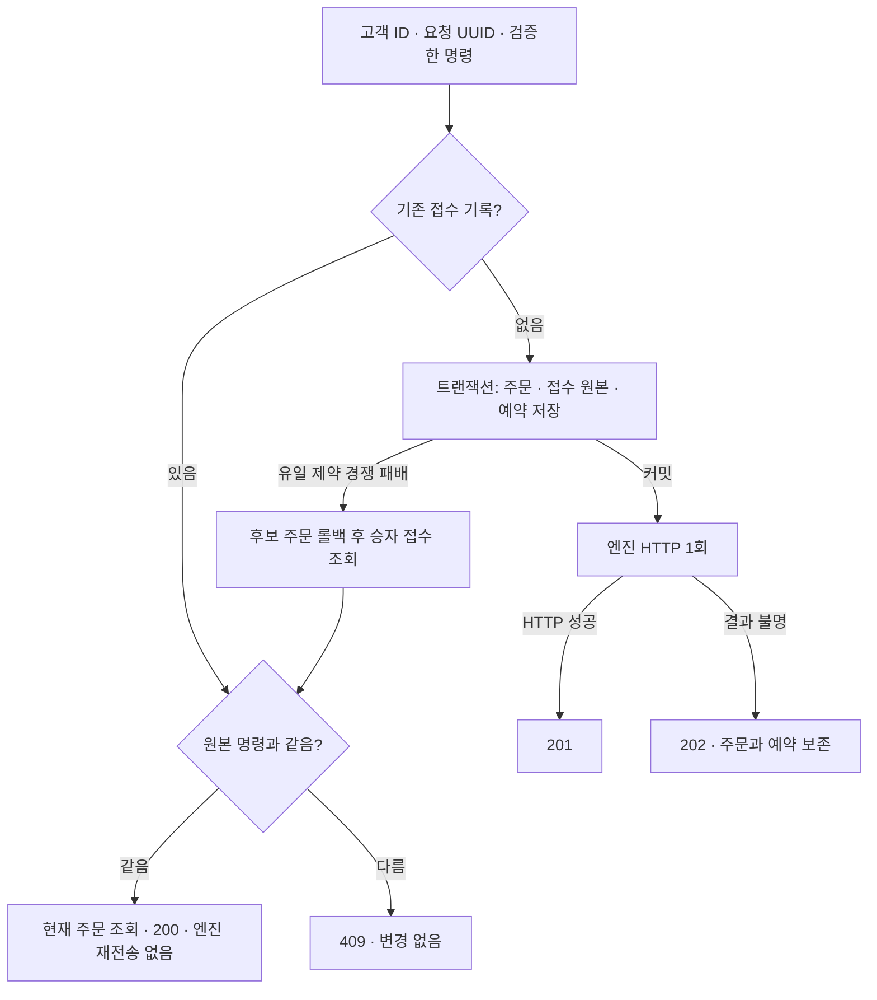

# 같은 고객 요청으로 주문을 두 번 만들지 않기

고객이 최초 주문 응답을 잃어도 같은 요청 키로 기존 주문을 찾게 한다. 고객별 요청 키와 원본 주문 명령을 DB에 보존해 주문 생성·예약·엔진 전송의 중복을 막는다. 이 문서는 접수 계약, 동시성 원리, 선택의 비용과 검증 범위를 설명한다.

- 작성·검증일: 2026-10-21.
- 상태: 고객 주문 생성 API의 플랫폼 중복 방지 구현·격리 로컬 검증 완료.
- 선행 기록: [결과 불명 시 주문·예약 보존](002-preserve-uncertain-order-submission.md).
- 엔진 영속 접수·엔진 중복 방지·미전송 명령 자동 복구는 아직 미완료다.

후속 [004](004-verify-durable-engine-receipt.md)에서 엔진 영속 접수와 동일 주문의 큐 중복 전달 차단을 연결했다. 아래는 이 사이클 당시 상태이며 자동 복구·체결 확정은 여전히 후속 범위다.

## 문제와 기존 동작

이전 사이클은 엔진 응답을 받지 못한 주문을 보존하도록 바꿨다. 하지만 고객이 플랫폼 응답 자체를 잃으면 주문 ID를 알 수 없었다. 같은 생성 POST를 다시 보내면 새 주문 ID를 발급하고 자산을 다시 예약했다. 서버 메모리에 요청 키를 보관하면 프로세스 재시작 후 같은 문제가 반복된다.

원본 요청을 변경되는 `orders` 행과 구분할 필요도 있었다. 시장가 매수의 원본 `quoteAmount`는 요청 DTO에만 있었고, 저장한 주문의 `amount=0`만으로 그 의도를 재구성할 수 없었다. 체결 후 수량이 바뀐 주문 행을 재요청 비교에 사용해서도 안 된다.

이번 구현의 보장은 다음과 같다.

- 동일한 인증 고객 + 동일한 UUID 키 + 동일한 유효 주문 내용 → 기존 주문의 현재 상태 조회.
- 동일 고객 + 동일 키 + 다른 유효 주문 내용 → 409, 기존 기록 변경 없음.
- 재요청에서는 예약·엔진 전송·생성 이벤트 호출을 반복하지 않음.
- 로컬 접수 트랜잭션이 실패하면 주문·키·예약이 함께 롤백됨.

## 기존 제품과 공식 자료의 접근

Stripe는 고객이 만든 멱등성 키를 요청에 포함하고 기존 요청과 파라미터를 비교한다. API v1은 최초 응답을 저장해 재생하는 방식이며 키 보존 기간도 설명한다. 이번 프로젝트는 바이트 단위 응답 캐시를 추가하지 않고 기존 주문의 현재 상태를 반환한다. [Stripe 멱등 요청](https://docs.stripe.com/api/idempotent_requests)

TigerBeetle은 최초 전송 전에 식별자를 보존하고 재전송에도 같은 식별자를 사용하도록 안내한다. 서버까지 그 식별자를 근거로 중복 실행을 막아야 한다. 이번에는 플랫폼 경계에 적용했으며 Rust 엔진까지 같은 보장이 완성됐다는 뜻은 아니다. [신뢰할 수 있는 거래 제출](https://docs.tigerbeetle.com/coding/reliable-transaction-submission/)

DB의 유일 제약은 애플리케이션의 사전 조회와 삽입 사이에 생기는 경쟁을 막는다. PostgreSQL의 READ COMMITTED에서는 조회 시점에 커밋된 행을 읽으므로 사전 조회만으로 다른 트랜잭션의 진행 중 삽입을 알아낼 수 없다. [PostgreSQL 16 유일 제약](https://www.postgresql.org/docs/16/ddl-constraints.html#DDL-CONSTRAINTS-UNIQUE-CONSTRAINTS), [트랜잭션 격리](https://www.postgresql.org/docs/16/transaction-iso.html#XACT-READ-COMMITTED)

## 선택과 트레이드오프

| 선택 | 얻는 보장 | 비용·제약 |
|---|---|---|
| 고객이 최초 전송 전에 UUID 생성·보존 | 응답 유실 후 같은 업무를 식별 | 고객이 새 키를 만들면 별개 주문. 키 누락은 400 |
| `(user_id, request_id)` DB 유일 제약 | 여러 요청·인스턴스의 경쟁에서도 하나만 접수 | 경합 시 대기·후보 행 롤백 비용 |
| 기존 JPA 삽입과 제약 오류 후 별도 조회 | 기존 라이브러리·트랜잭션 사용, H2에서도 검증 가능 | PostgreSQL 전용 `ON CONFLICT`보다 경합 시 예외·로그가 많음 |
| 원본을 별도 `order_submissions`에 보존 | 상태가 바뀌어도 요청 비교 가능, 과거 주문에 가짜 키를 채우지 않음 | 주문마다 추가 행·유일 인덱스·저장 비용 |
| 같은 키 재요청에 현재 주문 반환 | 응답 캐시 계층 없이 현재 상태 확인 | 최초 응답의 상태 코드·본문을 그대로 재생하지 않음 |
| 기존 접수는 엔진에 재전송하지 않음 | 현재 중복 방지 없는 엔진의 반복 실행을 피함 | 커밋 직후 종료된 미전송 주문도 자동 진행되지 않음 |
| 요청 키 만료·삭제 없음 | 같은 키가 나중에 새 금융 효과를 만들지 않음 | 보존 공간 증가. 법적 보존·삭제 정책은 별도 결정 필요 |

메모리 락은 다른 인스턴스·재시작을 보호하지 못하므로 사용하지 않았다. Redis·새 패키지·설정값·범용 멱등 미들웨어도 추가하지 않았다. 고객 주문의 실제 업무 경계에 필요한 기록과 제약을 구현했다.

## 구현과 동시성 원리

### 검증한 원본 명령

[OrderCommand](../../src/main/java/dustin/cex/domains/order/model/OrderCommand.java)는 주문 유형·방식·두 자산·가격·수량·시장가 매수 예산의 불변 값이다. DTO를 한 번 정규화한 뒤 저장·예약·전송이 같은 값을 사용한다.

- 통화 생략은 USDT로 정규화한다. 빈 통화·자산 앞뒤 공백·동일 자산 거래를 거부한다.
- 지정가는 가격·수량을 사용하고, 시장가 매수는 `quoteAmount`만 사용한다. 서로 배타적인 필드를 함께 보내면 400이다.
- 금액은 양수이며 현재 DB `DECIMAL(30,9)`에 정확히 표현돼야 한다. 지정가 매수의 곱도 검사한다. 임의 반올림은 하지 않는다.
- `100`, `100.00`은 같은 값이다. `stripTrailingZeros()`로 정규화한다.
- 아주 큰 지수는 숫자를 확장하지 않고 scale·정수 자릿수로 거부한다. `setScale`을 먼저 호출해 큰 정수를 할당하는 경로를 피한다.
- 시장가 매수의 원본 `amount=null`을 엔진 전송에서도 보존한다. 변경되는 상태 테이블의 시작 수량 0을 원본 수량으로 보내지 않는다.

이 검증이 마켓별 최소 주문·호가 단위·수수료·Rust Decimal 전체 범위 검증을 완성한 것은 아니다.

### 한 번만 생성하는 트랜잭션

[OrderService](../../src/main/java/dustin/cex/domains/order/service/OrderService.java)의 생성 경로는 다음 순서다.



두 요청이 사전 조회에서 모두 빈 결과를 받아도 유일 제약이 승자를 정한다. 패자는 후보 주문까지 롤백한 뒤 승자 기록을 읽는다. `DataIntegrityViolationException`은 `TransactionTemplate.execute` 밖에서 잡는다. 실패한 트랜잭션 안에서 계속 조회하거나 rollback-only 상태를 성공으로 반환하지 않는다. 해당 키의 확정 기록이 없으면 다른 DB 제약 오류를 그대로 전파한다.

원본 삽입은 잔액 잠금보다 먼저 수행한다. 같은 키를 기다리는 패자가 불필요하게 잔액 락을 선점하지 않게 한다. HTTP는 커밋 후 호출하며 기존 `Propagation.NEVER` 경계도 유지한다.

[OrderSubmission](../../src/main/java/dustin/cex/domains/order/model/entity/OrderSubmission.java)의 필드는 제품 경로에서 수정하지 않는다. `updatable=false`와 setter 부재를 사용한다. 이는 DB 관리자·직접 SQL의 수정을 막는 통제나 변조 방지 감사 로그는 아니다. 주문 ID도 유일하지만 현재 스칼라 매핑은 DB 외래키까지 생성하지 않는다. 정합성 대사·권한·감사 강화는 남아 있다.

## 고객 API 계약

```http
POST /api/cex/orders
Authorization: Bearer ...
Idempotency-Key: 2ed8a020-04ae-4afc-92c8-d48182726c6c
Content-Type: application/json
```

```json
{"orderType":"buy","orderSide":"limit","baseMint":"SOL","price":"100","amount":"2"}
```

| 응답 | 의미 |
|---|---|
| 201 + OrderResponse + Location | 새 플랫폼 주문을 저장했고 엔진 HTTP 성공 응답을 받음. 엔진 영속 처리 보장은 아님 |
| 202 + ORDER_SUBMISSION_UNCERTAIN + 주문 ID·조회 주소 | 새 플랫폼 주문 저장 후 엔진 결과 불명. 같은 키·내용으로 플랫폼 재요청 가능 |
| 200 + OrderResponse + Location | 같은 키·내용의 기존 주문 현재 상태. 예약·엔진 전송·생성 이벤트 반복 없음 |
| 409 + ORDER_REQUEST_CONFLICT | 같은 고객·키에 다른 유효 주문 내용 |
| 400 | 키 누락·UUID 변환 실패·요청 검증 실패 |
| 401 | 인증 실패 |

고객은 최초 제출 전에 키와 주문 내용을 함께 보존해야 한다. 응답을 잃었어도 같은 키를 사용한다. 200의 `pending`은 엔진 접수 완료나 향후 자동 완료를 뜻하지 않는다. `GET /api/cex/orders/{id}`의 소유자 조건은 유지한다.

이전의 키 없는 고객 생성 경로는 유지하지 않는다. 기존 프론트 호출은 새 백엔드 계약에 맞춰 향후 수정해야 하며 이번에 프론트를 구현하지 않았다. 현재 실행 중인 기존 플랫폼·엔진·프론트 프로세스는 교체하지 않았다.

봇 서비스는 내부에서 새 주문 의도마다 UUID를 만든다. 봇 HTTP API는 이 고객 API의 재요청 계약 대상이 아니며, 자동 봇은 계속 0이다. 내부 UUID 생성은 고객 키 누락을 대신하는 폴백이 아니다. 봇 API의 인증·멱등성은 별도 후속 범위다.

## 이해에 필요한 Java·DB 원리

- Java `record`는 불변 값 객체다. TypeScript의 readonly 데이터와 비슷한 목적이지만 런타임 객체도 값을 변경하는 setter가 없다. BigDecimal·String도 불변이어서 명령을 공유해도 내용이 바뀌지 않는다.
- BigDecimal의 `equals`는 scale까지 비교한다. 정규화한 명령끼리 비교해야 `100`과 DB에서 읽은 `100.000000000`을 같은 요청으로 볼 수 있다.
- `@UniqueConstraint`는 SQL 제약으로 이어진다. `find` 후 `save` 코드만으로는 경쟁을 막을 수 없다. 프로세스 내부 `synchronized`·TypeScript Map도 여러 인스턴스의 공통 근거가 아니다.
- `saveAndFlush`는 제약 오류를 HTTP 전송 전에 드러내지만 커밋과는 다르다. 실제 커밋 경계는 `TransactionTemplate.execute`의 정상 반환이다.
- `OrderCreationResult`는 서비스가 신규 여부를 HTTP 계층에 전달하는 값이다. 고객 응답 본문에는 이 래퍼를 노출하지 않는다.

## 작성한 테스트와 실제 결과

### 명령 검증: 19건

파일: [OrderCommandTest.java](../../src/test/java/dustin/cex/domains/order/model/OrderCommandTest.java).

| 함수 | 시나리오·기대 결과 |
|---|---|
| equivalentDecimalsAndDefaultQuoteProduceSameCommand | 소수 scale·기본 통화가 달라도 동일 의미면 같은 명령 |
| marketBuyKeepsMissingAmountAndExactQuoteBudget | 수량 null·정확한 원본 예산 유지 |
| marketSellReservesBaseAmount | 매도는 기준 자산 수량 예약 |
| invalidOrUnrepresentableCommandIsRejectedBeforeReservation ×13 | 잘못된 유형·방식·자산·배타 필드·금액·저장 불가능한 곱 거부 |
| marketBuyCannotCarryBaseAmount | 시장가 매수에 수량 혼용 거부 |
| hugeExponentIsRejectedWithoutExpandingTheNumber ×2 | ±10억 지수 입력을 큰 정수 확장 없이 거부 |

### 접수 중복 방지: 17건

파일: [OrderIdempotencyTest.java](../../src/test/java/dustin/cex/domains/order/service/OrderIdempotencyTest.java). H2 실제 JPA·커밋·롤백을 사용하고 엔진·Kafka는 대역으로 격리한다.

| 함수 | 시나리오·기대 결과 |
|---|---|
| sameKeyReturnsSameOrderWithoutAnotherReservationOrSubmission | 정상 재요청은 같은 주문, 예약·전송 1회 |
| retryAfterLostResponseFindsStoredOrderWithoutResending | 최초 엔진 응답 유실 후 같은 주문 조회, 재전송 없음 |
| sameKeyWithDifferentIntentIsRejected ×6 | 유형·자산·통화·가격·수량·방식 변경 충돌 |
| equivalentDecimalAndDefaultQuoteAreTheSameIntent | 정규화한 요청 동일성 |
| keyIsScopedToAuthenticatedUser | 다른 고객은 같은 UUID 사용 가능 |
| differentKeyCreatesIndependentOrder | 다른 키는 별개 주문 |
| failedLocalReservationRollsBackTheKeyToo | 잔액 부족이면 주문·키 롤백, 같은 키로 유효 재시도 가능 |
| marketBudgetIsPreservedApartFromChangingOrderState | 주문 상태 변경과 원본 예산을 분리, 예산 변경은 충돌 |
| newServiceInstanceUsesDatabaseRatherThanMemoryForReplay | 새 서비스 인스턴스도 DB 근거 사용 |
| duplicateWhileFirstHttpIsInFlightDoesNotWaitForOrRepeatHttp | 최초 HTTP 대기 중에도 기존 기록 조회, 추가 전송 없음 |
| uniqueConstraintRaceRollsBackCandidateAndReadsWinnerAfterRollback | 최초 조회만 빈 값으로 대체해 경쟁 주입. 실제 DB 제약·후보 롤백 검증 |
| unrelatedIntegrityErrorWithoutCommittedKeyIsNotHiddenAsReplay | 해당 키 없는 DB 제약 오류는 성공으로 숨기지 않음 |

### HTTP와 기존 회귀

[OrderSubmissionResponseTest](../../src/test/java/dustin/cex/domains/order/controller/OrderSubmissionResponseTest.java)의 기존 5건을 새 헤더 계약에 맞췄고 다음 4건을 추가했다.

- replayReturnsExistingOrderWithOkAndLocation: 정확한 키 전달, 200·주문 ID·Location.
- missingRequestKeyIsRejectedBeforeService: 헤더 누락 400, 서비스 호출 없음.
- malformedRequestKeyIsRejectedBeforeService: UUID 변환 실패 400, 서비스 호출 없음.
- differentRequestForSameKeyReturnsConflict: 다른 내용 409·오류 코드.

기존 [OrderSubmissionTest](../../src/test/java/dustin/cex/domains/order/service/OrderSubmissionTest.java) 15건은 각 신규 의도에 다른 키를 제공하도록 수정했다. 기존 HTTP 클라이언트 7건·플랫폼 시작 3건·잔액 동기화 4건도 함께 실행했다. 이전 [검증 기록](002-preserve-uncertain-order-submission.md)의 테스트 목적을 유지한다.

### 새 JAR·PostgreSQL·프로세스 재시작: 8건

파일: [verify_order_idempotency.py](../../scripts/verify_order_idempotency.py). 새 임시 DB·임의 루프백 포트·HTTP 엔진 대역·임시 JWT 키를 사용한다. 기존 5432·실제 엔진·Kafka·고객 데이터에는 요청하지 않는다.

| 함수 | 실제 확인 결과 |
|---|---|
| test_concurrent_same_key | 동시 12개 → 201 1개·200 11개, 주문·예약·엔진 전송 1회 |
| test_concurrent_same_key_different_content | 두 내용 각 6개 → 201 1개·200 5개·409 6개, 전송 1회 |
| test_invalid_header_and_command_have_no_financial_effect | 누락 키·잘못된 키·배타 필드 400, 주문·원본·전송 없음 |
| test_key_is_scoped_to_authenticated_user | 서로 다른 두 고객의 같은 키는 별개 주문 |
| test_lost_response_then_same_key | 최초 202 후 재요청 200, 같은 ID·예약·전송 1회 |
| test_market_original_budget_survives_order_changes | 123.250000001 보존, 상태 변경 후 조회, 다른 예산 409 |
| test_process_restart_uses_committed_key | 플랫폼 프로세스를 종료·재시작한 뒤 같은 ID 조회, 전송 증가 없음 |
| test_same_key_different_content | 다른 수량 409, 원본·예약 유지 |

상태 변경 주입은 원본 비교를 시험하며 실제 체결·정산을 재현하지 않는다. 스크립트 개발 중 unittest의 `run` 메서드 이름과 카운터가 충돌해 실행이 중단됐고 이를 `platform_runs`로 고쳤다. 남은 임시 DB를 정리하고 종료 정리를 보강했다. 수정 후 8건을 두 차례 통과했으며 최종 실행은 임시 DB 제거까지 확인했다.

## 실행 명령과 한계

```bash
cd /Users/dustin/Desktop/common/project/Cex-Platform-Service
export JAVA_HOME=/Library/Java/JavaVirtualMachines/temurin-21.jdk/Contents/Home
./gradlew clean test --tests 'dustin.cex.domains.order.*' \
  --tests 'dustin.cex.shared.http.EngineHttpClientTest' \
  --tests 'dustin.cex.shared.services.PlatformBalanceStartupTest' \
  --tests 'dustin.cex.shared.services.BalanceSyncServiceTest' bootJar
PATH=/usr/local/bin:$PATH python3 scripts/verify_order_idempotency.py
```

- Java **74건 통과, 실패 0, 제외 0**. 이 중 이번 신규는 40건, 기존 회귀는 34건이다.
- Python 프로세스 검증 **8건 통과**, 새 플랫폼 시작 2회, 봇 0, 임시 DB 제거 확인.
- 전체 테스트 소스 컴파일·실행 JAR 빌드 성공. 기존 전체 통합 테스트는 실행하지 않았다.
- 기존 deprecated API 안내와 JVM class sharing 경고가 남아 있다.
- 실행 증거: 공통 루트 `.local/order-idempotency-suite.log`, `.local/order-idempotency-process.log`, `.local/order-idempotency-process.json`.
- 메모리·DB 경쟁·프로세스 재시작 경계의 로컬 검증이며 운영 부하·다중 호스트·실제 Rust 매칭·재무 정산·외부 심사를 보장하지 않는다.

## 남은 경계와 관련 커밋

플랫폼 커밋 직후 HTTP 전송 전에 종료되면 접수 기록과 예약은 남지만 엔진에 도달하지 않았을 수 있다. 같은 키로 다시 호출해도 기존 주문만 반환한다. 엔진의 영속 접수·중복 방지가 없는 상태에서 임의 재전송하지 않는다. 다음 구현은 이 원본 명령과 주문 ID를 엔진의 영속 접수·처리 결과에 연결해야 한다.

새 접수 테이블은 기존 주문·이력을 변경하지 않는다. 과거 주문에 요청 키를 추측해 채우는 마이그레이션이나 키 없는 신규 고객 경로는 없다. 기존 로컬 서비스는 교체하지 않고 격리된 새 프로세스로 검증했다.

| 커밋 | 목적 |
|---|---|
| `ce088fd` | 검증한 원본 명령으로 예약·전송 통일 |
| `33489ab` | 큰 지수 입력 검증 비용 제한 |
| `69d4085` | 고객 요청 키·원본 보존·중복 접수 방지와 회귀 |
| `2bfb3b5` | PostgreSQL 동시 접수·프로세스 재시작 검증 스크립트 |

문서 커밋까지 완료한 작업 단위로 푸시한다. 공통 루트의 규칙·로드맵은 로컬 공통 문서이며 별도 Git 저장소를 만들지 않는다.

후속 검토: [금액 타입 경계 오류 수정](005-common-exact-amount-contract.md). 이 글의 당시 검증 결과와 후속 변경을 구분한다.
