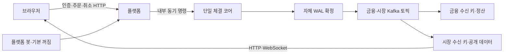

# 플랫폼을 BTC 주문·자체 시세의 진입점으로 모으기

브라우저는 플랫폼에만 연결하고, 엔진의 확정된 자체 호가·체결을 Kafka로 받아 공개한다. 주문·취소의 동기 접수와 금융·시세의 비동기 반영을 구분한다.

## 문제와 선택 근거

기존 프론트는 엔진을 직접 호출하고 바이낸스 SOL 데이터를 표시했다. 플랫폼에는 이미 일반 주문 서비스를 사용하는 봇이 있었지만, 시작 시 계정·거액 잔액을 만들거나 덮어썼으며 다른 사용자 봇 주문을 만드는 공개 테스트 API도 있었다. 주문 취소는 HTTP 응답 뒤 DB 상태를 먼저 바꿔 순서대로 들어오는 엔진 결과와 충돌할 수 있었다.

[게이트웨이 라우팅 패턴](https://learn.microsoft.com/en-us/azure/architecture/patterns/gateway-routing)의 단일 서비스 진입점 역할을 적용한다. [Coinbase 공개 호가 피드](https://help.coinbase.com/en/developer-platform/websocket-feeds/exchange)의 스냅샷 역할을 참고하되 현재는 매번 전체 상위 호가를 보낸다. [Spring의 WebSocket 전송 동기화](https://docs.spring.io/spring-framework/docs/6.1.13/javadoc-api/org/springframework/web/socket/handler/ConcurrentWebSocketSessionDecorator.html)를 확인하고 설치된 웹 프레임워크와 같은 버전의 서버 스타터를 사용했다.

## 구조와 보장 경계



플랫폼에 별도 매칭 루프를 추가하지 않았다. 기존 Java 실험 엔진은 거래 API에 연결하지 않는다. 엔진 코어에는 공유 락·디스크·Kafka 대기를 넣지 않는다.

### 공개 데이터와 영속 수신

[시장 서비스](../../src/main/java/dustin/cex/domains/market/MarketService.java)는 `market-events`를 별도 소비 그룹·동시성 1로 처리한다. 기존 [수신 키](../../src/main/java/dustin/cex/shared/kafka/EngineEventInbox.java)에 `:market` 식별 공간을 추가했다. 수신 키·최신 호가·공개 체결은 같은 DB 트랜잭션으로 저장한다.

| 상황 | 동작 |
| --- | --- |
| 같은 ID·같은 본문 재수신 | 수신 키로 중복 반영 방지 |
| 같은 ID·다른 본문 | 오류·롤백·소비 중단 |
| 같은 거래쌍의 정상 다음 변경 | `previous_sequence`가 영속 최신 순번과 같은지 확인 |
| 새 플랫폼의 첫 스냅샷 | 해당 시점부터 호가 기준점 생성 |
| 재시작 기준점이 현재 호가보다 과거 | 최신 호가를 되돌리지 않고 빠진 공개 체결만 한 번 보완 |
| 실제 순번 공백·엔진 UUID 교체 | 추측해 연결하지 않고 중단. 이력·기준점 복원 후 재개 |

기존 금융 이벤트와 시장 이벤트는 별도 토픽이므로 플랫폼 반영 시점이 다를 수 있다. 호가 도착을 원장 정산 완료로 해석하지 않는다. 시장 DB는 엔진 복구 근거가 아니며 엔진은 자체 WAL을 사용한다.

### 공개 API와 스트림

| 경로 | 역할 |
| --- | --- |
| `GET /api/market/BTC/USDT` | 최신 전체 호가와 최근 공개 체결 100개 |
| `GET /api/market/BTC/USDT/candles` | 최근 5천 체결 범위의 1분 OHLC·거래량 |
| `/ws/market/BTC/USDT` | 접속·재접속 뒤 전체 스냅샷과 후속 갱신 |
| `POST /api/cex/orders` | 인증·원본 키·예약 후 엔진 동기 접수 |
| `DELETE /api/cex/orders/{id}` | 인증·본인 확인 후 엔진 취소 접수, 202 |

시장 조회는 공개하며 사용자 ID·잔액·개별 미체결 주문을 포함하지 않는다. 계정·주문은 기존 인증 경로를 사용한다. 이전 플랫폼 DB 주문 목록을 호가처럼 반환하던 API·DTO·조회 메서드는 삭제했다.

[소켓 전송](../../src/main/java/dustin/cex/domains/market/MarketSocket.java)은 금융 소비자 밖에서 수행한다. 최대 100개 연결, 전송 스레드 4개, 유한 대기열 100개를 사용한다. 바쁜 화면에 중간 프레임을 무제한 쌓지 않고 최신 전체 상태로 동기화한다. 250ms 단위 변경 확인, 15초 심박, 느린 전송의 10초 차단 기준이 있다. 연결 수 경합은 세마포어로 제한하고 전송은 Spring의 세션 장식자로 보호한다. 실제 느린 네트워크의 부하 한계·공정성은 측정하지 않았다.

전체 스냅샷은 델타보다 크고 공개 DB 읽기·전송 비용이 든다. 초기 한 호스트에서 구조를 단순하게 유지하는 대신 이 비용을 감수한다. 차트의 최초 봉은 최근 5천 체결 범위 안에서 계산한 값이므로 전체 과거 봉 저장소를 의미하지 않는다.

## BTC 봇 경계

[설정](../../src/main/java/dustin/cex/domains/bot/model/BotConfig.java)의 기본 봇 수는 0이다. [계정 관리자](../../src/main/java/dustin/cex/domains/bot/service/BotManagerService.java)는 활성화할 때 미리 준비된 계정만 찾는다. 자동 가입·공통 비밀번호·거액 입금·잔액 덮어쓰기를 제거했다. 봇을 켜려면 계정·자금의 준비 절차가 필요하다.

[봇 주문 서비스](../../src/main/java/dustin/cex/domains/bot/service/BotService.java)는 고객과 같은 주문·예약·원본 키 경로를 호출한다. BTC/USDT, 건별 수량 최대 0.01 BTC·금액 기반 매수 최대 100 USDT·지정가 대금 최대 1천 USDT로 제한했다. 사용자별 미종결 주문이 20개면 가장 오래된 주문을 취소하고 반영을 기다린다. 현재 시연 범위의 고정 안전 한도이며 운영 위험 한도를 확정한 것은 아니다.

[참조 가격](../../src/main/java/dustin/cex/domains/bot/service/BinancePriceService.java)은 봇이 꺼져 있으면 외부 소켓도 시작하지 않는다. 설정한 `btcusdt@depth20@100ms`의 [Binance 부분 호가 스냅샷](https://developers.binance.com/docs/binance-spot-api-docs/web-socket-streams)을 직접 해독한다. 실제로 쓰지 않는 증분 스트림 별칭·SOL 심볼 주입을 삭제했다. 순서가 지난 스냅샷은 무시하고 잘못된 행을 건너뛰어 정상 가격처럼 사용하지 않는다. 10초 동안 새 정상 순번이 없으면 자동 주문을 중단한다. 임의의 150달러 초기 가격은 없다.

운영자 권한 체계가 없는 기존 공개 `/api/bot` 명령 경로도 제거했다. 현재 제어는 명시적인 서버 설정·시작·종료다. 운영자 화면·역할·감사 기록이 준비되기 전에 공개 봇 제어 API를 제공하지 않는다. 일반 실행에서는 계속 봇 0명이며 테스트도 실제 자동 스케줄러를 켜지 않는다.

## 취소 반영과 브라우저 정밀도

[주문 서비스](../../src/main/java/dustin/cex/domains/order/service/OrderService.java)는 본인 확인 후 내부 HTTP만 호출한다. HTTP 성공 직후 `cancelled`로 DB를 먼저 바꾸거나 플랫폼에서 취소 결과를 별도 발행하지 않는다. 엔진 결과 소비자가 앞선 체결·취소 순서에 따라 상태와 잔액 해제를 함께 반영한다.

엔진은 취소 판단에 플랫폼의 지연된 주문 행을 다시 읽지 않는다. 플랫폼이 원본 거래쌍을 보내고 코어가 현재 소유자·잔량을 검증한다. HTTP 202는 엔진 취소 확정이며 플랫폼 반영 완료는 아니다.

잔액·주문·포지션·체결 DTO의 `BigDecimal`을 문자열로 직렬화한다. 주문·체결 ID도 브라우저 숫자로 바뀌지 않는다. 자바의 `record`는 불변 전달 타입, `@Transactional`은 수신 키와 저장 변경을 묶는 경계다. TypeScript의 타입 표기만으로 런타임 JSON이나 트랜잭션이 보장되는 것과는 구분해서 이해해야 한다.

### 현재 코드로 연결해 읽기

플랫폼은 엔진의 시장 이벤트를 검증하고 영속 수신 키와 순번을 확인한다. 아래는 2026-10-23 현재 [실제 소스](../../src/main/java/dustin/cex/domains/market/MarketService.java#L25)의 연속 행 발췌다. 메서드 일부일 수 있으므로 독립 실행 예제로 사용하지 않고 앞뒤 검증과 함께 읽는다. 과거 사이클의 코드/측정 시점은 본문의 기록을 유지한다.

```java
public void consume(String payload) throws Exception {
    MarketSnapshot event=mapper.readValue(payload,MarketSnapshot.class);
    validate(event);
    // 동일 식별자의 다른 본문은 건너뛰지 않는다. 영속 수신 검사와 시세 반영이
    // 함께 롤백되므로 디비 오류 뒤 다시 수신해도 체결 이력을 잃지 않는다.
    if (!inbox.claim(event.eventId(),event.engineId(),payload)) return;
    String pair=pair(event.baseMint(),event.quoteMint());
    MarketState old=states.findById(pair).orElse(null);
    long sequence=Long.parseLong(event.sequence());
    if (old!=null) {
        if (!old.getEngineId().equals(event.engineId())) throw new IllegalStateException("Market engine identity changed");
        // WAL 출력 워커가 시작 기준점을 다시 발행할 수 있다. 과거 스냅샷이
        // 최신 호가를 덮어쓰지 않도록 영속 순번을 비교한다.
        if (sequence==old.getSequence()) throw new IllegalStateException("Market state is missing its receipt");
        if (sequence>old.getSequence() && Long.parseLong(event.previousSequence())!=old.getSequence()) {
            throw new IllegalStateException("Market sequence gap; restore Kafka history before continuing");
        }
    }
```

Kafka 소비 메서드의 `@Transactional`은 본문 위에서 확인할 수 있다. 이벤트가 중복이면 반환하고 엔진 ID가 달라지면 실패한다. 후속 순번/저장 검사까지 거쳐야 공개 화면에 사용할 상태가 된다.

## 작성·수정한 테스트

- [MarketSafetyTest](../../src/test/java/dustin/cex/domains/market/MarketSafetyTest.java), 6개: 정렬·음수·깊이·순번·중복 체결 ID·개인정보 제외·중복 수신·큰 금액과 ID 직렬화·계정 상한보다 큰 호가 합.
- [MarketPersistenceTest](../../src/test/java/dustin/cex/domains/market/MarketPersistenceTest.java), 4개: 실제 PostgreSQL의 중복 1회 반영, 순번 공백 롤백·재수신, 본문 충돌, 이전 기준점 보완 시 최신 호가 보존.
- [MarketSocketTest](../../src/test/java/dustin/cex/domains/market/MarketSocketTest.java), 2개: 연결 상한·회수한 슬롯, 공개 소켓의 주문 명령 거부.
- [BotSafetyTest](../../src/test/java/dustin/cex/domains/bot/service/BotSafetyTest.java), 6개: 기본 꺼짐·외부 연결 없음, 누락·만료 시세 차단, 계정 미준비 차단, 주문 한도, 미종결 상한, 실제 부분 호가 계약·역순·잘못된 수량.
- [OrderSubmissionTest](../../src/test/java/dustin/cex/domains/order/service/OrderSubmissionTest.java)의 `cancellationAcceptanceDoesNotPreemptKafkaStateOrBalanceRelease`, `failedCancellationPreservesOrderAndReservation`: HTTP 취소와 플랫폼 반영 경계를 실제 JPA 저장으로 확인.
- [MarketPathTest](../../src/test/java/dustin/cex/integration/MarketPathTest.java): 실제 봇 서비스 주문 → 플랫폼 HTTP 매수·동일 키 재조회 → Rust WAL → Kafka → 공개 호가·체결·차트 → 취소 정산 → 엔진 재시작·소켓 재연결.

## 실행 명령과 결과

2026-10-21, Java 21·PostgreSQL 16·Kafka 3.9.1, 각 실행 소유 DB 서버·브로커·저널·Rust 프로세스로 검증했다.

```sh
python3 scripts/verify_engine_inbox.py
python3 scripts/verify_market_path.py
```

선택 회귀 **133개 통과, 실패·제외 0개**, `bootJar` 통과. 실제 전체 경로 **1개 통합 시나리오 통과**. 외부 자원이 필요한 테스트는 기존 5432·5433·9092를 사용하지 않는다. 실행 소유 컨테이너를 회수한 결과를 공통 `.local/`에 기록한다. 형제 경로의 `Cex-Engine` 빌드와 스크립트가 필요하다.

초기 검증에서 테스트 빈 설정과 응답 표현 차이로 실패한 항목을 수정했고, 실제 두 서버의 취소 DB 조회 오류를 재현·수정했다. 마지막 결과는 수정 후 재실행 기준이다.

## 남은 범위

전체 경로 시나리오는 수수료 0인 지정가 시장을 명시적으로 준비했다. 기존 수수료 차감 권위·엔진/플랫폼 잔액 차이, 시장가 매수의 수량 0 처리와 IOC 종료·예약금의 모든 경우, 거부 결과의 금융 반영은 이번 검증으로 해결됐다고 주장하지 않는다. 기존 금융 정합성 후속 과제다.

시장 토픽의 보존 범위를 잃으면 첫 기준점 이전의 전체 공개 체결 이력을 자동 복원하지 못한다. 실제 순번 공백은 소비를 멈추므로 Kafka·WAL의 이력과 DB 기준점을 확인해 복원한 뒤 재개해야 한다. 무조건 오프셋을 건너뛰지 않는다. 규제 인증·운영자 권한·공개망 보안·장기 부하·디스크 손실 복제 검증은 별도 로드맵을 따른다.

[엔진 계약과 검증](../../../Cex-Engine/docs/decisions/011-durable-market-output.md), [프론트 계약과 검증](../../../Cex-Frontend/docs/decisions/001-platform-market-and-btc.md)에서 관련 구현을 이어서 볼 수 있다.

## 관련 구현 커밋

- [플랫폼 시장 수신·봇·취소·검증](https://github.com/GiHoon1123/Cex-Platform-Service/commit/d6bbe17)
- [엔진 확정 시장 출력](https://github.com/GiHoon1123/Cex-Engine/commit/92561a3)
- [프론트 연결](https://github.com/GiHoon1123/Cex-Frontend/commit/89e72dc)

금융 리스너 팩터리의 동시성도 1로 고정했다. 기존 12개 컨테이너 설명을 제거하고, 가상 스레드가 수신 루프를 실행한다는 의미와 DB 커밋·브로커 오프셋의 차이를 주석에 명시했다. 기존 설정 회귀에서 생성한 컨테이너의 동시성 1·자동 시작 금지를 함께 검사한다.
