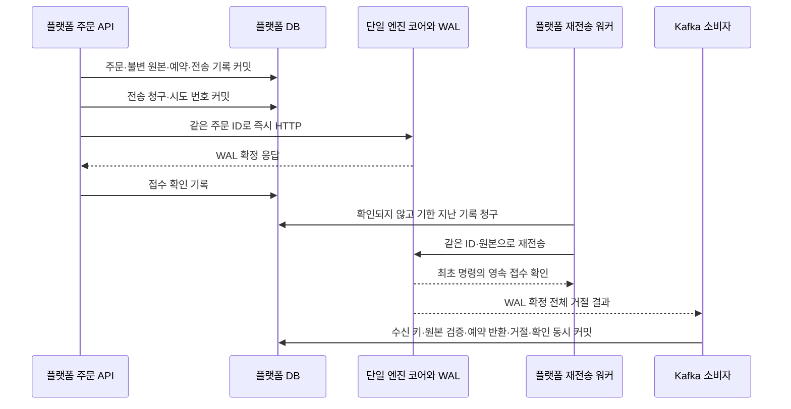

# 응답 불명 주문을 영속 재전송하고 확정 거절의 예약만 반환하기

플랫폼이 종료돼도 저장한 주문을 엔진에 전달하고, 이미 처리한 주문은 다시 실행하지 않도록 전송 대기 기록을 추가했다. 전체 거절은 WAL에서 나온 결과를 원본과 대조해 예약을 한 번만 반환한다. 작성일은 2026-10-22다.

## 문제와 기존 동작

주문·원본·잔고 예약은 HTTP 전 커밋됐다. 엔진 응답을 잃으면 202와 주문 ID를 반환하고 예약을 유지했다. 같은 고객 키는 기존 주문을 읽었지만 엔진에 다시 전송하지 않았다. 이 방식은 중복 예약을 막았지만 다음 두 상황을 자동 해소하지 못했다.

1. DB 커밋 직후 플랫폼이 종료돼 엔진에 전달하지 못함.
2. 엔진은 처리했으나 응답만 잃음.

또한 코어의 전체 거절은 WAL에만 있었고 플랫폼은 이를 받지 못했다. 시간 초과를 거절로 간주해 돈을 돌려주면 이미 실행한 주문에 쓴 돈을 다시 쓸 수 있다. 이번 작업은 **전송의 불확실성**과 **전체 명령의 확정 거절**을 각각 해결한다.

## 기존 제품과 의존성 확인

[AWS의 transactional outbox](https://docs.aws.amazon.com/prescriptive-guidance/latest/cloud-design-patterns/transactional-outbox.html)는 업무 데이터와 전송 기록을 함께 저장하고 별도 처리자가 전달하는 패턴이다. 중복 전달은 수신자가 멱등 처리해야 한다. [Stripe 멱등 요청](https://docs.stripe.com/api/idempotent_requests)은 연결 실패 시 같은 키·원본의 안전한 재요청 계약을 보여준다. 확인일은 2026-10-22다.

설치된 Spring Data JPA·트랜잭션·스케줄러·HTTP 클라이언트를 사용했다. 기존 `spring-retry`의 메모리 재시도만으로는 프로세스 종료를 넘을 수 없어 선택하지 않았다. 새 라이브러리·브로커·CDC 서비스는 추가하지 않았다. outbox의 수신자가 HTTP라는 점이 다르며 정상 주문은 여전히 즉시 HTTP로 전달한다.

## 선택과 트레이드오프

| 선택 | 이점 | 비용·제약 |
| --- | --- | --- |
| 주문·원본·예약·전송 기록의 동시 커밋 | 전송 전에 종료돼도 남은 일을 찾음 | 주문당 행 1개·전송 전후 트랜잭션 추가 |
| 정상 요청은 즉시 HTTP, 실패만 주기 재전송 | 기존 접수 지연 경로 유지 | 즉시 요청과 워커의 청구 경쟁 처리 필요 |
| 동일 주문 ID·저장 원본 재사용 | 이중 예약·다른 주문으로의 재실행 차단 | 엔진의 영속 중복 방지가 필수 |
| 짧은 DB 행 잠금과 만료 가능한 청구 | 네트워크 동안 DB 락을 보유하지 않음 | 기한 만료 시 같은 명령의 동시 전송 가능 |
| 영속 지수 지연·자동 금융 만료 없음 | 재시작에도 재시도 일정을 이어가고 임의 반환 방지 | 장애 장기화 시 자산이 계속 예약됨 |
| 거절 원본·미체결·수신 키 검증 후 반환 | 변조·이중 반환·후속 예약 침해 방지 | 결과 불일치는 소비를 중단하고 조사해야 함 |

엔진은 도착한 명령의 단일 순서로 실행한다. 이 기능은 플랫폼 DB 생성 시각과 엔진 실행 순서가 같다고 보장하지 않는다. 재전송은 늦게 도착할 수 있으며 새로운 주문이나 우선순위를 만들어 보상하지 않는다.

## 처리 흐름과 상태의 의미



그림의 응답은 유실될 수 있다. 엔진의 접수 확인은 명령과 결과가 WAL에 있다는 뜻이며 거래 성공·플랫폼 정산 완료를 뜻하지 않는다. 거절 역시 확정 결과이므로 HTTP 접수 확인을 받을 수 있다.

조회 응답 `order.submissionStatus`는 `pending` 또는 `recorded`다. `pending`은 전송/응답 확인을 아직 못 했고, `recorded`는 엔진 WAL 접수를 확인했거나 검증한 전체 거절을 받았다는 뜻이다. 기존 `order.status`의 `pending`·`partial`·`filled`·`expired`·`cancelled`·`rejected`는 금융 상태다. 두 필드를 혼동하면 안 된다. 새 요청의 불명 응답은 기존처럼 HTTP 202와 주문 ID이며, 같은 고객 키 재요청은 현재 주문을 읽는다.

## 구현과 관련 코드

- [전송 기록](../../src/main/java/dustin/cex/domains/order/model/entity/OrderDispatch.java): `order_id`를 PK와 주문 FK로 사용한다. 원본은 복제하지 않는다. `attempts`, `next_attempt_at`, `confirmed_at`을 저장한다. PK가 주문당 최대 한 행을 보장한다. 읽기 전용 JPA 연관은 이미 저장한 주문을 다시 저장하지 않는다.
- [후보·잠금 조회](../../src/main/java/dustin/cex/domains/order/repository/OrderDispatchRepository.java): 기한 지난 미확인 ID를 최대 20개 읽고 청구 시 행을 잠근다. 읽기 후보가 겹쳐도 각 행에서 다시 확인한다.
- [전송 서비스](../../src/main/java/dustin/cex/domains/order/service/OrderDispatchService.java): 청구 커밋 → 저장 원본으로 HTTP → 결과 커밋의 세 구간으로 나눈다. 네트워크 중 트랜잭션을 유지하지 않는다. 외부 트랜잭션 안에서 호출하면 거부한다.
- [주기 워커](../../src/main/java/dustin/cex/domains/order/service/OrderDispatchScheduler.java): 완료 뒤 1초 간격으로 실행한다. `order.dispatch.enabled` 기본값은 true다. 격리 목적 테스트만 명시적으로 끈다.
- [주문 접수](../../src/main/java/dustin/cex/domains/order/service/OrderService.java): 기존 주문·원본·예약 트랜잭션에 전송 행을 추가한다. DB 실패 시 전송도 없다. HTTP 예외 원인은 내부 진단용으로 보존하며 자산을 돌려주지 않는다.
- [금융 소비](../../src/main/java/dustin/cex/shared/kafka/KafkaOrderEventConsumer.java): `order_rejected`의 원본과 상태를 검증하고 해당 예약만 반환한다. 수신 키와 함께 같은 트랜잭션에서 반영한다.
- [응답](../../src/main/java/dustin/cex/domains/order/model/dto/OrderResponse.java): 접수 확인 상태를 별도 필드로 제공한다.

### 청구·실패·재시작

신규 행은 즉시 요청이 먼저 보낼 수 있게 30초 창을 둔다. 최초 즉시 호출만 이 기한을 무시하고 청구할 수 있다. 전송 중에는 청구 기한을 30초 뒤로 둔다. 프로세스가 종료되면 기한이 지난 행을 다음 워커가 다시 보낸다.

실패 후 지연은 2·4·8·16·32·60초이며 이후 60초다. 모든 값은 저장된다. 워커 한 회차는 최대 20건을 순차 처리하므로 실제 재시도 시각은 HTTP 대기·앞선 작업에 따라 더 늦어질 수 있다. 재시도 횟수가 많다는 이유로 예약을 해제하지 않는다.

응답 기록은 시도 번호가 현재 청구 번호와 같을 때만 반영한다. 만료한 이전 시도의 늦은 성공/실패가 새 시도를 덮어쓰지 않는다. Kafka 거절이 먼저 확인한 행은 늦은 HTTP 실패로 다시 대기 상태가 되지 않는다. 이 청구 기한 자체가 정확히 한 번 전송을 보장하지는 않는다. 중복 실행은 엔진의 영속 ID·원본 검사로 막는다.

저장 오류는 현재 회차를 중단하고 다음 주기에 재확인한다. HTTP 장애는 원본·예약을 유지하고 다음 기한을 기록한다. 엔진이 접수한 뒤 플랫폼의 확인 커밋만 실패해도 다음 재전송은 기존 접수를 확인하므로 추가 체결하지 않는다.

### 전체 거절의 반환 조건

소유자·거래쌍·방향·방식·가격·수량·예산·고정 수수료율이 불변 원본과 같아야 한다. 없는 필드는 명시적 `null`이어야 하며 누락은 거부한다. 사유 코드는 `ENGINE_EXECUTION_REJECTED`다. 상태는 `pending`, 체결 수량·대금은 0, 저장된 체결도 0건이어야 한다.

반환액은 결과가 주장한 숫자를 신뢰하지 않고 원본 예약에서 계산한다. 시장가 매수는 예산, 지정가 매수는 가격×수량, 매도는 수량이다. 사용 가능 잔액을 늘리고 잠금 잔액에서 같은 금액만 뺀다. 다른 주문의 예약은 남는다. 잠금 부족·원본 불일치·이미 체결된 주문은 전체 롤백한다. 이때 소비 실패를 성공으로 확인하지 않는다.

## 이해에 필요한 Java 문법과 원리

`TransactionTemplate.execute`의 람다 안에서만 청구와 결과 저장을 커밋한다. TypeScript에서 트랜잭션 콜백을 두 번 호출하고 그 사이에 HTTP를 호출하는 구조와 비슷하다. 트랜잭션 두 개와 HTTP를 하나의 분산 원자적 작업으로 만들었다는 뜻은 아니다.

`record Claim(...)`은 한 시도의 불변 값 묶음이다. JPA 엔티티의 지연 참조를 네트워크 구간으로 옮기지 않고 검증된 명령 값만 옮긴다. `PESSIMISTIC_WRITE`는 플랫폼 DB의 행 잠금이며 Rust 체결 코어의 공유 락과 무관하다. `@Transactional(NEVER)`는 호출자가 이미 연 트랜잭션에 합류해 네트워크까지 락을 유지하는 실수를 막는다.

`Math.incrementExact`는 시도 번호 오버플로를 숨기지 않는다. `Instant`는 시점을 나타내며 저장된 청구 기한·지연 응답 비교에 사용한다. 호스트 간 시계가 크게 어긋나면 중복 청구가 늘 수 있으므로 운영에서는 시간 동기화가 필요하다. 금융 안전성은 시계의 정확성보다 엔진 중복 방지에 의존한다.

### 현재 코드로 연결해 읽기

전송 시도 소유권을 짧은 DB 트랜잭션에서 확정한 뒤 외부 HTTP를 호출한다. 아래는 2026-10-23 현재 [실제 소스](../../src/main/java/dustin/cex/domains/order/service/OrderDispatchService.java#L35)의 연속 행 발췌다. 메서드 일부일 수 있으므로 독립 실행 예제로 사용하지 않고 앞뒤 검증과 함께 읽는다. 과거 사이클의 코드/측정 시점은 본문의 기록을 유지한다.

```java
Claim claim=transaction.execute(status->{
    var row=dispatches.findForUpdate(id).orElseThrow();
    if(!row.claim(Instant.now(),immediate)) return null;
    var original=submissions.findByOrderId(id).orElseThrow();
    return new Claim(id,original.getUserId(),original.command(),row.getAttempts());
});
if(claim==null) return dispatches.findById(id).orElseThrow().getConfirmedAt()!=null;
boolean acknowledged=false;
RuntimeException transportFailure=null;
try {
    var c=claim.command();
    acknowledged=engine.submitOrder(id,claim.userId(),c.orderType(),c.orderSide(),c.baseMint(),c.quoteMint(),
            text(c.price()),text(c.amount()),text(c.quoteAmount()));
} catch(RuntimeException failure) {
    transportFailure=failure;
    // HTTP 오류·시간 초과는 미실행의 증거가 아니다. 원본 예약을 보존하고 다음 시도를 기록한다.
    log.warn("엔진 제출 재확인 대기: orderId={}, attempt={}",id,claim.attempt(),failure);
}
```

`TransactionTemplate.execute`의 반환 이후에는 위 DB 락을 유지하지 않는다. `Claim`은 원본 명령과 시도 번호를 담는 값이며, 늦은 응답은 후속 시도 번호 검사로 판별한다. 현재 전송 경로와 과거 첫 접수 구현은 문서의 시점을 구분해 읽는다.

## 작성한 테스트

| 파일·함수 | 검증 |
| --- | --- |
| [OrderSubmissionTest](../../src/test/java/dustin/cex/domains/order/service/OrderSubmissionTest.java) `uncertainDeliveryRetriesSameOriginalWithoutSecondReservation` | 실제 DB 기록·지연·동일 원본 재전송·단일 예약·확인 상태 |
| 같은 파일 `committedBeforeSendIsRecoveredByNewServiceInstance` | 전송 전 커밋 후 호출 스택 없는 새 서비스에서 복구 |
| 같은 파일 `claimIsCommittedBeforeHttpAndCompetingWorkerCannotSendAgain` | HTTP 진입 전에 청구가 커밋되고 워커가 중복 전송하지 않음 |
| 같은 파일 `concurrentImmediateClaimSendsOneHttpRequest` | 한 스레드의 HTTP를 멈추고 다른 스레드에서 실제 청구 경쟁, HTTP 한 번·예약 한 번 |
| [OrderDispatchTest](../../src/test/java/dustin/cex/domains/order/service/OrderDispatchTest.java) `expiredLeaseCanBeClaimedButOldResponseCannotConfirmNewAttempt` | 만료 후 재청구·이전 응답 무효 |
| 같은 파일 `confirmedRejectionCannotBeReopenedByLateFailure` | 거절 확인 뒤 늦은 실패 무효 |
| 같은 파일 `backoffIsBoundedAndNeverExpiresFinancialReservation` | 지연 상한·실패 횟수로 자동 확정하지 않음 |
| [TradeFeeSettlementTest](../../src/test/java/dustin/cex/shared/kafka/TradeFeeSettlementTest.java) `durableRejectionReturnsOnlyOriginalReservationAndConfirmsDelivery` | 전액 반환·후속 예약 보존·확인·닫힌 주문 이중 반환 거부 |
| 같은 파일 `marketBuyRejectionUsesOriginalBudgetWithExplicitNullQuantity` | 수량 없는 시장가 매수 원본 예산 반환 |
| 같은 파일 `alteredRejectionAndPartiallyFilledOrderCannotReleaseFunds` | 원본 변조·부분 체결 거절의 반환 차단 |
| 같은 파일 `failedRejectionRefundRollsBackStateAndDispatchThenAllowsCorrectRetry` | 잔액 오류 전체 롤백·수정 후 같은 결과 정상 처리 |
| [MarketPathTest](../../src/test/java/dustin/cex/integration/MarketPathTest.java) `verifyMarketIoc` | 실제 소수 최소 단위 실패·코어 원본 보존·Kafka 거절·플랫폼 반환·원본 재전달·WAL 전량 재발행의 이중 반환 방지 |
| [실제 프로세스 접수 검증기](../../../Cex-Engine/scripts/verify_durable_acceptance.py) | 응답 유실과 엔진 미도달 주문을 실제 플랫폼 종료·재시작·스케줄러로 복구, 같은 원본·단일 체결·단일 예약 |

기존 취소·동시 고객 키·전송 예외 테스트의 새 전송 행 구성도 갱신했다. 처음 검증에서 JPA의 공유 PK 연관 병합 문제가 드러나 읽기 전용 FK 참조로 단순화했다. 금융 소수를 JSON 숫자로 만들던 새 테스트 데이터도 실제 계약인 문자열로 수정했다. 실패를 제외하거나 검증을 완화하지 않고 재실행했다.

## 실행 명령과 결과

| 명령 | 결과 |
| --- | --- |
| `python3 scripts/verify_engine_inbox.py` | Java **160개** 통과, 실패·오류·제외 0, 제품 JAR 빌드 포함 |
| `python3 scripts/verify_order_idempotency.py` | 실제 HTTP·고객 키 경쟁·응답 유실·재시작 **10개** 통과 |
| `python3 scripts/verify_market_path.py` | 지정가·시장가 8건·실제 전체 거절·재발행 **1개 통합 시나리오** 통과 |
| 엔진 `python3 scripts/verify_durable_acceptance.py` | 실제 영속 접수·응답 유실·엔진/플랫폼 재시작·자동 복구 **5개 시나리오** 통과 |
| 엔진 `python3 scripts/verify_engine_output.py` | 실제 출력 장애·복구 **6개 시나리오** 통과 |
| 엔진 `python3 scripts/verify_order_safety.py` | 고유 Rust **132개/135회** 통과, 전체 테스트 컴파일·제품 빌드 포함 |
| 엔진 `cargo check --locked --benches --features bench_mode` | 벤치 컴파일 통과. 성능 측정 아님 |

macOS·Java 21·Rust 1.91·PostgreSQL 16·Kafka 3.9.1에서 실행 소유 컨테이너·프로세스·저널만 생성하고 회수했다. 봇은 0명이며 통합 테스트의 기존 직접 호출만 유지했다. Java 문서 어노테이션 사용 중단·Rust 기존 경고는 남아 있다. 프론트는 수정·테스트하지 않았다. 로그와 결과 JSON은 공통 `.local/resolution-*.log`, 각 검증기의 결과 파일에 있다.

## 저장 계약과 운영 한계

새 플랫폼에는 `order_dispatches` 테이블과 주문당 기록이 필요하며 엔진은 저널 버전 **4**다. 새 격리 스키마에서 검증했고 기존 DB·저널·실행 프로세스는 바꾸지 않았다. 기존 주문의 전송 상태를 추측해 채우는 호환 경로·자동 변환·이력 삭제는 추가하지 않았다. 실제 금융 이력을 가진 환경에 바로 배포할 수 있다는 의미가 아니다.

이미 접수한 명령의 결과가 소비 실패로 멈추면 재전송만으로 금융 정산이 완료되지는 않는다. Kafka 수신 키·소비 중단 원인을 조사해야 한다. 만료 없는 재시도는 정상 네트워크 장애를 복구하지만 지속되는 원본 충돌·정합성 오류를 자동 해결하지 않는다. 운영 대기열·알림·승인 기반 수동 조치와 독립 대사는 후속 통제다. 이 작업을 규제 감사나 금융 서비스 전체 준비 완료로 해석하지 않는다.

다음은 **자산 원장과 독립 대사**이며 이후 접근 통제·승인·감사를 진행한다. 디스크 손실의 복제·백업은 문서상의 필요 조건으로 남긴다.

## 관련 커밋

- [엔진 구현 `9bc56a8`](https://github.com/GiHoon1123/Cex-Engine/commit/9bc56a8f31e9e0595df926ed394b23662a2961ce)
- [플랫폼 구현 `9bf1f13`](https://github.com/GiHoon1123/Cex-Platform-Service/commit/9bf1f13c481261cb441ec22af2d43c22edc1b8a2)
- [실제 프로세스 복구 검증 `8220a2f`](https://github.com/GiHoon1123/Cex-Engine/commit/8220a2fb0a89c93b45234b23b2050972192e4841)
