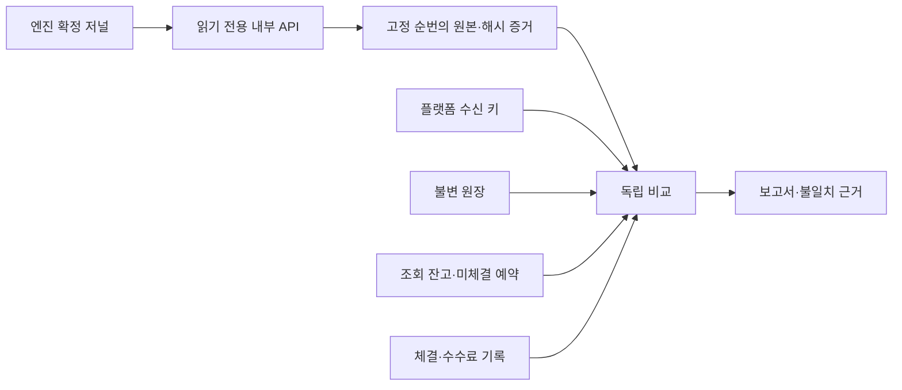

# 주문 자산 이동을 불변 원장에 남기고 독립 대사하기

주문 예약·체결·수수료·취소·IOC 반환·전체 거절을 자산별 양쪽 원장 항목으로 기록한다. 별도 대사 경로는 엔진 확정 결과와 원장, 조회 잔고, 예약금, 체결·수수료 기록을 비교하며 돈을 자동 수정하지 않는다. 작성일은 2026-10-22다.

## 문제와 기존 동작

기존 정산은 원본 검증과 DB 트랜잭션으로 고객 잔고를 갱신했다. 수신 키로 동일 이벤트의 중복 반영도 막았다. 그러나 조회용 `user_balances`가 잘못 바뀌었을 때 돈이 어떻게 이동했어야 하는지 별도로 합산할 불변 원장이 없었다. 수신 키만으로는 엔진 결과 누락이나, 반영한 금액 자체의 오류를 모두 찾을 수 없다.

실시간 정산에서 금액을 바꾸는 책임과, 뒤에서 서로 다른 근거를 비교하는 책임을 나눴다. 코어 매칭을 다시 실행하거나 플랫폼 잔고를 엔진의 현재 잔고로 덮어쓰는 방식은 선택하지 않았다.

## 기존 제품의 접근과 의존성 확인

Modern Treasury는 [원장 거래](https://docs.moderntreasury.com/ledgers/docs/ledger-transactions-overview)를 여러 계정 사이의 원자적 이동으로 설명하고, [확정 상태의 불변성](https://docs.moderntreasury.com/ledgers/docs/transaction-status-and-balances)과 역거래에 의한 정정을 구분한다. [계정 대사](https://docs.moderntreasury.com/ledgers/docs/account-reconciliation)는 내부 기록과 별도 보고 잔액의 차이를 비교한다. 확인일은 2026-10-22다.

이 원칙을 주문 업무 범위에 적용했다. 설치된 Spring JDBC·트랜잭션·PostgreSQL을 사용하며 새 패키지나 원장 서버를 추가하지 않았다. 별도 원장 제품은 운영·네트워크·정산 연동 책임을 늘리므로 현재 단일 플랫폼 DB 범위에서는 DB의 원자성·제약·트리거를 활용했다. 외부 제품을 도입하거나 해당 제품과 같은 보장 전체를 구현했다는 뜻은 아니다.

## 선택과 트레이드오프

| 선택 | 이점 | 비용·제약 |
| --- | --- | --- |
| 자산별 합계 0인 원장 항목 | 고객 간 이동·예약·수수료 귀속의 누락 탐지 | 잔고 갱신마다 원장 쓰기·검증 추가 |
| 기존 금융 트랜잭션에 원장 포함 | 잔고만 바뀌거나 원장만 남는 부분 확정 방지 | 원장 오류도 주문/정산 전체를 막음 |
| PostgreSQL 지연 제약·불변 트리거 | 일반 SQL 우회에서도 불균형·변경 차단 | PostgreSQL에 의존하고 커밋 시 검사 비용 발생 |
| 명시적 최초 반입 | 현재 잔액을 몰래 정답으로 채택하지 않음 | 기존 금융 이력 환경에 자동 적용할 수 없음 |
| 엔진 고정 범위 + 플랫폼 반복 읽기 스냅샷 | 서로 다른 시점 때문에 생기는 오탐 감소 | 원본 수집·스냅샷·증거 저장 비용 |
| 전체 이력 대사·별도 운영 명령 | 처음부터 끝까지 설명 가능한 최소 경로 | 데이터가 커지면 조회·저장 비용이 큼 |
| 오류를 보고하고 자동 보정하지 않음 | 손실이나 변조를 정상 잔고로 덮어 숨기지 않음 | 승인·정정·운영 대응 절차가 별도로 필요 |

H2에서 PostgreSQL 금융 제약을 흉내 내는 호환 경로는 만들지 않았다. 기존 H2 테스트는 원장을 대역으로 분리하고, 실제 제약은 별도 PostgreSQL 테스트에서 검증한다.

## 원장의 의미

원장 계정은 `고객 ID + 자산 + 사용 가능/예약`이다. 고객 ID 0은 실제 고객이 아니라 시스템의 `FEE`·`OPENING` 상대 계정이다. 양수 항목은 해당 계정 증가, 음수는 감소다. 모든 거래의 합계는 **자산마다 각각 0**이어야 한다. BTC와 USDT를 환율로 상쇄하지 않는다.

예를 들어 지정가 매수의 200 USDT 예약은 다음 두 항목이다.

| 계정 | 변화 |
| --- | ---: |
| 고객 USDT 사용 가능 | −200 |
| 고객 USDT 예약 | +200 |

체결에서는 매수자 예약 감소·가격 개선분 반환, 매도자 수취, 기준 자산 이동, 시스템 수수료 귀속을 한 원장 거래에 기록한다. 수수료를 고객 잔고에서 없애기만 하지 않고 해당 자산의 시스템 계정에 남긴다. 반환액 0인 시장가 종료도 업무 식별자는 기록하되 금액 0 항목은 저장하지 않는다.

이는 현재 주문 업무의 자산 보조 원장이다. 법인 전체의 재무회계 계정과목·결산 시스템이나 실제 수탁 자산의 증명까지 구현한 것은 아니다.

## 구현과 책임 분리

- [LedgerService](../../src/main/java/dustin/cex/domains/ledger/LedgerService.java): 업무 키와 항목을 기록한다. 같은 계정의 항목을 합산하고 자산별 균형을 검사한다. 금융 트랜잭션 밖의 기록을 거부한다.
- [DB 스키마](../../src/main/resources/ledger/schema.sql): `ledger_transactions`, `ledger_entries`, 대사 보고서·증거·차이 테이블을 만든다. 과거 금융 기록의 변환이나 잔고 보정은 하지 않는다.
- [주문 접수](../../src/main/java/dustin/cex/domains/order/service/OrderService.java): 주문·원본·예약·전송 대기와 `reserve:주문ID` 원장 기록을 함께 커밋한다.
- [금융 소비](../../src/main/java/dustin/cex/shared/kafka/KafkaOrderEventConsumer.java): 수신 키·체결/종료·잔고·수수료·`engine:이벤트ID` 원장을 같은 트랜잭션에 기록한다.
- [Trade](../../src/main/java/dustin/cex/domains/trade/model/entity/Trade.java): `engine_event_id`를 필수·유일 값으로 저장해 원본 체결과 직접 연결한다.
- [EngineAuditClient](../../src/main/java/dustin/cex/domains/reconciliation/EngineAuditClient.java): 내부 키로 엔진의 읽기 전용 API를 호출한다. 실패를 빈 목록으로 바꾸지 않는다.
- [ReconciliationService](../../src/main/java/dustin/cex/domains/reconciliation/ReconciliationService.java): 원본 수집·고정 기준·별도 계산·차이 저장을 담당한다. 정산 서비스나 코어 명령을 호출하지 않는다.
- [운영 명령](../../src/main/java/dustin/cex/domains/reconciliation/ReconciliationRunner.java): 명시적으로 실행할 때만 한 번 대사한다. 일치 보고서를 남기면 해당 점검 프로세스를 종료하고, 미완료/불일치/실패는 시작 실패로 비정상 종료한다. 일반 플랫폼 프로세스에는 기본 실행되지 않는다.

### DB에서 강제하는 규칙

원장 업무 키가 유일하다. 수신 키가 유실돼 다시 반영하려 해도 같은 원장 업무 키가 금융 트랜잭션의 중복 확정을 막는다. 정상 재전달은 앞단의 수신 키에서 종료하므로 원장을 다시 쓰지 않는다.

자산별 불균형과 고객 원장 사용 가능/예약 잔액의 음수는 지연 제약이 커밋 시 거부한다. 중간 항목 몇 개만 보고 정상 이동을 막지 않으면서, 전체 거래가 완성되지 않은 커밋을 차단한다. 원장 거래와 항목은 수정·삭제를 거부하며, 과거 확정 거래에 항목을 나중에 추가하는 것도 거부한다. 최초 원장 거래를 만든 DB 트랜잭션 안에서만 항목을 추가할 수 있다.

완료한 대사 보고서와 증거·차이도 수정·삭제·사후 추가를 막는다. 단, DB 소유자·슈퍼유저는 트리거 제거·테이블 삭제 등을 할 수 있다. 운영의 최소 권한·DDL 분리·감사·외부 백업까지 이 코드만으로 해결했다고 주장하지 않는다.

### 최초 잔액 반입

[LedgerOpeningRunner](../../src/main/java/dustin/cex/domains/ledger/LedgerOpeningRunner.java)를 `--ledger.initialize=true`로 명시한 실행에서만 반입한다. 기존 주문·원본·전송 기록·체결·수수료·수신 이력이나 예약 잔액이 있으면 거부한다. 새 환경에서 확인한 최초 잔액을 고객 사용 가능 계정과 `OPENING` 상대 계정에 함께 기록한다.

반입은 재시작 재입금이 아니다. 이미 최초 원장이 있으면 반복 반입을 거부한다. 원장 없이 주문을 제출해도 현재 잔고를 자동 채택하지 않고 금융 트랜잭션을 실패시킨다. 반입 후 별도로 DB에 자금을 추가하는 것도 정식 원장 항목 없이 허용되는 입금 절차가 아니다.

반입 금액의 외부 진실성은 운영자가 확인해야 한다. 현재 시연 자금과 실제 체인 입금·수탁 자산은 구분한다. 입출금 업무를 구현할 때 해당 자산 이동과 외부 근거를 이 원장에 연결해야 한다.

## 독립 대사의 흐름



1. 보고서를 `RUNNING`으로 생성한다.
2. 엔진에서 식별자와 확정 상한을 받고, 같은 상한으로 마지막 페이지까지 읽는다. 원본 JSON 문자열·SHA-256을 증거로 저장한다. HTTP 동안 플랫폼 DB 트랜잭션을 유지하지 않는다.
3. 수집을 끝낸 후 플랫폼의 `REPEATABLE_READ` 트랜잭션을 시작한다. 비교 단계는 30초 제한이다.
4. 원장 합계와 조회 잔고, 원본 예약과 미체결 잔액, 체결 합계와 주문 누적 수량·대금, 엔진 원본과 수신 키·체결·수수료·실제 원장 항목을 비교한다.
5. 차이를 저장하고 보고서를 완료한다. 잔고·주문·원장을 자동 수정하지 않는다.

원본 체결의 기대 항목은 엔진 결과와 불변 주문의 가격·수수료율로 별도 계산한다. 실시간 정산 함수를 다시 호출하지 않는다. 단위 검증 타입은 공유하지만 금액 이동 계산과 비교 경로는 분리한다. 원장과 조회 잔고를 같은 잘못된 값으로 바꿔도 원본 기대 항목과 비교해 탐지할 수 있다.

플랫폼은 스냅샷 시점에 더 나중의 결과까지 반영했을 수 있다. 원장·잔고·예약은 그 스냅샷의 현재 상태끼리 비교하고, 엔진 수신 비교는 고정 상한까지만 한다. 현재 엔진 잔고와 플랫폼의 선예약 잔고를 단순히 같다고 비교하지 않는다.

공개 호가도 같은 수신 키 테이블을 쓰므로 `:market` 키를 금융 누락으로 세지 않는다. 숫자 이벤트 인덱스의 금융 결과만 대사한다.

| 보고서 상태 | 의미 |
| --- | --- |
| `MATCHED` | 해당 엔진 상한과 플랫폼 스냅샷에서 검사한 항목이 일치 |
| `INCOMPLETE` | 엔진 결과 중 미수신 항목이 있음. 지연인지 영구 누락인지는 추가 확인 필요 |
| `MISMATCH` | 본문·원장 항목·잔고·예약·체결·수수료 등의 불일치 발견 |
| `FAILED` | 원본 조회·계약·DB 검사 등을 완료하지 못함 |
| `RUNNING` | 진행 중. 프로세스가 종료됐다면 부분 증거가 남은 미완료 실행일 수 있음 |

일치 판정은 거래소 전체나 모든 과거 시점의 안전 인증이 아니다. 보고서에 저장한 기준 범위의 검사 결과다. 엔진 API와 Kafka는 같은 직렬화를 사용하므로 직렬화 구현 자체의 독립 검증까지 제공하지는 않는다. 매칭의 가격·시간 우선순위 검증과는 다른 책임이다.

## 운영 명령과 조회

엔진과 점검 프로세스에 같은 `ENGINE_AUDIT_TOKEN`을 안전하게 주입한다. 최소 32바이트이며 브라우저에 전달하지 않는다. 점검은 기존 플랫폼의 복제 인스턴스로 거래를 처리하지 않도록 소비·재전송·봇을 끈다. 예시는 실제 대상 주소·DB 권한을 명시해야 한다.

```sh
java -jar build/libs/cex-0.0.1-SNAPSHOT.jar \
  --reconciliation.run=true \
  --server.address=127.0.0.1 --server.port=0 \
  --bot.bot-count=0 --order.dispatch.enabled=false \
  --spring.kafka.listener.auto-startup=false \
  --spring.jpa.hibernate.ddl-auto=validate \
  --spring.datasource.url=jdbc:postgresql://127.0.0.1:5433/cex \
  --engine.http.url=http://127.0.0.1:3002
```

현재 원장 스키마 설치에는 DDL 권한이 필요하다. 운영에서는 스키마 설치 계정과 업무·조회 계정을 분리해야 한다. 이 명령을 기존 금융 이력에 대한 자동 도입 절차로 사용하면 안 된다. 최초 반입과 대사는 별도 실행한다. 관리자 권한·승인 API가 없는 현재 단계에서 고객에게 대사 실행/조회 API를 공개하지 않았다.

보고서는 다음 테이블로 확인한다.

```sql
SELECT id,started_at,completed_at,engine_id,through_sequence,status
FROM reconciliation_runs ORDER BY started_at DESC;
SELECT category,reference,expected,actual
FROM reconciliation_issues WHERE run_id = '<보고서 UUID>' ORDER BY id;
```

현재는 단일 엔진의 금융 이력을 기준으로 한다. 다른 엔진 식별자의 금융 수신 이력이 섞여도 조용히 제외하지 않고 불일치로 남긴다.

현재는 전체 이력을 읽고 매 실행의 원본 증거를 저장한다. 증분 대사·마감·과거 시점 재구성·데이터 보관 정책·대규모 보고서 조회·경보·승인된 정정은 후속 범위다. 검사 도중 프로세스가 종료된 `RUNNING` 보고서를 자동 성공으로 바꾸거나 지우지 않는다.

## 이해에 필요한 Java와 DB 원리

`Posting`과 지역 `Account`의 `record`는 값 묶음이다. TypeScript 객체처럼 사용하지만 정해진 필드와 불변 참조를 가진다. `BigDecimal.compareTo`와 정규화로 소수 끝의 0 때문에 같은 금액을 다르게 비교하지 않는다.

`Propagation.MANDATORY`는 원장을 부른 쪽에 금융 트랜잭션이 반드시 있어야 한다는 뜻이다. 원장만 먼저 커밋하지 않는다. `NEVER`는 대사 진입 시 외부 트랜잭션에 합류하지 않아 네트워크 대기를 금융 트랜잭션으로 감싸는 실수를 막는다.

PostgreSQL의 지연 제약은 트랜잭션 종료 때 전체 항목을 검사한다. 중간에 고객 감소 항목만 잠깐 존재할 수 있지만, 최종적으로 대응 증가가 없으면 커밋하지 못한다. 반복 읽기 스냅샷은 검사 중 새 금융 거래가 커밋돼도 검사 기준이 섞이지 않게 한다. 이 DB 트랜잭션과 락은 Rust 체결 코어의 공유 락 제거 원칙과 별개다.

### 현재 코드로 연결해 읽기

원장 항목을 같은 계정끼리 모으고 자산별 합계가 0인지 검사한다. 아래는 2026-10-23 현재 [실제 소스](../../src/main/java/dustin/cex/domains/ledger/LedgerService.java#L64)의 연속 행 발췌다. 메서드 일부일 수 있으므로 독립 실행 예제로 사용하지 않고 앞뒤 검증과 함께 읽는다. 과거 사이클의 코드/측정 시점은 본문의 기록을 유지한다.

```java
    record Account(long owner,String bucket,String asset) {}
    var accounts=new LinkedHashMap<Account,BigDecimal>(); var totals=new HashMap<String,BigDecimal>();
    for(var entry:postings) {
        accounts.merge(new Account(entry.owner(),entry.bucket(),entry.asset()),entry.delta(),BigDecimal::add);
        totals.merge(entry.asset(),entry.delta(),BigDecimal::add);
    }
    if(totals.values().stream().anyMatch(value->value.signum()!=0)) throw new IllegalArgumentException("자산별 원장 합계 불일치");
    jdbc.update("INSERT INTO ledger_transactions(operation_key,kind) VALUES(?,?)",key,kind);
    accounts.forEach((account,delta)->{
        if(delta.signum()!=0) jdbc.update("INSERT INTO ledger_entries(operation_key,owner_id,bucket,asset,delta) VALUES(?,?,?,?,?)",
            key,account.owner(),account.bucket(),account.asset(),delta);
    });
}
```

메서드 안의 `record`도 값 동등성을 갖는 키로 사용할 수 있다. `merge`와 `BigDecimal::add`로 같은 자산의 변화를 합치며, 서로 다른 자산의 금액을 환율 없이 더해 균형을 맞추지 않는다.

## 작성한 테스트

[OrderLedgerTest](../../src/test/java/dustin/cex/domains/ledger/OrderLedgerTest.java)는 실행 소유 PostgreSQL의 테스트별 스키마에서 다음 15개를 실행한다.

| 함수 | 검증 |
| --- | --- |
| `openingAndReservationMatchLedgerProjectionAndOriginalOrder` | 최초 반입·예약·자산별 균형·호가 수신 키 오탐 방지·일치 판정 |
| `serviceRejectsUnbalancedPostingWithoutAnyFinancialWrite` | 서비스의 불균형 거부 |
| `databaseRejectsUnbalancedDirectInsertAtCommitAndRollsBackBalance` | 직접 SQL 우회도 커밋에서 거부·잔고 전체 롤백 |
| `customerOverdraftRollsBackBalancedPosting` | 양쪽 합계가 맞아도 고객 음수 원장 거부 |
| `committedJournalCannotBeEditedDeletedOrExtended` | 확정 항목 수정·삭제·과거 거래 사후 추가 거부 |
| `corruptedProjectionIsDetectedAndNeverRepaired` | 조회 잔고 손상 탐지·자동 보정 금지 |
| `unreceivedEngineResultIsIncompleteRatherThanMatched` | 미수신 원본은 미완료 |
| `unavailableSourceRecordsFailedRunWithoutChangingMoney` | 원본 장애의 실패 보고서·자금 불변 |
| `wrongReceiptAndCoherentlyWrongRefundCannotPassIndependentSourceComparison` | 원장과 잔고가 함께 잘못돼도 원본 반환·수신 해시·잔여 예약의 차이 탐지 |
| `changedPageIdentityCannotProduceSuccessfulReport` | 조회 중 엔진 식별자 교체 거부 |
| `finishedReportAndEvidenceCannotBeRewritten` | 완료 보고서 수정·사후 차이 추가 거부 |
| `openingCannotBeRepeatedOrInferredFromExistingOrders` | 최초 반입 반복 거부 |
| `missingOpeningNeverAdoptsCurrentBalanceAutomatically` | 최초 원장 누락 시 현재 잔액 자동 채택 금지 |
| `openingRefusesFinancialHistoryEvenWhenBalancesLookValid` | 금융 이력 있는 환경의 최초 반입 거부 |
| `terminalStateCannotDisagreeWithDurableResult` | 금액·예약이 맞아도 원본 거절과 다른 종료 상태는 불일치 |

[MarketPathTest](../../src/test/java/dustin/cex/integration/MarketPathTest.java)는 실제 Java·Rust·PostgreSQL·Kafka 경로에서 기존 지정가·시장가·취소·거절·WAL 재발행 후 대사 일치를 확인한다. 추가 시나리오는 다음과 같다.

1. 조회 잔고만 1 줄이면 `BALANCE_AVAILABLE` 불일치. 대사는 자금을 고치지 않는다.
2. 수수료 기록만 1 늘리면 `FEE_VALUE`, 저장 체결의 자산만 바꾸면 `TRADE_ASSET` 불일치. 수수료 적용률·귀속 고객·체결 대금도 비교한다.
3. 실제 금융 Kafka 소비를 중지하고 시장가를 접수하면 `INCOMPLETE`. 소비 재개·종료 반영 후 다시 `MATCHED`.
4. 별도 새 JAR 점검 프로세스가 실제 내부 조회·보고서 저장 후 종료 코드 0으로 끝나고, 주 플랫폼은 계속 동작함.

기존 단위/JPA 테스트에는 새 원장 대역과 생성자 인자를 추가했다. 실제 프로세스 접수 회귀는 [격리 최초 자금 자료](../../src/test/resources/ledger-opening-fixture.sql)를 명시적으로 사용한다. 오래된 회귀의 다른 주문 예약 25 가정은 테스트 자료에만 남기며 제품 최초 반입의 예약 0 조건을 완화하지 않는다.

## 실행 명령과 결과

| 명령 | 결과 |
| --- | --- |
| `python3 scripts/verify_engine_inbox.py` | Java **175개** 통과, 실패·오류·제외 0, 제품 JAR 빌드 포함 |
| `python3 scripts/verify_market_path.py` | 전체 금융 흐름·오류 주입·소비 지연·별도 JAR 명령을 포함한 **통합 시나리오 1개** 통과 |
| `python3 scripts/verify_order_idempotency.py` | HTTP·동시 요청·응답 유실·재시작 **10개** 통과 |
| 엔진 `python3 scripts/verify_order_safety.py` | 고유 Rust **135개/138회** 통과, 전체 테스트 컴파일·제품 빌드 포함 |
| 엔진 `python3 scripts/verify_engine_output.py` | 실제 출력·장애·복구 **6개 시나리오** 통과 |
| 엔진 `python3 scripts/verify_durable_acceptance.py` | 실제 영속 접수·응답 유실·양쪽 재시작 **5개 시나리오** 통과 |
| 엔진 `cargo check --locked --benches --features bench_mode` | 벤치 컴파일 통과. 성능 측정 아님 |

macOS·Java 21·Rust 1.91·PostgreSQL 16·Kafka 3.9.1에서 실행 소유 컨테이너·스키마·프로세스·저널만 사용하고 회수했다. 기존 서버와 금융 데이터는 변경하지 않았다. 봇은 0명이며 기존 통합 검증의 서비스 직접 호출만 유지했다. 프론트는 수정·테스트하지 않았다.

최초 통합 실행에서는 공개 호가 수신 키를 금융 누락으로 세는 오탐을 발견했다. 금융 이벤트 식별 규칙으로 수정하고 실제 지연·불일치 시나리오까지 재실행했다. 초기 로그는 `.local/ledger-market-initial-failure.log`, 최종 로그·JSON은 `.local/ledger-*.log`와 각 실행기 결과에 있다. Rust 기존 경고·Java 문서 어노테이션 사용 중단 경고는 남아 있다.

## 저장 계약과 남은 범위

엔진 WAL은 버전 **4 그대로**다. 플랫폼에는 새 원장·대사 테이블과 필수·유일한 `trades.engine_event_id`가 필요하다. 새 격리 스키마에서 검증했으며 기존 금융 이력에 가짜 원장·이벤트 ID를 채우거나 자동 변환·삭제하지 않았다. 기존 환경에 즉시 배포할 수 있다는 뜻은 아니다.

이번 범위는 최초 반입과 현재 주문 업무의 원장·독립 비교다. 실제 입출금 원장, 체인·수탁 자산 대사, 회계 마감과 과거 기준 시점, 정정·승인, 자동 경보와 운영자 권한은 남아 있다. 특히 외부 보관 자산과 고객 부채가 맞는지까지 검증한 것은 아니다. 규제·감사·인증 완료라고 표시하지 않는다.

다음은 고객·운영자 접근 통제·승인·감사다. 디스크 손실의 외부 복제·백업은 합의대로 문서상의 필요 조건이다.

## 관련 커밋

- [엔진 감사 조회 `c96133b`](https://github.com/GiHoon1123/Cex-Engine/commit/c96133bd59f048dac0251e60e29322c864a424c2)
- [플랫폼 원장·대사 `16c76bd`](https://github.com/GiHoon1123/Cex-Platform-Service/commit/16c76bd493601be6d7515889b732fe805cd3e74c)
- [실제 통합 검증 `80a97eb`](https://github.com/GiHoon1123/Cex-Platform-Service/commit/80a97eb0ac164509ee3992ffe0b6e5c2a866555a)
- [대사 근거 보강 `1e15e62`](https://github.com/GiHoon1123/Cex-Platform-Service/commit/1e15e62740d33b98bcf8c63a8f62ead199517d71)

087 현행 보강: [확정 원장의 전체 비우기 차단](087-block-ledger-truncate.md)에서 행 수정/삭제 외에 직접 TRUNCATE/CASCADE를 차단했다. 당시011의 실행 결과는 그대로 두며 현재 최초 반입 없는 시험은 원장을 지우지 않고 처음부터 반입을 생략한다.

088 현행 확장: [입금 보류 원장](088-bitcoin-pending-asset-ledger.md)에서 고객 PENDING/시스템 CUSTODY 계정을 추가했다. 원장 항목은 확정 원본이며 거래 가능한 AVAILABLE과 구분한다. 기존011의 주문 대사는 AVAILABLE/LOCKED 범위이고 수탁/입금 대사 전체 완료를 뜻하지 않는다.
