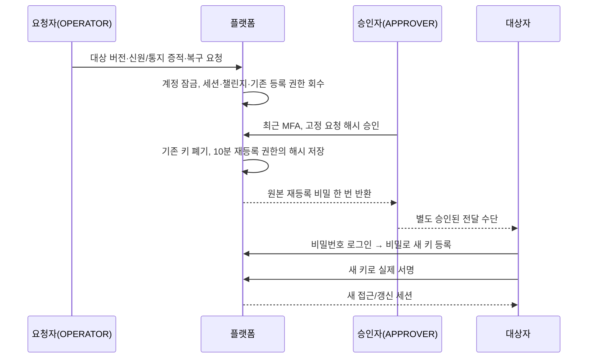

# 분실한 운영 보안키를 복구하면서 과거 세션과 권한을 되살리지 않기

2026-10-22. 예비 키를 이용한 기기 폐기, 별도 두 인물의 복구 요청·승인, 운영 권한 만료·재검토·즉시 회수를 구현한다. 최초 운영자 부여도 별도 관리 실행 파일로 분리한다. 복구가 MFA를 제거하거나 영구 운영 권한을 주는 경로가 되지 않는 것이 핵심이다.

## 문제와 기존 동작

[첫 MFA 사이클](014-operator-webauthn-mfa.md)은 실제 보안키 등록·서명과 세션 교체를 연결했다. 예비 키를 등록할 수 있지만 분실 키를 폐기하거나 모든 키를 잃었을 때 복구하는 업무는 없었다. 운영 권한도 별도 만료 없이 유지됐다.

`OperatorBootstrapRunner`는 일반 앱 컨텍스트의 실행 훅이었다. 봇과 Kafka를 끄는 인수를 붙여도 정산 스케줄러를 포함하는 앱 전체를 초기화했다. 운영자 한 명을 부여하는 명령이 금융 업무 프로세스를 함께 구성할 필요는 없다.

키를 지운 뒤 예전 접근/갱신 토큰을 남기거나, 복구 승인을 곧바로 로그인으로 처리하면 키 폐기의 의미가 약해진다. 복구 거절·만료 때 신고된 옛 기기의 접근을 자동 복원하는 것도 안전하지 않다.

## 기존 제품과 공식 자료의 접근

확인일은 2026-10-22다. 공개 고객 기능을 근거로 삼으며 거래소·증권사 내부 운영자의 승인 구현을 확인했다고 주장하지 않는다.

| 공식 자료 | 확인한 접근과 이번 선택 |
|---|---|
| [Coinbase 계정 복구](https://help.coinbase.com/en-gb/coinbase/managing-my-account/get-back-into-my-account/account-recovery-lost-email-2step-verification) | 인증 수단 상실과 침해 계정 잠금 해제를 구분하고 신원 확인·인증 수단 갱신 단계를 둠. 이번 운영자 복구는 승인 후에도 새 키 등록·서명을 요구 |
| [Kraken 침해 계정 대응](https://support.kraken.com/articles/4413167516692-my-account-is-compromised-what-should-i-do-) | 보안 담당자를 통한 다단계 복구를 공개적으로 안내. 자동 비밀번호 우회 대신 담당자와 승인자의 독립 확인 채택 |
| [IBKR 권한 변경](https://www.ibkrguides.com/adminportal/uar/modifyinguseraccessrights.htm) | 사용자별 권한 관리와 변경 내용 검토를 분리. 권한 재검토를 기록하는 별도 업무로 구현 |
| [NIST SP 800-63B-4 수명 관리](https://pages.nist.gov/800-63-4/sp800-63b/events/), [인증 수단](https://pages.nist.gov/800-63-4/sp800-63b/authenticators/) | 등록·분실·침해·회수·복구와 통지의 관리 필요성을 확인. 기기 폐기·세션 회수·재등록을 연결하고 통지는 운영 증적과 자동화 미완료를 구분 |
| [OWASP MFA](https://cheatsheetseries.owasp.org/cheatsheets/Multifactor_Authentication_Cheat_Sheet.html) | 인증 수단 변경·복구가 인증 우회가 될 수 있음. 다른 키로 재인증하거나 독립 승인 후 새 인증을 요구 |
| [안전성 확보조치 기준](https://www.law.go.kr/LSW/admRulInfoP.do?admRulSeq=2100000281400) | 제2026-9호·2026-07-01 시행 표기를 재확인. 권한 이력·회수·인증 통제의 사업별 조문·부칙과 실제 운영 증적은 [근거 대조표](../reference/access-control-compliance.md)의 별도 확인 대상으로 유지 |
| [금융보안원 금융권 ISMS-P 점검항목](https://www.fsec.or.kr/bbs/detail?bbsNo=11386&menuNo=247) | 금융권 자료와 적용 대상을 재확인. 현물 거래소에 모든 금융회사 기준이 그대로 의무라고 단정하지 않으며 조직·인사·정기 검토 증적을 남은 과제로 연결 |

두 사람의 역할, 30일 권한 기간, 10분 승인/등록 권한, 5분 재인증은 이번 서비스 정책이다. 법정 공통 수치·인증 등급을 충족했다고 설명하지 않는다.

## 선택과 트레이드오프

| 선택 | 이점 | 비용·대안과 선택 이유 |
|---|---|---|
| 예비 키로 인증한 뒤 분실 키 폐기 | 현재 세션이 실제로 다른 키의 서명으로 만들어졌는지 확인 | 폐기할 현재 인증 키와 마지막 키는 직접 삭제 불가. 다른 키가 없으면 복구 승인으로 이동 |
| 복구 접수 즉시 계정 잠금·모든 세션 회수 | 침해가 의심되는 기기의 추가 접근 차단 | 요청자가 정상 업무를 중단시킬 수 있음. 복구 요청자도 최근 MFA·현재 권한·다른 실제 인물이 필요하고 행위는 감사 |
| 복구에 요청자·승인자·대상자를 서로 다른 인물로 요구 | 본인 복구 승인과 동일인의 다중 계정 우회 차단 | 실제로 최소 세 인물이 필요. 혼자 작성한 UUID로 실제 조직의 인력 분리를 증명하지 못함 |
| 승인 후 단기 재등록 비밀만 발급 | 복구가 관리자 로그인으로 직결되지 않음 | 비밀번호·새 키 등록·새 서명이 모두 필요. 원본 비밀을 한 번만 반환하므로 응답 유실/만료 때 새 요청·승인 필요 |
| 거절·만료가 옛 접근을 복원하지 않음 | 신고된 침해 수단이 자동으로 다시 열리지 않음 | 계정이 계속 잠길 수 있음. 새로운 복구 요청으로 증적·대상 버전을 다시 확인 |
| 권한을 최대 30일로 부여·재검토 | 영구·방치 운영 권한을 줄이고 검토 이력 확보 | 정기 업무 부담과 만료 잠금 비용. 스케줄러 실행 여부에 의존하지 않고 매 인증에서 기한 검사 |
| 회수는 즉시, 연장은 별도 두 인물 승인 | 침해/퇴직 계정의 노출을 승인 대기 시간만큼 늘리지 않음 | 한 운영 인물의 악의적 중단 위험. 회수 기록·외부 인사 통제·관리자 대응 필요. 회수와 권한 확대의 위험을 다르게 취급 |
| 비활성 운영 계정 재활성화 API 없음 | 퇴직 계정의 과거 자격 증명을 재사용하지 않음 | 재입사·재부여에는 새 전용 계정과 명시적 부여 절차 필요. 고객 역할로 바꾸는 우회도 제공하지 않음 |
| 별도 관리 JAR·명시적 import·스키마 검증만 | 일반 서버 실행과 최초 권한 부여 경계 분리 | 실행 파일이 하나 늘어남. 금융 워커·DDL 권한 없이 운영 가능하며 새 프레임워크/패키지는 필요 없음 |

## 상태와 보장 조건

### 예비 키를 가진 경우

1. 예비 키로 WebAuthn 인증을 완료한다. `RefreshToken.mfaCredentialFingerprint`에 실제 서명한 키의 SHA-256 지문을 보관한다.
2. 최근 5분 MFA와 살아 있는 현재 키를 확인하고, **다른** 분실 키를 폐기한다. 자신이 방금 사용한 키나 마지막 키는 제거하지 못한다.
3. 모든 세션·진행 중 챌린지·남은 등록 권한을 회수한다. 재로그인 후 남은 키로 서명해야 한다. 금융 원장과 보안 감사 기록은 삭제하지 않는다.

### 모든 키를 잃은 경우



- 요청자·승인자·대상자의 계정 ID와 실제 인물 ID가 각각 달라야 한다. 요청자는 현재 OPERATOR, 승인자는 현재 APPROVER이며 최근 5분 MFA를 서비스 트랜잭션 안에서도 재검사한다.
- 계정의 최신 버전·인물 ID·현재 활성 상태, 요청 해시·10분 만료·PENDING 상태를 확인한다. 요청자의 역할/신원 변경·권한 만료·회수도 승인을 막는다.
- 신원 확인과 통지는 **외부 업무 기록의 참조 ID**를 받는다. 원본 신분증·연락처·생체 정보는 요청·감사 본문에 저장하지 않는다. 참조의 실재와 독립적인 확인은 조직의 책임이다.
- 승인 뒤 운영 권한 기한은 자동 연장하지 않는다. 복구 중 권한이 만료됐으면 별도 재검토가 필요하다. 기한 재검토로 대상 버전이 바뀌면 이전 복구 승인은 실패하며 새 복구 요청이 필요하다.
- 재신청은 새 ID와 새 대상 버전을 남기고 이전 요청을 재사용하지 않는다. 거절/만료/PENDING 이력은 삭제하지 않는다. 해당 요청을 거절해도 옛 키·세션의 접근을 자동 복원하지 않는다.
- 재등록 비밀의 원본은 승인 성공 응답에 한 번만 존재한다. 서버에는 SHA-256만 저장한다. 다시 조회하거나 완료 요청을 재호출해 원본을 회수할 수 없다. `Cache-Control: no-store`를 적용한다.
- 승인 효과·기존 키 삭제·새 등록 권한·계정 상태·성공 감사는 같은 트랜잭션이다. 필수 감사 실패는 전체 롤백이다. 거부 감사는 별도 트랜잭션이다.

### 운영 권한의 재검토·회수

- `User.operatorAccessExpiresAt`이 없거나 만료되면 운영 로그인·기존 API 세션·갱신·MFA·승인 업무를 거부한다. 고객 계정에는 이 기한을 요구하지 않는다.
- 재검토는 현재 권한을 확인하고 기한만 최대 앞으로 30일 이내로 정한다. 다른 요청자와 승인자가 같은 고정 내용을 확인한다. 역할을 바꾸거나 비활성 계정을 켜는 API가 아니다.
- 승인 때 `operatorLastReviewedAt`과 대상 버전을 갱신한다. 기한이 전과 같아도 검토 사실을 남기고 동시 승인에 오래된 버전이 재사용되지 않게 한다. 이전 세션을 회수하므로 새 로그인·MFA가 필요하다.
- 퇴직·침해 회수는 다른 인물의 현재 OPERATOR/APPROVER가 최근 MFA로 실행한다. 대상 계정 비활성화, 키·세션·옵션·등록 권한 회수가 함께 커밋된다.
- 회수에도 대상 버전을 확인한다. 동시 변경으로 409가 나면 최신 상태를 읽고 재요청해야 한다. 충돌을 무시해 다른 변경 내용을 덮지 않는다. 회수가 성공한 뒤 옛 승인 요청으로 다시 열 수 없다.
- MFA 시각만 있고 서명 키 지문이 없는 세션은 운영 권한·갱신·추가 키 등록에 쓸 수 없다. 현재 WebAuthn으로 재검증해야 한다. 누락 필드를 과거 세션 호환을 위해 채우는 분기는 없다.

## 구현과 관련 코드

| 코드 | 책임 |
|---|---|
| [OperatorDeviceService](../../src/main/java/dustin/cex/domains/security/OperatorDeviceService.java) | 본인 키 목록·다른 키 폐기·세션/챌린지 회수·감사 |
| [OperatorLifecycleService](../../src/main/java/dustin/cex/domains/security/OperatorLifecycleService.java) | 복구/재검토 두 업무의 불변 요청·분리 승인·효과·즉시 권한 회수 |
| [OperatorSessionPolicy](../../src/main/java/dustin/cex/domains/security/OperatorSessionPolicy.java) | 사용자 행 잠금 뒤 현재 역할·세션·최근 MFA 재검사. 필터 통과 뒤 회수된 세션도 업무 직전에 차단 |
| [OperatorLifecycleController](../../src/main/java/dustin/cex/domains/security/OperatorLifecycleController.java) | 타입이 정해진 JSON API, 본문 행위자 입력 금지, 증적 참조 형식 검사 |
| [User](../../src/main/java/dustin/cex/domains/auth/model/entity/User.java), [RefreshToken](../../src/main/java/dustin/cex/domains/auth/model/entity/RefreshToken.java) | 권한 기한·검토 시각·복구 잠금과 서명 키 결합 |
| [AuthService](../../src/main/java/dustin/cex/domains/auth/service/AuthService.java), [SessionService](../../src/main/java/dustin/cex/domains/security/SessionService.java), [MFA](../../src/main/java/dustin/cex/domains/security/OperatorMfaService.java) | 모든 인증 경로에 현재 자격 반영, 갱신에 서명 키 결합 보존 |
| [기존 운영 승인](../../src/main/java/dustin/cex/domains/security/OperatorApprovalService.java) | 기존 고객 거래 제한의 요청자·승인자에게도 현재 자격 적용 |
| [스키마](../../src/main/resources/security/schema.sql) | 생성 이후 요청 내용 수정·삭제·TRUNCATE 차단. 최종 승인/거절 상태 전이만 허용 |
| [OperatorAdminApplication](../../src/main/java/dustin/operator/OperatorAdminApplication.java), [OperatorBootstrapService](../../src/main/java/dustin/cex/domains/security/OperatorBootstrapService.java) | 최초 전용 계정 부여만 수행하는 비웹 프로세스. 일반 앱의 탐색 범위와 실행 훅에서 제거 |
| [SecuritySchemaInitializer](../../src/main/java/dustin/cex/domains/security/SecuritySchemaInitializer.java) | 일반 서버의 스키마 준비. 관리 도구에는 import하지 않아 DDL을 실행하지 않음 |

사용자 행은 모든 보안 업무에서 ID 오름차순으로 잠근다. 결정은 요청 행을 잠그고 관련 사용자를 같은 순서로 잠근다. 키·세션·권한의 효과가 경쟁해도 현재 상태를 다시 확인한다. 이 플랫폼 DB 잠금은 엔진 체결 코어의 공유 락과 무관하다.

## API 참조

모두 플랫폼만 호출하며 행위자는 검증한 Bearer 세션에서 읽는다. 아래 API는 CUSTOMER·MFA_PENDING에게 허용하지 않는다.

| API | 권한·입력·결과 |
|---|---|
| `GET /api/auth/operator-mfa/credentials` | 본인 운영 계정, 최근 MFA. 지문·이름·생성/사용 시각 |
| `DELETE /api/auth/operator-mfa/credentials/{fingerprint}` | 본인, 다른 키로 최근 MFA. 성공 후 현재 세션까지 회수 |
| `POST /api/admin/operator-security/recoveries` | OPERATOR. `targetId`, `expectedVersion`, `reason`, `identityEvidence`, `notificationEvidence` |
| `POST /api/admin/operator-security/access-reviews` | OPERATOR. 위 필드와 `accessUntil`(UTC Instant) |
| `POST /api/admin/operator-security/requests/{id}/approve` | APPROVER. `{payloadHash}`. 복구 성공만 `{request,enrollmentToken}`을 한 번 반환 |
| `POST /api/admin/operator-security/requests/{id}/reject` | APPROVER. `{payloadHash}`. 원본 기기 접근은 복원하지 않음 |
| `POST /api/admin/operator-security/operators/{id}/revoke` | OPERATOR/APPROVER. `expectedVersion`, `reason`, `notificationEvidence` |
| `GET /api/admin/operator-security/operators/{id}` | OPERATOR/APPROVER/AUDITOR. 버전·역할·활성 상태·기한·최근 검토·복구 잠금 |
| `GET /api/admin/operator-security/requests?page=0` | 동일 조회 역할. 최대 50개, 페이지 0~10000 |

증적 참조는 영문·숫자·`_`·`-`로 된 3~100자다. 형식 검증이 증적 내용의 진실성을 증명하는 것은 아니다. 요청 사유는 200자 이내이며 JSON 원문·신원 서류를 감사에 복제하지 않는다. 403은 권한/인증 거부, 409는 대상 버전/상태 충돌, 400은 입력 오류다.

## 전용 관리 명령

```sh
./gradlew operatorAdminJar
java -jar build/libs/cex-0.0.1-SNAPSHOT-operator-admin.jar \
  --operator.bootstrap.user-id=전용계정ID \
  --operator.bootstrap.person-id=검증한실제인물UUID \
  --operator.bootstrap.role=OPERATOR
```

실행 전 승인된 비밀 주입 도구가 프로세스의 `SPRING_APPLICATION_JSON`에 `spring.datasource`와 `operator.bootstrap.enrollment-token`을 공급한다. 원본 등록 비밀/DB 비밀번호를 셸 인수·저장소·공유 로그에 쓰지 않는다. 재등록 비밀은 CSPRNG로 32바이트 이상 생성하고 별도 안전한 경로로 전달해야 한다. 길이 검사는 엔트로피나 신원 확인을 대신하지 않는다.

관리 명령은 스키마가 준비된 DB에서 금융 이력이 없는 활성 CUSTOMER 전용 계정만 최초 운영 계정으로 부여한다. 권한 기한은 30일, 최초 등록 권한은 10분이며 기존 세션은 회수한다. 기존 운영 계정의 역할을 다시 부여하거나 재활성화하지 않는다.

`StandardEnvironment`와 비웹 컨텍스트를 명시하고 스키마는 `validate`, SQL 초기화는 `never`로 강제한다. 일반 서버의 컴포넌트 탐색·금융 워커·Kafka 소비자를 불러오지 않는다. 기존 `OperatorBootstrapRunner`와 `operator.bootstrap.enabled` 실행 경로는 삭제했다. 운영체제·JAR·DB 관리 권한을 가진 신뢰된 관리자의 최초 부여 경계이며 OS 관리자 침해까지 막는 수단은 아니다.

## 이해에 필요한 Java 원리

- `isAuthenticationAllowed()`는 현재 사용자 상태의 공통 판정이다. 고객과 운영자의 조건을 명시적으로 나누고, 만료/복구 잠금을 각 호출부에서 빼먹지 않게 했다. Java의 `@Transient`는 이 계산 결과를 JPA 컬럼으로 취급하지 말라는 뜻이다.
- `Kind` enum은 복구와 재검토 두 값만 허용한다. 임의 명령·역할·실행 함수를 전달받는 추상화가 아니다. TypeScript라면 두 리터럴의 유니온으로 표현할 수 있다.
- `@Version`의 낙관적 잠금과 사용자 행의 비관적 잠금을 함께 사용한다. 행 잠금은 지금의 실행을 직렬화하고 버전은 운영자가 화면/요청에서 본 내용이 아직 유효한지 확인한다.
- 복구 요청은 대상 버전을 갱신해 이전 요청을 무효화한다. 동일한 만료일의 권한 재검토도 검토 시각을 기록하므로 버전이 바뀐다.
- `Decision` record의 기본 `toString()`은 원본 비밀을 포함할 수 있어 직접 가렸다. API 응답은 한 번 전달하지만 목록·감사·디버깅 문자열은 원본을 포함하지 않는다.
- Java의 패키지와 Spring의 컴포넌트 탐색 범위는 별개다. 관리 클래스는 일반 앱의 `dustin.cex` 범위 밖에 두고 `@Import`로 저장소·부여 업무·감사만 구성한다.
- 하나의 소스에서 `BootJar`의 `mainClass`와 classifier를 달리해 관리 실행 파일을 만든다. HTTP 앱과 관리 명령을 별도 프로세스로 실행하면서 의존성을 중복 설계하지 않는다.

## 작성한 테스트

[OperatorLifecycleTest](../../src/test/java/dustin/cex/domains/security/OperatorLifecycleTest.java)는 실제 PostgreSQL과 [SoftwareAuthenticator](../../src/test/java/dustin/cex/domains/security/SoftwareAuthenticator.java)의 P-256 서명으로 서로 다른 세 계정을 준비한다. MFA 검증기의 성공을 모킹하지 않는다.

| 함수 | 시나리오·기대 결과 |
|---|---|
| `recoveryImmediatelyBlocksSessionsRefreshSigninAndOldChallenges` | 접수 즉시 과거 세션·갱신·비밀번호 로그인·옵션 사용 차단 |
| `approvedRecoveryRequiresPasswordNewRegistrationAndNewSignature` | 승인 후에도 새 등록/서명 전에는 운영 API 차단, 전체 흐름 성공 |
| `approvalResponseContainsSecretOnlyOnceAndReadsNeverExposeIt` | 해시만 저장, 목록·감사 원본 제외, 재승인 불가 |
| `requesterApproverAndTargetMustBeDifferentPeople` | 자기 요청·동일 인물의 다중 계정 승인 거부 |
| `changedTargetVersionAndRevokedRequesterInvalidateDecision` | 대상 변경·요청자 권한 회수 후 승인 거부 |
| `expiredRequestAndWrongHashCannotRecover` | 처음부터 만료된 불변 fixture와 다른 해시 거부 |
| `rejectionDoesNotRestoreReportedCompromisedKeyAccess` | 거절 뒤 옛 자격 증명 접근 복원 금지 |
| `reissuedRecoveryInvalidatesOlderRequest` | 새 ID·버전이 이전 승인 무효화 |
| `recoveryApprovalAuditFailureRollsBackKeysGrantAndAccountState` | 키·등록 권한·잠금·요청 상태 전체 롤백 |
| `recoveryRequestAuditFailureDoesNotSuspendAccount` | 접수 감사 실패 시 세션/계정 원상 보존 |
| `concurrentRecoveryApprovalsHaveOneWinner` | 병렬 승인에서 성공과 성공 감사 각 한 건 |
| `staleOrRevokedSessionCannotBypassControllerWithDirectServiceCall` | 서비스 직접 호출도 오래되거나 회수된 세션 거부 |
| `accessExpiryBlocksSigninRefreshApiAndPendingApproval` | 기한 만료가 모든 기존 운영 진입점과 대기 승인 차단 |
| `missingOperatorExpiryFailsClosed` | 기한 없는 운영 계정 거부 |
| `approvedReviewRenewsExpiredRightsButRequiresNewSigninAndMfa` | 기한 검토 후에도 새 로그인·MFA 필요 |
| `reviewExpiryIsBoundedAndSameExpiryReviewsStillChangeVersion` | 최대 30일 제한, 같은 기한도 검토/버전 갱신 |
| `emergencyRevocationDisablesAccountKeysAndSessionsWithoutWaitingForApproval` | 즉시 회수 후 키·세션 차단, 복구/검토로 재활성화 불가 |
| `revocationAuditFailureRollsBackDisabledStateAndKeys` | 회수 감사 실패 시 키·세션·활성 상태 보존 |
| `selfOrSamePersonRevocationIsDenied` | 자기/동일 인물 계정 회수 거부 |
| `lastKeyAndCurrentlyAuthenticatedKeyCannotBeDeleted` | 마지막 키·타인의 키 폐기 거부 |
| `backupKeyCanRevokeLostKeyAndAllSessionsAreRecalled` | 다른 키로 폐기, 세션 회수, 폐기된 키 거부·예비 키 재로그인 |
| `deviceRevocationAuditFailureRestoresKeyAndSession` | 키 폐기 감사 실패 시 키·세션 보존 |
| `refreshPreservesSigningKeyFingerprint` | 갱신 후에도 실제 서명 키 결합 유지 |
| `securityRequestEvidenceAndPayloadCannotBeMutatedOrDeleted` | DB 수정·삭제·TRUNCATE 차단 |
| `customerCannotBeRecoveryTargetOrReceiveOperatorExpiryRules` | 고객 인증 유지, 고객 운영 복구 대상 거부 |
| `evidenceMustBePresentAndContainsReferenceRatherThanRawIdentityDocuments` | 누락·원본 서류 형태 증적 거부 |
| `actualHttpAuthorizationRecoveryAndApprovalReturnNoCachedSecret` | 실제 필터/컨트롤러에서 역할 분리·승인·캐시 금지 검증(MockMvc) |
| `requestReadsAreBoundedAndUnknownRoutesRemainDenied` | 조회 경계·새 미검토 경로 기본 거부 |
| `currentKeyCannotDeleteItselfEvenWhenBackupExists` | 두 키가 있어도 사용 중인 현재 인증 키 삭제 거부 |
| `revokedTargetCannotBeRestoredByPreviouslyApprovedIntent` | 회수 성공 뒤 옛 대기 승인으로 권한 복원 불가 |
| `samePersonsSeparateRequesterAndTargetAccountsAreDenied` | 대상과 요청자가 같은 인물인 다른 계정이어도 거부 |
| `makerIdentityChangeAndCheckerSessionRevocationInvalidateApproval` | 요청자 신원 변경·승인자 세션 회수 거부 |
| `reviewAuditFailureDoesNotExtendRightsOrRevokeExistingSession` | 기한·세션·검토 결과 롤백 |
| `regularServerHasNoBootstrapRunnerOrManagementConfiguration` | 일반 앱에 관리 설정·부여 서비스·실행 훅 없음 |

[OperatorSessionPolicyTest](../../src/test/java/dustin/cex/domains/security/OperatorSessionPolicyTest.java)는 추가 3개다.

- `equalLargeUserIdsAreAcceptedAcrossSeparateBoxedInstances`: 128·1000·Long 최댓값을 서로 다른 객체로 생성해 같은 ID가 허용되는지 확인.
- `differentUserIdNeverReceivesOwnersSession`: 다른 ID 소유자의 세션은 거부.
- `revokedStaleOrUnboundSessionsCannotAuthenticate`: 회수·오래된 MFA·서명 키 결합 누락은 여전히 거부.

마지막 검토에서 새 정책의 `Long != Long` 참조 비교 오류를 발견했다. 작은 ID만 쓴 기존 fixture에서는 정수 캐시가 오류를 가렸다. 수정 전 `./gradlew test --tests '*OperatorSessionPolicyTest'`로 3개 중 1개 실패를 재현했고, `.equals()` 값 비교로 바꿨다. 이후 실제 PostgreSQL의 전체 복구 fixture도 ID 1000부터 생성하도록 바꿔 34개 업무와 정책 3개를 모두 다시 통과했다.

Java의 두 `Long` 객체를 `==`/`!=`로 비교하는 것은 TypeScript의 원시 숫자 비교와 다르다. 한쪽이 원시 `long`이면 언박싱되므로 모든 `!=`가 잘못된 것은 아니다. [Java 21 Long 공식 문서](https://docs.oracle.com/en/java/javase/21/docs/api/java.base/java/lang/Long.html)의 값 비교·객체 래핑 계약을 확인했다. 이 차이는 구현 주석과 회귀에도 남겼다.

기존 [OperatorMfaTest](../../src/test/java/dustin/cex/domains/security/OperatorMfaTest.java)에 `timestampWithoutSigningKeyBindingCannotGrantRightsOrAddBackup`을 추가했다. 시각만 있는 세션은 운영 권한·갱신·추가 키 등록이 불가능하며 실제 WebAuthn 재검증은 가능해야 한다. 기존 보안 테스트의 운영 계정에는 명시적인 권한 기한과 인증 fixture를 넣는다. fixture는 실제 서명 증적으로 간주하지 않는다.

[verify_operator_admin.py](../../scripts/verify_operator_admin.py)는 기존 실제 프로세스 검증의 격리 PostgreSQL·플랫폼 준비를 재사용하고 증적 디렉터리를 분리한다. 두 테스트만 명시적으로 선택한다.

- `test_dedicated_jar_grants_without_ddl_or_business_workers`: 실제 관리 JAR, DDL 권한 없는 DB 계정, 강제 웹/스키마 삭제 인수에도 비웹·DDL 미실행, 최초 부여·해시 저장·성공 감사·원본 비밀 미노출.
- `test_financial_customer_and_repeated_grant_are_rejected`: 금융 이력이 있는 고객과 중복 부여는 비정상 종료, 사용자/감사 중복 효과 없음.

## 실행 명령과 결과

```sh
python3 scripts/verify_operator_lifecycle.py
python3 scripts/verify_operator_mfa.py
python3 scripts/verify_platform_security.py
python3 scripts/verify_engine_inbox.py
./gradlew operatorAdminJar bootJar jmhClasses writeDependencyInventory --console=plain
python3 scripts/verify_operator_admin.py
python3 scripts/verify_order_idempotency.py
python3 scripts/verify_market_path.py
python3 scripts/audit_dependencies.py
python3 scripts/verify_dependency_integrity.py
```

| 실행 | 실제 결과 | 범위 |
|---|---|---|
| `verify_operator_lifecycle.py` | **37개 통과**, 실패/제외 0 | 실제 PostgreSQL·세 인물의 WebAuthn·복구/회수 34개와 큰 ID 정책 3개. 전체 DB 사용자 ID는 1000부터 시작 |
| `verify_operator_mfa.py` | **42개 통과**, 실패/제외 0 | 기존 실제 서명·실제 HTTP·RP/출처·UV·세션, 신규 서명 키 결합 검사 |
| `verify_platform_security.py` | **39개 통과**, 실패/제외 0 | 역할·기존 승인·감사·최초 부여 서비스와 금융 이력 보호 |
| `verify_engine_inbox.py` | **183개 통과**, 실패/제외 0 | 선택한 주문·수수료·원장·정산·재시도·시장 회귀 |
| `operatorAdminJar bootJar jmhClasses writeDependencyInventory` | 통과 | 두 실행 파일·벤치 클래스 컴파일·실제 의존성 목록. 벤치 측정은 하지 않음 |
| `verify_operator_admin.py` | **2개 시나리오 통과** | 실제 관리 JAR 4회 실행. DDL 권한 없는 DB 계정, 잘못된 웹/DDL 설정, 정상 부여·금융 고객 거부·중복 거부·비밀 미노출 |
| `verify_order_idempotency.py` | **10개 시나리오 통과** | 실제 일반 JAR 2회, PostgreSQL·엔진 HTTP 대역. 동시 요청·응답 유실·재시작 |
| `verify_market_path.py` | **MarketPathTest 1개 통과**, 실패/제외 0 | 실제 Java/Rust/PostgreSQL/Kafka와 수수료·원장·독립 대사 CLI |
| `audit_dependencies.py` | **222개 패키지 버전, 알려진 OSV 검출 0** | 새 라이브러리/버전 변경 없음. 목록 해시는 이전 MFA 사이클과 동일 |
| `verify_dependency_integrity.py` | 통과 | 임시 복사본의 체크섬 변조를 Gradle이 종료 코드 1로 거부. 원본 캐시 미수정 |

선택한 JUnit 302개와 별도 프로세스 시나리오 12개가 통과했다. 전체 저장소의 모든 테스트·실물 기기·운영 배포 검증으로 표현하지 않는다. 실행 소유 DB·Kafka·프로세스는 정리했고 기존 서비스·데이터와 봇 0명 정책을 유지했다.

[고정 검증 증적](../reference/operator-lifecycle-verification-2026-10-22.json)에 검사별 결과·자원 정리·의존성 해시를 남겼다. 패키지별 파일 해시는 [동일한 의존성 목록](../reference/operator-mfa-dependencies-2026-10-22.json)을 따른다. 런타임·테스트·벤치·빌드 잠금/검증 메타데이터의 버전 변경은 없다. OS/JDK/이미지·JNI·배포 전체 보안 판정은 아니다.

공통 루트 `.local/operator-lifecycle-results.json`, `operator-lifecycle.json`, `operator-mfa.json`, `platform-security.json`, `wal-java-inbox.json`, `operator-admin-process/`, `order-idempotency-process.json`, `market-path-results.json`, `dependency-audit.json`, `dependency-integrity.json`과 실행 로그를 증적으로 사용했다. 기존 deprecated API·JVM 클래스 공유·Gradle 향후 호환 경고는 남아 있다.

구현 중 삭제한 Runner를 참조하던 테스트의 컴파일 실패는 새 부여 서비스 검증으로 수정했다. 사용자 버전·금융 이력·등록 권한·감사 롤백 검사를 유지했다. 추가 `BootJar`가 대상 Java 버전을 자동으로 얻지 못한 빌드 실패는 표준 속성 `targetJavaVersion=VERSION_21`을 지정해 수정했다. 실패를 건너뛰는 테스트 제외는 추가하지 않았다.

## 운영 조건과 남은 범위

- **자동 통지 발송·외부 신원 증적 연동은 구현하지 않았다.** 현재 코드는 참조 형식과 고정된 승인 내용을 검증한다. 실제 독립 신원 확인·대상자 통지·별도 채널의 비밀 전달·증적 원본 보존과 승인자의 검토를 조직이 수행해야 한다. 빈 문자열이 아니라고 실제 통지/신원 확인이 이뤄졌다고 판단하지 않는다.
- 모든 운영 인물의 세션/권한이 만료·회수되면 앱 안에서 복구 승인을 수행할 수 없다. 신뢰된 관리자의 전용 초기 부여 절차·별도 전용 계정·운영 대응이 필요하다. 코드가 비상 업무 인력·배포 권한을 준비해 주지는 않는다.
- 기존 운영 계정의 누락된 기한·서명 키 지문을 자동으로 채우지 않는다. 운영 기한이 없는 계정은 차단되며, 활성 담당자/승인자의 명시적인 재검토가 필요하다. 호환·임시 OTP·일괄 권한 승격·금융 기록 변환은 없다.
- 운영 역할의 최초 부여는 OS 관리 경계다. 일반 역할 변경·상시 권한 부여의 별도 요청/승인, 특정 업무 내용에 결합된 추가 WebAuthn 증명은 후속 업무다. 기한 재검토 API를 역할 변경 API로 확대 해석하지 않는다.
- 키가 폐기돼도 이미 실행 중인 외부 효과를 소급 취소하지 않는다. 새 보안 서비스는 트랜잭션 안에서 세션을 재확인하지만 기존 업무 전체의 중간 실행 취소 장치를 구현한 것은 아니다.
- 실물 인증기·브라우저 UX·TLS·Linux EC2 배포·조직 인사 연동·정기 검토 알림·보존/파기·독립 점검은 운영 검증이 필요하다. 테스트용 제한 DB 역할은 DDL 미실행 증적이며 운영 DB 권한 설계 전체가 완료됐다는 뜻은 아니다.
- 새 스키마는 실행 소유 PostgreSQL에서 검증한다. 기존 DB·Kafka·금융 기록을 직접 변경하거나 운영 배포하지 않는다. 테스트 리소스만 정리하고 봇은 0명으로 유지한다.
- 엔진 소스·단일 스레드 체결 코어·WAL·Kafka 출력 워커는 변경하지 않는다. 디스크/호스트 손실 대비 외부 복제·백업은 문서 조건으로만 남긴다.

## 관련 커밋

선행 MFA: `b421aa4`, `b12bf28`, `fa77605`. 이번 커밋:

- `842bb42`: 기기 폐기·복구/재검토·권한 회수, 세션의 서명 키 결합과 기한, 비웹 관리 도구 및 자동 검증.
- 이 문서·근거/목차 갱신·고정 검증 증적은 별도 문서 커밋으로 기록한다.
