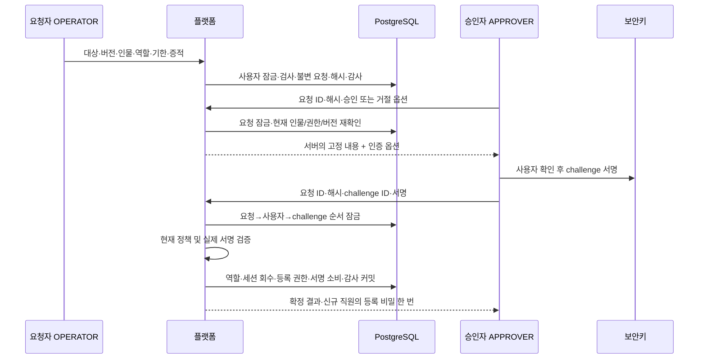

# 운영 역할 변경을 독립 승인과 업무별 보안키 서명에 묶기

운영자에게 역할을 부여하거나 바꾸는 정상 업무를 구현한다. 요청자·승인자·대상자가 서로 다른 사람인지 확인하고, 불변 요청의 내용과 승인·거절 동작에 묶인 WebAuthn 서명을 실행 직전에 검증한다. TypeScript 백엔드 개발자가 정책·트랜잭션·테스트를 직접 설명할 수 있도록 판단 근거와 한계를 남긴다.

- 확인일: 2026-10-22.
- 선행 구현: [운영자 MFA](014-operator-webauthn-mfa.md), [복구·권한 수명](015-operator-recovery-and-access-lifecycle.md).
- 적용 위치: Java 플랫폼. Rust 체결 코어·출력 워커·Kafka 계약·프론트는 수정하지 않는다.
- 이번 범위: 일반 역할 부여·변경과 **그 요청의 승인·거절에 대한 추가 인증**. 기존 거래 제한·복구·기한 재검토·긴급 회수·기기 폐기는 기존 정책을 유지한다. 이들 업무 전체에 추가 인증을 적용한 상태는 아니다.

> 후속 상태: [기존 승인 업무 확장](017-bound-approval-for-existing-operations.md)에서 네 업무의 인증 결합을 공유하고 역할 전용 단기 표·내부 메서드를 제거했다. 이 문서의 역할 전용 표·메서드와 “다음 사이클” 표기는 첫 구현 시점의 기록이다. 현재 API의 역할 승인 정책은 유지하며 복구·재검토·거래 제한에도 업무별 서명을 적용했다.

## 문제와 기존 동작

기존에는 전용 관리 JAR의 명시적 초기 부여만 가능했다. 일반 운영에서 요청·검토·승인으로 새 직원을 추가하거나 직무를 바꾸는 경로가 없었다. 최근 5분 이내 MFA도 해당 세션의 인증 수준만 나타냈다. 특정 직원의 특정 역할 변경을 승인했다는 증명으로 사용할 수는 없었다.

이에 따라 다음 조건을 함께 구현한다.

1. 금융 이력이 없는 별도 계정에만 처음 운영 역할을 부여한다.
2. OPERATOR가 요청하고 APPROVER가 승인한다. AUDITOR는 조회만 한다.
3. 요청자·승인자·대상자는 계정 ID와 실제 인물 UUID 모두 달라야 한다.
4. 요청 ID, 요청자 버전·인물, 대상 버전·인물, 이전/변경 역할, 기한, 사유, 신원·통지 증적 참조를 생성 때 고정한다.
5. 승인용 서명은 다른 요청·내용·세션·행위자·거절 동작에 쓸 수 없다.
6. 역할·세션 회수·등록 권한·서명 소비·공개키 카운터·성공 감사는 함께 커밋한다.

## 기존 제품과 공식 자료의 접근

| 근거 | 확인한 접근과 이번 적용 | 한계 |
|---|---|---|
| [Kraken Organizations](https://support.kraken.com/articles/about-organizations) | 자금 이동뿐 아니라 관리 변경·거버넌스 변경도 승인 대상에 포함한다. 우리도 권한 변경을 승인 업무로 취급한다. | 공개 제품 기능이며 내부 구현을 확인한 것은 아니다. |
| [IBKR Authorizers](https://www.ibkrguides.com/brokerportal/uar/authorizers.htm), [사용자 권한 변경](https://www.ibkrguides.com/adminportal/uar/modifyinguseraccessrights.htm) | 사용자 기능 권한과 업무별 승인자를 구분한다. 요청자와 독립 승인자의 현재 권한을 재확인한다. | 우리 역할 세 가지는 프로젝트의 현재 정책이다. IBKR의 권한 모델을 그대로 복제하지 않는다. |
| [OWASP 거래 승인 지침](https://cheatsheetseries.owasp.org/cheatsheets/Transaction_Authorization_Cheat_Sheet.html) | 서버가 내용을 고정하고 실행 직전 확인한다. 단기·일회성 인증과 승인 내용 표시 원칙을 따른다. | 보안키에 거래 내용을 표시하는 기능은 별도다. 브라우저 내용과 서버 응답의 일치를 후속 UI에서 검증해야 한다. |
| [Spring Security 7.1.1 Passkeys](https://docs.spring.io/spring-security/reference/servlet/authentication/passkeys.html) | 설치된 WebAuthn 검증기를 등록·로그인·업무 서명에서 재사용한다. | 기본 로그인 웹페이지는 활성화하지 않는다. 현재 Bearer API 계약을 유지한다. |
| [WebAuthn Level 3, 2026-08-25 권고안](https://www.w3.org/TR/2026/REC-webauthn-3-20260825/) | 서버가 만든 예측 불가능한 challenge, 정확한 RP·origin, 사용자 확인과 서명을 검증한다. | 일반 보안키의 서명이 직원·역할 정보를 키 화면에 표시했다는 뜻은 아니다. |

새 의존성은 추가하지 않았다. 실제 설치된 `spring-security-webauthn 7.1.1`, `WebAuthn4J 0.31.9.RELEASE`, 기존 JDBC 저장소·Jackson 매퍼의 타입과 동작을 확인했다. 서명 검증 부분을 `OperatorMfaService.verifyAssertion`으로 추출해 공유한다. 암호 알고리즘·표준 인증기를 직접 만들지 않는다.

### 국내 규제·심사와 연결하는 범위

[개인정보의 안전성 확보조치 기준](https://www.law.go.kr/LSW/admRulInfoP.do?admRulSeq=2100000281400)은 페이지 표기상 고시 제2026-9호, 2026-07-01 시행본임을 재확인했다. 이번 수집에서는 본문 조문이 추출되지 않아 조문별 적용·보존 기간을 새로 확인했다고 주장하지 않는다. 개인정보 취급자의 최소 권한·변경 이력 통제 준비와 연결하며 세부 적용 조건은 [기존 근거 표](../reference/access-control-compliance.md)에 남긴다.

[금융위·FIU의 2026-08-13 신고 매뉴얼 개정 안내](https://www.fsc.go.kr/po010104/87521)는 조직·전산설비·내부통제 등 개업 준비의 상위 근거다. 이 API만으로 신고 조건을 충족하지 않는다. [금융보안원 2023-12 금융권 ISMS-P 점검항목](https://www.fsec.or.kr/bbs/detail?bbsNo=11386&menuNo=247)은 적용 대상이 전자금융거래법·신용정보법의 금융회사·전자금융업자 등이라고 명시한다. 현물 가상자산 거래소가 해당 대상인지 별도 판단해야 한다. 금융권 수준의 권한 분리·검토·감사 관점으로 참고한다.

KISA 안내 페이지 일부는 502였고 개인정보 포털의 과거 자료 링크는 안내 화면으로 이동했다. 확인되지 않은 최신 안내서 내용이나 적용 의무를 보완해 추측하지 않는다. 법령·인증 전체 충족, 실물 기기 적합성, 실제 조직의 신원 확인·통지 이행은 미확인이다. CISSP/CISA 등 개인 자격은 검토 지식이며 이 시스템의 사업 인허가나 조직 인증을 대체하지 않는다.

## 선택과 트레이드오프

| 선택 | 얻는 점 | 비용·대안과 선택 이유 |
|---|---|---|
| 세 역할 중 하나, 최대 30일 기한 | 현재 정책이 명확하고 영구 권한을 피한다. | 사용자별 임의 권한·역할 조합은 제공하지 않는다. 아직 필요 없는 범용 정책 엔진을 만들지 않는다. |
| 요청자·승인자·대상자 세 인물 분리 | 스스로 자신의 권한을 높이는 경로를 막는다. | 최소 두 명의 활성 담당자가 다른 직원을 처리해야 한다. 소수 인력에서는 운영 부담이 크다. |
| 기존 직원의 역할 변경 때 키 유지, 세션 전부 회수 | 같은 사람의 확인된 키를 재사용하면서 권한 전환 후 재로그인을 강제한다. | 역할 변경마다 기기를 전부 재등록하는 방식보다 부담이 작다. 키 분실·침해는 별도 복구/회수로 처리한다. |
| 새 운영 계정은 금융 이력 없는 계정만 허용 | 고객 거래·원장 이력이 권한 전환으로 가려지지 않는다. | 거래 중인 고객 계정을 직원 계정으로 재사용할 수 없다. 금융 기록은 삭제하지 않는다. |
| 10분 요청, 2분 업무 challenge, 세션별 진행 옵션 하나 | 요청·서명의 노출 시간과 재사용 범위를 줄인다. | 탭을 여러 개 열면 새 옵션이 이전 옵션을 무효화한다. 기한은 이번 업무의 고정 정책이며 외부 표준의 법정 수치가 아니다. |
| 승인·거절 때 각각 별도 보안키 확인 | 최근 MFA를 다른 작업에 전용할 수 없다. | 매 건 사용자 확인이 필요하고 DB·서명 검증 비용이 든다. 엔진 처리 경로에는 영향이 없다. |
| 검증과 효과를 같은 트랜잭션으로 묶기 | 감사 실패 시 권한과 서명 소비를 함께 되돌린다. | 실패 후 같은 서명을 재시도할 수 있다. 성공 효과가 커밋되지 않았으므로 이 재시도는 중복 실행이 아니다. |
| 요청자 버전까지 고정 | 요청자가 역할을 바꿨다가 돌아와도 오래된 요청이 살아나지 않는다. | 사용자 이름 등 다른 버전 변경도 재요청을 요구한다. 현재는 보수적인 무효화가 단순하다. |

최초 관리 JAR는 계속 별도 OS·DB 관리 권한의 신뢰 경계다. 정상 직원 추가·변경은 이번 API를 사용한다. 관리 JAR를 일반 운영자가 실행할 수 있도록 배포하거나, DB 관리자 침해까지 이 승인으로 차단했다고 해석하면 안 된다. 관리 도구 접근의 별도 승인·기록·반출 통제와 사용 종료 정책은 운영 절차로 확보해야 한다. 코드가 관리 JAR를 두 번 사용한 뒤 자동 봉쇄하는 구조는 아니다.

## 구현과 관련 코드

| 파일 | 책임 |
|---|---|
| [OperatorRoleService](../../src/main/java/dustin/cex/domains/security/OperatorRoleService.java) | 불변 요청, 신원·역할·버전 재확인, 전용 계정 검사, 결정과 금융 기록 보존 |
| [OperatorRoleController](../../src/main/java/dustin/cex/domains/security/OperatorRoleController.java) | 역할 요청·인증 옵션·승인/거절·조회 API, 행위자 입력 배제 |
| [OperatorMfaService](../../src/main/java/dustin/cex/domains/security/OperatorMfaService.java) | 기존 검증기 공유, 업무 challenge 저장·서명 검증·일회성 소비·실패 제한 |
| [SecurityConfiguration](../../src/main/java/dustin/cex/domains/security/SecurityConfiguration.java) | HTTP 메서드·경로별 최소 역할, 기본 거부 |
| [security/schema.sql](../../src/main/resources/security/schema.sql) | 불변 역할 요청과 단기 challenge 두 표, 기존 감사·요청 이력 보존 |

### API 계약

기본 경로는 `/api/admin/operator-security`다. 화면/쿠키 로그인으로 이동하지 않는다. actor와 session은 검증한 Bearer 토큰에서만 가져온다. 이 경로의 응답은 `Cache-Control: no-store`다.

| 메서드·경로 | 허용 역할 | 입력·결과 |
|---|---|---|
| POST `/role-requests` | OPERATOR | `targetId`, `expectedVersion`, `personId`, `role`, `accessUntil`, `reason`, `identityEvidence`, `notificationEvidence` → 불변 payload·해시·상태 |
| POST `/role-requests/{id}/approve/options` | APPROVER | `payloadHash` → 서버 요청 전체·approve=true·authentication |
| POST `/role-requests/{id}/reject/options` | APPROVER | `payloadHash` → 서버 요청 전체·approve=false·authentication |
| POST `/role-requests/{id}/approve` | APPROVER | `payloadHash`, `proof:{challengeId,credential}` → 결정·최초 등록 비밀 또는 null |
| POST `/role-requests/{id}/reject` | APPROVER | 위와 동일하되 거절용 서명 필요 → 결정, 등록 비밀 null |
| GET `/role-requests?page=0` | 세 운영 역할 | 페이지당 50개, 0~10000 범위 |
| GET `/role-targets/{id}` | 세 운영 역할 | ID·버전·역할·활성 여부·인물·기한. 비밀번호·키 원문은 반환하지 않음 |

신규 직원의 등록 비밀은 32바이트 난수의 base64url 문자열이다. DB에는 SHA-256과 10분 만료만 저장한다. HTTP 응답으로 한 번 반환하고 목록·감사에는 원문이 없다. 승인 응답 유실 시 원문 재조회나 결정 재실행을 허용하지 않는다. 기존 복구 요청·승인으로 새 등록 권한을 발급한다. 실제 신원 확인, 직원에게 비밀 전달, 통지 수신은 조직이 수행하고 증적을 보관해야 한다.

### 실행 직전의 확인

- 대상이 활성 상태이고 버전이 동일해야 한다. 분실 복구 중인 대상의 역할은 바꿀 수 없다.
- 기존 직원의 인물 UUID를 역할 변경으로 수정할 수 없다. 비활성 계정 재활성화·운영자를 CUSTOMER로 전환하는 기능도 없다.
- 최초 부여는 주문 이력, 원장 이력, 사용 가능/예약 잔액, 과거 운영 초기화 흔적, 거래 제한을 검사한다. 잔액이 0이어도 과거 주문·원장이 있으면 거부한다.
- 요청자와 승인자의 현재 역할·접근 기한·인물·세션을 확인한다. 요청자는 요청 당시 사용자 버전도 같아야 한다.
- 승인자의 로그인은 여전히 5분 내 MFA여야 한다. 업무별 서명은 세션의 인증 시각·12시간 수명을 늘리지 않는다.
- 서명은 사용자·세션·요청 ID·해시·승인/거절·만료·미소비 조건을 모두 만족해야 한다. 등록된 키의 RP·origin·challenge·UV·소유자·서명·카운터 검증도 통과해야 한다.
- 사용자 확인이 없는 서명, 다른 키 소유자의 서명, 로그인용 서명은 거부한다. MFA 실패 5회/15분 제한을 기존 로그인 검증과 공유한다.

### 잠금과 실패 원자성

동일 요청의 승인·거절은 요청 행을 먼저 잠근다. 연관 사용자 ID를 정렬해 잠그고 challenge 행을 잠근다. 최초 부여와 고객 주문 접수는 같은 사용자 행에서 선후가 결정된다. 이미 금융 이력이 생겼으면 최종 승인에서 다시 거부한다. 이 잠금은 Java 플랫폼 DB의 정책이며 Rust 체결 코어의 무잠금 단일 스레드와 별개다.

성공 감사 저장 실패를 주입하면 역할·등록 비밀 해시·세션 회수·공개키 카운터·challenge 소비·요청 상태가 모두 롤백된다. 거부 시도는 별도 감사 트랜잭션으로 보존한다. DB/감사 장애를 인증 실패로 숨기지 않는다. 트리거·앱 통제는 슈퍼유저가 DB를 직접 조작하는 위협을 막지 않는다.

## 이해에 필요한 Java 문법과 원리

- `record Payload(...)`: 고정한 요청 필드의 자료형이다. TypeScript의 읽기 전용 DTO와 비슷하지만 Java는 생성 시 타입·필드를 가진 객체를 만든다. record의 참조 필드가 깊게 불변이 되는 것은 아니다. 이 payload는 문자열·UUID·Instant·enum으로 구성한다.
- `UserRole` enum: 임의 문자열 권한이 아닌 현재 허용한 네 가지 역할이다. 신규 부여에는 CUSTOMER를 거부한다.
- `TransactionTemplate.execute`: 콜백 안의 JPA·JDBC·표준 검증기 저장 작업이 같은 DB 트랜잭션을 사용한다. 비동기로 따로 커밋하는 방식이 아니다.
- `requireBusinessTransaction`: 업무별 추가 인증 도우미를 트랜잭션 밖에서 호출해 서명만 소비하는 실수를 막는다. package 접근으로 같은 보안 모듈의 역할 서비스에서만 호출한다.
- `Instant.truncatedTo(MICROS)`: PostgreSQL 저장 정밀도에 먼저 맞춘다. 생성 때 나노초를 해시에 넣고 조회 때 마이크로초로 바뀌는 문제를 피한다.
- `json.writeValueAsString(payload)` 후 SHA-256: 필드 순서가 고정된 DTO를 서버 매퍼로 직렬화한다. 사유에 `|`가 있어도 문자열 연결 구분자가 모호해지지 않는다. 클라이언트가 임의로 직렬화한 값을 권위로 삼지 않는다.
- `Long` 객체끼리는 `.equals`로 비교한다. 사용자 ID와 primitive `long`의 `==`는 자동 언박싱으로 값 비교다. 이 테스트도 ID 1000부터 시작해 작은 정수 캐시 때문에 오류가 가려지지 않게 한다.

## 작성한 테스트

신규 파일은 [OperatorRoleTest](../../src/test/java/dustin/cex/domains/security/OperatorRoleTest.java), 실행기는 [verify_operator_roles.py](../../scripts/verify_operator_roles.py)다. 실행 소유 임시 PostgreSQL 16을 임의 포트에 만들고 마지막에 제거한다. 서비스의 서명 성공을 모킹하지 않고 기존 [SoftwareAuthenticator](../../src/test/java/dustin/cex/domains/security/SoftwareAuthenticator.java)의 실제 P-256/ECDSA 서명을 사용한다. 역할별 API·실패 주입에는 MockMvc를 사용하고 별도 테스트는 임의 포트의 실제 Tomcat/HTTP도 통과한다. 테스트용 키는 실물 기기나 브라우저 검증 증적이 아니다.

| 테스트 함수 | 시나리오·기대 결과 |
|---|---|
| `grantsEachOperatorRoleOnlyAfterIndependentSignature` | OPERATOR·APPROVER·AUDITOR 세 역할 각각 서명 승인 뒤에만 부여 |
| `grantRequiresNewPasswordSigninRegistrationAndSignature` | 신규 직원은 기존 고객 세션이 무효이고 로그인·키 등록·서명까지 거쳐야 운영 API 허용 |
| `changedRoleKeepsKeysButRecallsAllSessionsAndPendingOptions` | 기존 직원의 역할 변경은 키를 보존하고 세션·진행 중 로그인 옵션을 회수 |
| `secretIsHashedNeverLoggedOrReadBackAndDecisionCannotReplay` | 등록 비밀 해시 저장, 로그·목록·디버그 원문 배제, 성공 재실행 거부 |
| `rejectionNeedsItsOwnSignatureAndDoesNotChangeTarget` | 거절용 서명 필요, 역할·등록 권한 변화 없음 |
| `recentMfaAndPasswordAloneCannotApprove` | 최근 로그인 MFA만 있고 업무 서명이 없으면 거부 |
| `ordinaryLoginAssertionCannotAuthorizeRole` | 로그인용 challenge 서명을 역할 승인에 사용 불가 |
| `requestHashAndIdAreBoundToProof` | 다른 요청 ID·해시로 바꿔치기 거부, 원래 요청만 실행 |
| `approveAndRejectProofsAreNotInterchangeable` | 승인 서명과 거절 서명의 상호 전용 거부 |
| `proofCannotMoveToAnotherApprover` | 다른 승인자로 서명 전용 불가 |
| `proofCannotMoveToRefreshedSession` | 같은 계정이라도 갱신 후 다른 세션에 서명 전용 불가 |
| `expiredChallengeCannotExecute` | 만료 challenge 실행 거부 |
| `newOptionsInvalidatePreviousChallengeAndDoNotExtendSessionMfa` | 새 옵션으로 이전 옵션 폐기, MFA 시각·세션 수명 연장 없음 |
| `actualSignatureValidationRejectsTampering` | origin·UV·서명·소유자·카운터·client challenge 여섯 변조 각각 거부 |
| `fiveInvalidProofsLimitFurtherOptionsAndDecision` | 잘못된 증명 5회 후 옵션·결정 429, 제한 이후 원래 실패 수 유지 |
| `requesterCheckerAndTargetMustBeDifferentActualPeople` | 동일 계정 및 같은 사람의 다른 계정에서 자기 권한 변경 거부 |
| `targetVersionChangeAfterOptionsBlocksEffect` | 옵션 발급 후 대상 버전 변경 시 효과 없음 |
| `changedRequesterIdentityOrRevokedRightsBlockPreviouslySignedApproval` | 요청자 권한 회수·인물 변경 후 기존 서명 실행 거부 |
| `disabledOrExpiredApproverCannotExecuteSignedRequest` | 승인자 접근 기한 만료 후 서명 실행 거부 |
| `staleAndRevokedSessionCannotBypassWithDirectServiceCalls` | HTTP 필터를 거치지 않은 직접 서비스 호출도 오래된·회수 세션 거부 |
| `disabledRecoveryLockedAndSameRoleTargetsAreDenied` | 비활성·복구 중·같은 역할로 무의미한 변경 거부 |
| `existingPersonCannotBeReassignedByRoleChange` | 역할 변경에 인물 UUID 변경을 끼워 넣을 수 없음 |
| `deadlineRoleAndEvidenceAreStrictlyValidated` | 과거/30일 초과 기한·CUSTOMER 부여·증적 원문 거부 |
| `positiveOrLockedBalanceCannotBecomeOperator` | 가용 잔액·예약 잔액이 있는 고객 전환 거부 |
| `financialStateCreatedAfterRequestPreventsGrant` | 요청 뒤 금융 상태가 생겨도 최종 승인에서 거부 |
| `restrictedOrPreviouslyUsedOperatorCandidateCannotBeGranted` | 거래 제한·운영 인물 흔적이 있는 고객 전환 거부 |
| `concurrentApprovalHasOneWinnerAndOneEnrollment` | 동시 두 승인 중 한 건 성공, 등록 권한·성공 감사 하나 |
| `competingRequestCannotOverwriteNewRole` | 같은 대상의 다른 요청으로 이미 변경한 역할을 덮어쓸 수 없음 |
| `auditFailureRollsBackRoleSessionEnrollmentCounterAndProofConsumption` | 최종 감사 실패 시 역할·세션·등록 권한·카운터·서명 소비·상태 롤백, 미확정 증명 재시도 가능 |
| `requestAuditFailureLeavesNoPendingRequest` | 요청 감사 실패 시 불완전한 요청 저장 없음 |
| `immutableRequestCannotBeEditedDeletedTruncatedOrReopened` | 불변 요청 수정·삭제·초기화·재개 거부 |
| `storedPayloadHashMatchesReturnedMicrosecondPrecisionJson` | 저장·조회 정밀도와 JSON 해시 일치, 화면에 서버 요청 반환 |
| `expiredRequestCannotIssueOptionsOrExecute` | 만료 불변 요청의 옵션 발급·효과 실행 거부 |
| `actualHttpRoleFlowRejectsUnsignedAndUsesNoStore` | MockMvc로 요청→옵션→실제 서명 승인, 비밀번호만 제출 거부와 캐시 금지 |
| `httpRolesDenyCustomerMakerAndAuditorApprovalOptions` | 고객·요청자·감사자 승인 권한 없음, 미인증 401, 감사 조회·페이지 제한 |
| `requesterRoleRoundTripStillInvalidatesOlderRequest` | 요청자가 역할을 바꿨다 돌아와도 예전 요청 무효 |
| `cancelledOrderHistoryCannotBeErasedByZeroBalanceRoleConversion` | 현재 잔액이 없어도 취소 주문 이력 보존 및 고객 전환 거부 |
| `zeroCurrentBalanceDoesNotHideHistoricalLedgerEntries` | 현재 잔고가 없어도 원장 이력이 있으면 고객 전환 거부 |
| `oldCustomerAccessCannotCreateOrderAfterApprovedRoleChange` | 역할 변경 후 기존 고객 권한으로 새 주문 접수 불가 |
| `authorizationHelpersCannotRunOutsideBusinessTransaction` | 업무 트랜잭션 없는 서명 옵션·소비 내부 호출 거부 |
| `realHttpServerBindsApprovalAndRejectsOldCustomerSession` | 실제 임의 포트 HTTP에서 옵션→서명→승인, 이전 고객 토큰 401, 동일 승인 재실행 409 |

## 실행 명령과 결과

macOS·Temurin 21·PostgreSQL 16의 실행 소유 임시 컨테이너에서 검증했다. 봇은 0명이며 기존 PostgreSQL 5432/5433/5435와 Kafka 9092에는 테스트를 연결하지 않았다. 최종 선택 JUnit **350개**, 실패·오류·제외 **0개**다. 별도 실제 프로세스 시나리오 **12개**도 모두 통과했다. 전체 저장소 테스트나 운영 환경 검증을 뜻하지 않는다.

| 실행 명령 | 최종 결과 | 범위 |
|---|---|---|
| `python3 scripts/verify_operator_roles.py` | 48/48, 제외 0 | 신규 함수 41개에 역할 3개·변조 6개 매개변수 사례 포함. 실제 ECDSA·PG·MockMvc·임의 포트 HTTP |
| `python3 scripts/verify_operator_lifecycle.py` | 37/37, 제외 0 | 복구·회수·기기·권한 수명과 큰 Long ID 회귀 |
| `python3 scripts/verify_operator_mfa.py` | 42/42, 제외 0 | 기존 등록·로그인·UV·RP·origin·세션·기기 검증 |
| `python3 scripts/verify_platform_security.py` | 39/39, 제외 0 | 기존 접근·거래 제한 승인·감사·초기 관리 도구 서비스 |
| `python3 scripts/verify_engine_inbox.py` | 183/183, 제외 0 | 금융·주문·수수료·정산·수신 멱등성·시장 경로 회귀 |
| `./gradlew operatorAdminJar bootJar jmhClasses writeDependencyInventory --console=plain` | 종료 0 | 두 JAR·JMH 코드 컴파일·의존성 목록. 성능 측정은 아님 |
| `python3 scripts/verify_operator_admin.py` | 프로세스 시나리오 2/2 | 실제 전용 관리 JAR 4회 호출, 금융 고객·중복 부여 거부와 DDL/웹/금융 워커 배제 |
| `python3 scripts/verify_order_idempotency.py` | 프로세스 시나리오 10/10 | 실제 일반 JAR 두 번 기동, 동시 주문·응답 유실·재시작·금융 롤백 |
| `python3 scripts/verify_market_path.py` | 1/1, 제외 0 | 실제 Java HTTP·Rust 엔진·PG·격리 Kafka·시장 공개·정산·독립 대사 |
| `python3 scripts/audit_dependencies.py` | 222개 버전, 알려진 OSV 검출 0 | 조회 시점 기준이며 모든 취약점 부재 보장은 아님 |
| `python3 scripts/verify_dependency_integrity.py` | 통과 | 임시 사본의 잘못된 체크섬을 Gradle 종료 1로 차단. 원본 캐시 미수정 |

확정한 결과는 [검증 증적 JSON](../reference/operator-role-verification-2026-10-22.json)에 보관한다. 의존성 목록 SHA-256은 `590da8748d7e2940dbc56dfe714c8c4cab4d1e5ed9b0be72dbf14e024e79268a`로 선행 사이클과 같다. 새 패키지·버전·잠금·체크섬 메타데이터 변경은 없다. 테스트가 소유한 컨테이너와 임시 DB를 정리했고 기존 서비스는 유지했다.

컴파일의 기존 deprecated API 경고와 테스트 JVM 공유 경고를 확인했다. JMH 실행·성능 벤치마크·EC2/Linux·실물 보안키·브라우저·운영 TLS·배포는 수행하지 않았다. 문서의 로컬 링크와 신규 테스트 함수 41개의 연결도 확인했다.

### 검증 중 확인한 문제

실제 HTTP 테스트를 보강하는 과정에서 `LocalServerPort`의 패키지를 잘못 지정해 테스트 컴파일이 한 번 실패했다. 기존 `OperatorMfaTest`와 실제 설치 타입을 확인해 `org.springframework.boot.test.web.server.LocalServerPort`로 수정했다. 실패 로그는 로컬 `.local/operator-roles-http-compile-before.log`에 남겼다. 이 실패는 제품 업무 실행 실패와 구분하고 최종 재실행 결과를 아래 증적에 기록한다.

## 남은 범위와 운영 조건

- 기존 복구·권한 기한 재검토·거래 제한 승인에는 이번 업무별 서명을 아직 연결하지 않았다. 각각 기존 인증 정책을 유지한다. 다음 사이클의 우선 범위는 **기존 승인 업무의 서명 연결과 비밀번호 재인증 경로 제거**다.
- 최초 관리 JAR·DB/OS 관리자에 대한 접근 승인·사용 종료·외부 증적은 운영 책임이다. 이번 정상 API가 관리 권한자의 직접 DB 수정까지 막지 않는다.
- 인물 UUID와 신원·통지 참조의 진실성은 외부 인사/신원 확인 절차에 의존한다. UUID 세 개가 다르다고 현실의 세 사람이 검증된 것은 아니다.
- 키 화면에 역할 내용을 표시하는 기기 기능, 브라우저에서의 내용 확인·변조 방어, 실물 키·모바일·운영 HTTPS 검증은 수행하지 않았다. 이번 서명은 서버 저장 업무와의 결합을 보장한다.
- 직원의 역할·세션 변경은 진행 중인 이미 확정된 금융 거래를 되돌리지 않는다. 새 입출금 같은 금융 변경 경로를 추가하면 동일한 사용자 상태 잠금·정책을 반드시 연결해야 한다.
- 신규 역할 표 두 개를 만들지만 기존 금융·감사 기록을 옮기거나 삭제하는 마이그레이션·호환 분기를 만들지 않는다. 기존 로컬 서비스 DB에 실행·배포하지 않는다.
- TLS·네트워크 제한·비밀 전달·외부 감사 저장·최소 DB 권한·경보·실제 조직 심사·KYC/AML·수탁 업무는 후속 범위다. 디스크·호스트 손실 대비 별도 복제·백업은 문서 요구사항으로 유지한다.

## 관련 커밋

구현·테스트 커밋은 [`0c8307c`](https://github.com/GiHoon1123/Cex-Platform-Service/commit/0c8307c5467bfe50f7535a184615674f793b328b)이다. 문서 커밋과 일반 푸시의 원격 main/로컬 HEAD 일치 결과는 공통 [사이클 기록](../../../docs/roadmap/operator-role-approval.md)에 남긴다.
