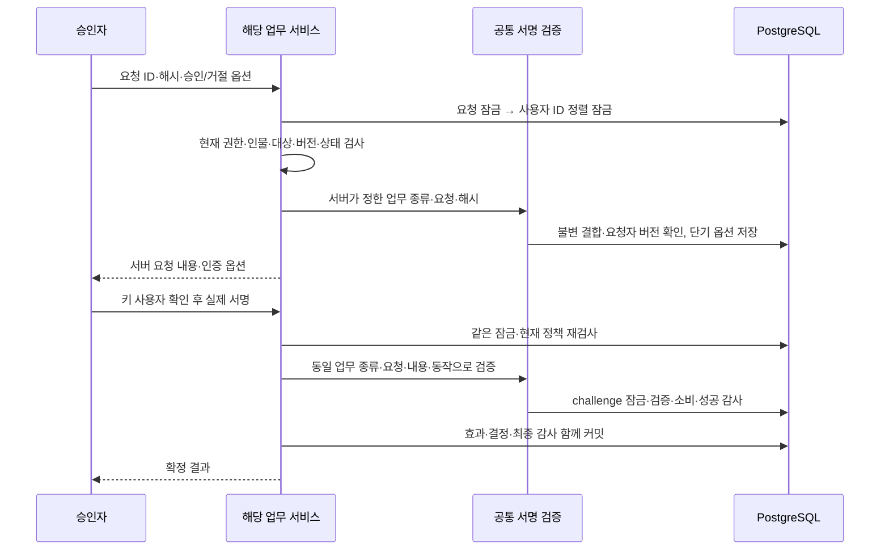

# 복구·권한 재검토·거래 제한 승인을 업무별 보안키 서명으로 확정하기

기존 역할 승인에 쓰던 업무별 서명을 복구·권한 기한 재검토·고객 거래 제한 승인과 거절까지 적용한다. 비밀번호만 받던 승인 경로를 제거하고, 업무 종류·고정 내용·현재 인물·권한·세션을 실행 직전에 검증한다. 기존 요청과 금융·감사 기록은 보존한다.

- 작성일: 2026-10-22.
- 독자: TypeScript 백엔드 개발을 주력으로 하며 금융 업무·동시성·보안 판단을 코드와 함께 설명할 프로젝트 소유자.
- 선행 기록: [역할 승인과 업무별 서명](016-operator-role-approval-and-bound-authentication.md), [복구와 권한 수명](015-operator-recovery-and-access-lifecycle.md).
- 변경 위치: Java 플랫폼. Rust 단일 스레드 체결 코어·출력 워커·프론트·봇 설정은 수정하지 않는다.

## 문제와 기존 동작

역할 부여·변경은 별도 서명을 요구했지만 복구와 권한 기한 재검토는 최근 MFA만으로 결정할 수 있었다. 고객 거래 제한·해제는 최근 MFA와 비밀번호 재입력을 사용했다. 로그인 인증과 특정 업무에 대한 동의가 서로 다른데도 같은 의미로 쓰일 여지가 있었다.

이번에는 네 업무를 명시적으로 구분한다.

| 업무 종류 | 실행 서비스 | 결정의 효과 |
|---|---|---|
| `ROLE` | `OperatorRoleService` | 신규 운영 역할·직무 변경·기한 부여와 대상 세션 회수 |
| `MFA_RECOVERY` | `OperatorLifecycleService` | 분실 키 폐기·한 번만 반환하는 단기 재등록 권한 |
| `ACCESS_REVIEW` | `OperatorLifecycleService` | 최대 30일 내 접근 기한 재검토·세션 회수 |
| `TRADING_RESTRICTION` | `OperatorApprovalService` | 고객 신규 주문 제한 또는 해제 |

업무 종류는 서버가 요청을 읽어 결정한다. 클라이언트가 임의 업무 이름·명령·인증 방식을 선택하는 API는 없다. 각 업무의 요청·대상 검사·효과 실행은 기존 도메인 서비스에 둔다.

## 기존 제품과 공식 자료의 접근

| 공식 근거 | 이번 적용 | 확인 범위 |
|---|---|---|
| [Kraken Organizations](https://support.kraken.com/articles/about-organizations), 페이지 갱신 2026-08-17 | 관리 변경에도 승인 절차를 두는 공개 제품 패턴을 채택 | 제품 기능만 확인했다. 내부 DB·검증 구현을 추측하지 않는다. |
| [IBKR Authorizers](https://www.ibkrguides.com/brokerportal/uar/authorizers.htm) | 업무 기능별 승인자와 현재 권한을 분리 | 다단계 승인 수·정족수 설정 엔진까지 도입하지 않는다. |
| [OWASP Transaction Authorization](https://cheatsheetseries.owasp.org/cheatsheets/Transaction_Authorization_Cheat_Sheet.html) | 서버가 내용·절차를 통제하고 실행 직전 일회성·단기 증명을 확인 | 브라우저 표시 내용과 서버의 일치, 서명 재사용 방지 관점을 적용한다. |
| [Spring Security 7.1.1 Passkeys](https://docs.spring.io/spring-security/reference/servlet/authentication/passkeys.html) | 설치된 WebAuthn4J 기반 검증기와 JDBC 키 저장소 공유 | 새 암호 구현·라이브러리·기본 로그인 웹페이지를 추가하지 않는다. |
| [개인정보의 안전성 확보조치 기준](https://www.law.go.kr/LSW/admRulInfoP.do?admRulSeq=2100000281400) | 접근 권한 변경·검토·감사 통제 준비와 연결 | 페이지상 고시 제2026-9호, 2026-07-01 시행 표기를 재확인했다. 조문 본문은 이번 추출에 없으므로 세부 의무 전체를 확인했다고 주장하지 않는다. |
| [금융보안원 금융권 ISMS-P 점검항목](https://www.fsec.or.kr/bbs/detail?bbsNo=11386&menuNo=247), 2023-12 판본 | 역할 분리·중요 업무 인증·감사·권한 회수 검토 관점 | 적용 대상인 금융회사·전자금융업자 등과 현물 가상자산 거래소의 사업 분류를 구분한다. |

사업 신고·인가, 개인정보 취급 범위, 인증 기준과 자율 강화는 [기존 근거 대조표](../reference/access-control-compliance.md)를 따른다. 이 구현은 KYC/AML·고객 자산 수탁·조직 운영·인허가·인증 전체 완료를 의미하지 않는다. 개인 자격증의 지식 범위와 사업 허가·조직 인증을 구분한다.

## 선택과 트레이드오프

| 선택 | 얻는 점 | 비용·대안과 이유 |
|---|---|---|
| 네 업무가 같은 서명 검증 경로 사용 | RP·origin·challenge·UV·키 소유자·서명·카운터 검증의 차이를 줄인다. | 공통 저장 계약이 생긴다. 실제 사용 중인 네 종류의 인증 결합만 공유하고 실행 서비스는 합치지 않는다. |
| 업무 종류까지 증명에 결합 | 같은 UUID·내용 해시가 다른 업무에 있어도 증명을 전용할 수 없다. | 요청 ID·해시만 비교하는 방식보다 필드가 하나 늘어난다. 서로 다른 업무의 의미를 분리하는 데 필요하다. |
| 불변 승인 결합 정보 별도 보관 | 요청 당시 담당자 버전을 고정하며 원래 요청·감사 표의 이력을 유지한다. | 표가 하나 늘고 요청과 같은 트랜잭션에 삽입해야 한다. 오래된 이력에 버전을 추측해 채우지 않는다. |
| 과거 결합 정보 없는 요청은 조회만 허용 | 과거 감사 이력을 보존하면서 새 정책의 우회 실행을 막는다. | 과거 대기 요청은 재신청해야 한다. 호환 인증·비밀번호 폴백·자동 이전을 만들지 않는다. |
| 최근 5분 MFA와 별도의 2분 서명 모두 요구 | 현재 운영 세션과 해당 업무 동의를 함께 확인한다. | 5분이 지나면 새 로그인 MFA가 먼저 필요하다. 해당 인증으로 세션 수명을 연장하지 않는다. |
| 한 세션에서 진행 중 업무 옵션 하나 | 업무 간 오래된 옵션의 재사용 범위를 줄인다. | 다른 탭·다른 업무의 새 옵션을 받으면 이전 옵션이 무효다. |
| 최종 감사와 서명 소비를 업무 효과에 함께 커밋 | 장애 시 일부 권한·고객 상태만 바뀌는 결과를 방지한다. | DB 트랜잭션·서명 검증 비용이 추가된다. 미확정 실패 후에는 같은 증명의 정상 재시도를 허용한다. |
| 긴급 회수·분실 신고의 즉시 차단 유지 | 승인 대기 때문에 침해 확산 차단이 늦어지지 않는다. | 모든 운영 POST를 같은 승인 절차로 강제하지 않는다. 업무별 위험과 효과를 구분한다. |

신원·통지 참조는 외부 증적을 가리킬 뿐 실제 신원 확인·직원 통지·수신 완료 자체를 입증하지 않는다. 기존 비웹 관리 JAR와 DB/OS 관리자 신뢰 경계도 유지한다. 관리자 침해를 이 승인 API가 막았다고 설명하지 않는다.

## 구현과 관련 코드

### 공통 인증의 저장 계약

[security/schema.sql](../../src/main/resources/security/schema.sql)에 다음 두 표를 둔다.

- `operator_approval_bindings`: `kind + request_id`를 기본키로 한다. 요청자 ID·요청 당시 버전·내용 해시·만료를 불변 보관한다. 변경·삭제·초기화 트리거를 두며 업무 결정 뒤에도 남긴다.
- `operator_authorization_challenges`: 사용자·세션·업무 종류·요청 ID·해시·승인/거절·옵션·기한·소비 여부를 저장한다. 결합 정보의 복합키를 외래키로 참조한다. 개인키·원본 인증 서명은 저장하지 않는다.

옛 `operator_role_challenges`는 단기 인증 옵션이므로 폐기한다. 역할 요청·복구 요청·거래 제한 요청·감사·금융 기록은 삭제하지 않는다. 과거 결합 정보를 자동으로 만들거나 과거 비밀번호 요청을 실행하는 경로는 없다. 기존 로컬 DB에는 배포하지 않는다.

[OperatorMfaService](../../src/main/java/dustin/cex/domains/security/OperatorMfaService.java)의 package 범위 내부 메서드는 다음 역할을 담당한다.

1. `bindApproval`: 요청과 같은 트랜잭션에 요청 당시 담당자 버전·고정 내용을 추가한다.
2. `approvalOptions`: 업무 서비스가 요청·사용자를 잠그고 현재 정책을 검사한 뒤 인증 옵션을 만든다. 결합 정보와 담당자 버전이 현재 상태와 같은지 확인한다.
3. `authorizeApproval`: 같은 업무 트랜잭션에서 결합 정보와 세션을 재확인하고, 표준 검증기로 실제 서명을 검증한다. challenge를 소비하고 성공 감사에 업무 종류·해시·사용한 키 지문을 남긴다.

옵션 생성·검증은 기존 설치 의존성 `spring-security-webauthn 7.1.1`, `WebAuthn4J 0.31.9.RELEASE`를 사용한다. 외부 인증 방식이나 범용 실행기 설정을 도입하지 않는다. 새 의존성·잠금 파일 변경은 없다.

### 각 업무의 최종 검사

| 코드 | 검사와 효과 |
|---|---|
| [OperatorApprovalService](../../src/main/java/dustin/cex/domains/security/OperatorApprovalService.java) | 요청·결정 모두 서비스 안에서 현재 세션 검사. 요청자·승인자 실제 인물 분리, 고객 역할·활성 여부·버전·현재 제한 상태, 요청 해시·만료·대기 상태 확인. 비밀번호 의존성과 검증 분기 제거. |
| [OperatorLifecycleService](../../src/main/java/dustin/cex/domains/security/OperatorLifecycleService.java) | 옵션·최종 결정이 같은 대상·인물·현재 권한 검사를 공유. 복구와 재검토의 종류를 서버에서 결정하고 해당 서명 요구. 분실 신고 직후 차단·거절 후 차단 유지·세션 회수·등록 비밀 일회성 반환 유지. |
| [OperatorRoleService](../../src/main/java/dustin/cex/domains/security/OperatorRoleService.java) | 기존 역할 승인 정책을 공통 인증 결합 경로에 연결. 대상 키·세션·금융 기록 보존 정책 유지. |
| [OperatorController](../../src/main/java/dustin/cex/domains/security/OperatorController.java), [OperatorLifecycleController](../../src/main/java/dustin/cex/domains/security/OperatorLifecycleController.java) | 인증 옵션과 최종 서명 DTO. 사용자·세션은 검증한 Bearer에서 가져오며 비밀번호 입력 필드는 제거. |
| [SecurityConfiguration](../../src/main/java/dustin/cex/domains/security/SecurityConfiguration.java) | 승인·거절 옵션도 APPROVER에게만 허용. 검토하지 않은 경로는 계속 거부. |
| [JwtAuthenticationFilter](../../src/main/java/dustin/cex/domains/auth/middleware/JwtAuthenticationFilter.java) | `/api/admin/` 응답 전체에 `Cache-Control: no-store`. |

고객 상태가 옵션 발급 후 바뀌면 최종 결정은 거부된다. 거절 역시 현재 대상이 달라진 오래된 요청으로 처리하지 않는다. 기존 로그인 비밀번호 추측 제한과 로그인 자체는 유지한다. 제거한 것은 거래 제한 **승인의 비밀번호 재인증**이다. 과거의 비밀번호 재인증 감사 기록은 읽기·보존한다.

### API 순서

| 업무 | 경로 시작점 | 옵션과 결정 |
|---|---|---|
| 복구·권한 기한 재검토 | `/api/admin/operator-security/requests/{id}` | POST `/approve/options` 또는 `/reject/options` 후 해당 `/approve` 또는 `/reject` |
| 거래 제한·해제 | `/api/admin/requests/{id}` | 위와 동일 |
| 역할 부여·변경 | `/api/admin/operator-security/role-requests/{id}` | 기존 외부 경로 유지, 공통 검증 경로로 연결 |

옵션 요청은 `{payloadHash}`다. 응답은 `{request,approve,authentication:{challengeId,publicKey}}`로 서버가 보관한 내용을 반환한다. 최종 결정은 `{payloadHash,proof:{challengeId,credential}}`다. 비밀번호만 보내거나 proof를 생략하면 거부한다. 업무별 서명은 로그인용 서명과 서로 대체할 수 없다.



## 이해에 필요한 문법과 원리

- `enum ApprovalKind`: 구현된 네 업무를 컴파일 단계에서 제한한다. TypeScript 문자열 리터럴 유니온과 비슷한 용도다. 임의 문자열로 실행할 서비스를 찾는 패턴이 아니다.
- package 접근 메서드: `public`이 없는 메서드는 같은 보안 패키지에서만 사용한다. HTTP 클라이언트가 업무 종류를 직접 골라 호출하는 일반 인증 API를 만들지 않는다.
- 복합 기본키·외래키: UUID가 같아도 `ROLE`과 `MFA_RECOVERY`는 다른 결합 정보다. DB와 서명 조회가 같은 업무 종류를 확인한다.
- JPA `@Version`과 JDBC 비교: 현재 사용자 버전과 요청 당시 버전을 값으로 비교한다. 역할을 바꿨다가 돌아와도 버전은 증가하므로 예전 요청이 되살아나지 않는다.
- `TransactionTemplate`의 기본 전파: 중첩 호출도 같은 업무 트랜잭션에 참여한다. 실패 시 공개키 카운터·서명 소비·업무 상태·감사가 함께 롤백된다. 거부 시도는 별도 감사 트랜잭션으로 보존한다.
- 단일 스레드 엔진과 DB 잠금: 여기의 잠금은 Java 플랫폼의 운영 보안 상태와 승인 경쟁을 제어한다. Rust 코어에 락·입출력 대기를 추가하는 작업이 아니다.

### 현재 코드로 연결해 읽기

업무 종류·요청·해시·결정 방향·세션에 묶인 일회용 옵션만 조회한다. 아래는 2026-10-25 현재 [실제 소스](../../src/main/java/dustin/cex/domains/security/OperatorMfaService.java#L119)의 연속 행 발췌다. 메서드 일부일 수 있으므로 독립 실행 예제로 사용하지 않고 앞뒤 검증과 함께 읽는다. 과거 사이클의 코드/측정 시점은 본문의 기록을 유지한다.

```java
public void authorizeApproval(long actor,UUID sid,ApprovalKind kind,UUID requestId,String payloadHash,boolean approve,AuthorizationProof proof) {
    requireBusinessTransaction();
    operation(actor,()->{
        requireFresh(lock(actor,sid));
        checkBinding(kind,requestId,payloadHash);
        if(proof==null || proof.challengeId()==null || proof.credential()==null) throw denied();
        var rows=jdbc.queryForList("""
            SELECT options FROM operator_authorization_challenges WHERE id=? AND user_id=? AND session_id=?
             AND kind=? AND request_id=? AND payload_hash=? AND approve=? AND NOT consumed AND expires_at>clock_timestamp() FOR UPDATE
            """,proof.challengeId(),actor,sid,kind.name(),requestId,payloadHash,approve);
        if(rows.isEmpty()) throw denied();
        var key=verifier.verifyAssertion(actor,(String)rows.getFirst().get("options"),proof.credential());
        jdbc.update("UPDATE operator_authorization_challenges SET consumed=true WHERE id=?",proof.challengeId());
        // 서명 소비·공개키 카운터·업무 변경·감사는 같은 업무 트랜잭션에서 확정된다.
        audit.record(actor,"APPROVAL_AUTHORIZATION","request:"+requestId,"SUCCESS",
            kind+":"+(approve?"APPROVE:":"REJECT:")+payloadHash+":key="+sha256Hex(key.getRawId().toBase64UrlString()));
        return null;
    });
}
```

SQL 조건의 `kind`가 같은 서명을 다른 업무에 쓰지 못하게 한다. `FOR UPDATE`는 같은 옵션의 동시 소비를 직렬화하며, 본문 뒤의 실제 서명 검증·카운터·감사도 같은 업무 트랜잭션이다. 현재는 EDD 종류도 함께 지원한다.

## 작성·수정한 테스트

[BoundApprovalTest](../../src/test/java/dustin/cex/domains/security/BoundApprovalTest.java)는 실제 임시 PostgreSQL, 새 P-256 키와 ECDSA 서명, 임의 포트의 실제 HTTP 서버를 사용한다. 서명 성공을 모킹하지 않는다. [OperatorRoleTest](../../src/test/java/dustin/cex/domains/security/OperatorRoleTest.java), [OperatorLifecycleTest](../../src/test/java/dustin/cex/domains/security/OperatorLifecycleTest.java), [PlatformSecurityTest](../../src/test/java/dustin/cex/domains/security/PlatformSecurityTest.java)의 기존 사례도 새 서명 계약으로 갱신한다.

기존 접근 통제 테스트의 일반 역할 전용 fixture 일부는 논리적으로 인증된 세션을 직접 만든다. 거래 제한 승인 검증은 실제 등록·서명을 거친 승인자를 사용하며, 신규 네 업무 통합 테스트는 요청자·승인자·대상자를 실제 키 등록과 인증으로 준비한다. 소프트웨어 테스트 키는 실물 키·브라우저·운영 TLS 검증 증적이 아니다.

| 신규 테스트 함수 | 시나리오·기대 결과 |
|---|---|
| `eachWorkflowRequiresItsOwnSignature` | 네 업무 각각 proof 없는 결정 거부, 올바른 서명 뒤 해당 업무 효과만 확정 |
| `rejectionHasIndependentSignatureAndNoBusinessEffect` | 승인·거절 증명 상호 전용 거부, 거절 후 효과 없음, 복구 차단은 유지 |
| `hashExpiryAndSuccessfulReplayAreChecked` | 내용 해시 바꿔치기·만료 서명·성공 결정 재실행 거부 |
| `signatureCannotMoveToRefreshedSession` | 같은 승인자의 갱신된 다른 세션에 증명을 전용할 수 없음 |
| `loginSignatureAndMissingUserVerificationCannotExecute` | 로그인용 challenge·UV 없는 실제 서명으로 승인 불가 |
| `requesterRoleRoundTripInvalidatesExistingProof` | 요청자가 역할을 바꿨다가 돌아온 경우에도 이전 증명 무효 |
| `businessAuditFailureRestoresProofCounterAndBusinessState` | 최종 감사 실패 때 효과·카운터·서명 소비·성공 감사 롤백, 미확정 증명 재시도 가능 |
| `concurrentApprovalsHaveExactlyOneWinner` | 동일 증명을 동시 승인해도 한 건만 성공하고 성공 인증 감사 하나 |
| `fiveInvalidProofsSharePersistentMfaLimit` | 5회 잘못된 증명 뒤 결정·옵션 모두 429, 금융·권한 효과 없음 |
| `bindingHistoryCannotBeChangedOrDeleted` | 결정 뒤에도 결합 이력을 보존하며 변경·삭제·초기화 거부 |
| `realHttpRequiresProofReturnsServerContentAndNeverCaches` | 실제 임의 포트 HTTP의 네 업무 옵션→서명→결정, 비밀번호 단독 400·내용 반환·no-store·재실행 409 |
| `onlyApproverCanObtainWorkflowOptions` | 요청자·감사자는 옵션 403, 복구 정지 대상은 인증 401 |
| `identicalIdsAndHashesAcrossWorkflowsDoNotShareProof` | 의도적으로 동일 ID·해시 결합 정보를 만들어도 업무 종류가 다르면 서명 전용 거부 |
| `oldPendingRequestWithoutBindingRemainsReadableButCannotExecute` | 과거 결합 없는 요청은 조회 가능하고 옵션·결정 거부, 원본 이력 유지 |
| `proofCannotExecuteAnotherRequestInSameWorkflow` | 같은 업무라도 다른 요청에 서명 전용 거부, 새 요청의 정상 서명은 허용 |
| `newOptionsInAnotherWorkflowInvalidateOldChallenge` | 같은 세션의 다른 업무 옵션 발급은 앞선 업무 옵션 무효화 |
| `independentApproverApprovalAndRejectionRaceHasOneFinalDecision` | 실제 서로 다른 두 승인자의 유효한 승인·거절 서명 경쟁에서도 한 상태만 확정 |

기존 회귀의 수정 내용도 다음과 같이 남긴다.

| 파일·함수 | 수정·기대 결과 |
|---|---|
| `OperatorLifecycleTest.proof`, `approve` | 실제 서명 옵션·증명 생성으로 정상 복구·재검토·거절·감사 롤백 사례 유지 |
| `OperatorLifecycleTest.concurrentRecoveryApprovalsHaveOneWinner` | 같은 확정 전 서명을 두 스레드에서 실행해 정확히 한 번 성공 |
| `OperatorLifecycleTest.actualHttpAuthorizationRecoveryAndApprovalReturnNoCachedSecret` | MockMvc 결정에도 실제 서명 제공, 역할 검사·일회성 비밀·no-store 유지 |
| `PlatformSecurityTest.ensureApprover`, `proof`, `decide` | 표준 검증기의 실제 등록·인증을 마친 승인자와 ECDSA 업무 서명 사용 |
| `PlatformSecurityTest.changedPayloadAndMissingProofAreRejected` | 옛 비밀번호 실패 사례를 해시 변조·proof 누락 거부로 교체 |
| `PlatformSecurityTest.approvalProofGuessingIsBoundedWithoutApplyingEffect` | 옛 승인 비밀번호 추측 대신 잘못된 증명 5회 제한과 효과 없음 검증 |
| `PlatformSecurityTest.approvalRunsThroughActualHttpAndAudit` | 실제 서명을 가진 HTTP 결정과 최종 감사 확인 |
| `PlatformSecurityTest.concurrentApprovalsExecuteExactlyOnce` | 동일 증명의 동시 실행에서 정확히 한 번 성공 |
| `OperatorRoleTest`의 기존 48개 사례 | 역할 정책·서명·금융 이력·세션 회수 검증은 유지하고 공통 내부 메서드·상태 표로 변경 |

## 테스트 격리 실패와 수정

처음 신규·기존 테스트를 한 Gradle 실행과 같은 임시 DB에 묶었다. 서로 다른 Spring 컨텍스트가 JPA 사용자 표를 재생성하지만 JDBC 보안 이력 표는 유지했고, 두 fixture가 사용자 시퀀스를 다시 1000으로 설정했다. 그 결과 `operator_enrollment`의 사용자 ID 1000 등이 중복되어 **174개 중 82개 실패**했다. 신규 50개·기존 접근 39개·세션 정책 3개는 그 실행에서도 통과했고, 나머지 복구 34개·역할 48개는 fixture 준비 단계의 같은 유일 키 충돌이었다.

[verify_bound_approvals.py](../../scripts/verify_bound_approvals.py)는 이제 실행 소유 PG 컨테이너 안에서도 **bound·roles·lifecycle·security 네 묶음마다 별도 DB**를 만든다. 불변 감사·인증 결합 이력을 삭제해 테스트를 맞추지 않는다. 각 묶음의 실제 XML 결과를 별도 보관한 후 집계하고 컨테이너를 제거한다. 실패 로그·XML은 로컬 `.local/bound-approval-initial/`에 보관했다. 격리 수정 뒤 174개 전체 통과를 확인했다. 추가 경쟁·업무 간 전용 검사를 보강한 최종 승인 묶음은 **186개 모두 통과**했다.

## 실행 명령과 결과

macOS·Temurin 21·PostgreSQL 16의 실행 소유 임시 환경에서 선택 JUnit **412개**, 실패·오류·제외 **0개**다. 별도 실제 프로세스 시나리오 **12개**도 모두 통과했다. 봇은 0명이며 기존 DB 5432/5433/5435 및 Kafka 9092에 테스트를 연결하지 않았다.

| 실행 명령 | 최종 결과 | 검증 범위 |
|---|---|---|
| `python3 scripts/verify_bound_approvals.py` | 186/186, 제외 0 | 신규 네 업무 62개, 역할 48개, 복구/세션 정책 37개, 접근 39개. 묶음별 별도 DB·실제 서명·실제 HTTP·경쟁·감사 롤백 |
| `python3 scripts/verify_operator_mfa.py` | 42/42, 제외 0 | 기존 등록·로그인·UV·RP·origin·세션 회귀 |
| `python3 scripts/verify_engine_inbox.py` | 183/183, 제외 0 | 주문·원장·수수료·정산·영속 수신·시장 경로 회귀 |
| `./gradlew operatorAdminJar bootJar jmhClasses writeDependencyInventory --console=plain` | 종료 0 | 두 JAR·JMH 코드 컴파일·실제 의존성 목록. 성능 측정은 아님 |
| `python3 scripts/verify_operator_admin.py` | 프로세스 2/2 | 실제 전용 관리 JAR 4회 호출, 금융 고객·중복 거부, 웹/DDL/금융 워커 배제 |
| `python3 scripts/verify_order_idempotency.py` | 프로세스 10/10 | 실제 일반 JAR 두 번 기동, 동시 접수·응답 유실·재시작·롤백 |
| `python3 scripts/verify_market_path.py` | 1/1, 제외 0 | 실제 플랫폼 HTTP·Rust·격리 PG/Kafka·시장 공개·정산·독립 대사 |
| `python3 scripts/audit_dependencies.py` | 222개 버전, 알려진 OSV 검출 0 | 조회 시점의 알려진 취약점 대조이며 모든 취약점 부재 보장은 아님 |
| `python3 scripts/verify_dependency_integrity.py` | 통과 | 임시 사본의 체크섬 변조를 Gradle 종료 1로 차단, 원본 캐시 미수정 |

신규 테스트 메서드는 17개다. 그중 15개를 네 업무에 각각 실행하고 단일 사례 2개를 더해 **62개**다. 실제 HTTP 사례도 이 개수에 포함하며 별도 중복 집계하지 않는다. 기존 테스트의 계약 갱신과 최초 실패/수정 내역도 위에 기록했다.

[확정 검증 증적](../reference/bound-approval-verification-2026-10-22.json)에 명령·결과·중간 실패·제한을 보관한다. 의존성 목록 SHA-256은 `590da8748d7e2940dbc56dfe714c8c4cab4d1e5ed9b0be72dbf14e024e79268a`로 선행 사이클과 같다. 새 라이브러리·버전·잠금/체크섬 메타데이터 변경은 없다.

기존 deprecated API·테스트 JVM 공유 경고는 남아 있다. 선택 회귀와 컴파일을 전체 저장소 테스트·성능 측정·운영 적합성으로 확대하지 않는다. 실제 브라우저·보안키·운영 TLS·EC2/Linux·조직 운영 검증과 배포는 수행하지 않았다. 테스트 소유 DB·컨테이너는 정리하고 기존 서비스는 유지한다.

## 남은 범위

- 이 사이클은 네 가지 승인·거절 업무를 다룬다. 출금·원장 정정·정산 재실행 같은 아직 없는 업무까지 승인 체계가 완성됐다는 뜻은 아니다.
- 분실 신고의 즉시 차단·긴급 회수·기기 폐기는 별도의 현재 정책이다. 외부 인사/신원·통지 증적 연동, 관리 도구 사용 승인/종료, 역할별 실제 담당자와 인수인계는 운영 절차가 필요하다.
- 일반 보안키가 역할·고객·거래 내용을 자체 화면에 표시했다는 보장은 없다. 브라우저 내용 확인·실물 키·운영 HTTPS 검증과 함께 평가해야 한다.
- DB/OS 관리자·슈퍼유저 침해, 외부 감사 보존·보유/파기·암호화·경보, 조직 인증/신고 심사는 별도 범위다. 디스크·호스트 손실에 대한 별도 복제·백업은 계속 문서 요구사항으로 유지한다.
- 다음 업무 계층은 기존 로드맵의 고객 확인(KYC)과 고객 거래 가능 정책이다. Didit 공식 명세·현재 계약/개인정보 조건을 다시 확인한 뒤 진행한다.

## 관련 커밋

구현·테스트 커밋은 [`fa7a065`](https://github.com/GiHoon1123/Cex-Platform-Service/commit/fa7a065ce2e9d0793db5547228a9a2cba06e74bb)이다. 문서 커밋과 일반 푸시의 원격 main 일치 결과는 공통 [사이클 기록](../../../docs/roadmap/bound-approval.md)에 남긴다.
