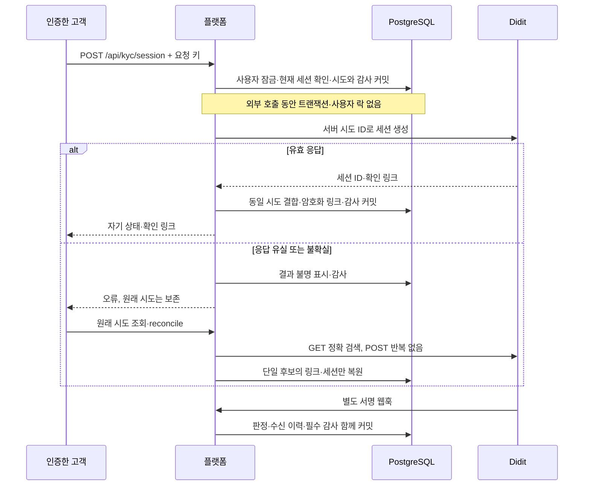

# Didit 신분 확인과 고객 신규 주문 허용 조건을 연결하기

고객 계정과 외부 신분 확인 세션을 안전하게 연결하고, 서명으로 확인한 신분증·생체 확인 결과가 유효할 때만 신규 주문을 허용한다. 외부 HTTP 응답 유실, 중복·역순 웹훅, 감사 실패에서도 거래 권한을 추측해 부여하지 않는 첫 계층이다.

- 작성일: 2026-10-22.
- 독자: TypeScript 백엔드 개발을 주력으로 하며 금융·보안 판단을 코드와 함께 설명할 프로젝트 소유자.
- 변경 위치: Java 플랫폼. Rust 체결 코어와 출력 워커에는 KYC 로직을 넣지 않는다.
- 상태: 코드·로컬 대역 검증. 실제 Didit 계정·샌드박스·운영 워크플로·신분증 제출 검증은 수행하지 않았다. 전체 고객확인·자금세탁방지 완료나 사업 신고·인증 충족을 뜻하지 않는다.

## 문제와 기존 동작

기존 신규 주문 정책은 활성 고객 역할과 운영자의 거래 제한을 검사했다. 계정의 로그인 성공과 실제 신분 확인은 다른 사실인데도, 신분 확인 근거 없이 자산 예약을 시작할 수 있었다.

단순히 외부 `Approved` 문자열을 사용자 필드에 복사하면 다음 문제가 생긴다.

1. 복귀 주소의 상태 값이나 다른 고객의 세션으로 승인할 수 있다.
2. 다른 애플리케이션·샌드박스·워크플로의 결과가 운영 권한으로 섞일 수 있다.
3. POST 응답 유실 후 재요청으로 여러 유료 세션이 생길 수 있다.
4. 오래된 결과나 중복 이벤트가 최신 거절을 덮어쓸 수 있다.
5. 상태 변경 뒤 감사 저장이 실패하면 근거 없는 권한이 남을 수 있다.
6. 신원 확인 결과가 운영자의 사고 대응 제한까지 풀어 버릴 수 있다.

이번 구현은 이 경계를 고객 인증 → 확인 세션 → 서명 결과 → 신규 주문 정책으로 연결한다. 자금 출처·거래 목적·실소유자·제재/정치적 주요인물·지속 모니터링은 별도 업무로 남긴다.

## 기존 제품과 공식 자료의 접근

2026-10-22 확인한 공식 자료를 사용한다. 공개된 기능·명세를 참고하며 거래소 내부 DB 구조를 추측하지 않는다.

| 근거 | 적용한 패턴과 확인 범위 |
|---|---|
| [Kraken 계정 확인과 기능](https://support.kraken.com/articles/360001395743-verification-levels-explained), [Coinbase 신분증 확인](https://help.coinbase.com/en/pro/getting-started/authentication-and-verification/id-document-verification) | 로그인과 신분 확인을 구분하고 확인 상태를 거래 가능 조건에 연결한다. 외부 제품의 한도·정책을 그대로 복제하지 않는다. |
| [Didit 세션 생성](https://docs.didit.me/sessions-api/create-session) | 서버에서 워크플로와 연결 식별자를 정하고 `POST /v3/session/`을 호출한다. 완료 상태와 워크플로 버전에 따라 재사용 범위가 달라지므로 POST 전체를 안전한 무한 재시도로 취급하지 않는다. |
| [Didit 세션 목록](https://docs.didit.me/sessions-api/list-sessions) | 결과 불명 시 정확한 `vendor_data`·워크플로·사용자 세션 조건으로 원래 후보를 조회한다. 한 후보로 확정하지 못하면 새로 생성하지 않는다. |
| [Didit 웹훅](https://docs.didit.me/integration/webhooks) | 전체 본문 V2 서명, 이벤트 ID, 전송 시각과 변경 시각, 환경·애플리케이션·세션 결합을 검증한다. 재전송 때 바뀌는 전송 시각은 중복 내용 해시에서 제외한다. |
| [Didit 확인 상태](https://docs.didit.me/integration/verification-statuses) | 진행·검토·거절·만료 상태는 신규 거래 허용으로 해석하지 않는다. 알 수 없는 상태는 충돌로 차단한다. |
| [금융정보분석원 고객확인제도](https://www.kofiu.go.kr/kor/policy/amls05.do) | 신분 확인만으로 고객확인 전체를 충족했다고 표시하지 않는다. 거래 목적·실소유자·위험에 따른 추가 확인과 지속 관리가 남는다. |

법령 페이지 [자금세탁방지 관련 업무규정 이력](https://www.law.go.kr/LSW/admRulInfoP.do?admRulSeq=2100000284076&chrClsCd=010201)은 2026-08-20·제2026-2호와 연혁 표시를 확인했지만, 이번 도구의 본문 추출로 조문 전체나 최신 적용 관계를 확정하지 못했다. 이 자료만으로 국내 영업 적법성이나 최신 규정 전체 충족을 선언하지 않는다. 기존 [접근 통제 근거 대조](../reference/access-control-compliance.md)와 공통 [KYC 검토](../../../docs/roadmap/didit-kyc.md)도 함께 읽는다.

## 선택과 트레이드오프

| 선택 | 얻는 점 | 감수하는 비용·검토한 대안 |
|---|---|---|
| 공급사 신분 확인과 거래소 제한을 AND 조건으로 결합 | 공급사 승인으로 사고 제한이 해제되지 않는다. | 하나의 `approved` 필드보다 상태가 늘어난다. 서로 다른 책임을 구분하는 데 필요하다. |
| 외부 호출 전에 시도·요청 키·감사를 커밋 | 응답 유실 뒤에도 원래 시도를 찾는다. | 두 번의 짧은 DB 트랜잭션이 필요하다. 네트워크 동안 사용자 락을 잡지 않는다. |
| 고객별 요청 키와 서버 생성 시도 UUID 분리 | 다른 고객의 같은 키와 외부 연결 식별자가 섞이지 않는다. | 식별자가 하나 늘지만 역할이 다르다. 고객 입력을 그대로 공급사 연결 키로 쓰지 않는다. |
| 불명 POST는 조회로만 복원 | 중복 세션·중복 비용 위험을 줄인다. | 조회 후보가 없거나 여러 개면 수동 확인·재조회가 필요하다. 목록의 승인 문자열로 거래를 열지는 않는다. |
| V2 서명 한 종류만 허용 | 전체 결정 본문을 검증하는 계약이 명확하다. | 오래된 단순 서명·원문 서명은 거부한다. 호환 폴백이 없다. |
| 같은 초의 서로 다른 결정은 충돌 | 초 단위 시각만으로 순서를 추측하지 않는다. | 정상적인 빠른 연속 변경도 재확인이 필요할 수 있다. 충돌한 시도는 나중 승인으로 자동 해제하지 않는다. |
| 유효 신분 확인 30일·24시간 내 새 시도 3회 | 무기한 권한과 비용 남용 범위를 줄인다. | 재확인 부담과 거절 후 재시도 제한이 있다. 둘 다 프로젝트의 보수적 초기 정책이며 법정 고정 수치가 아니다. |
| 신분증·이름·생년월일·생체 원본을 복사하지 않음 | 민감정보 저장 범위를 줄인다. | 향후 법정 고객확인 자료·고객 정보 대조·증빙 조회는 별도로 설계해야 한다. 현재 최소 상태만으로 해당 의무를 완료했다고 볼 수 없다. |
| 확인 링크를 AES-GCM 암호화 | DB에서 링크를 평문으로 바로 읽지 못한다. 다른 시도의 암호문 전용도 막는다. | 독립 키의 보관·백업·교체·폐기 운영이 필요하다. 애플리케이션·키가 함께 침해되는 상황까지 보호하지 않는다. |
| 설치된 Jackson·JDK HTTP·JCE 사용 | 새 SDK·HTTP 풀·암호 라이브러리를 추가하지 않는다. | 공급사 특유 V2 JSON 정규화 어댑터는 유지해야 한다. Python 독립 기대값 300건으로 경계 차이를 검증한다. |

설치된 의존성·타입과 공식 명세를 먼저 확인했다. RFC 8785 정규화와 Didit의 Python 방식은 같지 않으므로 일반 JSON 정렬 패키지를 같은 계약으로 가정하지 않는다. HTTP·JSON 파서·HMAC·암호화 자체는 표준 구현에 맡긴다. 새 의존성·버전·잠금 파일 변경은 없다.

## 구현과 관련 코드

### 역할과 저장 경계

| 코드 | 책임 |
|---|---|
| [DiditSettings](../../src/main/java/dustin/cex/domains/kyc/DiditSettings.java) | 필수 설정과 운영/샌드박스·워크플로 버전 검사. 비밀을 `toString()`에 출력하지 않는다. |
| [DiditClient](../../src/main/java/dustin/cex/domains/kyc/DiditClient.java) | 고정 공급사 HTTP, 세션 생성·정확 검색, 응답 크기·완료 시간·리다이렉트 제한. |
| [DiditWebhookVerifier](../../src/main/java/dustin/cex/domains/kyc/DiditWebhookVerifier.java) | 중복 JSON 키 거부, V2 전체 본문 정규화·HMAC·시각 검사. |
| [KycService](../../src/main/java/dustin/cex/domains/kyc/KycService.java) | 시도 수명, 사용자·세션 결합, 이벤트 중복·역순·충돌, 상태·필수 감사의 원자적 변경. |
| [KycController](../../src/main/java/dustin/cex/domains/kyc/KycController.java) | 자기 세션 API·서명 웹훅·운영자 최소 상태 조회. |
| [스키마](../../src/main/resources/kyc/schema.sql), [초기화](../../src/main/java/dustin/cex/domains/kyc/KycSchemaInitializer.java) | `kyc_attempts`, `kyc_profiles`, 불변 `kyc_events`를 별도 저장. 일반 서버에서 초기화하며 관리 JAR에 업무 워커를 추가하지 않는다. |
| [TradingAccessPolicy](../../src/main/java/dustin/cex/domains/security/TradingAccessPolicy.java) | 자산 예약 트랜잭션에서 활성 고객·수동 제한·유효한 운영 환경 신분 확인을 함께 검사. |
| [SecurityConfiguration](../../src/main/java/dustin/cex/domains/security/SecurityConfiguration.java), [JwtAuthenticationFilter](../../src/main/java/dustin/cex/domains/auth/middleware/JwtAuthenticationFilter.java) | 정확한 HTTP 메서드·역할 통제와 KYC 응답 `Cache-Control: no-store`. |

`kyc_attempts`에는 서버 생성 ID, 고객별 요청 키, 고객·공급사 애플리케이션·환경·워크플로·버전, 세션 ID와 암호화 링크를 둔다. `kyc_profiles`는 현재 유효한 시도와 판정·기한·마지막 변경 시각을 둔다. `kyc_events`에는 이벤트 ID·시도·내용 해시·공급사 시각·처리 결과만 남긴다. 원본 본문·서명·신분증·생체 자료는 저장하지 않는다. 이벤트 표의 UPDATE·DELETE·TRUNCATE는 트리거로 거부한다. DB 슈퍼유저의 통제 회피까지 막는 외부 불변 보관은 아니다.

### 세션 생성과 결과 불명

`start`와 `reconcile`은 `@Transactional(propagation = NEVER)`다. 상위 코드가 이미 트랜잭션을 열었다면 진입부터 거부한다. 내부 `TransactionTemplate` 두 구간 사이에 외부 HTTP를 둬서 응답 대기 때문에 사용자 락이 유지되지 않게 한다. 단순히 메서드 내부에서 트랜잭션을 나눴다고 설명하고 바깥 트랜잭션을 무시하지 않는다.

같은 고객·같은 요청 키는 같은 현재 시도를 반환한다. 진행 중이거나 유효한 확인이 있을 때 다른 키는 409다. 과거 시도의 키를 다시 보내도 새 시도로 바꾸지 않는다. 요청 키에 기록하지 않은 새 의미를 임시로 부여하지 않는다.

HTTP 응답보다 웹훅이 먼저 와도 판정을 덮어쓰지 않는다. 생성 후 감사 커밋이 실패하면 시도는 이미 보존돼 있으므로 읽기 전용 검색으로 이어간다. 결과 불명·조회 실패를 승인으로 해석하지 않는다.

HTTP는 `https://verification.didit.me`로 고정한다. 연결 5초, 전체 응답 본문 완료 10초, 본문 1MiB 제한이며 리다이렉트·애플리케이션 POST 자동 재시도는 없다. JDK 수신기에 크기 제한을 추가하고 기한을 넘긴 future는 취소한다. 헤더 수신이나 입력 스트림 반환을 본문 완료로 간주하지 않는다. [JDK HttpClient](https://docs.oracle.com/en/java/javase/21/docs/api/java.net.http/java/net/http/HttpClient.html), [BodySubscribers](https://docs.oracle.com/en/java/javase/21/docs/api/java.net.http/java/net/http/HttpResponse.BodySubscribers.html)를 확인했다.

### 서명과 판정

1. 본문 1MiB, 깊이 100, 중복 JSON 키·비정상 서로게이트를 제한한다.
2. `X-Signature-V2`와 `X-Timestamp`만 받는다. 시각은 현재 기준 ±300초이며 서명된 본문의 정수 `timestamp`와 헤더 값도 같아야 한다.
3. Python 명세의 키 정렬·Unicode·정수/부동소수 정규화 후 HMAC-SHA256을 상수 시간 비교한다. 서명 유효기간이 남아 있어도 저장한 이벤트 ID로 금융 권한의 중복 효과를 막는다.
4. 서버 시도·고객·세션·애플리케이션·운영/샌드박스·워크플로·정확한 정수 버전과 이벤트 종류를 확인한다. 운영 시도에 샌드박스 시나리오를 섞지 않는다.
5. `Approved`여도 결정의 세션·상태 일치, 비어 있지 않은 `id_verifications`, `liveness_checks`, `face_matches` 전부의 승인 여부를 검사한다. 신분증은 `verification_method=document`, `assurance=documentary`를 요구한다. 빠진 근거를 통과로 추정하지 않는다.
6. 같은 사용자 행을 신규 주문 정책과 동일하게 잠근다. 판정·이벤트 영수증·필수 감사가 함께 커밋된다. 감사 저장 실패는 전부 롤백한다.

| 상황 | 처리 |
|---|---|
| 같은 이벤트·같은 내용, 전송 시각만 변경 | 기존 효과 유지, 새 영수증·중복 권한 변경 없음 |
| 같은 이벤트 ID·다른 내용 | 원래 영수증은 보존하고 현재 시도는 충돌·거래 차단, 별도 거부 감사 |
| 이미 교체된 과거 시도 | `SUPERSEDED` 이력만 보존, 현재 시도 변경 없음 |
| 더 오래된 `created_at` | `STALE` 이력만 보존 |
| 같은 초·서로 다른 결정 | `TIME_CONFLICT`, 권한 차단 |
| 이미 충돌한 시도에 새 승인 | 자동 해제 없음. 한도 내 새 시도에서 다시 확인해야 함 |
| 진행·검토·거절·만료·알 수 없는 상태 | 신규 거래 불가 |
| 승인 후 로컬 30일 만료 | 다음 신규 주문 검사에서 차단, 만료 웹훅에만 의존하지 않음 |

`created_at`은 이벤트 변경 시각이고 `timestamp`는 전송 시각이다. 재시도 때 갱신되는 `timestamp`를 빼고 전체 내용 해시를 계산한다. 제공되지 않은 전역 순번을 만들어 순서가 확정된 것처럼 취급하지 않는다.

### 주문·취소와의 관계

신규 주문은 활성 CUSTOMER, 수동 거래 제한 없음, 현재 시도 VERIFIED, 기한 유효, 환경 live가 모두 필요하다. 샌드박스 승인으로 운영 주문은 열리지 않는다. 운영자의 제한 해제 역시 KYC를 우회하지 않는다.

기존 주문의 같은 키 재조회는 새로운 예약이 아니므로 기존 중복 요청 계약을 유지한다. 자기 주문 취소는 신규 거래 권한과 분리한다. KYC 만료·수동 제한 때문에 위험을 줄이는 취소까지 막지 않는다. 타인 주문 취소 권한은 생기지 않는다.

## API와 설정

| 메서드·경로 | 인증·효과 |
|---|---|
| POST `/api/kyc/session` | 활성 고객 Bearer, UUID `Idempotency-Key`. 자기 확인 시도 생성/재조회 |
| GET `/api/kyc/session` | 자기 상태·자기 확인 링크 조회 |
| POST `/api/kyc/sessions/{id}/reconcile` | 자기 현재 시도만 정확 검색. 생성 응답의 링크·세션 복원이며 신분 승인 API가 아님 |
| POST `/api/kyc/webhook` | 로그인 대신 V2 서명 필수. 다른 메서드·callback 승인 경로 없음 |
| GET `/api/admin/kyc/customers/{id}` | 기존 세 운영 역할의 최소 상태 조회. 링크·신분증·결정 원문 미반환 |

[application.properties](../../src/main/resources/application.properties)의 환경 변수는 다음과 같다.

| 환경 변수 | 의미 |
|---|---|
| `DIDIT_API_KEY` | 서버 전용 API 키 |
| `DIDIT_WEBHOOK_SECRET` | 서버 전용 웹훅 HMAC 비밀 |
| `DIDIT_APPLICATION_ID` | 결과를 받을 애플리케이션 UUID |
| `DIDIT_WORKFLOW_ID` | 신분증·실재성·얼굴 대조를 요구하는 워크플로 UUID |
| `DIDIT_WORKFLOW_VERSION` | 검토·고정한 양의 정수 버전 |
| `DIDIT_ENVIRONMENT` | `live` 또는 `sandbox` |
| `DIDIT_CALLBACK` | 쿼리·fragment·사용자 정보 없는 고정 HTTPS 복귀 주소 |
| `DIDIT_ENCRYPTION_KEY` | 독립적인 난수 32바이트를 Base64로 표현한 링크 저장 키 |

전부 없으면 플랫폼 자체는 실행되지만 KYC API는 503이고 확인 없는 신규 주문은 거부한다. 일부만 설정하면 시작을 거부한다. 로컬에서 주문을 열기 위한 우회 플래그·가짜 승인 기본값은 없다. callback은 화면 이동용이며 URL의 `status`를 거래 허용 근거로 받지 않는다. 확인 링크는 `https://verify.didit.me`의 세션 경로만 허용하고 쿼리·fragment·사용자 정보·다른 포트를 거부한다.

실제 워크플로를 게시·변경하면 생성 API와 고정 버전의 일치 여부를 먼저 검증해야 한다. 미확인 최신 버전을 자동으로 신뢰하지 않는다. 설정·키 교체와 링크 복호화 보존 기간은 운영 절차가 필요하며 기존 키로 자동 폴백하는 호환 경로는 없다.

## 이해에 필요한 Java 문법과 원리

- `record Status(...)`, `record Session(...)`: 생성자·접근자·값 비교를 갖는 Java 데이터 타입이다. TypeScript의 응답 타입과 역할은 비슷하지만 런타임 객체이며 타입 삭제만으로 사라지지 않는다. 링크가 있는 `Session`은 기본 문자열 출력을 덮어써 비밀 노출을 줄인다.
- `UUID`: 문자열을 그대로 비교하는 대신 식별자를 파싱한다. 고객 요청 키는 `(user_id, request_id)`로 범위를 정하고, 외부 연계 UUID는 서버에서 별도로 생성한다.
- `TransactionTemplate.execute`: 콜백 안의 DB 변경과 감사가 하나의 트랜잭션이다. TypeScript ORM의 transaction 콜백과 비슷하지만 JPA 사용자 잠금과 JDBC 명령이 같은 Spring 트랜잭션에 참여하는 점을 확인해야 한다.
- `Propagation.NEVER`와 `MANDATORY`: 세션 생성은 이미 열린 트랜잭션이 없어야 하고, 신규 주문 정책은 자산 예약 트랜잭션 안이어야 한다. 주석만으로 경계를 가정하지 않는다.
- `sendAsync`와 `CompletableFuture.get`: 현재 서비스 호출은 결과를 기다리지만 DB 락은 이미 풀려 있다. Rust 코어의 비동기 출력 구조와는 다른 플랫폼 외부 연동 문제다. 매 요청마다 HTTP 클라이언트·연결 풀을 만들지 않는다.
- `MessageDigest.isEqual`: HMAC 비교를 일반 문자열 비교에 맡기지 않는다. 암호 알고리즘은 JCE를 사용한다.
- `AES/GCM/NoPadding`, 12바이트 nonce와 AAD: 매 암호화마다 새 nonce를 만들고 시도 ID를 추가 인증 데이터로 결합한다. 다른 시도에 암호문을 옮기면 인증 태그 검증이 실패한다.
- `BigInteger`, `BigDecimal`, Unicode 코드 포인트: JavaScript `number`·문자열 정렬과 같다고 가정하면 큰 정수·소수·비BMP 문자에서 서명이 달라진다. 공급사의 Python 정규화 계약에 맞춘 경계 어댑터다.

## 작성·수정한 테스트

[DiditWebhookVerifierTest](../../src/test/java/dustin/cex/domains/kyc/DiditWebhookVerifierTest.java)는 아래 4개 JUnit 사례다. [독립 Python 기대값](../../src/test/resources/didit-v2-canonical-fixtures.json) 300건은 첫 테스트 내부의 입력 사례이며 300개 JUnit으로 중복 집계하지 않는다. 정수화되는 큰 소수, 지수 표현, 가장 작은 비정규 수, 음수 0, 임의 유한 IEEE 754 값, 한글·이모지·키 정렬·빈 객체·제어 문자를 포함한다.

| 함수 | 시나리오·기대 결과 |
|---|---|
| `pythonCanonicalFixturesMatchIncludingUnicodeEmptyObjectsAndFloatingPoint` | Python이 만든 300건의 정규 문자열과 HMAC에 정확히 일치 |
| `duplicateKeysInvalidSurrogatesAndOversizedBodiesAreRejected` | 중복 키·잘못된 Unicode·큰 본문 거부 |
| `signatureAndSignedTimestampBothMustMatchFreshHeader` | 변조·오래된 시각·헤더만 새로 바꾼 재전송 거부 |
| `missingOrPartialConfigurationNeverCreatesAnAuthenticationBypass` | 전부 미설정은 API 비활성, 부분 설정은 시작 실패 |

[KycIntegrationTest](../../src/test/java/dustin/cex/domains/kyc/KycIntegrationTest.java)는 실행 소유 PostgreSQL과 루프백 HTTP 공급사 대역, 실제 JDK HTTP·HMAC·AES-GCM을 사용한다. 공급사 승인을 실제로 받았다는 증적은 아니다. 감사 실패만 spy로 주입하며 거래 정책은 실제 DB를 읽는다.

| 함수 | 시나리오·기대 결과 |
|---|---|
| `unverifiedCustomerIsBlockedThenVerifiedOnlyAfterSignedChecks` | 확인 전 거부, 결합과 모든 검사가 맞는 서명 결과 뒤 허용 |
| `sameKeyReusesAttemptAndDifferentKeyConflictsWithoutCreatingAnother` | 같은 키 재조회·다른 키 충돌, POST 한 번 |
| `simultaneousSessionStartDoesNotWaitOnNetworkOrCreateTwice` | 첫 HTTP 대기 동안 같은 키 요청은 DB 락에 묶이지 않고 시도 조회 |
| `lostResponseUsesReadOnlyReconciliationAndNeverRepeatsPost` | 응답 유실 후 정확 GET으로 링크 복원, POST 반복·목록 상태만으로 승인 없음 |
| `multipleReconciliationCandidatesRemainBlocked` | 복수 후보·32비트 정수 변환 넘침 후보 수는 확정·승인하지 않음 |
| `webhookMayArriveBeforeCreationResponseWithoutLosingDecision` | 선행 웹훅의 판정을 HTTP 응답이 지우지 않음 |
| `retryChangesDispatchTimestampWithoutApplyingEffectAgain` | 새 전송 시각 재시도에도 수신 이력·권한 효과 한 번 |
| `staleEventCannotReplaceNewerDecision` | 오래된 결과가 새 거절을 덮어쓰지 않음 |
| `sameTimestampDisagreementBlocksRatherThanGuessingOrder` | 같은 초의 다른 결과는 충돌 |
| `eventIdContentChangeBlocksAndPreservesOriginalReceipt` | 같은 ID 내용 변경 시 원본 이력 보존·차단 |
| `supersededAttemptCannotApproveNewVerification` | 과거 시도가 새 시도를 승인하지 않음 |
| `manualRestrictionAndDisableAreNeverClearedByProvider` | 공급사 승인에도 수동 제한·계정 정지는 유지 |
| `localExpiryBlocksWithoutWaitingForAnotherWebhook` | 유효기간 만료만으로 신규 주문 거부 |
| `nonApprovedStatusesNeverOpenTrading` | 진행·검토·거절·만료·미지 상태 10개 각각 거래 거부 |
| `crossApplicationEnvironmentWorkflowAndSessionBindingsAreRejected` | 앱·환경·워크플로·버전·세션·고객 연결·세션 종류·샌드박스 혼입 8개 거부 |
| `approvedLabelWithoutRequiredDecisionEvidenceIsConflict` | 승인 문자열만 있고 필요한 결정 근거가 빠진 5개 경우 충돌 |
| `malformedProviderResponseCannotLeakKeyOrCreateUsableSession` | 잘못된 링크·버전·리다이렉트 3개 거부, 비밀 노출 없음 |
| `linksAreEncryptedBoundToAttemptAndAbsentFromAudit` | DB 평문 링크 없음, 다른 시도의 암호문 사용 거부, 감사에 링크 없음 |
| `anotherUsersAttemptOrRevokedSessionCannotBeUsed` | 타인 시도·회수 세션 조회/복원 거부 |
| `dailyAttemptLimitIsPersisted` | 24시간 새 시도 3개 뒤 429 |
| `creationAuditFailureDoesNotCallProvider` | 첫 감사 실패는 시도·외부 POST 없음 |
| `webhookAuditFailureRollsBackReceiptAndTradingPermission` | 최종 감사 실패는 수신 이력·권한 함께 롤백 |
| `concurrentIdenticalWebhooksCommitOneReceipt` | 동일 이벤트 동시 도착에서도 수신 한 건 |
| `immutableReceiptCannotBeChangedDeletedOrTruncated` | UPDATE·DELETE·TRUNCATE 차단 |
| `realHttpOnlyAllowsOwnSessionAndSignedWebhookAndNeverCachesLinks` | 실제 임의 포트 서버의 역할·자기 세션·헤더·no-store·callback 조작 거부 |
| `sandboxVerificationCannotEnableLiveTrading` | 로컬 fixture의 sandbox 승인도 운영 거래 차단 |
| `completionAuditFailureLeavesDurableAttemptForReadOnlyRecovery` | 후속 감사 실패 후 원래 시도 보존·GET 복원 |
| `conflictRequiresFreshVerificationAndOldEventsStaySuperseded` | 충돌 시도 자동 재승인 없음, 새 확인만 허용·옛 이벤트 무효 |
| `workflowVersionMustBeExactIntegerWithoutOverflow` | 소수·32비트 넘침·문자열 버전 3개 거부 |
| `responseBodyHasHardSizeAndCompletionDeadline` | 1MiB 초과·끝나지 않는 본문을 크기/10초 제한으로 중단 |
| `incompleteChecksAndNonDocumentaryMethodCannotPass` | 개별 검사 미승인·비문서 확인으로 허용 안 됨 |
| `idempotencyKeysAreScopedPerCustomerAndVendorReferencesComeFromServer` | 같은 고객 키 재사용·서로 다른 고객의 같은 키 분리·서버 연결 ID 확인 |
| `outerTransactionCannotKeepLocksOpenAcrossProviderHttp` | 외부 트랜잭션 안의 생성·조회 복원 진입 거부, HTTP 0회 |

금융 회귀를 위해 [KycFixtures](../../src/test/java/dustin/cex/domains/kyc/KycFixtures.java), [별도 프로세스 SQL fixture](../../src/test/resources/kyc-verified-fixture.sql)를 추가했다. `PlatformSecurityTest.fund`, `MarketPathTest`와 `verify_order_idempotency.py`가 격리 DB에 신뢰된 확인 상태를 명시적으로 만든다. 이는 각 금융 테스트의 선행 조건이며 Didit 검증 성공 증적이나 제품 우회 API가 아니다. `PlatformSecurityTest`의 자기 주문 취소 사례에는 KYC 만료를 추가해 수동 제한과 함께 취소가 가능한지 확인한다. 기본 테스트 프로필은 외부 `DIDIT_*` 설정을 비워 실제 키를 물려받지 않게 한다.

## 실행 명령과 결과

[verify_kyc.py](../../scripts/verify_kyc.py)는 새 PostgreSQL 16 컨테이너를 임의 포트로 띄우고 KYC 테스트·JAR 빌드 후 컨테이너를 제거한다. 봇은 0명이며 엔진·Kafka 외부 주소도 격리한다. 기존 로컬 서비스에 실제 키·가짜 신분 확인을 넣지 않는다.

최종 수치와 회귀 결과는 [확정 검증 증적](../reference/kyc-verification-2026-10-22.json)에 기록한다. 실행 환경은 macOS·Temurin 21·Docker의 임시 PostgreSQL/Kafka다. 실제 엔진 연결은 기존 시장 경로 테스트에서 별도로 확인한다.

최종 선택 JUnit **473개**, 실패·오류·제외 **0개**다. 별도 실제 프로세스 시나리오 **12개**도 통과했다. 기존 서비스의 DB 5432/5433/5435와 Kafka 9092에는 테스트를 연결하지 않았다.

| 실행 명령 | 최종 결과 | 범위 |
|---|---|---|
| `python3 scripts/verify_kyc.py` | 61/61, JAR 빌드 성공 | 신규 통합 57개·서명/설정 4개, 독립 Python 입력 300건 포함 |
| `python3 scripts/verify_bound_approvals.py` | 186/186 | 업무 서명 62·역할 48·복구/세션 정책 37·접근 39, 묶음별 별도 DB |
| `python3 scripts/verify_operator_mfa.py` | 42/42 | 기존 보안키 등록·인증·회수·시각/출처 검사 |
| `python3 scripts/verify_engine_inbox.py` | 183/183 | 주문·금액·수수료·원장·정산·중복 수신·실패 회귀. 일부 정산 실행 기록은 H2, KYC와 영속 수신 제약은 실제 PostgreSQL |
| `./gradlew operatorAdminJar bootJar jmhClasses writeDependencyInventory --console=plain` | 종료 0 | 두 JAR·벤치마크 코드 컴파일·의존성 목록. 성능 측정 아님 |
| `python3 scripts/verify_operator_admin.py` | 프로세스 2/2 | 실제 관리 JAR 4회 호출, 금융 고객/중복 거부·웹/업무 워커 배제 |
| `python3 scripts/verify_order_idempotency.py` | 프로세스 10/10 | 실제 일반 JAR 두 번 기동·동시 주문·응답 유실·재시작·원본 요청 보존 |
| `python3 scripts/verify_market_path.py` | 1/1 | 실제 플랫폼 HTTP·Rust·격리 PostgreSQL/Kafka·시세 공개·정산·독립 대사 |
| `python3 scripts/audit_dependencies.py` | 222개 버전, 알려진 OSV 검출 0 | 조회 시점의 알려진 취약점 대조. 모든 취약점 부재 보장은 아님 |
| `python3 scripts/verify_dependency_integrity.py` | 통과 | 임시 사본의 체크섬 변조를 Gradle 종료 1로 차단, 원본 캐시 미수정 |

의존성 목록 SHA-256은 `590da8748d7e2940dbc56dfe714c8c4cab4d1e5ed9b0be72dbf14e024e79268a`로 선행 사이클과 같다. 기존 deprecated API·테스트 JVM 공유 경고와 신규 통합 테스트의 자료형 변환 unchecked 경고가 남아 있다. 실제 공급사·KYC 전용 프로세스 재시작·브라우저·운영 TLS·EC2/Linux·부하 검증은 수행하지 않았다. 선택 회귀를 전체 저장소 테스트나 운영 적합성으로 확대하지 않는다. 테스트 소유 컨테이너·임시 DB는 정리했다.

### 중간 실패와 수정

- 첫 컴파일은 Jackson 3의 `JsonFactory` 패키지 경로와 `Timestamp` 와일드카드 import 충돌로 오류 5개가 났다. 실제 설치된 타입에 맞게 import를 수정했다.
- 첫 통합 실행은 총 51개 중 1개 실패했다. 같은 초 충돌을 만드는 테스트가 본문 변경 시각을 전송 시각보다 미래로 만들었고, 제품의 미래 시각 차단에 걸렸다. 테스트의 전송 시각이 변경 시각 이상이 되게 고쳤다. 제품의 시각 검사를 느슨하게 하지 않았다.
- 기존 승인 회귀 첫 실행은 역할 48개 중 2개, 두 번째는 업무 서명 62개 중 3개가 실패했다. JUnit에 단일 사례 약 905초·931초의 경과 증가와 인증 만료 오류가 관찰됐다. 실행 환경 중단 가능성이 있으나 원인을 확정하지 않는다. 실패 기록을 보존하고 제품·테스트 인증 기한을 바꾸지 않은 채 절전 방지 실행으로 전체 회귀를 다시 검증했다.
- 금융 회귀 첫 실행은 183개 중 9개가 실패했다. 기존 H2 기반 `TradeSettlementFailureTest`·`TradeSettlementRunServiceTest`가 PostgreSQL 전용 KYC 스키마까지 초기화한 것이 원인이다. 정산 실행 기록만 검증하는 두 테스트에 `@MockitoBean KycSchemaInitializer`를 명시해 관심사를 분리했다. 제품 스키마에 H2 폴백을 추가하거나 KYC 통합 검증을 제외하지 않았다. 두 테스트의 기존 `recordAndGetFailures`·런 시작/완료·실패 목록 사례를 다시 실행한다. KYC DDL·불변 트리거 검증은 실제 PostgreSQL의 신규 테스트가 담당한다.
- 이후 경계 사례를 추가하고 각각 재실행했다. 최종 개수는 중간 실행을 더해 부풀리지 않는다.

## 운영 전 확인과 남은 범위

1. 실제 Didit 계정의 애플리케이션·워크플로 버전·필수 세 검사·환경·웹훅 헤더/배열을 확인한다. 실제 샌드박스·운영 검증과 계약·비용은 미확인이다. 로컬 공급사 대역 성공을 실연동 성공으로 부르지 않는다.
2. **현재 reconcile은 생성 응답 유실의 세션·링크 복원만 한다.** 승인 판정의 웹훅 자체가 누락됐을 때 서버가 결정 API로 자동 대사하는 워커는 아직 없다. Didit 콘솔 재전송과 현재 상태 조회 절차가 필요하며 다음 개발 우선 항목이다. 누락을 성공으로 추측하지 않는다.
3. 완전한 고객확인에는 계정 정보와 실제 확인 신원의 일치, 중복 인물·차명/도용 위험, 실소유자·거래 목적·자금 출처, 국가·고객 위험 등급, 제재/정치적 주요인물 검사, 고위험 추가 확인, 지속 모니터링과 보고 업무를 설계해야 한다. 현재의 문서/생체 결과만으로 이 범위가 끝나지 않는다.
4. [Didit 데이터 보유](https://docs.didit.me/console/data-retention)는 기본 무기한 보유와 별도 보유 설정·생체 템플릿 정책을 설명한다. EU 기본 처리·국내 저장 선택의 계약 조건을 확인하고 국외 이전·처리위탁·삭제·정보주체 권리 대응을 검토해야 한다.
5. [2026-10-07 개정 개인정보 정책](https://didit.me/terms/privacy-policy/)은 학습 목적 데이터 사용과 조직 설정의 거부 옵션을 설명한다. 운영 전 실제 거부 설정·계약/DPA·기존 데이터 적용 범위와 보유/삭제 정책을 확인한다. 테스트에서는 개인정보를 제출하지 않았다.
6. 플랫폼에는 원문이 없으므로 향후 적법한 증빙 조회·접근권한·필요 최소 수집·보존/파기·감사 열람을 별도로 설계한다. 불변 해시 이력도 무조건 영구 보관해야 한다는 법률 판단이 아니다.
7. 요청 본문 크기 제한 외에 외부 프록시의 요청 수·연결/본문 시간 제한, 웹훅 처리 지연·누락·충돌 경보, 키 보관·분리·백업·복원은 운영 조건이다. KYC 전용 프로세스 강제 종료/재시작·실제 브라우저·Didit·TLS·부하 검증은 이번 범위에 없다. 기존 금융 프로세스 재시작 테스트와 구분한다.
8. 디스크·호스트 손실 보호는 별도 복제·백업이 필요하다. 사용자 지시대로 이번에는 필요 조건만 문서화하고 인프라를 배포하지 않는다.

## 관련 커밋

- [`2a5a28e`](https://github.com/GiHoon1123/Cex-Platform-Service/commit/2a5a28e237a6466a4dc263706ff7b6682cbf49ef): Didit HTTP 경계·설정·V2 정규화/서명과 독립 Python 기대값 검증.
- [`afcb5ea`](https://github.com/GiHoon1123/Cex-Platform-Service/commit/afcb5ea3aca8ef922a8b42168eabc25be2b4097a): 영속 확인 시도·웹훅 상태·감사·신규 주문 정책과 통합/금융 회귀.

문서 커밋과 일반 푸시의 원격 main 일치 결과는 공통 [KYC 사이클 기록](../../../docs/roadmap/kyc-identity.md)에 남긴다. 엔진·프론트 변경과 배포는 이 사이클에 포함하지 않는다.

## 후속 구현: 2026-10-23

이 문서의 미완료 표기는 최초 사이클 당시의 범위다. 후속 [플랫폼 KYC 대사](019-platform-kyc-reconciliation.md)에서 누락된 웹훅을 원래 서명 이력·현재 결정과 대조하고 영속 임대·재시도·최근 확인 기한·실제 JVM 강제 종료/복원을 검증했다. 생성 응답의 링크 복원과 판정 복원을 계속 구분한다. 실제 Didit 연동·전체 CDD/AML·계약/개인정보·인증/신고 조건은 남아 있다.
