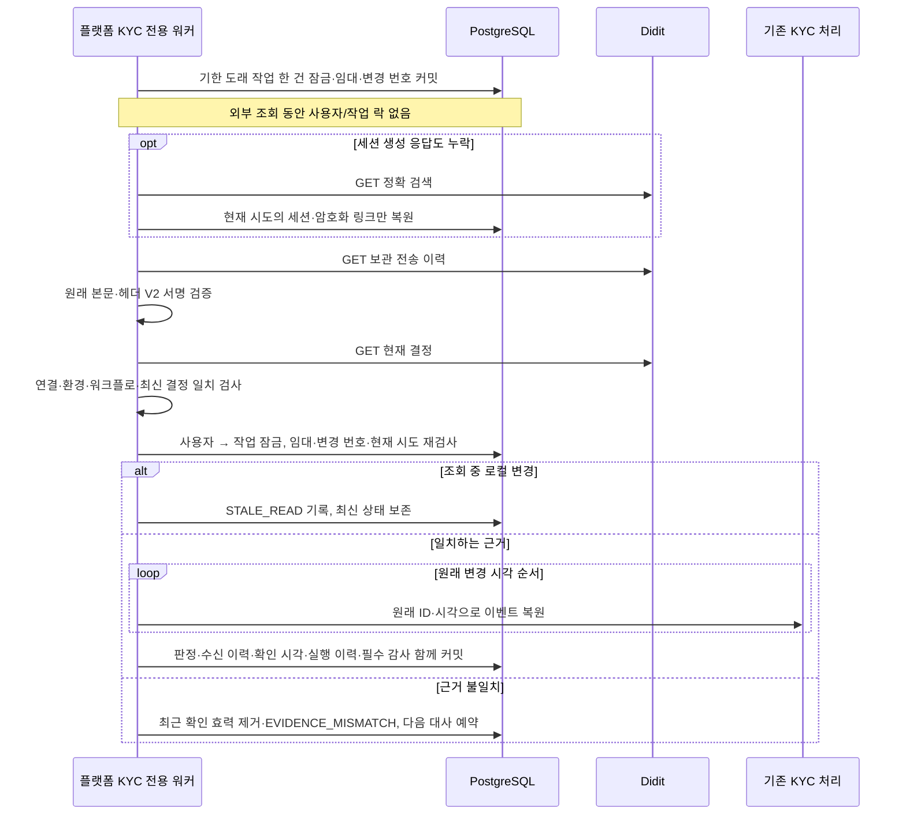

# 플랫폼 KYC의 누락 웹훅을 복원하고 확인 기한을 검사하기

Didit 웹훅이 누락돼도 현재 결정과 원래 서명 이벤트를 조회해 신분 확인 상태를 복원한다. 외부 조회가 늦거나 실패했을 때 오래된 결과가 거래를 다시 열지 못하도록 영속 임대·로컬 변경 번호·필수 감사·최근 확인 기한을 함께 적용한다.

- 작성일: 2026-10-23.
- 대상: TypeScript 백엔드 개발을 주력으로 하며 금융·동시성·보안 판단을 코드와 함께 설명할 프로젝트 소유자.
- 선행 기록: [018. Didit 신분 확인과 신규 주문 정책](018-didit-identity-verification-and-trading-policy.md).
- 위치: **Java 플랫폼의 KYC 대사**다. 엔진의 금융 대사 조회·단일 스레드 체결 코어·WAL·Kafka 출력 워커를 변경하지 않는다.
- 상태: 로컬 HTTP 공급사 대역·실제 PostgreSQL·별도 JVM 검증. 실제 Didit 계정·운영 워크플로·샌드박스·개인정보 제출·배포·외부 심사는 수행하지 않았다.

## 문제와 기존 동작

이전 사이클은 세션 생성 응답 유실 시 링크·세션 ID를 정확 검색으로 복원했다. 신분 승인 자체는 웹훅으로만 반영했다. 공급사 재전송이 끝난 뒤에도 웹훅이 누락됐다면 고객이 계속 대기하거나, 이미 승인된 고객의 이후 거절을 놓칠 수 있었다.

결정 조회 응답을 새 웹훅으로 만들어 적용하는 방식에도 문제가 있다. 결정 API의 `created_at`은 **세션 생성 시각**이고, 웹훅의 `created_at`은 **원래 레코드 변경 시각**이다. 조회 시각을 새 변경 시각으로 쓰면 오래된 승인으로 새 거절을 덮어쓰거나 30일 유효기간을 계속 늘릴 수 있다.

따라서 현재 결정은 비교 근거로, 보관된 서명 이벤트는 상태 변경 근거로 구분한다. 공급사가 보낸 적 없는 이벤트 ID·변경 시각을 플랫폼에서 만들어 내지 않는다.

## 기존 제품과 공식 자료

2026-10-23 공식 자료를 다시 확인했다. 공개 명세·제품 기능을 근거로 하며 각 회사의 내부 DB·워커 구성을 추측하지 않는다.

| 근거 | 확인 내용과 적용 |
|---|---|
| [Didit 웹훅](https://docs.didit.me/integration/webhooks) | 웹훅을 주 경로로 두고 결정 조회는 재시작·대사에 사용한다. 이벤트 ID와 원래 변경 시각을 유지한다. |
| [Didit 결정 조회](https://docs.didit.me/sessions-api/retrieve-session) | 현재 상태·고객 연결·환경·워크플로·필수 검사 결과를 비교한다. 일반 응답에 없는 애플리케이션 ID·변경 시각·워크플로 버전을 임의로 채우지 않는다. |
| [Didit 전송 이력 목록](https://docs.didit.me/management-api/sessions/list-webhooks), [개별 이력](https://docs.didit.me/management-api/sessions/get-webhook) | 저장된 `request_body`, `request_header`에서 원래 서명 이벤트를 확인한다. 권한에 따라 가려진 본문은 원래 서명과 다를 수 있으므로 검증을 우회하지 않는다. |
| [Stripe 미전달 이벤트 처리](https://docs.stripe.com/events/manage-webhook-endpoints#process-undelivered-events) | 누락 목록을 읽어 중복 처리 상태를 확인하고 기존 처리 경로로 복원하는 패턴을 채택한다. Stripe의 보유 기간·재시도 수치를 Didit 계약으로 가져오지 않는다. |
| [Didit 호출 제한](https://docs.didit.me/integration/rate-limiting) | 429와 정수 초 `Retry-After`를 처리한다. 앱의 대사 전체에 대기 시각을 저장한다. 현재 공개 문서는 v3 결정 GET에 일반 GET 제한을 적용한다고 설명하며, 계정별 실제 조건은 실연동 때 확인한다. |
| [Kraken 확인 상태와 기능](https://support.kraken.com/articles/360001395743-verification-levels-explained), [Coinbase 신분 확인](https://help.coinbase.com/en-gb/coinbase/getting-started/getting-started-with-coinbase/id-doc-verification) | 확인 상태·재확인을 기능 허용 조건과 연결한다. 이번 프로젝트의 5분·15분 수치를 이 회사들의 정책으로 설명하지 않는다. |
| [IBKR 규제 정보 갱신](https://www.ibkrguides.com/advisorportal/regulatoryinformation.htm), 페이지 갱신 2025-09-15 | 증권사도 고객 규제 정보를 별도로 갱신한다는 공개 업무를 확인했다. 이 페이지가 자동 KYC 대사·이번 신분 확인 구현을 규정하지는 않는다. |
| [금융정보분석원 고객확인제도](https://www.kofiu.go.kr/kor/policy/amls05.do) | 신원 외 실소유자·거래 목적·자금 원천 등의 고객확인 범위는 계속 후속 요건이다. 이 워커를 전체 CDD/AML 완료로 표시하지 않는다. |
| [Spring 작업 스케줄링](https://docs.spring.io/spring-framework/reference/integration/scheduling.html) | 설치된 `ThreadPoolTaskScheduler`로 수명이 긴 전용 스레드 하나와 종료를 관리한다. 별도 큐 제품·스케줄링 라이브러리를 추가하지 않는다. |

실제 잠금 의존성은 Boot 4.1.1·Spring Context 7.0.9·Jackson 3.1.8이다. 스케줄링 공식 문서 화면은 7.0.10이며, 사용한 메서드는 설치된 7.0.9의 컴파일·실행으로 확인했다. 새 의존성·잠금/체크섬 메타데이터 변경은 없다.

국내 사업의 신고·인증·조직 운영 조건은 [기존 근거 대조표](../reference/access-control-compliance.md)를 따른다. 이번 변경은 누락 결과 복원과 거래 허용 시각의 내부 통제다. 새 법정 수치·자격 요건을 만든 작업이 아니며 관련 법령 전체·운영 적합성을 확인했다고 주장하지 않는다.

## 선택과 트레이드오프

| 선택 | 이점 | 비용·대안·선택 이유 |
|---|---|---|
| 현재 결정과 원래 서명 이벤트를 함께 조회 | 가짜 변경 시각 없이 기존 이벤트 중복·역순 처리를 재사용한다. | 보통 GET 두 번, 생성 연결도 없으면 정확 검색까지 세 번이다. 결정 문자열만 복사하는 방식보다 느리고 호출량이 많다. |
| 보관 본문도 전체 V2 HMAC 검증 | 인증 API만 믿고 서명·고객/환경/버전을 생략하지 않는다. | 가려진 본문·교체 전 비밀로 서명한 이력은 복원하지 못할 수 있다. 이전 키 폴백·단순 서명 우회는 없다. |
| 전용 스레드 하나·작업 한 건씩 | 주문 재전송·시장 공개의 기본 스케줄러를 공급사 I/O로 막지 않는다. | 고객 수가 늘면 대기열과 확인 기한을 함께 관측해야 한다. 무제한 병렬 호출은 하지 않는다. |
| DB 임대 2분·최종 소유권 재검사 | 여러 프로세스·장애·늦은 작업의 확정을 제어한다. | 임대와 실패 상태를 저장해야 한다. 일반적인 프로세스 종료 뒤에는 임대 만료를 기다린다. |
| 사용자 잠금 뒤 작업 행 잠금 | 웹훅·신규 시도·주문과 같은 순서로 상태를 확정한다. | 플랫폼의 짧은 DB 잠금이 필요하다. Rust 코어에 락을 추가하는 작업이 아니다. |
| 조회 전후 로컬 변경 번호 비교 | 조회 중 도착한 웹훅·계정 변경·새 시도를 오래된 읽기가 덮어쓰지 않는다. | 경합하면 결과를 버리고 다시 읽는다. 외부 네트워크 동안 DB 락을 유지하는 대안은 배제한다. |
| 신분 유효기간과 최근 확인 기한 분리 | 30일 신분 유효기간 안이어도 이후 거절을 장기간 놓치지 않는다. | 공급사 장기 장애·작업 지연이 고객 신규 주문 차단으로 이어진다. 취소·기존 요청 재조회는 유지한다. |
| 감사·전체 복원 배치를 한 트랜잭션으로 확정 | 옛 승인만 먼저 노출되고 뒤의 거절 반영이 실패하는 결과를 막는다. | 이력 개수·트랜잭션 길이에 제한이 필요하다. |
| 신규 시도·유효 웹훅이 남긴 작업만 처리 | 매초 전체 고객을 스캔하거나 과거 확인 근거를 소급하지 않는다. | 새 작업 기록 없는 옛 시도는 자동 복원하지 않는다. 명시적인 새 확인이 필요하다. |

두 외부 조회는 원자적인 공급사 스냅샷이 아니다. 상태가 읽기 사이·직후 바뀔 수 있으므로 웹훅이 계속 주 경로다. 이번 구현은 불일치를 차단하고 오래된 허용의 상한을 두며, 공급사와 플랫폼 상태의 매 순간 일치를 보장하지 않는다.

## 처리 흐름과 관련 코드



| 코드 | 책임 |
|---|---|
| [KycReconciliationWorker](../../src/main/java/dustin/cex/domains/kyc/KycReconciliationWorker.java) | 스키마 초기화 이후 전용 스케줄러 시작, 호출 종료 후 1초 간격, 종료 시 중단. 기본 스케줄러 선택에 영향을 주는 빈으로 공개하지 않는다. |
| [KycReconciliationService](../../src/main/java/dustin/cex/domains/kyc/KycReconciliationService.java) | 기한 도래 작업 임대·외부 조회·현재 결정 비교·경합 검사·일괄 복원·영속 재시도와 감사. |
| [DiditClient](../../src/main/java/dustin/cex/domains/kyc/DiditClient.java) | 고정 공급사의 `/decision/`, `/webhooks/` GET, 기존 1MiB/전체 본문 10초 제한, 429 대기 전달. |
| [DiditWebhookVerifier](../../src/main/java/dustin/cex/domains/kyc/DiditWebhookVerifier.java) | 외부 웹훅은 기존 ±300초 유지. 내부 보관 API 복원만 과거 전송 시각 허용, 전체 HMAC·본문/헤더 일치·미래 시각 검사는 그대로 수행. |
| [KycService](../../src/main/java/dustin/cex/domains/kyc/KycService.java) | 새 시도와 작업을 함께 기록, 기존 이벤트 수신 로직 공유, 고객 로그인 세션을 꾸미지 않는 내부 생성 연결 복원, 최근 확인·변경 번호·짧은 공급사 만료 반영. |
| [TradingAccessPolicy](../../src/main/java/dustin/cex/domains/security/TradingAccessPolicy.java) | 기존 조건에 `fresh_at > DB 현재 시각 - 15분` 추가. 확인 없는 기본 허용·장애 폴백 없음. |
| [KYC 스키마](../../src/main/resources/kyc/schema.sql) | 작업·실행 기록·앱별 호출 제한 시각 저장. 이전 시도·금융·감사·이벤트 이력은 변경하지 않는다. |

### 영속 작업과 실행 기록

- `kyc_reconciliations`: 시도별 `revision`, `fresh_at`, `next_attempt_at`, `lease_id`, `lease_until`, `failures`, `outcome`을 둔다. 작업 발견·재시작은 이 표를 기준으로 한다. 새 시도 생성 트랜잭션과 유효한 신규 웹훅이 작업을 남긴다.
- `kyc_reconciliation_runs`: 실행 ID·시도·고정 결과·거래 조건에 필요한 결정 투영의 해시·조회 이력 개수·완료 시각만 남긴다. UPDATE·DELETE·TRUNCATE는 불변 트리거로 거부한다. 원문·서명·신분증·생체·URL을 복사하지 않는다.
- `kyc_provider_cooldowns`: 앱별 대사 GET의 다음 허용 시각이다. 같은 앱의 다른 고객을 바로 조회해 429를 반복하지 않는다. DB 슈퍼유저 침해를 막는 외부 불변 보관은 아니다.

### 조회 결과의 사용 범위

보관 API의 `created_at`은 전송 이력 생성 시각이므로 순서 기준으로 쓰지 않는다. 서명 본문의 원래 `created_at`으로 정렬한다. 이벤트 ID·내용 해시·같은 초 충돌·교체된 시도·알 수 없는 판정은 기존 규칙을 따른다.

현재 결정 응답에서는 세션 ID·고객 연결 ID·사용자 세션 종류·환경·워크플로를 확인한다. 최신 변경 시각에 속한 보관 이벤트 모두가 현재 상태와 일치해야 한다. 원래 서명이 맞는 같은 초의 상반된 결정은 기존 수신 경로에서 충돌로 확정하고 새 확인을 요구한다. 로컬에서 이미 받은 변경 시각보다 오래된 공급사 이력은 최근 확인을 연장할 수 없다. 승인 비교에는 신분증·실재성·얼굴 대조의 검사 상태·문서 확인 방식·만료를 사용한다. 이름·미디어 URL·점수 같은 현재 거래 조건에 사용하지 않는 필드를 비교 기준에 섞지 않는다. 원래 이벤트를 적용할 때는 기존의 앱·환경·정확한 워크플로 버전·필수 승인 검사를 다시 수행한다.

보관 API는 HMAC에 포함된 과거 전송 시각을 인증된 GET에서 읽은 경우에만 복원한다. 공개 `/api/kyc/webhook`은 과거 서명을 계속 거부한다. 권한별 본문 가림·변조·잘못된 JSON·서명 비밀 교체를 API 신뢰만으로 우회하지 않는다.

같은 이벤트의 반복 조회는 수신 효과와 신분 유효기간을 늘리지 않는다. 새로운 독립 조회가 일치했을 때만 최근 확인 시각을 갱신한다. 이미 충돌한 시도는 자동으로 해제하지 않으며, 공급사가 더 짧은 `expires_at`을 제공하면 30일 로컬 기한보다 먼저 만료시킨다.

### 주기·실패와 거래 정책

| 조건 | 현재 정책 |
|---|---|
| 최초 작업 | 생성 후 1분부터 조회 대상 |
| 정상 대사 | 완료 후 5분 뒤 다음 조회 |
| 일반 조회/검증 실패 | 60·120·240·480·최대 900초, DB에 실패 수·다음 시각 저장 |
| 429 | 시도별 대기와 앱별 대기 동시 저장. 정수 `Retry-After`는 최소 60초·최대 하루, 잘못된 값은 60초. 하루 초과 공급사 지시는 운영 확인이 필요 |
| 확인 효력 | 새 유효 이벤트 또는 일치하는 독립 조회 이후 15분. 만료 시 신규 주문 거부 |
| 조회 중 상태 변경 | `STALE_READ`, 새 상태 보존·60초 뒤 재조회 |
| 현재 결정/이력 불일치·누락·로컬보다 오래된 이력 | `EVIDENCE_MISMATCH`, 즉시 최근 확인 효력 제거·60초 뒤 재조회 |
| 프로세스 종료 | 확정한 임대·시도는 보존. 임대가 만료되면 새 프로세스가 다시 조회 |

수치는 모두 프로젝트의 초기 운영 정책이며 법정 주기나 실제 공급사 SLA가 아니다. 작업 하나에 GET 두 번, 생성 연결 복원은 세 번까지 필요하고 각각 본문 완료 10초 제한이다. 워커는 한 건씩 처리하므로 고객 수·외부 응답 지연·대기열이 늘면 5분 내 재확인이 늦을 수 있다. 15분 기한은 지연 시 허용을 늘리는 대신 주문을 닫는다. 운영 전 대기열·최장 지연·최근 확인 만료·오류율과 공급사 한도를 관측해야 한다.

최대 전송 이력 100건과 전체 응답 1MiB를 적용한다. 목록 API의 URL을 따라가거나 무제한 이력을 읽지 않는다. 너무 큰 이력·가려진 이력·옛 비밀의 서명은 자동 복원 불가로 기록한다. 이런 경우 원래 고객 확인 기록을 삭제해 해결하지 않고, 실제 공급사에서 가능한 증적 확보·원문 접근·새 확인 절차를 검토해야 한다. 이번에는 키 이력 폴백·무제한 본문·자동 승인 우회를 추가하지 않았다.

KYC 만료·최근 확인 만료·수동 제한은 신규 주문을 막는다. 기존 주문의 같은 요청 키 재조회와 자기 주문 취소는 유지한다. 거래 제한은 공급사 결과로 해제하지 않는다. `GET /api/kyc/session`과 운영자 최소 조회의 `Status`에는 `lastConfirmedAt`, `reconciliationOutcome`을 추가했다. 신분 판정이 `VERIFIED`여도 최근 확인이 만료되거나 불일치면 신규 주문은 불가하다.

최근 확인이 만료됐거나 설정된 앱·환경·워크플로·버전이 바뀐 경우 새 요청 키로 재확인할 수 있다. 기존 키는 원래 시도 의미를 유지하고 자동 POST하지 않는다. 작업 표 없는 옛 시도를 자동으로 채우지 않으며, 명시적인 새 확인 또는 새 유효 이벤트가 필요하다. 하루 새 시도 3회 제한도 유지한다.

`KYC_RECONCILIATION_ENABLED=false`는 백그라운드 실행만 끈다. 최근 확인 조건을 생략하지 않는다. 실제 Didit 설정이 전부 없을 때도 워커가 외부 호출을 시작하지 않는다. 테스트에서는 명시적으로 비활성화하고 서비스 진입점을 직접 실행한다.

## 이해에 필요한 Java·DB 원리

- `ThreadPoolTaskScheduler`: 설치된 Spring 구현을 사용한다. 풀 크기를 1로 두고 작업 완료 뒤 지연을 적용하므로 같은 워커에서 여러 조회가 겹치지 않는다. `@DependsOn`은 작업 시작 전에 KYC 스키마를 준비한다.
- `@Transactional(NEVER)`: 바깥 트랜잭션이 열린 상태로 조회를 시작하면 거부한다. `TransactionTemplate`의 짧은 claim·확정 구간 사이에서만 HTTP를 호출한다.
- `FOR UPDATE ... SKIP LOCKED`: 다른 프로세스가 임대한 행을 기다리며 같은 작업을 잡지 않는다. 최종 사용자 잠금 → 작업 잠금 → 임대 ID/만료 검사로 늦은 작업의 확정을 배제한다.
- `revision`: 공급사 전역 순번이 아니다. 로컬 상태가 조회 중 바뀌었는지를 비교하는 영속 번호다. TypeScript 서비스의 버전 필드 비교와 같은 목적이지만 실제 DB 트랜잭션·행 잠금과 결합한다.
- `Propagation.MANDATORY`: 내부 복원 메서드는 이미 열린 확정 트랜잭션을 요구한다. 전체 배치·필수 감사가 같은 트랜잭션에 참여해 실패 시 함께 롤백된다.
- `instanceof DiditClient.RateLimited limited`: 공급사 호출 제한에서 안전하게 추출한 대기 시간만 처리한다. 예외 원문을 로그나 감사 근거에 복사하지 않는다.
- 최근 확인 기한과 신분 유효기간: 하나는 외부 상태를 최근에 확인했는지, 다른 하나는 확인 자체가 언제까지 유효한지다. 하나의 `approved` 값으로 합치지 않는다.

### 현재 코드로 연결해 읽기

작업 임대만 짧게 확보하고 공급사 조회는 열린 DB 트랜잭션 밖에서 수행한다. 아래는 2026-10-23 현재 [실제 소스](../../src/main/java/dustin/cex/domains/kyc/KycReconciliationService.java#L58)의 연속 행 발췌다. 메서드 일부일 수 있으므로 독립 실행 예제로 사용하지 않고 앞뒤 검증과 함께 읽는다. 과거 사이클의 코드/측정 시점은 본문의 기록을 유지한다.

```java
public boolean reconcileDue() {
    if (!settings.configured()) return false;
    Work work = tx.execute(status -> claim());
    if (work == null) return false;
    try {
        UUID session = work.session();
        if (session == null) {
            // 생성 응답도 누락된 경우 정확 검색으로 연결만 되찾는다. POST를 재실행하지 않는다.
            session = kyc.recoverMissingSession(work.user(), work.attempt(), client.find(work.attempt()));
        }
        Evidence evidence = readEvidence(work, session);
        finish(work, evidence);
    } catch (RuntimeException failure) {
        // 예외 원문에는 공급사 응답·개인정보가 들어갈 수 있다. 고정된 실패 코드만 저장한다.
        fail(work,failure);
    }
    return true;
}
```

`Work`는 임대와 원래 상태 번호를 들고 있는 값이다. 외부 조회가 끝나도 바로 반영하지 않고 후속 `finish`에서 임대·현재 시도·변경 번호를 다시 확인한다. 오래된 읽기가 새 결과를 덮어쓰지 못하는 근거다.

## 작성·수정한 테스트

[KycIntegrationTest](../../src/test/java/dustin/cex/domains/kyc/KycIntegrationTest.java)에 아래 사례를 추가했다. 실제 임시 PostgreSQL·루프백 HTTP·HMAC·AES-GCM·사용자 잠금으로 검증하고, 감사 실패만 spy로 주입한다. 이전 61개 사례와 독립 Python 정규화 입력 300건도 유지한다.

| 새 함수 | 시나리오·기대 결과 |
|---|---|
| `missedOldWebhookRecoversFromOriginalSignedEventAndKeepsOriginalExpiry` | 공개 수신에서 만료된 서명은 거부하되 인증된 보관 API로 복원, 원래 시각+기한 유지 |
| `missedDeclineClosesPreviouslyAllowedAccountAtomically` | 누락 거절과 이전 승인 배치를 함께 확정하고 신규 거래 차단 |
| `currentDecisionDisagreementSuspendsUntilMatchingEvidenceArrives` | 불일치 시 최근 확인 효력 제거, 일치하는 근거가 오면 재확인 |
| `repeatedIndependentReadsDoNotExtendIdentityExpiryOrDuplicateEvents` | 두 번 조회해도 이벤트 한 건·원래 유효기간 유지, 대사 실행은 각각 기록 |
| `archivedRetriesWithChangedDispatchTimeShareOneReceipt` | 재전송 시각이 달라도 같은 이벤트 효과 한 번 |
| `missingOrConflictingLatestEventNeverUsesDecisionAsInventedWebhook` | 이력 누락은 차단, 같은 초의 상반된 서명 근거는 기존 이벤트로 충돌 확정·새 확인 가능 |
| `archivedBindingsAreValidatedAgainBeforeAnyEffect` | 앱·환경·워크플로·버전·세션·고객 연결·종류·샌드박스 8개 변조 거부 |
| `decisionBindingsCannotBeBorrowedFromAnotherSession` | 현재 결정의 연결 필드 5개 바꿔치기 거부 |
| `redactedOrTamperedArchiveNeverFallsBackToApiTrustAlone` | 원문 가림·변조로 서명 불일치 시 API 인증만으로 승인하지 않음 |
| `providerFailureUsesPersistentBackoffAndDoesNotRenewFreshness` | 실패 수·다음 시각 보존, 최근 확인 미연장·15분 만료 차단 |
| `duplicateLiveWebhookCannotRenewExpiredReconciliationFreshness` | 중복 웹훅만으로 최근 확인 기한 연장 안 됨, 독립 대사로만 재확인 |
| `staleLiveEventDoesNotInvalidateNewerFreshApproval` | 오래된 이벤트가 최신 승인·최근 확인을 덮어쓰지 않음 |
| `inFlightLiveWebhookInvalidatesOlderPollWithoutHoldingUserLock` | 조회 중 정상 거절 웹훅 처리 가능, 오래된 읽기는 폐기 |
| `newAttemptWhileReadingCannotBeApprovedBySupersededSnapshot` | 조회 중 새 확인 시도를 이전 스냅샷으로 승인하지 않음 |
| `twoWorkersCannotClaimSameAttemptAndHttpDoesNotKeepUserLock` | 동시 워커 한 임대, HTTP 대기 중 사용자 잠금 가능 |
| `expiredLeaseDiscardsZombieAndFreshWorkerRecoversPersistedAttempt` | 늦은 작업 확정 금지·새 서비스 인스턴스의 임대 회수 |
| `finalAuditFailureRollsBackEntireRecoveredBatchAndLeaseCanBeReclaimed` | 최종 감사 실패는 판정·수신·실행 이력 함께 롤백, 임대 만료 후 복원 |
| `recoveredIdentityNeverRemovesManualRestriction` | 복원 승인도 수동 거래 제한 해제 안 됨 |
| `reconciliationHistoryCannotBeChangedDeletedOrTruncated` | 실행 이력 UPDATE·DELETE·TRUNCATE 거부 |
| `schedulerEntryCannotJoinAnOuterTransaction` | 바깥 트랜잭션 조회와 트랜잭션 없는 내부 복원 진입 거부 |
| `unknownCreationIsRecoveredWithReadsWithoutCustomerSessionOrSecondPost` | 생성 응답·웹훅 모두 유실돼도 고객 세션을 꾸미거나 POST를 반복하지 않음 |
| `oversizedReconciliationResponseIsRejectedBySharedHttpBoundary` | 큰 공급사 응답 거부 |
| `rateLimitIsPersistedAcrossCustomersWithBoundedRetryAfter` | 정상·잘못된·음수·과도한 헤더 4개, 같은 앱 다른 고객도 대기 |
| `expiredFreshnessAllowsExplicitNewVerificationButDoesNotReuseOldRequestKey` | 최근 확인 만료 뒤 새 확인 허용, 옛 키·옛 이벤트 전용 차단 |
| `statusExposesLastConfirmationAndReconciliationFailureWithoutRawEvidence` | 실제 HTTP 상태에 최소 확인 시각·결과만 반환 |
| `providerExpiryCapsLocalThirtyDayWindowForLiveAndRecoveredApproval` | 웹훅·복원 모두 더 짧은 공급사 만료 준수 |
| `failedRecoveryAuditDoesNotOverwriteLeaseOrExtendConfirmation` | 복원 이벤트 감사 실패도 수신·확인 갱신 안 됨 |
| `staleProviderReadCannotRenewNewerLocalApproval` | 로컬보다 오래된 공급사 조회는 최근 확인 연장 불가, 새 근거로만 재확인 |
| `pastAttemptWithoutNewWorkRecordIsNeverBackfilledOrSilentlyReposted` | 작업 없는 과거 시도 자동 보정·POST 없음, 명시적인 새 시도만 생성 |

[KycReconciliationWorkerTest](../../src/test/java/dustin/cex/domains/kyc/KycReconciliationWorkerTest.java)의 `dedicatedThreadRunsAndShutdownInterruptsBlockedWork`는 실제 전용 스레드 이름·한 번 실행·종료 중단을 검사한다. `disabledOrUnconfiguredWorkerNeverStartsProviderWork`는 설정 미완성·비활성 시 공급사 작업이 시작되지 않음을 검사한다.

[PlatformSecurityTest](../../src/test/java/dustin/cex/domains/security/PlatformSecurityTest.java)의 `restrictionStillAllowsOwnCancellationButNeverAnotherCustomersOrder`는 신분 기한과 최근 확인 기한 만료를 각각 실행한다. 두 경우 모두 자기 주문 취소는 가능하고 타인 주문 취소는 불가하다. [KycFixtures](../../src/test/java/dustin/cex/domains/kyc/KycFixtures.java)와 [프로세스 fixture](../../src/test/resources/kyc-verified-fixture.sql)는 금융 테스트의 최근 확인 선행 조건을 명시하며 제품 우회 API가 아니다. 기존 프로세스 실행기에서도 실제 `DIDIT_*` 환경을 제거하고 워커를 끈다.

### 실제 프로세스 강제 종료·복원

[verify_kyc_recovery.py](../../scripts/verify_kyc_recovery.py)는 새 PostgreSQL·자체 루프백 공급사·별도 JVM 두 개를 사용한다. [KycRecoveryProcessProbe](../../src/test/java/dustin/cex/domains/kyc/KycRecoveryProcessProbe.java)는 제품 빈을 그대로 사용하되 테스트 클래스 경로에서만 공급사 클라이언트를 루프백으로 교체한다. 제품 JAR·설정에 주소 변경 기능을 넣지 않는다.

1. `kill_during_provider_get_preserves_pending_attempt_and_lease`: 시도·임대 커밋 뒤 GET 대기 중 첫 JVM을 SIGKILL한다. PENDING·임대는 남고 수신 효과는 0건이다.
2. `fresh_jvm_recovers_expired_lease_and_original_signed_approval`: 같은 DB를 새 JVM에서 검증해 실행하고, 원래 서명 승인 복원과 실제 신규 주문 정책 허용을 확인한다.
3. `subsequent_reconciliation_keeps_one_receipt_and_original_expiry`: 다시 조회해도 이벤트 한 건·유효기간 불변, 실행 이력만 증가한다.

실제 2분을 기다리는 대신 실행기가 소유한 작업의 임대 시각만 과거로 이동한다. 금융·감사·수신 이력은 바꾸지 않는다. 백그라운드 주기는 꺼 두고 실제 서비스 진입점을 호출하며, 전용 스케줄러 수명은 별도 단위 테스트에서 확인한다. 실연동·배포·운영 호스트 장애 검증으로 확대하지 않는다.

## 실행 결과

최종 선택 JUnit **519개**, 실패·오류·제외 **0개**다. 별도 실제 프로세스 시나리오 **15개**도 통과했다. [확정 증적](../reference/kyc-reconciliation-verification-2026-10-23.json)에 명령·최종 집계·중간 실행·검토 수정·한계를 보관한다.

| 실제 명령 | 최종 결과 | 범위 |
|---|---|---|
| `python3 scripts/verify_kyc.py` | 106/106·JAR 빌드 성공 | 통합 100·기존 서명/설정 4·전용 워커 2. 이전 61개에서 신규 45개 증가 |
| `python3 scripts/verify_kyc_recovery.py` | 프로세스 3/3·JVM 2회 | GET 중 SIGKILL, 영속 임대 회수·원래 승인 복원·재조회 효과 불변 |
| `python3 scripts/verify_bound_approvals.py` | 187/187 | 업무 서명 62·역할 48·복구/세션 37·접근 40. 취소의 최근 확인 만료 사례 1개 증가 |
| `python3 scripts/verify_operator_mfa.py` | 42/42 | 기존 키 등록·인증·세션·출처/시각 검증 |
| `python3 scripts/verify_engine_inbox.py` | 183/183 | 주문·금액·수수료·원장·정산·영속 수신·실패 회귀 |
| `./gradlew operatorAdminJar bootJar jmhClasses writeDependencyInventory --console=plain` | 종료 0 | 두 JAR·벤치마크 코드 컴파일·실제 의존성 목록. 성능 측정 아님 |
| `python3 scripts/verify_operator_admin.py` | 프로세스 2/2 | 실제 관리 JAR 호출·금융 고객/중복 거부·일반 워커 배제 |
| `python3 scripts/verify_order_idempotency.py` | 프로세스 10/10 | 실제 일반 JAR 2회 기동·동시 주문·응답 유실·원본 요청·재시작 |
| `python3 scripts/verify_market_path.py` | 1/1 | 실제 플랫폼 HTTP·Rust·격리 PostgreSQL/Kafka·시세 공개·정산·독립 금융 대사 |
| `python3 scripts/audit_dependencies.py` | 222개 버전, 알려진 OSV 검출 0 | 조회 시점의 알려진 취약점 대조. 모든 취약점 부재 보장은 아님 |
| `python3 scripts/verify_dependency_integrity.py` | 통과 | 임시 사본의 체크섬 변조를 Gradle 종료 1로 차단, 원본 캐시 미변경 |

신규 JUnit 실행 사례는 총 **46개**다. KYC 45개와 기존 취소 테스트의 추가 매개변수 1개를 합친 수다. Python 정규화 입력 300건은 이전부터 유지한 단일 JUnit 내부의 입력이며 별도로 중복 집계하지 않는다. 중간 KYC 94·104·105개 실행도 모두 통과했고 최종 합계에 더하지 않는다. 완료 전 검토에서는 스키마 초기화 순서, 과거 시도 자동 채움 제거, 오래된 공급사 읽기의 확인 연장 차단, 같은 초 충돌 후 재확인 경로를 보완한 뒤 전체 회귀를 다시 실행했다. 이번 사이클에서 실패한 제품 테스트는 없다.

의존성 목록 SHA-256은 `590da8748d7e2940dbc56dfe714c8c4cab4d1e5ed9b0be72dbf14e024e79268a`로 선행 사이클과 같다. 기존 deprecated API·테스트 JVM 공유·통합 테스트의 unchecked 자료형 변환 경고와 초기 fixture DDL의 없는 제약 건너뜀 경고는 남아 있다. 신규 프로세스 검증의 최초 `ddl-auto=update`는 실행 소유 빈 DB 준비에만 사용하고 재기동은 `validate`다. 제품 호환 마이그레이션을 추가하지 않는다.

환경은 macOS·Temurin 21·Docker 임시 PostgreSQL 16/Kafka이며 봇은 0명이다. 기존 DB 5432/5433/5435·Kafka 9092에 테스트를 연결하지 않았고 실행 소유 자원은 정리했다. 선택 회귀를 전체 저장소 테스트·부하·실제 Didit·EC2·운영 TLS·조직/인증/신고 검증으로 확대하지 않는다. 배포하지 않았다.

## 운영 전 확인과 다음 단계

- 실제 공급사의 전송 이력 조회 권한·원문 반환·HMAC 비밀·워크플로 버전·환경·계정별 한도·보유 기간을 검증해야 한다. 로컬 공급사 대역 통과를 실제 Didit 연동 완료라고 부르지 않는다.
- 서명 비밀 교체로 과거 이력을 검증할 수 없는 경우, 본문 가림·100건/1MiB 초과·이력 자체 부재는 자동 복원 불가다. 키 교체 계획과 고객 재확인·증적 확보 절차를 운영 전에 결정해야 한다. 실패를 승인으로 바꾸지 않는다.
- 최근 확인 만료·작업 지연·반복 오류·충돌·호출 제한·감사 실패의 경보와 담당자·조치 기한을 정해야 한다. 전용 워커도 CPU·메모리·DB·네트워크 자원을 사용한다. 별도 스레드가 자원 경합을 제거하지 않는다.
- 고객 계정 정보와 확인 신원의 일치·중복 인물·실소유자·거래 목적·자금 원천·국가/고객 위험·제재/정치적 주요인물·강화된 확인·지속 감시·보고는 후속 CDD/AML 업무다. 다음 우선순위는 **고객 정보 대조와 위험 평가**다.
- 공급사 계약/DPA·국외 이전·학습 사용 거부·보유/삭제·민감정보 접근 통제·외부 감사 보존·인허가/인증 조건은 계속 별도 확인 사항이다. 디스크·호스트 손실의 외부 복제·백업은 사용자 지시대로 필요 조건만 기록하고 배포하지 않는다.

## 관련 커밋

- [`5e79202`](https://github.com/GiHoon1123/Cex-Platform-Service/commit/5e79202aba393987fd1ce13b056f17a3f29c3f6b): 서명 이벤트·현재 결정 대사, 영속 임대·확인 기한·호출 제한과 신규/기존 회귀.
- [`9423967`](https://github.com/GiHoon1123/Cex-Platform-Service/commit/94239674368eb12ddf1df7e71230ddaee4c3c448): 제품 빈을 사용한 실제 JVM SIGKILL·복원 실행기와 세 가지 프로세스 시나리오.

문서 커밋과 일반 푸시의 원격 main 일치 확인은 공통 [플랫폼 KYC 대사 사이클](../../../docs/roadmap/platform-kyc-reconciliation.md)에 남긴다.

## 고객 정보 대조 후속 변경

[020 고객 신고·초기 위험 평가](020-customer-declaration-and-initial-risk.md)부터 현재 결정/원래 서명 이력 비교에 추출 신원과 AML 판정 근거의 키 기반 지문을 추가한다. 불필요한 문서 번호·검색 상세 자료는 CDD 지문에 복사하지 않는다. JSON 필드 순서 차이는 동일하게, 실제 근거 변경은 불일치로 처리한다. 위의 최초 사이클 검증 수치와 후속 수치를 합산하지 않는다.
