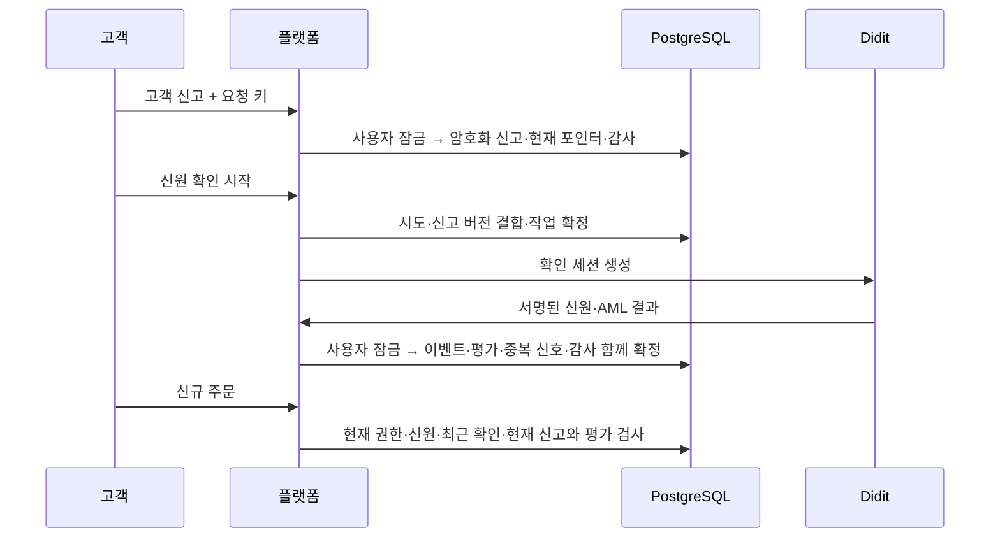

# 고객 신고와 서명된 신원을 대조해 초기 거래 위험을 평가하기

신분증이 승인됐다는 사실만으로 거래소의 고객 확인이 끝나지는 않는다. 고객이 신고한 이름·생년월일·국적과 실제 확인 결과를 대조하고, 실소유자·거래 목적·자금 원천·정치적 주요인물 신고와 AML 검사 근거를 신규 주문 조건에 연결한다.

- 작성일: 2026-10-23.
- 독자: TypeScript 백엔드 개발자인 프로젝트 소유자. 업무 판단·트레이드오프·Java 코드·실제 테스트를 함께 설명한다.
- 선행: [018 신분 확인](018-didit-identity-verification-and-trading-policy.md), [019 누락 결과 복원](019-platform-kyc-reconciliation.md).
- 위치: Java 플랫폼. Rust 체결 코어·WAL·Kafka 출력 워커와 프론트는 변경하지 않는다.
- 상태: 실행 소유 PostgreSQL·루프백 공급사·실제 HTTP/서명·별도 JVM으로 로컬 검증한다. 실제 Didit 계정·샌드박스·운영 워크플로·실제 개인정보 제출·배포는 수행하지 않았다.

## 문제와 기존 동작

기존 정책은 현재 고객 권한·운영 제한·서명된 신분 승인·만료·최근 확인 기한을 검사했다. 신분증·얼굴 검사가 모두 승인돼도 계정의 신고 정보가 그 사람과 일치하는지, AML 검사가 같은 사람을 대상으로 실행됐는지까지 검사하지 않았다. 고객 신고를 바꾼 뒤 옛 확인을 재사용하는 것도 막아야 했다.

**CDD(Customer Due Diligence, 고객확인)**는 신원 검증 외에도 실제 소유자·거래 목적·자금 원천·위험을 파악하는 업무다. **AML(Anti-Money Laundering, 자금세탁방지)**은 그보다 넓은 감시·조사·보고·조직 통제까지 포함한다. 이번 계층은 신고와 초기 자동 평가이며 전체 업무 완료가 아니다.

## 기존 제품과 공식 자료의 접근

2026-10-23 공식 자료를 확인했다. 공개 기능을 근거로 사용하며 각 회사 내부의 점수·DB·심사 조직은 추측하지 않는다.

| 근거 | 확인한 패턴과 적용 |
|---|---|
| [FIU 고객확인제도](https://www.kofiu.go.kr/kor/policy/amls05.do) | 신원 외 실제 소유자·목적·자금 원천을 확인하는 제도다. 신고 항목과 거래 허용 판단을 분리한다. 신고만으로 해당 사실이 증명됐다고 표시하지 않는다. |
| [Coinbase 계정 검토](https://help.coinbase.com/en/coinbase/managing-my-account/other/account-review) | 직업·목적·예상 활동/거래량·자금 원천·주소 등을 상황과 관할에 맞춰 요청하고 갱신한다. 우리도 고객 맥락을 신고로 수집한다. 이 회사의 비공개 위험 가중치를 가져오지 않는다. |
| [Kraken 신원 확인 자료](https://support.kraken.com/articles/360000672203-document-requirements-for-verification), 페이지 갱신 2026-08-19 | 신분 확인과 거주지 확인 자료는 구분된다. 이번 주소 입력은 고객 신고이고 주소 증명 완료가 아니다. |
| [IBKR 규제 정보 갱신](https://www.ibkrguides.com/advisorportal/regulatoryinformation.htm), 페이지 갱신 2025-09-15 | 고객 규제 정보의 갱신 업무를 별도로 둔다. 정보 변경을 기존 확인에 조용히 덮어쓰지 않는 근거다. |
| [Didit 세션 생성](https://docs.didit.me/sessions-api/create-session) | `expected_details`의 불일치는 경고로 나타날 수 있다. 요청으로 보낸 값을 검증된 신원으로 취급하지 않는다. 이름을 임의로 성/이름으로 분리해 보내지 않고 실제 추출된 전체 이름을 직접 대조한다. |
| [Didit 결정 조회](https://docs.didit.me/sessions-api/retrieve-session) | `id_verifications`·`aml_screenings`는 검사별 배열이다. 모든 필수 검사와 실제 추출 필드·검사 대상의 일치를 확인한다. |
| [Didit AML 명세](https://docs.didit.me/standalone-apis/aml-screening) | `Approved`만으로 검색 결과가 없다고 단정할 수 없다. 검사 대상과 결과·점수·경고를 함께 확인한다. 별도 유료 AML POST를 추가하지 않고 기존 워크플로의 서명된 결과만 소비한다. |
| [FATF 권고](https://www.fatf-gafi.org/en/publications/Fatfrecommendations/Fatf-recommendations.html) | 위험에 따른 고객 확인과 PEP 관리의 국제 기준을 참고한다. 국제 기준을 국내 법률·신고 충족 판정으로 바꾸지 않는다. 공개 페이지의 2026년 6월 개정 표기를 확인했으나 이번 코드에 국가별 최신 제재 목록을 복사하지 않았다. |

국내 법령·신고·인증·개인 자격의 구분은 [기존 대조표](../reference/access-control-compliance.md)를 유지한다. 이번 법령 링크 조회에서 조문 본문·부칙을 완전히 추출하지 못했으므로 최신 조항 전체·적용 조건을 확인했다고 표시하지 않는다. 고객 신고로 주민등록번호·여권번호 등 고유식별정보를 받거나 그 번호를 추출해 고객 식별 지문으로 사용하지 않는다. 공급사 전체 본문의 기존 서명/무결성 검증은 유지하되 CDD 근거는 허용한 신원 세 필드와 검사 결과만 추린다. AML의 상세 검색 자료나 `screened_data.document_number`도 대조 지문에 복사하지 않는다. 수집 근거·보존·파기·증적 요건은 실제 사업별 법률 검토가 필요하다.

## 선택과 트레이드오프

| 선택 | 얻는 이점 | 감수하는 비용과 대안 |
|---|---|---|
| 국내 거주 내국인 개인 투자만 초기 자동 처리 | 사업 범위와 자동 판단을 명확히 제한한다. | 다른 국적·거주지는 검토 대기다. 이를 불법 또는 고위험 국가로 단정하지 않는다. 전 세계 위험 점수·국가 목록을 추측해 구현하지 않는다. |
| 이름의 공백·대소문자·유니코드 정규화 후 정확 비교 | 다른 사람의 신원을 유사 이름으로 잘못 연결할 위험을 줄인다. | 로마자/한글·하이픈·이름 순서 차이는 자동 승인하지 못한다. 추측성 음역·퍼지 매칭보다 검토 비용을 선택했다. |
| 신고 버전과 확인 시도를 불변으로 결합 | 신고 변경 후 옛 신원 승인을 재사용하지 못한다. | 주소만 바뀌어도 새 확인이 필요하다. 현재 단계에서 필드별 예외·부분 재확인 정책은 만들지 않는다. |
| 버전이 있는 명시적 판정·사유 코드 | 왜 통과/검토됐는지 재현하고 설명할 수 있다. | 통계 근거 없는 가중치·금액 기준을 사용하지 않는다. 예상 거래량은 수집하지만 이상 거래 탐지로 사용하지 않는다. |
| 암호화 원문과 키 기반 지문 분리 | 필요한 재대조는 가능하고 공개 해시의 사전 대입 위험은 줄인다. | 독립 키 두 개·접근 통제·백업·보유/삭제 정책이 필요하다. 암호화만으로 개인정보 처리의 적법성이 확보되지 않는다. |
| 이름·생일·국적 지문 충돌은 추가 검토 | 동시 중복 자동 통과를 DB 고유 키로 막는다. | 동명이인 가능성이 있고 개명·다른 문서 표기로 중복을 놓칠 수 있다. 고유 인물 증명으로 과장하지 않는다. 나중 신고 때문에 먼저 확인된 고객을 자동 동결하지 않는다. |
| 모호한 결과는 신규 주문 거부 | 누락·불일치·오래된 근거를 승인으로 보완하지 않는다. | 수동 EDD 심사 업무가 구현되기 전에는 검토 고객을 승인할 수 없다. 운영자의 일반 거래 제한 해제로 이 조건을 우회할 수 없다. |

설치된 Spring 트랜잭션·JDBC·Jackson 3과 JDK의 AES-GCM·HMAC·유니코드/국가 코드를 사용한다. 패키지를 추가하지 않았으며 별도의 규칙 엔진·설정식 점수·다중 공급사 추상화도 만들지 않았다.

## 구현과 데이터 흐름



### 고객 신고와 API

[CustomerDeclaration](../../src/main/java/dustin/cex/domains/cdd/CustomerDeclaration.java)은 전체 이름, 생년월일, 국적·거주국(ISO 3자리), 한 줄 주소, 직업, 목적, 자금 원천, 예상 월 거래금액(USDT), 자기 소유자 여부, PEP 신고를 받는다. PEP는 정치적 주요인물이며 `NO/YES/UNKNOWN` 중 `NO`만 초기 자동 처리 대상이다.

| API | 접근과 응답 |
|---|---|
| `POST /api/kyc/customer-profile` | 현재 CUSTOMER Bearer 세션, `Idempotency-Key` UUID 필수. JSON 8KiB 이하, 중복 키·알 수 없는 필드·잘못된 자료형 거부. 최소 상태만 응답한다. |
| `GET /api/kyc/customer-profile` | 자기 신고 ID·평가 ID·결과·사유·시각. 신고 원문을 반환하지 않는다. |
| `GET /api/admin/kyc/customer-profiles/{id}` | 기존 MFA/권한 통제를 통과한 OPERATOR·APPROVER·AUDITOR의 최소 상태 조회. 개인정보 원문 열람 기능은 없다. |

[컨트롤러](../../src/main/java/dustin/cex/domains/cdd/CddController.java)는 오류에 입력값을 반사하지 않는다. 응답은 기존 인증 필터의 `Cache-Control: no-store`를 사용한다. 미신고는 `NOT_DECLARED`, 신고 후 새 신원 근거 대기는 `PENDING_IDENTITY`다. 응답의 `outcome`은 마지막 초기 평가이며, 신원 만료·운영 제한·최근 확인을 포함한 전체 주문 허가를 뜻하지 않는다. 신원 확인 세션만 먼저 시작할 수는 있지만 그 시도에는 이후 신고를 소급 결합하지 않으며 주문은 닫힌다. **권장 순서는 신고 → 새 확인 시도 → 서명 결과 → 주문**이다.

같은 고객·같은 키·같은 정규화 본문·같은 현재 신고는 같은 응답을 준다. 본문 변경이나 과거 신고 키 재사용은 409다. 새 신고는 하루 3회, 나이는 한국 날짜 기준 만 19세 이상, 생년 하한은 1900년이다. 이름/주소 길이와 금액 정밀도도 제한한다. 이 수치들은 프로젝트의 초기 입력·남용 방지 정책이며 법정 보장·수치가 아니다. 직업·자금 원천은 증빙 자료를 확인한 결과가 아니다.

### 불변 기록과 동시성

[CddService](../../src/main/java/dustin/cex/domains/cdd/CddService.java)와 [스키마](../../src/main/resources/cdd/schema.sql)의 책임은 다음과 같다.

| 표 | 책임 |
|---|---|
| `cdd_declarations` | 암호화된 신고, 내용 HMAC, 키 식별자, 고객별 요청 키. 과거 신고 변경 금지. |
| `cdd_attempt_bindings` | 확인 시도와 그 시점의 신고 결합. 나중 신고로 덮어쓰지 않는다. |
| `cdd_assessments` | 이벤트·신고·시도·판정 해시·정책 버전·키·사유·시각·신원 HMAC. 원본 신분증 자료는 없다. |
| `cdd_profiles` | 현재 신고·평가 포인터. 새 신고는 이전 평가 포인터를 비운다. |
| `cdd_identity_claims` | 신원 HMAC·키별 최초 자동 처리 고객. 동시 충돌을 고유 키로 직렬화한다. |

신고·결합·평가·최초 지문은 UPDATE/DELETE/TRUNCATE를 막는다. 같은 사용자 작업은 기존 사용자 행을 먼저 잠근다. 서로 다른 사용자 사이 동일 지문 경합은 `INSERT ... ON CONFLICT DO NOTHING`과 후속 소유자 확인으로 처리한다. 모든 평가·신원 수신 효과·감사는 같은 트랜잭션이다. 감사 저장에 실패하면 지문 선점까지 함께 롤백한다.

보존 잠금은 DB 관리자 침해 방지나 법정 보존/파기의 완성판이 아니다. 실제 개인정보 보존 기간·적법한 삭제·법적 보존·증적 보관·키 폐기 절차는 후속 설계다. 실고객 자료를 넣기 전에 확인해야 하며 무기한 보유 정책으로 해석하지 않는다.

### 자동 평가 조건

신분증·실재성·얼굴 검사에 대한 기존 필수 조건을 먼저 통과해야 한다. 그 뒤 다음을 함께 확인한다.

1. 모든 승인된 신분증의 실제 `full_name/date_of_birth/nationality`가 완전하고 서로 일치해야 한다. 누락·잘못된 날짜·충돌은 검토다.
2. 신고의 정규화 이름·생일·국적과 정확히 일치해야 한다. 요청의 `expected_details`를 증거로 사용하지 않는다.
3. 비어 있지 않은 `aml_screenings`의 모든 검사가 Approved·개인 대상이며, 정수 `total_hits=0`, 숫자 `score=0`, 빈 `hits`, 빈 `warnings`여야 한다.
4. AML `screened_data`의 이름·생일·국적도 같은 신원이어야 한다. 명세상 AML 국적은 ISO 2자리, 신분증 국적은 3자리여서 JDK 표준 코드로 명시적으로 변환한다. 누락을 기본 국적으로 채우지 않는다.
5. PEP 신고 NO·자기 실제 소유자·국적/거주국 KOR·개인 투자 목적이며 직업/자금 원천이 OTHER가 아니어야 한다.
6. 동일 신원 조합 지문의 다른 자동 처리 고객이 없어야 한다.

모두 통과하면 `STANDARD`, 그 밖에는 `REVIEW_REQUIRED`와 사유 코드를 남긴다. `STANDARD`는 **이 버전의 초기 조건 통과**다. 전체 CDD 완료, 제재 관련 법적 허용, PEP의 영구 부재, 실제 자금 원천 증명, 사업자 영업 적합성을 의미하지 않는다. 법인·해외 고객·강화된 확인(EDD)·오탐 해결·증빙 열람/반출·수동 승인 API는 아직 없다.

### 주문·대사·운영 계정 경계

[TradingAccessPolicy](../../src/main/java/dustin/cex/domains/security/TradingAccessPolicy.java)는 현재 신고와 평가의 선언 ID·활성 시도·현재 신원 판정 해시·현재 키·정책 버전이 모두 같은 STANDARD 평가인지 검사한다. 기존 권한·신원 VERIFIED·live 환경·만료·최근 확인 조건도 그대로 필요하다. 같은 요청 키의 기존 주문 결과 재조회와 자기 주문 취소는 새 고객 심사로 막지 않는다.

[KycReconciliationService](../../src/main/java/dustin/cex/domains/kyc/KycReconciliationService.java)는 신원 추출 필드와 AML 판단 근거의 HMAC을 현재 결정/보관 이벤트의 비교에 추가했다. 이름이나 AML 결과가 달라지면 옛 서명 승인으로 확인 기한을 연장하지 않는다. JSON 객체의 필드 순서 차이는 기존 서명 정규화를 재사용해 같은 근거로 처리한다. 일반 SHA에 이름·생일만 넣는 대신 정규화 해시를 다시 독립 키 HMAC으로 보호한다.

최근 결정 조회 성공이 AML 데이터셋 재검색 성공이라는 뜻은 아니다. 공급사의 지속 모니터링 활성화·제재/PEP/부정 뉴스 범위·목록 갱신과 새 검사 실행을 아직 확인하지 않았다. 이번 GET 대사를 지속적인 제재 감시 완료로 표시하지 않는다.

[정상 역할 부여](../../src/main/java/dustin/cex/domains/security/OperatorRoleService.java)와 [최초 관리 도구](../../src/main/java/dustin/cex/domains/security/OperatorBootstrapService.java)는 고객 신원 확인·CDD 신고 이력이 있는 계정을 전용 운영 계정으로 전환하지 않는다. 새 운영 계정이 필요하다. 관리 DB 역할에는 기존 권한 외 **`kyc_attempts`, `cdd_declarations`의 `user_id` 컬럼 SELECT**가 필요하며 DDL·원문 조회 API 권한을 추가하지 않는다.

## 암호화와 필요한 설정

[CddCrypto](../../src/main/java/dustin/cex/domains/cdd/CddCrypto.java)는 원문에 AES-256-GCM, 지문에 HMAC-SHA-256을 사용한다. 암호화는 매번 무작위 12바이트 nonce·128비트 인증 태그를 사용하고 AAD에 사용자 ID·신고 UUID를 결합한다. 암호문을 다른 고객/신고로 복사하거나 변경하면 복호화에 실패한다.

제품 설정 `CDD_ENCRYPTION_KEY`, `CDD_FINGERPRINT_KEY`는 각각 독립적인 32바이트 비밀의 Base64다. 두 키가 같거나 기존 Didit 링크 암호화 키와 같으면 기동을 거부한다. 둘 다 비어 있으면 CDD 제출은 503, 신규 주문은 거부한다. 일부만 설정·길이/형식 오류도 기동 실패다. 충분한 엔트로피와 비밀 저장·접근 통제는 운영자가 별도로 확보해야 한다. 테스트의 공개 가짜 키를 운영에 쓰지 않는다.

키 식별자는 두 키의 SHA-256이다. DB에 실제 비밀을 저장하지 않는다. 키나 정책 버전이 바뀌면 옛 평가로 주문을 열지 않는다. 과거 키 자동 선택·평문 폴백·기존 고객 자동 승인·기존 이력 보정은 없다. 키 교체 전 보존/복호화 필요성과 보호된 백업, 새 신고·새 확인 절차를 마련해야 한다.

## 이해에 필요한 Java 문법과 원리

- `record`는 고정 필드를 갖는 값 타입이다. TypeScript의 타입 선언과 달리 런타임 생성자·접근자·동등성·문자열 표현이 생긴다. 개인정보를 노출할 수 있는 기본 `toString()`은 고정 문구로 재정의했다. `@RequestBody`의 타입 선언만 믿지 않고 전용 JSON 파서와 명시적 검증을 사용한다.
- `enum`은 직업·목적·PEP 등 허용된 값을 런타임에도 제한한다. 모르는 값을 자동으로 OTHER로 바꾸지 않는다. OTHER는 고객이 명시적으로 신고한 값이다.
- `BigDecimal`은 십진 금액을 반올림 없이 표현한다. 예상 월 거래량은 USDT 기준 신고이며 주문·잔액을 바꾸지 않는다. 작은 숫자도 소수점 9자리 한도를 지켜야 한다.
- `Normalizer.Form.NFC`와 `Locale.ROOT`는 유니코드 표기·대소문자를 일정하게 한다. 제어/방향 전환/보이지 않는 형식 문자는 거부하고, 문장 부호·음역·성/이름 순서를 추측하지 않는다.
- `@Transactional` 메서드는 프록시를 통해 호출될 때 트랜잭션을 시작/합류한다. KYC에서 CDD의 `assess()`를 다른 빈으로 호출하므로 `MANDATORY`가 수신 트랜잭션 안에서 동작한다. JPA와 `JdbcTemplate`이 같은 PostgreSQL 트랜잭션을 사용한다.
- `ON CONFLICT DO NOTHING`은 중복 신원 경합에서 DB가 한 삽입만 확정하게 한다. 사용자별 락만으로 서로 다른 고객의 동일 신원을 직렬화할 수 없다는 점이 핵심이다.
- HMAC은 키가 필요한 지문이고 SHA-256은 공개 해시다. 암호화와 지문은 목적이 다르다. nonce는 암호화마다 새로 만들지만 같은 값 대조용 HMAC은 같은 키에서 안정적이다.

## 작성한 테스트

신규 CDD 통합 사례는 [KycIntegrationTest](../../src/test/java/dustin/cex/domains/kyc/KycIntegrationTest.java)에 추가했다. 기존 KYC 사례도 실제 신고와 완전한 서명 필드를 사용한다. 승인된 CDD 행을 끼워 넣어 이 통합 검증을 통과시키지 않는다.

| 함수 | 검증 시나리오와 기대 결과 |
|---|---|
| `cddCompleteSignedEvidenceProducesVersionedAssessmentWithoutPii` | 정상 서명·실제 신고로 STANDARD·신규 주문 통과, 평가/암호문에 이름·생일 원문 없음 |
| `cddIdentityApprovalWithoutCustomerDeclarationCannotTrade` | 미신고 신분 승인만으로 주문 불가 |
| `cddDeclarationAfterSessionCannotReuseItsIdentityEvidence` | 세션 생성 뒤 신고를 소급 결합하지 않음 |
| `cddNameMismatchNeverUsesFuzzyOrTransliteratedMatch` | 이름 불일치 검토·주문 거부 |
| `cddBirthdayMismatchRequiresReview` | 생일 불일치 검토 |
| `cddIncompleteExtractedIdentityCannotApproveRisk` | 추출 필드 누락 검토 |
| `cddConflictingApprovedDocumentsCannotApproveRisk` | 복수 승인 문서의 다른 신원 검토 |
| `cddMissingAmlCannotBeReplacedByIdentityApproval` | AML 누락은 승인으로 대체 불가 |
| `cddApprovedAmlWithPositiveHitsStillRequiresReview` | Approved여도 검색 결과가 있으면 검토 |
| `cddAmlScoreWarningAndHitDetailsCannotBeHiddenByZeroCount` | 개수 0인데 상세 결과 존재하면 검토 |
| `cddAmlScreenedPersonMustMatchVerifiedPerson` | 검사 대상이 다른 사람인 AML 승인 거부 |
| `cddPepDeclarationClosesNewOrdersWithoutManualOverride` | PEP YES 신고 검토·신규 주문 거부 |
| `cddNonSelfBeneficialOwnerRequiresReview` | 자기 소유자 아님 검토 |
| `cddForeignResidenceIsOutsideInitialAutomaticPolicy` | 외국 거주를 초기 자동 범위 밖으로 처리 |
| `cddChangedProfileInvalidatesOldApprovalAndRequiresNewAttempt` | 신고 변경 즉시 주문 닫힘·옛 시도 키 거부·새 시도 후 재평가 |
| `cddSubmissionKeyIsBoundToCurrentCanonicalBody` | 같은 요청 재사용·본문 변경/과거 키 충돌 |
| `cddImmutableHistoryRejectsUpdateDeleteAndTruncate` | 불변 신고/평가/결합/지문 삭제·전체 삭제 거부 |
| `cddAuditFailureRollsBackDeclarationAndAssessment` | 평가 감사 실패 시 KYC 수신·평가 함께 롤백 |
| `cddSameSignedEventDoesNotDuplicateAssessment` | 중복 수신 평가 1회 |
| `cddProviderIdentityChangeCannotRefreshOldSignedEvidence` | 현재 결정의 신원 변경 시 옛 서명으로 기한 연장 불가 |
| `cddProviderAmlChangeCannotRefreshOldSignedEvidence` | 현재 AML 결과 변경 시 옛 서명으로 기한 연장 불가 |
| `cddCurrentPolicyAndKeyMustMatchAssessment` | 다른 키에서 옛 평가 효력 없음 |
| `cddHttpRequiresCustomerSessionAndNeverReturnsOriginalPii` | 실제 HTTP 401/403·자기 상태/제출 200·원문 미반환·캐시 금지 |
| `cddHttpRejectsUnknownDuplicateOversizeAndInvalidValuesWithoutEcho` | 미지 필드/중복/잘못된 값 400·대형 본문 413·입력 미반사 |
| `cddConcurrentSameIdentityAllowsOnlyOneCustomerAndDoesNotFreezeFirstClaim` | 두 사용자 실제 동시 처리: STANDARD 1·중복 검토 1, 먼저 확정된 고객 유지 |
| `cddSubmissionRequiresCurrentOwnedCustomerSession` | 모르는 세션·회수 세션 거부 |
| `cddSubmissionHasBoundedDailyChangesAndAtomicAudit` | 하루 신고 3회 후 429 |
| `cddDeclarationAuditFailurePreservesPreviousPointer` | 신고 감사 실패 시 옛 포인터·이력 개수 유지 |
| `cddCustomerIdentityHistoryCannotBecomeDedicatedOperatorAccount` | 금융 기록 없이 고객 신고만 있어도 운영 전용 계정 전환 거부 |
| `cddReorderedAmlObjectFieldsRemainSameEvidenceDuringRecovery` | 객체 필드 순서만 다른 현재 결정은 동일 근거로 복원 |
| `cddAmlAmbiguousAndMalformedResultsNeverPassAutomatically` | 점수·경고·소수형 개수·큰 개수·대기·법인·배열 손상은 자동 통과 불가 |
| `cddUnknownPepIsNotInterpretedAsNoPep` | PEP UNKNOWN을 NO로 처리하지 않음 |
| `cddUnexplainedCustomerContextRequiresReview` | 목적 OTHER는 고객 맥락 검토 |
| `cddHttpRejectsScalarCoercionAndDateArrays` | 숫자 enum·문자열 Boolean/금액·날짜 배열을 400으로 거부 |
| `cddMissingIdentityFieldCanBeReconciledButRemainsReviewRequired` | 빠진 신원 필드는 null 근거로 대사할 수 있지만 검토·주문 차단 유지 |
| `cddUnneededDocumentNumberDoesNotEnterRiskEvidence` | AML 검사 대상의 불필요한 문서 번호는 CDD 대조 지문에 포함하지 않음 |

### 운영 역할 분리 회귀

[OperatorRoleTest](../../src/test/java/dustin/cex/domains/security/OperatorRoleTest.java)의 `customerDeclarationWithoutFinancialHistoryCannotBecomeOperator`, `customerIdentityAttemptWithoutFinancialHistoryCannotBecomeOperator`는 금융 이력이 없어도 고객 신고·확인 시도 이력으로 정상 역할 부여를 거부한다. `newCustomerDeclarationAfterRoleRequestPreventsApprovalWithoutVersionChange`는 역할 요청 후 고객 신고가 생겼을 때 사용자 버전이 같아도 승인 단계에서 다시 거부하는 경합을 검증한다. 여기의 DB 행은 역할 조건만 검증하는 합성 사전 조건이며 CDD 검증 증거가 아니다.

### 단위 테스트

| 파일·함수 | 검증 |
|---|---|
| [CddCryptoTest](../../src/test/java/dustin/cex/domains/cdd/CddCryptoTest.java) · `emptyConfigurationCannotEncryptOrFingerprint` | 미설정은 비활성 우회가 아니라 거부 |
| 같은 파일 · `partialInvalidOrReusedKeysFailStartup` | 부분 설정·잘못된 키·동일 키·Didit 키 재사용 거부 |
| 같은 파일 · `authenticatedCiphertextCannotMoveBetweenUsersOrDeclarations` | 복호화 정상·무작위 nonce·고객/신고 변경·변조 거부 |
| 같은 파일 · `fingerprintIsStableDomainSeparatedAndChangesWithKey` | 같은 키 안정성·목적/키 변경 시 지문 분리·비밀 문자열 미노출 |
| [CustomerDeclarationTest](../../src/test/java/dustin/cex/domains/cdd/CustomerDeclarationTest.java) · `exactNormalizationPreservesPunctuationAndDoesNotTransliterate` | 공백/대소문자/NFC만 정규화·문장 부호/음역 보존 |
| 같은 파일 · `controlBidiAndInvisibleCharactersAreRejected` | 제어·양방향·보이지 않는 문자·공백/초과 길이 거부 |
| 같은 파일 · `adulthoodUsesExplicitKoreanCalendarBoundary` | 한국 날짜 만 19세 경계 |
| 같은 파일 · `countryAndExactVolumeMustBeComplete` | ISO 3자리·정확 금액/범위·민감 값 문자열 미노출 |

금융·시장 회귀의 [KycFixtures](../../src/test/java/dustin/cex/domains/kyc/KycFixtures.java)와 [프로세스 SQL](../../src/test/resources/kyc-verified-fixture.sql)은 금융 처리에만 집중하는 **명시적 합성 사전 조건**이다. 실제 신원·AML 검증으로 집계하지 않는다. 반면 [강제 종료 복원 프로브](../../src/test/java/dustin/cex/domains/kyc/KycRecoveryProcessProbe.java)는 실제 고객 신고와 완전한 서명 결과를 사용하며 신뢰된 평가 행을 넣지 않는다.

## 실행 명령과 결과

최종 수치·컨테이너 정리·프로세스 종료·명령별 결과는 [확정 증적](../reference/cdd-initial-risk-verification-2026-10-23.json)에 보관한다. 검증 환경은 macOS·Temurin 21·실행 소유 PostgreSQL 16·필요 시 실행 소유 Kafka이며 봇은 0명이다. 기존 개발 DB/9092를 테스트에 사용하지 않는다.

| 검증 | 최종 결과 |
|---|---|
| 고객 확인·CDD | JUnit 150개. 기존 KYC 106 + 신규 CDD 통합 36·단위 8 |
| 승인·접근 통제 | 190개. 역할 회귀 3개 신규 포함 |
| 운영 보안키 | 42개 |
| 금융·시장·수신 | 183개 |
| 실제 Rust/PG/Kafka 시장 연결 | 1개 |
| 선택 JUnit 합계 | **566개, 실패·오류·제외 0개. 신규 47개** |
| 별도 프로세스 시나리오 | **15개**. KYC 강제 종료/복원 3·관리 JAR 2·주문 프로세스 10. 신규 시나리오 수를 더하지 않고 기존 시나리오의 CDD 사전 조건/근거와 컬럼 권한 검사를 확장 |
| 빌드 | `bootJar`, `operatorAdminJar`, `jmhClasses`, 의존성 목록 생성 성공. JMH 성능 측정은 안 함 |
| 의존성 | 222개 버전, OSV 알려진 검출 0개, 잠금/체크섬 변경 없음. 변조 복사본 Gradle 종료 1로 차단 |

최종 전체 회귀 뒤 누락/개인정보 최소화 보완은 KYC 150개·실제 JVM 복원·최소 권한 관리 JAR·실제 시장 연결·빌드·의존성을 다시 확인했다. 나머지 금융·승인·주문 프로세스 수치는 직전 전체 회귀다. 두 실행의 같은 테스트를 합산하지 않는다. 실행 소유 PostgreSQL/Kafka·임시 DB는 정리했다.

```sh
python3 scripts/verify_kyc.py
python3 scripts/verify_kyc_recovery.py
python3 scripts/verify_bound_approvals.py
python3 scripts/verify_operator_mfa.py
python3 scripts/verify_engine_inbox.py
./gradlew operatorAdminJar bootJar jmhClasses writeDependencyInventory --console=plain
python3 scripts/verify_operator_admin.py
python3 scripts/verify_order_idempotency.py
python3 scripts/verify_market_path.py
python3 scripts/audit_dependencies.py
python3 scripts/verify_dependency_integrity.py
```

실제 실행은 `JAVA_HOME=/Library/Java/JavaVirtualMachines/temurin-21.jdk/Contents/Home`에서 수행했다. 긴 실행은 `caffeinate -dims`로 감쌌다. 첫 회귀에서 신규 테스트의 세션 회수 쿼리를 트랜잭션 밖에서 호출한 오류 1건을 수정했다. 이후 실제 JVM 복원에서 JSON 필드 순서에 따른 근거 지문 차이를 재현해 정규화 재사용과 전용 회귀를 추가했다. 시장 전체 경로 테스트는 일반 프로필을 사용해 새 CDD 키가 미설정이었고 신규 주문이 거부됐다. 금융용 합성 평가와 같은 공개 테스트 키를 명시하는 사전 조건으로 고쳤다. 입력 경계 보완 중 Jackson 2의 `DeserializationFeature` 위치를 그대로 사용한 enum 설정 컴파일 오류도 수정했다. 설치된 Jackson 3.1.8 타입을 다시 확인했으며 enum 설정은 `cfg.EnumFeature`에 있다. 이번 API는 enum뿐 아니라 날짜 배열·Boolean/금액 문자열도 거부해야 하므로, Jackson 트리의 실제 필드 자료형을 짧게 검사한 뒤 같은 라이브러리로 record를 만든다. 라이브러리에 enum 검증 기능이 없어서 직접 파서를 만든 것은 아니다. 마지막 검토에서는 누락 노드를 명시적 null 근거로 비교하도록 보완해 대사 성공과 고객 자동 통과를 구분하는 회귀를 추가했다. AML 근거도 실제 사용하는 세 신원 필드와 상태·개수/점수·결과/경고의 비어 있음만 추려 불필요한 문서 번호나 상세 검색 자료가 CDD 지문에 들어가지 않게 했다. 중간 실행 수치를 최종 합계에 중복 가산하지 않는다.

기존 deprecated/unchecked 컴파일 안내, Mockito 계측에 따른 JVM 클래스 공유 안내, 최초 임시 스키마 준비 시 존재하지 않는 테이블 안내, 테스트의 Swagger 활성화 안내는 기능 성공과 별도로 기록한다. 새 성능 측정·실제 공급사 승인·개업 검증을 수행한 것은 아니다.

## 남은 범위와 다음 순서

1. 추가 검토 사건·증빙·독립 심사자·업무별 추가 인증·승인/거절·유효기간·감사. 근거가 부족한 신원·AML을 운영자가 버튼으로 우회하는 업무가 되어서는 안 된다.
2. 제재/PEP/부정 뉴스 범위·국내 목록·실제 공급사 워크플로/지속 모니터링·데이터셋 갱신·오탐 및 재심사. 이번 결과 읽기와 새 스크리닝을 구분한다.
3. 주소·직업·자금 원천/재산·실제 소유자 증빙·법인·해외 고객·고객 정보 갱신과 재확인 정책. 예상 활동과 실제 거래의 감시·조사·보고.
4. 처리 근거·정보주체 안내/동의·DPA/국외 이전·데이터별 보유/파기·민감 원문 열람/내보내기·키 수명·관리 도구 최소 DB 권한·외부 감사 보관.
5. 실제 사업 범위의 법령/부칙·FIU 신고·ISMS/ISMS-P·조직/인력/내부 감사·외부 심사. 개인 자격증이나 이번 코드로 충족을 주장하지 않는다.

엔진 코어는 이 정책을 알 필요가 없다. 주문 이전 플랫폼에서 통제하며 기존 엔진의 단일 스레드·공유 락 제거·입출력 워커 분리를 유지한다. 디스크/호스트 손실의 외부 복제·백업은 기존 문서 요건으로 남긴다.

## 관련 커밋

- [`a0de0d2`](https://github.com/GiHoon1123/Cex-Platform-Service/commit/a0de0d2b576a93f561958d221d1d59d78b919217): 고객 신고값·독립 암호화/지문 계약과 단위 테스트.
- [`7b4fcd0`](https://github.com/GiHoon1123/Cex-Platform-Service/commit/7b4fcd0363f794ed7f58cd2b61fed06f8b3cb055): 서명 신원/AML·현재 신고·신규 주문·대사·운영 계정 경계와 통합/실제 프로세스 회귀.

구현·검증·문서의 기능 단위 커밋은 같은 작업 단위로 일반 푸시한다. 작성자·커미터는 Gihoon이며 강제 푸시·배포·기존 이력 변경은 없다. 최종 커밋과 원격 일치는 공통 완료 기록에 연결한다.
