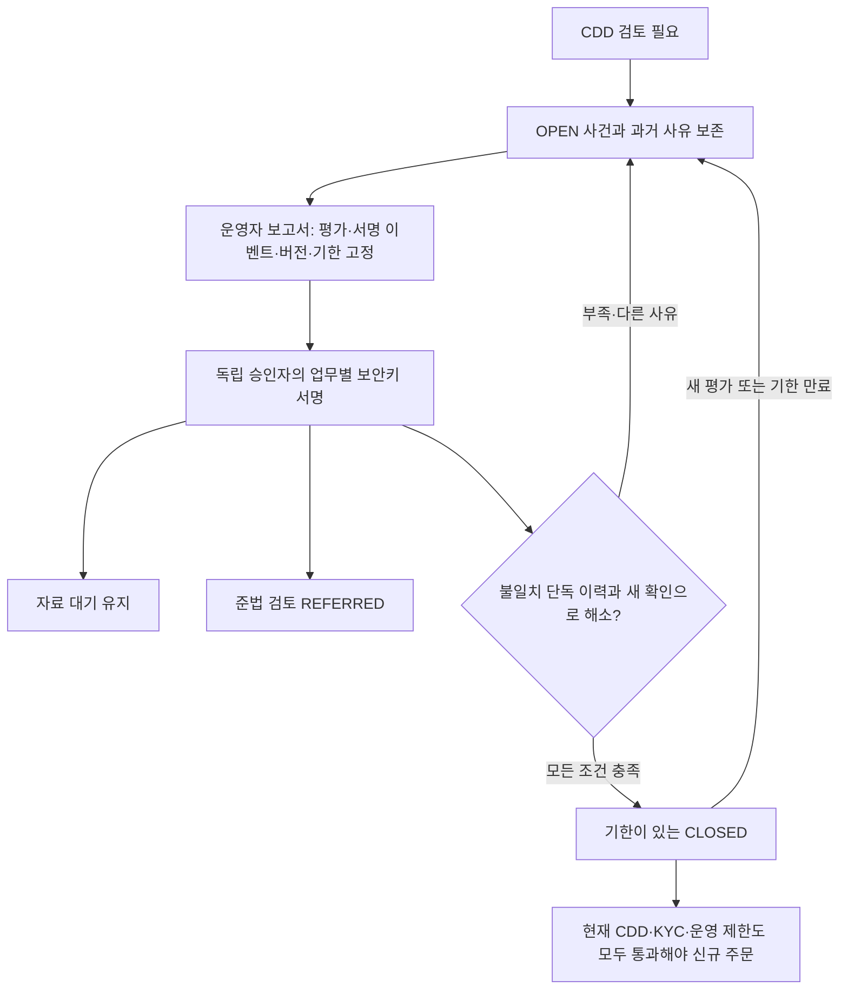

# 검토 이력을 유지하고 독립된 서명으로 EDD 결론을 확정하기

고객이 신고를 바꿔 초기 자동 평가를 통과해도 기존 추가 검토를 벗어나지 못하게 한다. 실제 신원 확인 기록에 결합한 검토 요청을 만들고, 다른 운영 인물의 업무별 보안키 서명으로 유지·준법 검토 회부·제한적 종결을 확정한다.

- 작성일: 2026-10-23.
- 독자: TypeScript 백엔드 개발자인 프로젝트 소유자. 정책·동시성·실패 처리와 실제 Java/SQL 코드를 함께 설명한다.
- 선행: [020 고객 신고와 초기 평가](020-customer-declaration-and-initial-risk.md), [017 업무별 서명](017-bound-approval-for-existing-operations.md).
- 상태: 로컬 격리 PostgreSQL·실제 HMAC·소프트웨어 보안키 서명 검증. 실제 Didit·실물 보안키·조직 심사·운영 배포·개업 적합성 확인은 아니다.
- 변경 영역: Java 플랫폼. 엔진의 단일 스레드 체결 코어·WAL·Kafka 출력 워커·프론트 제품 코드는 변경하지 않는다.

## 문제와 기존 동작

초기 CDD는 현재 신고와 현재 평가만으로 신규 주문을 판단했다. PEP YES나 AML 검토로 분류된 고객이 신고를 NO로 바꿔 새 STANDARD 평가를 받으면 과거 검토의 해결 여부를 판단할 업무가 없었다. 새 결과가 과거 위험을 지우게 해서는 안 된다.

추가 확인은 단순한 승인 버튼으로 만들 수 없다. 새 확인으로 직접 해소할 수 있는 정보 불일치와, 자금 원천·재산·실소유자·제재·PEP·국가·중복 인물의 조사가 필요한 사유를 구분해야 한다. 이번에는 실제 시스템 근거로 판단 가능한 좁은 종결과, 부족한 근거를 유지/준법 검토로 넘기는 업무를 끝까지 연결한다.

## 기존 제품과 공식 자료

2026-10-23 공식 자료를 다시 확인했다. 공개 업무를 참고하며 회사 내부 심사 알고리즘·DB·직책을 추측하지 않는다.

| 근거 | 적용과 한계 |
|---|---|
| [FIU 고객확인제도](https://www.kofiu.go.kr/kor/policy/amls05.do) | 신원 외 실제 소유자·목적·자금 원천을 확인한다. 재신고가 확인 사실을 대신하지 못하게 한다. |
| [특금법 제5조의2 조문정보](https://law.go.kr/LSW/lsLinkCommonInfo.do?chrClsCd=010202&lsJoLnkSeq=1022860887), 표시 시행 2026-10-02·법률 제21857호 | 이번 조회에서는 조문 본문을 확인했다. 신원/실제 소유자·의심 시 목적/원천, 지침의 절차·방법, 확인 불가 시 신규 거래 거절/관계 종료와 보고 검토를 구분한다. 내부 REFERRED는 법정 관계 종료·의심거래 보고를 실행한 결과가 아니다. 사업별 적용·시행령/고시·전체 부칙 검토는 계속 필요하다. |
| [FATF PEP 지침](https://www.fatf-gafi.org/en/publications/Fatfrecommendations/Peps-r12-r22.html), 2013년 지침 | PEP 확인은 추가 조치가 필요한 위험 관리이며 범죄 판정이 아니다. 이번 APPROVER 역할을 법령상 고위 경영진으로 인정했다고 주장하지 않는다. PEP를 신원 재제출만으로 종결하지 않는다. 최초 recommendations 경로의 PDF는 접근 실패해 공식 지침 페이지와 guidance 경로를 대조했다. |
| [Coinbase 계정 검토](https://help.coinbase.com/en/coinbase/managing-my-account/other/account-review) | 신고·요청 자료·검토/재요청은 구분된다. 고객에게 자료를 요청했다는 이유만으로 부정행위라고 단정하지 않는다. 우리도 검토 유지와 준법 회부를 명시한다. |
| [Kraken Organizations](https://support.kraken.com/articles/about-organizations), 갱신 2026-08-17 | 운영·승인 역할과 다자 승인을 구분하는 공개 패턴을 기존 보안키 승인에 적용한다. 실제 Kraken EDD 내부 절차를 구현한 것은 아니다. |
| [IBKR 규제 정보 갱신](https://www.ibkrguides.com/advisorportal/regulatoryinformation.htm), 갱신 2025-09-15 | 고객 정보 변경을 확인하는 별도 업무를 참고한다. 질문은 관할마다 다르며 우리 정책 기간을 증권사 규칙으로 설명하지 않는다. |

[기존 규제 대조표](../reference/access-control-compliance.md)의 사업 신고·ISMS/ISMS-P·조직 운영·개인 자격 구분을 유지한다. CISSP/CISA/CAMS 지식 범위의 참고가 사업 허가나 EDD 담당자의 권한 임명을 대신하지 않는다. 이번 지침 페이지와 조문 확인을 전체 최신 규제 검토 완료로 확대하지 않는다.

## 선택과 트레이드오프

| 선택 | 이점 | 비용·검토한 대안 |
|---|---|---|
| 고객별 지속 사건과 누적 실제 평가 사유 | 신고 변경·재확인이 과거 위험을 삭제하지 못한다. | 과거 PEP/AML 등은 현재 결과가 깨끗해도 추가 조사 전까지 유지된다. 최신 평가만 사용하는 방식보다 가용성이 낮지만 위험의 미해결 상태를 정확히 표현한다. |
| 불일치 단독 이력만 새 확인 후 종결 | 실제 서명과 현재 신원으로 검증 가능한 범위를 완성한다. | 다른 검토 사유의 종결은 지원하지 않는다. 근거 없는 외부 파일 번호·해시를 받는 범용 수동 승인보다 좁고 설명 가능한 구현을 선택했다. |
| 불변 보고서·별도 불변 결정 | 보고서 내용을 바꾸거나 이전 결론을 덮어쓰지 못한다. | 정정은 새 요청·새 결론이 필요하다. payload를 수정하며 승인하는 경로는 없다. |
| 기존 MFA 라이브러리·업무별 결합 재사용 | 로그인 성공 토큰을 승인 권한으로 바꾸지 않고 실제 서명을 검증한다. | 새로운 EDD 종류와 지원 스키마가 필요하다. 이름만 다른 별도 인증 체계는 만들지 않는다. |
| 고객 행 먼저·정렬된 운영자 행 잠금 | 신고/평가 변경과 승인·거절의 선후를 확정한다. | 짧은 플랫폼 DB 잠금이 생긴다. 외부 HTTP는 이 트랜잭션에 없고 엔진 코어는 영향받지 않는다. |
| 요청 10분·확인 옵션 2분·종결 최대 24시간 | 오래된 의도와 무기한 예외를 남기지 않는다. | 정상 고객도 종결 기한 이후 다시 검토해야 한다. 프로젝트 초기 정책이며 법정 기간이 아니다. |

새 라이브러리를 설치하지 않았다. 기존 Spring 트랜잭션/JDBC·Jackson·WebAuthn 검증·JDK 암호화를 사용한다. 실제 자금 원천/재산 증빙·안전한 첨부 보관·반출·제재 해소·고위 경영진 승인·지속 감시가 없는 상태에서 포괄적 EDD 완료로 표시하지 않는다.

## 구현과 상태

[서비스](../../src/main/java/dustin/cex/domains/cdd/EddService.java) · [API](../../src/main/java/dustin/cex/domains/cdd/EddController.java) · [스키마](../../src/main/resources/edd/schema.sql) · [주문 조건](../../src/main/java/dustin/cex/domains/cdd/CddService.java)



기한 만료는 별도 워커로 상태를 수정하지 않고 신규 주문 SQL에서 거부한다. 저장된 CLOSED와 `validUntil`을 함께 읽어야 하며 상태 이름만 거래 허가로 해석하면 안 된다.

### 사건과 근거

- `edd_cases`: 고객별 하나의 지속 사건, 최초/최근 실제 평가·변경 번호·상태·종결 기한.
- `edd_reports`: 요청자·요청 키·고정 payload·정규화 해시·10분 만료. 수정/삭제/전체 삭제 금지.
- `edd_decisions`: 보고서별 하나의 승인/거절, 실제 승인 인물·시각. 수정/삭제/전체 삭제 금지.
- 근거는 기존 불변 `cdd_assessments`와 실제 서명된 `kyc_events`다. 임의의 외부 증빙 ID를 검증된 문서인 것처럼 받지 않는다. 사진·PDF·자금 원천 증빙·서명 원문을 이 API에 업로드하지 않는다.

신규 검토는 CDD와 같은 사용자 잠금·트랜잭션에서 사건을 만든다. 이미 검토 이력이 있는 고객은 명시적 검토 요청 시 실제 이력을 근거로 사건을 열 수 있다. 미존재 과거 자료를 추측해 만들거나 승인 상태를 자동 반입하지 않는다. 과거 REVIEW_REQUIRED 이력이 있지만 사건이 없으면 주문은 닫힌다.

현재 STANDARD와 관계없이 과거 검토 이력이 있으면 유효한 종결이 필요하다. 새 평가는 사건을 다시 OPEN으로 만들고 변경 번호를 올린다. 재신고는 현재 CDD 포인터를 비우므로 승인 단계의 현재 근거 확인에서 거부된다. 새 근거로 무효화된 미결 보고서는 새 요청을 막지 않는다. 같은 현재 근거에는 미결 요청 한 건만 허용한다.

### 결론의 의미

| finding | 승인 후 상태 | 금융 효과 |
|---|---|---|
| `AWAITING_EVIDENCE` | OPEN | 검토 유지. 신규 주문 차단 유지 |
| `COMPLIANCE_ESCALATION` | REFERRED | 내부 준법 검토 회부. 관계 종료·출금·법정 보고 실행 아님 |
| `CORRECTED_SIGNED_IDENTITY` | 조건부 CLOSED | 아래 조건을 만족한 정보 불일치 사건만 기한 내 종결. 일반 거래 제한/신원/잔액 조건을 우회하지 않음 |

종결은 누적 사유가 **IDENTITY_MISMATCH만** 있고, 현재 CDD가 현재 키/정책의 STANDARD이며, REVIEW_REQUIRED가 발생한 적 없는 **새 확인 시도**, live 신원 승인·유효기한·최근 15분 확인이 있어야 한다. 요청한 기한은 미래이면서 최대 24시간이고 신원 만료보다 짧아야 한다. 같은 시도의 자료 정정만으로 종결하지 않는다.

PEP/AML·불완전 신원·실소유자·국가·목적/원천·중복 신원 검토는 종결 대상이 아니다. 원래 사건이 정보 불일치여도 나중에 다른 검토 사유가 생기면 종결할 수 없다. 원천/재산 조사나 제재 후보의 오탐 판정을 새 신원 승인으로 대신하지 않는다.

### 인증·동시성·감사

운영자(OPERATOR)가 최근 MFA 세션으로 요청하고 별도 승인자(APPROVER)가 승인/거절 내용에 결합한 보안키 서명을 제출한다. 계정 ID가 달라도 실제 운영 인물이 같으면 거부한다. 요청자의 역할·인물·버전과 승인자의 현재 권한/세션을 실행 직전에 검사한다.

요청자/승인자/고객 행을 ID 순서로 잠근 뒤 사건을 잠근다. 같은 고객의 승인·거절은 직렬화되며, 잠금을 얻은 뒤 결정 상태도 다시 조회한다. 결정·사건 변경·인증 옵션 소비·공개키 카운터·감사는 같은 트랜잭션이다. 하나라도 실패하면 모두 롤백한다.

EDD 서명은 역할·복구·거래 제한 등 다른 업무에서 사용할 수 없다. kind/request ID/payload 해시/승인 또는 거절/세션/기한이 모두 같아야 한다. 이전 네 업무 회귀 62개는 그대로 유지하고, 새 종류는 전용 EDD 검증에서 실제 서명으로 확인한다.

### API와 스키마 조건

| API | 접근 |
|---|---|
| POST `/api/admin/edd/customers/{user}/reports` | OPERATOR. 고객의 예상 assessmentId·finding·필요 시 validUntil, Idempotency-Key 필수 |
| POST `/api/admin/edd/reports/{id}/approve/options`, `/reject/options` | APPROVER. 저장된 보고서·해시·업무별 인증 옵션 반환 |
| POST `/api/admin/edd/reports/{id}/approve`, `/reject` | APPROVER. 고정 해시와 실제 서명 제출 |
| GET `/api/admin/edd/customers/{user}`, `/reports?page=0` | OPERATOR·APPROVER·AUDITOR. 민감 원문 없는 근거/상태, 보고서 페이지 최대 50건 |

요청 키는 요청자·고객·평가·finding·기한에 결합한다. 같은 키로 내용을 바꾸면 409다. 미결 보고서는 10분 후 EXPIRED로 읽으며 승인할 수 없다. 만료/거부·무효화된 요청 이력은 보존한다.

승인 종류에 `EDD_REVIEW`를 추가했다. 새 지원 스키마의 CHECK가 필요하며 기존 4종 제약은 자동 ALTER/자료 이전하지 않는다. 지원하지 않는 제약이면 기동을 거부한다. 현재 개발 DB를 자동 변경·재시작·삭제하지 않았고, 실제 이력 보존과 승인된 스키마 준비/배포 절차는 운영 전 과제다. 테스트는 이번 코드의 스키마로 만든 실행 소유 DB와 동일 스키마 재시작을 사용한다.

## 실제 코드와 이해에 필요한 Java·SQL

다음은 이번에 작성한 코드의 실제 발췌다. 각 블록은 메서드 일부이며 독립 실행 예제가 아니다. 링크한 파일을 함께 읽으면 호출 위치와 앞뒤 검증을 확인할 수 있다.

### 새 평가가 옛 종결을 무효화한다

```java
            // 새 검증 사실은 옛 보고서와 종결의 효력을 없앤다. 중복 이벤트는 CDD에서 이미 배제돼 여기 오지 않는다.
            jdbc.update("UPDATE edd_cases SET latest_assessment=?,revision=revision+1,state='OPEN',valid_until=NULL WHERE id=?",assessment,prior.id());
            audit.record(user,"EDD_CASE_UPDATED","edd:"+prior.id(),"SUCCESS","NEW_ASSESSMENT");
```

`revision=revision+1`은 새 근거와 이전 요청을 구분하는 번호다. TypeScript의 객체 필드 갱신과 달리 DB 트랜잭션과 사용자 잠금으로 다른 요청과의 순서를 확정한다.

### 다른 위험을 신원 재확인으로 지우지 않는다

```java
// PEP·제재 의심·실소유자·국가·목적·중복 신원은 신원 재제출만으로 해소되지 않는다.
if(c.reviewReasons().isEmpty() || !c.reviewReasons().stream().allMatch("IDENTITY_MISMATCH"::equals)
        || !a.get("outcome").equals("STANDARD") || !CddService.POLICY.equals(a.get("policy_version")) || !crypto.keyId().equals(a.get("key_id"))) throw deny(HttpStatus.CONFLICT);
if(until==null || !until.isAfter(Instant.now()) || until.isAfter(Instant.now().plusSeconds(86400))) throw deny(HttpStatus.CONFLICT);
```

`allMatch`는 과거 사유가 전부 정보 불일치인지 확인한다. 현재 신고만 보는 조건과 다르다. `Instant`는 한 시점을 나타내며 저장 전 마이크로초로 고정한다. 이어지는 SQL이 새 시도·현재 판정·신원 만료·최근 확인도 검사한다. 위 if문 하나가 전체 종결 조건은 아니다.

### 실제 서명과 업무 변경은 한 트랜잭션이다

```java
mfa.authorizeApproval(actor,sid,OperatorMfaService.ApprovalKind.EDD_REVIEW,id,hash,approve,proof);
var checker=users.findById(actor).orElseThrow();
jdbc.update("INSERT INTO edd_decisions(report_id,approver_id,approver_person,approved) VALUES(?,?,?,?)",id,actor,checker.getOperatorPersonId(),approve);
if(approve) {
    String state=switch(r.payload().finding()) {case AWAITING_EVIDENCE->"OPEN";case COMPLIANCE_ESCALATION->"REFERRED";case CORRECTED_SIGNED_IDENTITY->"CLOSED";};
    jdbc.update("UPDATE edd_cases SET state=?,valid_until=?,revision=revision+1 WHERE id=?",state,
        r.payload().validUntil()==null?null:Timestamp.from(r.payload().validUntil()),c.id());
}
audit.record(actor,"EDD_DECIDED","edd-report:"+id,"SUCCESS",(approve?"APPROVED:":"REJECTED:")+hash);
```

`switch`는 finding에 대응하는 사건 상태를 명시한다. TypeScript의 분기문과 비슷하지만 Java enum을 추가하면 완전한 switch 식도 수정해야 한다. 이번 컴파일 검증에서 기존 테스트의 두 switch에 새 분기를 빠뜨린 것을 발견해 수정했다.

`authorizeApproval()`이 별도 승인 토큰을 발급하는 것이 아니다. 열린 업무 트랜잭션에서 서명을 확인하고 일회용 인증 옵션과 공개키 카운터를 소비한다. 같은 트랜잭션의 감사가 실패하면 소비·결정·사건 변경이 전부 되돌아간다. 재시도 시 유효한 같은 서명을 다시 제출할 수 있는 이유다.

### 신규 주문에는 과거 검토의 유효한 종결도 필요하다

다음은 [CddService.permitted](../../src/main/java/dustin/cex/domains/cdd/CddService.java)의 실제 SQL 일부다.

```sql
AND (NOT EXISTS(SELECT 1 FROM cdd_assessments old WHERE old.user_id=c.user_id AND old.outcome='REVIEW_REQUIRED')
 OR EXISTS(SELECT 1 FROM edd_cases e WHERE e.user_id=c.user_id AND e.latest_assessment=r.id
  AND e.state='CLOSED' AND e.valid_until>clock_timestamp())))
```

`EXISTS`는 행이 있는지만 검사한다. REVIEW_REQUIRED 이력이 없다면 일반 CDD 경로, 이력이 있다면 현재 평가와 연결된 유효한 CLOSED가 필요하다. 실제 코드에서는 이 앞에 현재 신고/시도·판정·키/정책 조건도 있고, 상위 TradingAccessPolicy가 현재 권한·운영 제한·신원·최근 확인을 검사한다. **이 발췌만으로 주문을 허용하지 않는다.**

## 작성한 테스트

[EddIntegrationTest](../../src/test/java/dustin/cex/domains/kyc/EddIntegrationTest.java)는 고객 신고와 KYC 제품 경로에서 실제 HMAC을 검증하고 실제 ECDSA 보안키 서명으로 요청/결정을 실행한다. 유료 공급사 세션 생성 HTTP만 대역이다. 외부 HTTP 명세는 기존 KYC 통합/프로세스 검증을 유지한다. 실제 장치·Didit 계정 연동 검증이 아니다.

| 함수 | 검증 시나리오·기대 결과 |
|---|---|
| `ordinaryVerifiedCustomerDoesNotNeedEddCase` | 검토 이력이 없는 정상 신원은 기존 거래 경로 유지 |
| `reviewCreatesCaseAndNewDeclarationCannotRemoveHold` | 불일치 사건 보존·새 신고/정상 평가 후에도 차단 |
| `freshSignedReverificationAndIndependentSignatureCloseOnlyMismatch` | 새 신원·독립 서명으로 불일치 단독 사건만 기한 내 종결 |
| `rejectionPreservesHoldAndAllowsNewReport` | 거절은 차단 유지·새 요청 가능 |
| `complianceReferralRecordsConclusionWithoutOpeningTrading` | 준법 회부 결론 기록·차단 유지 |
| `awaitingEvidenceApprovalDoesNotPretendToFinishEdd` | 자료 대기는 OPEN 유지 |
| `historicalPepCannotBeErasedByNoPepRedeclaration` | PEP 재신고로 과거 위험 지우기 불가 |
| `oldOrUnverifiedAssessmentCannotBeClosedByHuman` | 불충분한 현재 평가를 승인으로 대체 불가 |
| `disclosureChangeAfterOptionsInvalidatesSignature` | 옵션 뒤 신고 변경 시 결론 불가·결정 0개 |
| `newAssessmentInvalidatesOldReportAndDoesNotBlockNewProposal` | 새 근거는 옛 서명 무효·새 요청 허용 |
| `closedCaseReopensOnNewVerificationFact` | 종결 후 새 확인 사실은 OPEN 재검토 |
| `closedDispositionExpiresWithoutBackgroundWorker` | 기한 지난 종결로 주문 불가 |
| `currentKycFreshnessStillRequiredForClosure` | 최근 신원 확인 만료는 종결 불가 |
| `invalidClosureLifetimeAndRetentionFindingLifetimeAreRejected` | 과거/24시간 초과/누락 기한·유지에 불필요한 기한 거부 |
| `proposalKeyIsBoundToExactCurrentBodyAndOnePendingReport` | 같은 키 재조회·본문 변경 거부·현재 근거 미결 1개 |
| `samePersonDifferentApproverAccountCannotSelfApprove` | 다른 계정이어도 같은 인물 승인 거부 |
| `requesterRoleVersionChangeInvalidatesPendingReport` | 요청자 버전 변경 시 옛 요청 거부 |
| `sessionRevocationAndStaleMfaPreventApproval` | 회수한 승인 세션 거부 |
| `approvalProofCannotAuthorizeRejectionOrDifferentPayload` | 승인 서명의 거절/다른 해시 재사용 거부 |
| `proofCannotBeReplayedAfterCommittedDecision` | 확정 후 중복 결정 거부 |
| `approvalAuditFailureRollsBackCaseDecisionChallengeAndCounter` | 감사 실패로 사건/결정/인증 소비 롤백·같은 서명 재시도 성공 |
| `proposalAuditFailureRollsBackReportAndApprovalBinding` | 요청 감사 실패로 보고서/결합 저장 롤백 |
| `immutableReportAndDecisionRejectMutation` | 보고서·결정의 변경/삭제/전체 삭제 거부 |
| `concurrentApprovalAndRejectionHaveExactlyOneConclusion` | 다른 승인 인물 동시 결론 1개·늦은 결정 409 |
| `customerAndAuditorCannotWriteAndResponsesContainOnlyBoundEvidence` | 고객 거부·감사자 읽기만·원문 배제·캐시 금지 |
| `historicalAmlRiskCannotBeErasedByLaterCleanScreening` | 나중 깨끗한 결과로 과거 AML 검토 지우기 불가 |
| `freshnessLostAfterOptionsCannotBeRestoredByOldSignature` | 옵션 뒤 확인 기한 만료·서명 소비하지 않고 거부 |
| `oldApprovalSchemaFailsWithoutModifyingExistingHistory` | 격리 트랜잭션에서 옛 제약을 NOT VALID로 재현·실제 스키마 가드 거부·이력 보존 |
| `expiredImmutableReportCannotIssueOptions` | 과거 만료 보고서 합성 이력은 EXPIRED·옵션 거부 |
| `concurrentProposalKeysNeverCreateTwoPendingReports` | 같은 키/다른 키 동시 요청 2개 실행 사례·미결 보고서 1개 |
| `invalidOriginOrMissingUserVerificationNeverConsumesBusinessDecision` | 잘못된 origin/사용자 확인 없음 거부·정상 서명 후 성공 |
| `roleAndEddProofsAreNotInterchangeable` | 역할↔EDD 업무 서명 양방향 재사용 거부 |
| `completeApprovalHttpUsesStoredPayloadAndActualSignature` | 실제 MVC 보안/옵션/서명/승인 200·재실행 409 |
| `caseAuditFailureRollsBackIdentityAndAssessmentTogether` | 사건 개시 감사 실패는 신원·평가 함께 롤백 |

신규 실행 사례는 35개다. 파라미터화한 동시 요청 2개를 포함한다. 기존 [BoundApprovalTest](../../src/test/java/dustin/cex/domains/security/BoundApprovalTest.java)는 원래 네 업무의 62개를 명시적으로 선택한다. EDD를 가짜 공통 fixture로 통과시키지 않고 전용 실제 서명 검증에서 다룬다. 공통 소프트웨어 키 helper의 필요한 API만 테스트 패키지 밖으로 공개했으며 제품 인증 API와 무관하다.

## 실행 명령과 확정 결과

```sh
python3 scripts/verify_edd.py
python3 scripts/verify_kyc.py
python3 scripts/verify_kyc_recovery.py
python3 scripts/verify_bound_approvals.py
python3 scripts/verify_operator_mfa.py
python3 scripts/verify_engine_inbox.py
./gradlew operatorAdminJar bootJar jmhClasses writeDependencyInventory --console=plain
python3 scripts/verify_operator_admin.py
python3 scripts/verify_order_idempotency.py
python3 scripts/verify_market_path.py
python3 scripts/audit_dependencies.py
python3 scripts/verify_dependency_integrity.py
```

Temurin 21·macOS·실행 소유 PostgreSQL 16·필요한 격리 Kafka·봇 0명으로 실행한다. 기존 개발 DB/9092를 사용하지 않는다. JMH는 컴파일이며 새 성능 측정이 아니다. 최종 수치·명령별 결과·정리 증거는 [확정 JSON](../reference/edd-case-verification-2026-10-23.json)을 따른다.

초기 컴파일에서 새 승인 종류 때문에 두 테스트 switch의 완전성 오류를 발견해 수정했다. 옛 스키마 검증은 기존 EDD 행을 지우지 않고 NOT VALID 제약을 격리 트랜잭션에 만들어 가드의 실제 오류 문구를 검사한다. 실패한 트랜잭션을 롤백해 지원 제약과 모든 이력이 남는지도 확인했다. 중간 25/35개 실행을 최종 합계에 중복 가산하지 않는다.

기존 deprecated/unchecked 컴파일 안내, Mockito/JVM 클래스 공유 안내, 임시 스키마의 테이블 안내, 테스트 Swagger 활성화 안내는 별도로 기록한다. 실제 공급사·실물 장치·운영 조직·법률 전체 충족을 검증한 결과가 아니다.

## 남은 범위와 다음 순서

다음은 **실제 추가 확인 자료의 안전한 보관·필요 최소 열람·독립적인 사실 검증**이다. 자금 원천/재산·주소·실소유자 증빙, 제재/PEP 오탐과 지속 감시, 고위 경영진의 실제 권한·승인 증적, 법인/해외 고객은 이번 좁은 종결로 대체할 수 없다. 자료가 없는 경로를 임의 증빙 번호로 완료 처리하지 않는다.

준법 회부 뒤 조사·의심거래 보고 검토/보고·법적 관계 종료·안전한 잔여 자산 처리와 고객 통지/비밀 유지도 남아 있다. REFERRED는 이 업무들을 완료한 상태가 아니다. 실제 계약·국외 이전·보유/파기·접근/반출·키 수명·신고/인증·조직/인력·운영 심사와 승인된 스키마 배포는 별도 조건이다.

## 확정 수치

선택 JUnit **601개**, 실패·오류·제외 0개다. 신규 EDD 35·기존 KYC/CDD 150·승인/접근 190·보안키 42·금융 183·실제 시장 연결 1개다. 별도 프로세스 **15개**도 통과했다. 두 JAR·JMH 코드 컴파일·의존성 목록 생성 성공, 222개 버전의 알려진 OSV 검출 0·체크섬 변조 차단을 확인했다. 중간 실행을 합산하지 않는다. 실행 소유 자원은 정리했다.

EDD 전용 JVM 강제 종료 시나리오는 새로 작성하지 않았다. 별도 15개는 기존 KYC 복원·관리 도구·주문 프로세스 검증이다. 실제 EDD DB 트랜잭션·서명 소비·감사 실패·동시성은 새 35개에서 검증했다.

## 관련 커밋

[`b9d12d8`](https://github.com/GiHoon1123/Cex-Platform-Service/commit/b9d12d8)은 사건·서명·제한적 종결과 전용/기존 회귀를 구현한다.

구현과 실제 검증, 문서와 확정 증적을 목적별로 나눠 같은 작업 단위로 일반 푸시한다. 작성자·커미터는 Gihoon이다. 최종 커밋/원격 일치는 공통 완료 기록에 연결한다.
