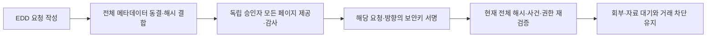

# EDD 결정의 자료 목록을 동결하고 독립 승인자의 전체 페이지 열람을 요구하기

주소·자금·재산 관찰 결과를 준법 회부에 연결한다. **결정 당시의 전체 자료 목록과 검토 상태를 동결하고, 승인자가 그 묶음을 제공받은 뒤 서명하도록** 구현했다. 사건 변경 번호가 그대로여도 새 자료 요청·미결 관찰이 생기면 이전 서명을 실행하지 못한다.

기준일은 2026-10-23이다. 기존 내용 검토가 외부기관 검증·적법성·위험 해소로 승격되는 기능은 아니다. 원문·이름·금액을 새 묶음에 복사하지 않는다. 내부 고객/자료 식별자도 추적 가능한 정보이므로 역할·최근 인증·감사·보존 통제 대상이다.

## 문제와 기존 동작

[023 주소](023-address-document-independent-review.md)·[024 자금](024-source-of-funds-pair-and-trade-review.md)·[025 재산](025-wealth-period-independent-review.md)은 각각 실제 자료와 관찰·독립 서명을 연결했다. EDD 사건 요청은 현재 평가·누적 위험·사건 변경 번호를 묶었지만, 그 시점의 개별 자료/관찰 목록은 함께 보존하지 않았다.

새 자료 **제출**·관찰 **결정**은 사건 변경 번호를 올린다. 그러나 새 자료 **요청**·미결 관찰 **작성**은 변경 번호를 올리지 않는다. 따라서 번호만 같다고 판단 근거가 같다고 볼 수 없다. 당시 목록은 보존하고 현재 목록과 달라지면 재작성해야 한다.

## 공식 자료와 선택 근거

- [Coinbase 계정 검토](https://help.coinbase.com/en/coinbase/managing-my-account/other/account-review): 필요한 자료 요청·검토·부족 자료의 추가 요청이라는 공개 고객 절차를 확인했다. 이 안내가 내부 승인/스냅샷 구현을 공개한 것은 아니다.
- [AUSTRAC SoF/SoW](https://www.austrac.gov.au/industry-and-business/obligations-and-guidance/your-amlctf-program/customer-due-diligence/source-funds-and-source-wealth), 표시 갱신 2026-10-13: 고객 설명·보유 정보·신뢰할 독립 근거를 위험에 비례해 대조한다. 관찰 목록 보존과 실체 검증을 구분하는 근거로 참고하며 호주 의무를 국내 의무로 표시하지 않는다.
- [FINRA Notice 19-18](https://www.finra.org/rules-guidance/notices/19-18), 발행 2019-05-06: 미국 증권사 대상 과거 안내에서 조사·추가 고객 확인·보고 검토를 구분한다. 신호나 사유 목록 자체를 범죄 판정으로 보지 않는다.
- [특정금융정보법 제5조의2](https://law.go.kr/LSW/lsLinkCommonInfo.do?chrClsCd=010202&lsJoLnkSeq=1022860887), 조회 화면 시행 2026-10-02·법률 제21857호: 위험에 따른 확인과 확인 불가 시 거절/종료·보고 검토를 대조했다. 근거 묶음·회부 승인이 법정 보고나 관계 종료 완료는 아니다.
- [PostgreSQL 16 바이너리 함수](https://www.postgresql.org/docs/16/functions-binarystring.html): 이미 사용하는 PostgreSQL의 SHA-256을 사용한다. 별도 확장이나 새 암호 패키지를 추가하지 않았다. 업무별 WebAuthn·필수 감사도 기존 설치 구현을 사용한다.

스냅샷과 전체 페이지 제공은 이 프로젝트가 선택한 통제다. 위 기관이 같은 내부 구조를 사용한다고 주장하지 않는다. 전체 법령·하위 규정·인증·신고 요건을 이번에 새로 전수 검증한 것은 아니다. 기존 대조표의 운영/외부 조건은 유지한다.

## 선택과 트레이드오프

| 선택 | 이점 | 비용·제약·대안 |
| --- | --- | --- |
| 사건 변경 번호와 전체 목록 해시를 함께 확인 | 번호가 바뀌지 않는 새 요청·미결 관찰도 탐지 | 근거가 바뀌면 기존 서명을 버리고 새 요청을 검토해야 한다 |
| 전체 목록은 불변 보존, 응답만 25개씩 분할 | 숨은 페이지까지 해시에 포함하며 당시 근거를 재현 | 요청마다 메타데이터 사본을 보관한다. 이력 누적에 따라 저장·집계·조회 비용이 증가한다 |
| 승인자는 본인 세션으로 모든 페이지를 제공받아야 함 | 첫 페이지만 보고 승인하는 API 우회를 막음 | 각 페이지 5분 기한·최근 MFA를 함께 만족해야 한다. 큰 사건은 재열람 비용이 크다 |
| 과거 목록 조회와 승인용 열람 분리 | 감사자가 당시 목록을 읽어도 승인 자격이 생기지 않음 | GET 조회 후에도 승인자는 별도 POST 열람을 진행해야 한다 |
| 원문과 금액을 목록에서 제외 | 불필요한 민감정보 복제를 줄임 | 실제 이미지·관찰 원문·내부 체결 금액은 기존 권한 있는 API에서 별도로 확인해야 한다 |
| 기존 EDD_REVIEW 사용, 요청 정책 버전 갱신 | 새 승인 종류나 범용 실행기를 추가하지 않음 | 옛 형식은 역사 조회만 유지하며 새 정책으로 실행하거나 자동 변환하지 않는다 |

목록 제공은 사람이 실제 읽고 이해했다는 자동 증명이 아니다. 자료 파일의 열람·독립 관찰·외부 진위 확인을 대신하지 않는다. 자료가 있는 사건의 단순 신원 정정 종결 차단은 유지한다.

## 보존하는 내용과 상태 의미

한 사건의 자료 요청 및 주소/자금/재산 내용 검토 전체를 명시적 필드로 수집한다. 사건 요청 자체와 페이지 제공 영수증은 입력에 넣지 않아 자기 자신을 추가하거나 열람했다는 이유로 해시가 달라지지 않는다.

| 종류 | 목록에 포함하는 항목 |
| --- | --- |
| EVIDENCE | 요청 ID·목적·평가·기한·제출된 자료 ID·원본 해시·증빙 키 식별자·당시 요청/만료/미검증 수신 상태 |
| ADDRESS/FUNDS/WEALTH | 관찰 검토 ID·평가/변경 번호·정책·자료 ID·원래 내용 해시·불일치 사유·키 식별자·확인 범위·당시 미결/만료/승인/거절 |

관찰 원문·암호문·성명·주소·잔고·내부 체결 지출액은 포함하지 않는다. 과거 평가의 자료도 이력으로 보존하며 평가 식별자로 구분한다. 목록의 APPROVED는 **그 내용 검토가 승인된 상태**이며 위험이 해소됐다는 뜻이 아니다. 동결 이후 원본 검토가 달라져도 과거 목록 상태를 현재 상태로 덮어쓰지 않는다.

목록 전체의 순서는 종류와 ID로 고정한다. `statement_timestamp()`를 기준으로 기한 상태를 한 SQL에서 계산하며 날짜 문자열은 UTC로 고정한다. 동결한 텍스트를 그대로 보관해 DB 버전의 JSON 출력 방식이 달라져도 과거 텍스트 해시를 검증할 수 있다. 이는 범용 JSON 표준 정규화나 외부기관 전자서명과 다른 계약이다.

## 업무 흐름과 API



1. OPERATOR가 기존 `POST /api/admin/edd/customers/{user}/reports`로 요청한다. 서버가 당시 자료 묶음 ID·해시·항목 수·페이지 수·정책을 승인 내용에 고정한다.
2. APPROVER는 `POST /api/admin/edd/reports/{id}/inspect?page=0`부터 모든 페이지를 제공받는다. 각 제공은 인물·계정 버전·세션·요청·자료 묶음·해시·페이지에 결합되고 필수 감사와 함께 저장된다. 빈 목록도 0번 페이지 제공이 필요하다.
3. 기존 approve/reject options와 결정 API를 사용한다. 별도 요청 ID·해시·방향·세션에 묶인 실제 WebAuthn 서명과 현재의 모든 페이지 제공 기록이 필요하다.
4. 자료가 달라졌으면 옛 요청의 상태가 PENDING이어도 실행할 수 없다. 같은 변경 번호라도 새 해시의 요청을 만들 수 있으며, 같은 변경 번호/평가/해시/정책의 미결 요청은 하나만 허용한다.
5. 감사자는 `GET /api/admin/edd/reports/{id}/dossier?page=0`으로 원래 목록을 읽는다. OPERATOR/APPROVER도 최근 인증 후 읽을 수 있지만 이 GET은 승인용 영수증을 만들지 않는다. 고객은 관리 API에 접근할 수 없다.

자료 대기·준법 회부는 각각 OPEN/REFERRED이고 거래를 열지 않는다. 기존 CORRECTED_SIGNED_IDENTITY는 자료 요청이 없고 오직 신원 불일치만 실제 새 서명 확인으로 해소된 좁은 조건을 유지한다. 자료/내용 검토 승인을 이 경로로 우회하지 않는다.

## 실제 코드와 필요한 문법

### 1. 전체 자료 묶음을 서버에서 동결하기

출처: [EddDossier.java](../../src/main/java/dustin/cex/domains/edd/EddDossier.java#L57)

```java
public Summary capture(UUID caseId,long user) {
    transaction();if(!Boolean.TRUE.equals(jdbc.queryForObject("SELECT EXISTS(SELECT 1 FROM edd_cases WHERE id=? AND user_id=?)",Boolean.class,caseId,user)))throw denied(HttpStatus.CONFLICT);UUID id=UUID.randomUUID();
    jdbc.update(BUNDLE+"INSERT INTO edd_case_dossiers(id,case_id,user_id,items,digest,item_count) SELECT ?,?,?,items,encode(sha256(convert_to(items,'UTF8')),'hex'),jsonb_array_length(items::jsonb) FROM bundle",caseId,user,id,caseId,user);
    return read(id);
}
```

호출 EddService가 고객/사건을 잠근 업무 트랜잭션 안에서 실행한다. `BUNDLE`은 필요한 필드만 조합한 정적 SQL이고 사용자 입력은 바인딩한다. DB가 전체 JSON 목록을 만들고 SHA-256과 항목 수를 함께 저장한다. Java가 큰 원문 목록을 HTTP 응답용으로 전부 읽어 보관하지 않는다. 집계·저장 자체의 비용이 없어지는 것은 아니며 엔진 코어에 조회나 락을 추가하지 않는다.

### 2. 목록을 요청 해시에 고정하기

출처: [EddService.java](../../src/main/java/dustin/cex/domains/cdd/EddService.java#L83)

```java
var p=new Payload(UUID.randomUUID(),c.id(),c.revision(),user,expectedAssessment,(UUID)assessment.get("event_id"),(UUID)assessment.get("attempt_id"),
    (String)assessment.get("status_digest"),(String)assessment.get("key_id"),(String)assessment.get("policy_version"),c.reviewReasons(),finding,micros(until),
    actor,maker.getOperatorPersonId(),maker.getVersion(),expires,REVIEW_POLICY,dossier);
String hash=verifier.digest(json.valueToTree(p));
```

기존 요청 내용의 canonical JSON 해시 안에 불변 자료 묶음 요약을 넣는다. 자료 묶음 자체는 DB가 보존한 정확한 텍스트 바이트의 SHA-256이고, 요청 해시는 기존 DiditWebhookVerifier의 JSON 정규화를 사용한다. 둘의 직렬화 규칙을 같은 것이라고 설명하지 않는다. 요청 해시·권한·결정 방향을 기존 WebAuthn 서명과 연결한다.

### 3. 본인 세션으로 모든 페이지를 제공받았는지 확인하기

출처: [EddDossier.java](../../src/main/java/dustin/cex/domains/edd/EddDossier.java#L79)

```java
public void requireAllPages(UUID report,Summary summary,User actor,UUID sid) {
    transaction();long count=jdbc.queryForObject("SELECT count(DISTINCT page) FROM edd_case_dossier_views WHERE report_id=? AND dossier_id=? AND actor_id=? AND actor_person=? AND actor_version=? AND session_id=? AND digest=? AND page>=0 AND page<? AND viewed_at>clock_timestamp()-interval '5 minutes'",Long.class,report,summary.id(),actor.getId(),actor.getOperatorPersonId(),actor.getVersion(),sid,summary.digest(),summary.pageCount());
    if(count!=summary.pageCount())throw denied(HttpStatus.CONFLICT);
}
```

`count(DISTINCT page)`로 같은 페이지를 반복해도 전체 제공으로 세지 않는다. 계정 ID만 같아도 다른 세션·사용자 버전·인물의 기록은 사용할 수 없다. 5분 이전 기록도 제외한다. 이미지의 실제 열람 영수증과 별개의 목록 제공 기록이다. TypeScript의 타입 검사와 달리 이 조건은 DB의 실제 이력에 실행 시 적용한다.

### 4. 마지막에도 현재 전체 근거를 확인하기

출처: [EddService.java](../../src/main/java/dustin/cex/domains/cdd/EddService.java#L140)

```java
if(!REVIEW_POLICY.equals(p.reviewPolicy()))throw deny(HttpStatus.CONFLICT);
dossiers.verify(p.dossier(),c.id(),p.userId());
if(!p.dossier().digest().equals(dossiers.liveDigest(c.id(),p.userId())))throw deny(HttpStatus.CONFLICT);
if(requireInspection)dossiers.requireAllPages(p.id(),p.dossier(),checker,sid);
validateFinding(c,current,p.finding(),p.validUntil());return c;
```

현재 사건·평가·누적 사유·작성자/승인자·최근 MFA를 앞에서 검사한 뒤 실행된다. 번호가 같아도 `liveDigest`가 다르면 거절한다. 고객 잠금이 새 자료 요청·관찰 작성과 순서를 정하므로 검사와 결정 사이에 다른 제품 경로가 근거를 바꾸지 못한다. 두 결정의 경합은 기존 사건 잠금 뒤 상태 재확인으로 하나만 확정된다.

### 5. 제공 영수증과 감사가 함께 확정되기

출처: [EddService.java](../../src/main/java/dustin/cex/domains/cdd/EddService.java#L96)

```java
var r=read(id);check(actor,sid,r,r.payloadHash(),false);var result=dossiers.page(r.payload().dossier(),page);
var checker=users.findById(actor).orElseThrow();dossiers.viewed(id,r.payload().dossier(),page,checker,sid);
audit.record(actor,"EDD_DOSSIER_INSPECTED","edd-report:"+id,"SUCCESS",r.payload().dossier().digest()+":page="+page);
return new Inspection(r,result);
```

페이지 데이터 준비·제공 영수증·필수 감사가 같은 TransactionTemplate 안에 있다. 감사가 실패하면 응답 데이터가 반환되지 않고 새 영수증도 취소된다. 이후 결정 실패가 이미 별도 트랜잭션에 확정된 정상 열람 이력까지 삭제하는 것은 아니다. 결정·서명 소비·키 카운터·사건 변경은 기존대로 최종 결정 감사와 함께 롤백한다.

### 6. 실제 페이지 경계 테스트

출처: [EddDossierIntegrationTest.java](../../src/test/java/dustin/cex/domains/kyc/EddDossierIntegrationTest.java#L61)

```java
@Test void allPagesAreRequiredAndRepeatingFirstPageCannotCompleteInspection() throws Exception {
    reviewed();seedExpiredRequests(28);var r=referral();assertEquals(2,r.payload().dossier().pageCount());
    assertEquals(25,inspect(r,0).dossier().items().size());
    // 첫 페이지를 반복 제공해도 서로 다른 모든 페이지를 제공한 것으로 세지 않는다.
    inspect(r,0);assertThrows(ResponseStatusException.class,()->options(r));
    assertEquals(3,inspect(r,1).dossier().items().size());assertNotNull(options(r));
    decide(r,true,proof(checker,r,true));blocked();
}
```

28건의 합성 과거 요청을 새로 추가해 25+3 페이지 경계를 검증한다. 기존 불변 이력을 수정/삭제하거나 외부 확인 완료를 채우지 않는다. 실제 서비스·DB·소프트웨어 보안키 서명을 사용한다. 정상 자료 검토·부정 관찰은 실제 PNG 제출과 주소/자금/재산 제품 경로를 통해 따로 검증한다.

## 저장·정책과 기존 이력

새 `edd_case_dossiers`와 `edd_case_dossier_views`는 UPDATE/DELETE/TRUNCATE를 거절한다. 목록의 항목 수·배열 형식·정확한 해시도 DB 제약으로 확인한다. 요청 작성·스냅샷·인증 결합·감사는 같은 트랜잭션이고, 미결 중복 거절/감사 실패 시 참조되지 않는 스냅샷도 남지 않는다.

승인 종류는 기존 여덟 종류를 유지한다. 요청 형식은 `EDD_CASE_DOSSIER_REVIEW_V1`, 묶음 정책은 `EDD_DOSSIER_V1`이다. 옛 요청 원본 JSON은 원본 자체의 해시로 역사 조회할 수 있지만 새 필드를 채우거나 실행하지 않는다. 과거 요청/감사/금융 이력을 변환하지 않는다. 기존 개발 DB·실행 중 서버는 재시작/배포하지 않았다. 운영 적용 전 이력을 보존하는 승인된 신규 스키마 준비가 필요하다.

## 작성한 테스트

신규 [EddDossierIntegrationTest](../../src/test/java/dustin/cex/domains/kyc/EddDossierIntegrationTest.java)에 다음 시나리오를 작성했다. 기존 EddTestSupport는 실제 페이지 열람 후 옵션을 요청하도록 바꾸고 EddIntegrationTest의 HTTP/실제 서명 흐름도 새 계약으로 갱신했다. 검증을 생략하거나 서명 검증을 참으로 대체하지 않았다.

- `emptyBundleStillRequiresIndependentPageZeroAndDoesNotClaimExternalVerification`: 빈 목록도 페이지 제공 전 옵션을 거절하고 회부 뒤 거래 차단을 유지한다.
- `evidenceRequestsAndReceivedFilesAreDistinctAndContainNoPrivateContent`: 자료 요청과 미검증 수신을 구분하고 원문·성명·금액을 목록에 포함하지 않는다.
- `pendingContentReviewChangesDigestWithoutChangingCaseRevision`: 주소/자금/재산 미결 관찰은 변경 번호 없이도 옛 서명을 무효화하고 새 묶음으로 회부할 수 있다.
- `allPagesAreRequiredAndRepeatingFirstPageCannotCompleteInspection`: 28건을 25+3으로 나누며 첫 페이지 반복만으로는 옵션을 받지 못한다.
- `frozenHistorySurvivesNewRequestButOldSignatureCannotDecide`: 새 요청이 생겨도 원래 빈 목록은 보존하고 옛 서명을 거절한다.
- `uploadChangesCurrentCaseAndCannotReuseOldInspection`: 새 제출 후 옛 사건/열람으로 결정하지 못한다.
- `historicalGetDoesNotCountAsIndependentInspection`: 역사 GET은 승인용 영수증을 만들지 않는다.
- `anotherPersonInspectionCannotAuthorizeCurrentApprover`: 다른 인물의 열람을 빌려 옵션을 발급하지 못한다.
- `invalidPageNeverLeavesViewReceipt`: 음수·범위 밖 페이지에 영수증을 만들지 않는다.
- `inspectionAuditFailureRollsBackReceiptAndDoesNotReturnBundle`: 제공 감사 실패는 새 영수증을 롤백하고 목록을 반환하지 않는다.
- `proposalAuditFailureRollsBackSnapshotReportAndBindingTogether`: 작성 감사 실패는 묶음·요청·서명 결합을 함께 롤백한다.
- `historicalReadAuditFailureReturnsNoMetadata`: 과거 목록의 감사 실패도 응답을 막는다.
- `staleSessionMfaAndSamePersonCannotInspect`: 오래된 MFA·같은 인물의 다른 계정은 독립 열람을 할 수 없다.
- `completedDossierAndViewsRejectUpdateDeleteAndTruncate`: 두 불변 표의 수정·삭제·전체 삭제를 DB에서 차단한다.
- `auditorReadsHistoricalMetadataButCannotCreateApprovalReceipt`: 감사자는 과거 조회만 가능하고 고객은 관리 경로에 접근하지 못한다.
- `oldReportPolicyCanBeReadButCannotInspectOrExecute`: 옛 형식은 원본 해시로 역사 조회하되 새 승인용 열람·실행은 거절한다.
- `componentCannotCaptureWithoutBusinessTransaction`: 업무 트랜잭션 없는 스냅샷 생성을 차단한다.
- `receiptOlderThanFiveMinutesCannotReplaceFreshInspection`: 최근 MFA가 있어도 6분 전 제공 기록은 거절하고 새 제공 후에만 옵션을 허용한다.
- `snapshotDigestDoesNotDependOnDatabaseSessionTimeZone`: DB 연결이 UTC/서울이어도 같은 자료 목록의 해시는 같다.
- `approvedNegativeAddressObservationIsCarriedIntoReferralWithoutResolvingRisk`: 실제 주소 관찰 승인의 부정 사유를 묶음에 보존하고 회부 후에도 차단한다.
- `pendingDuplicateProposalRollsBackUnreferencedSnapshot`: 같은 근거의 미결 요청 중복 거절로 스냅샷만 남지 않는다.

## 실행 명령과 결과

- `caffeinate -dims python3 scripts/verify_edd.py`
- `python3 scripts/verify_kyc.py`, `verify_kyc_recovery.py`, `verify_bound_approvals.py`, `verify_operator_mfa.py`, `verify_engine_inbox.py`
- `./gradlew operatorAdminJar bootJar jmhClasses writeDependencyInventory --console=plain`
- `python3 scripts/verify_operator_admin.py`, `verify_order_idempotency.py`, `verify_market_path.py`
- `python3 scripts/audit_dependencies.py`, `verify_dependency_integrity.py`

선택 JUnit **859개**, 실패·오류·제외 0개다. EDD/증빙/주소/자금/재산/근거 묶음 293개(신규 근거 묶음 통합 23개), KYC 150·승인/접근 190·MFA 42·금융 183·실제 시장 연결 1개다. 기존 별도 프로세스 **15개**도 통과했다. 실행 소유 DB/브로커·임시 DB/체크섬 표본은 정리했다.

두 JAR·JMH 컴파일·의존성 목록 생성을 통과했다. 의존성 222개 버전의 조회 시점 알려진 OSV 검출은 0개다. 변조 체크섬은 예상한 Gradle 종료 코드 1로 차단됐다. 의존성 목록 SHA-256은 `590da8748d7e2940dbc56dfe714c8c4cab4d1e5ed9b0be72dbf14e024e79268a`다. 운영 OS/JDK/컨테이너 전체에 취약점이 없다는 뜻은 아니다.

[확정 증적](../reference/edd-dossier-verification-2026-10-23.json)에 실제 명령·분리 집계·개별 테스트 사례·실행 소유 자원 정리·현재 코드 발췌 97개 대조와 검증 한계를 남겼다.

최종 회귀 전 테스트 예제를 줄바꿈하는 과정에서 이전 본문 두 줄이 중복돼 첫 KYC 회귀의 테스트 컴파일이 실패했다. 중복을 제거하고 전체 선택을 재실행했다. 앞선 EDD 통과와 이 컴파일 실패를 최종 통과 수치에 중복 합산하지 않는다.

실행 소유 PostgreSQL/Kafka의 임의 loopback 포트만 사용한다. 기존 5432/5433/5435 DB·9092 브로커를 테스트하지 않는다. 기존 폐기 예정 API/unchecked 변환·JVM 테스트 계측 경고는 남아 있다. JMH는 컴파일이며 새 성능 측정이 아니다. 이 묶음 전용 JVM 강제 종료 검증은 새로 작성하지 않았다.

## 남은 범위

자료 묶음의 확인 범위는 `METADATA_SNAPSHOT_ONLY_EXTERNAL_VERIFICATION_UNRESOLVED`다. 외부 발급기관·신뢰할 독립 정보·은행/체인 유입·재산 소유권/가치·고객의 별도 재산 진술·PEP/제재 실체 판단은 여전히 필요하다. 다음은 이 근거 묶음에 개별 위험의 조사·외부 확인 결과를 연결하는 단계다.

준법 회부는 STR 제출·관계 종료·출금/잔여 자산 처리 완료가 아니다. 개인정보 보존/파기·국외 이전·KMS/키 교체·DB 권한 분리·외부 감사 보존·실제 조직/운영·인증/신고는 기존 대조표에서 이어 관리한다. 내부 불변 트리거는 슈퍼유저 침해를 막지 않는다.

엔진 단일 스레드 코어·출력 워커·프론트는 변경하지 않았다. 봇은 0명이며 기존 로컬 서버 재시작·DB 변환·배포를 하지 않았다.

## 관련 커밋

- [`30a6c45`](https://github.com/GiHoon1123/Cex-Platform-Service/commit/30a6c456d21d9f724f7955df33c28ec43c916466): 불변 근거 묶음·독립 전체 페이지 제공·현재 근거 재확인과 신규 통합 테스트 23개.
