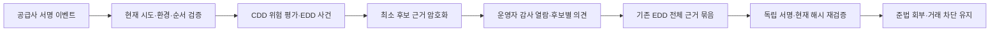

# 서명된 AML 후보 근거와 개별 조사 의견을 EDD 회부에 연결하기

기존에는 AML 검토 사유와 해시만 남아 당시 어떤 후보를 보고 판단했는지 플랫폼에서 재현할 수 없었다. 서명 검증된 최신 공급사 자료의 최소 필드를 암호화하고, 실제 검색 노드·후보와 담당자 의견을 연결해 기존 EDD 결정의 근거 묶음에 포함한다.

- 기준일: 2026-10-23. 독자: TypeScript 백엔드 개발자인 소유자와 금융 업무 검토자.
- 선행: [020 초기 위험 평가](020-customer-declaration-and-initial-risk.md), [026 결정 근거 묶음](026-edd-dossier-and-independent-inspection.md).
- 상태: 실제 HMAC·WebAuthn 소프트웨어 서명·격리 PostgreSQL과 공급사 대역 검증. 실제 고객·Didit 운영 계약·국내 목록 완전성·외부 기관의 사실 확인·신고/인증 완료가 아니다.
- 조사 의견은 동일 인물 확정·제재 해소·STR 제출·관계 종료·거래 허용이 아니다. 이전 관찰 검토를 외부 사실 검증으로 승격하지 않는다.

## 문제와 기존 경로

KYC 수신 이력에는 원문 신분증·생체 정보 없이 이벤트 해시와 처리 결과만 보관했다. CDD는 신원 대조와 AML 상태·후보 유무를 검증하지만 후보별 조사 근거와 메모를 남기는 API가 없었다. 또한 CDD 평가가 신원 VERIFIED인 전체 Approved 결과에만 실행돼 AML 때문에 전체 상태가 In Review/Declined인 실제 검토 자료를 조사 사건으로 연결하지 못했다.

키가 없는 암호화나 오래된 자료를 임의로 채우는 경로를 추가하지 않는다. 정상 고객의 자동 거래 조건은 유지하고, 실제 AML 검토 사유가 있는 최신 live 평가만 신규 조사 자료를 만든다.

## 기존 제품과 공식 자료

| 근거 | 적용한 부분과 한계 |
| --- | --- |
| [Didit AML 보고서](https://docs.didit.me/core-technology/aml-screening/report-aml-screening) | aml_screenings는 노드별 배열이고 후보 ID·신원 일치 점수와 위험 점수·자료 속성이 구분된다. 후보가 남아 있어도 오탐 또는 미판정일 수 있으므로 단일 수치로 인물을 확정하지 않는다. 공급사의 후보 상태와 집계 상태가 항상 함께 갱신되는 것도 아니다. |
| [Didit 웹훅](https://docs.didit.me/integration/webhooks) | 상태 변경과 data.updated를 구분하고 기존 전체 본문 HMAC 검증·현재 상태 대사를 재사용한다. 이번에 새 서명 체계나 독자 후보 매칭 알고리즘을 만들지 않았다. |
| [업비트 고객확인 공개 절차](https://support.upbit.com/hc/ko/articles/4406595681817-고객확인절차-알아보기) | 기본 확인과 필요한 추가 확인을 구분하는 고객 흐름을 참고한다. 업비트 내부 조사·승인 구현을 확인한 것은 아니다. |
| [특금법 제5조의2](https://law.go.kr/LSW/lsLinkCommonInfo.do?chrClsCd=010202&lsJoLnkSeq=1022860887), 화면 시행 2026-10-02·법률 제21857호 | 위험에 비례한 고객 확인과 확인 불가 시 거절/종료·보고 검토를 대조한다. 조사 의견 저장을 법정 보고 이행으로 취급하지 않는다. |

Didit 문서는 공급사의 응답 계약이며 국내 거래소 의무나 국내 제재 목록의 완전성 증명은 아니다. 법령 전체·하위 규정·조직/고위 경영진·사업 신고·인증 기준을 이번에 새로 전수 확인한 것은 아니다. 해외 참고 자료를 국내 법적 의무로 적용하지 않는다.

## 선택과 트레이드오프

| 선택 | 이점 | 비용·제약·대안 |
| --- | --- | --- |
| 실제 서명 결과의 같은 트랜잭션에서 최소 필드 보존 | 외부 ID만 입력한 근거와 구분하고 당시 자료를 재현 | 개인정보 보관 책임과 암호화/저장 비용이 증가. 과거 원문을 저장하지 않은 평가는 복구해 채우지 않음 |
| 후보 신원과 문서 번호·미디어·URL을 구분 | 조사에 필요한 이름/생일·국적/속성만 제공 | 외부 원문 발급기관·기사·목록의 진위 확인은 별도 필요 |
| 배열 위치와 실제 후보 ID 결합 | 여러 검색 노드의 같은 후보를 구분 | 중복 ID가 같은 노드에 여러 번 있으면 모호하므로 기록 거절 |
| 담당자 의견 저장과 최종 EDD 결론 분리 | 별도 승인 종류를 만들지 않고 현재 근거 묶음·독립 서명을 활용 | 조사 의견만으로 거래 차단을 해제하지 못함. 실제 위험별 종결 기준은 후속 범위 |
| 공급사 주장과 조사 의견을 암호화한 원문 API로 제한 | 일반 목록/감사에 후보 성명·메모가 섞이지 않음 | 원문 열람 권한·최근 MFA와 보유/파기·키 관리 책임이 남음 |
| 후보의 의미 있는 변경을 대사 지문에 포함 | 기존 비어 있지 않음만 같은 경우의 변경도 탐지 | 투영·해시 계산 비용 증가. 공급사 자료 변경과 서명 이력이 다르면 확인 기한을 갱신하지 않음 |

시간이 더 걸린다는 사실을 핵심 트레이드오프로 삼지 않는다. 저장/조회·공급사 자료 의존성·개인정보와 운영 판단 비용, 잘못된 자동 해제의 위험을 비교한다. 추가 라이브러리·설정·별도 승인 종류는 없다. 기존 Spring/JDBC·Jackson·JDK·두 암호화 컴포넌트를 사용한다.

## 상태와 데이터의 의미



- `edd_aml_sources`: 실제 live/APPLIED 이벤트·CDD 평가·사건·고객·원래 상태 해시·공급사 시각·키 ID·암호문과 지문. 평가별 하나다. 정상 고객에는 만들지 않는다.
- `edd_aml_source_views`: 자료/인물/계정 버전/세션/사건 변경 번호/지문/제공 시각의 불변 기록.
- `edd_aml_investigations`: 실제 자료·검색 위치·후보 ID·의견·메모 지문·행위자/버전과 암호화한 메모. 수정은 새 기록으로 남기며 같은 요청 키의 동일 재전송은 기존 기록을 반환한다.
- 세 표의 UPDATE/DELETE/TRUNCATE는 거절한다. 내부 트리거는 슈퍼유저 침해를 방지하지 않는다.

자료의 확인 범위는 `PROVIDER_ASSERTIONS_ONLY_NOT_ADJUDICATED`, 담당자 기록은 `ANALYST_OBSERVATION_ONLY_RISK_UNRESOLVED`다. `POSSIBLE_MATCH`, `IDENTIFIERS_DIFFER`, `INSUFFICIENT_INFORMATION`은 담당자 의견이며 공급사에 판정을 쓰거나 거래를 열지 않는다. 후보가 없거나 자료가 없으면 자료 부족 의견만 가능하다.

허용한 원문은 공급사가 확인한 최소 신원, 검색 대상의 성명/생일/국적, 검색 상태·점수, 후보 ID/이름/분류/점수/공급사 검토 상태와 명시한 이름·별칭·생일·국적 속성이다. 부분 생일은 그대로 표시하고 완전한 생일로 추정하지 않는다. 문서 번호·이미지·생체·임의 속성·기사 원문·URL·연관인 전체를 복사하지 않는다. 남는 ID/지문도 연결 가능한 개인정보이므로 익명 자료가 아니다.

## 실제 코드와 필요한 문법

다음은 실제 메서드 일부다. 독립 실행 예제가 아니며 호출부의 사용자 잠금·트랜잭션·인증과 함께 읽는다.

### 1. 전체 승인 전의 실제 위험 자료도 조사한다

출처: [KycService.java](../../src/main/java/dustin/cex/domains/kyc/KycService.java#L231)

```java
private boolean reviewableAml(JsonNode body,UUID session) {
    if(!Set.of("In Review","Declined").contains(body.path("status").asText()))return false;
    var d=body.path("decision");if(!session.toString().equals(d.path("session_id").asText())||!body.path("status").equals(d.path("status")))return false;
    var checks=d.path("aml_screenings");if(!checks.isArray())return false;
    for(var check:checks)if(Set.of("In Review","Declined").contains(check.path("status").asText())
            || (check.path("total_hits").isNumber()&&check.path("total_hits").decimalValue().signum()>0)
            || (check.path("hits").isArray()&&!check.path("hits").isEmpty())
            || (check.path("warnings").isArray()&&!check.path("warnings").isEmpty()))return true;
    return false;
}
```

`Set.of(...).contains(...)`로 지원하는 전체 상태만 다룬다. 내부 decision이 같은 세션/상태에 묶였는지 확인한다. 호출부는 APPLIED인 최신 이벤트만 CDD 평가로 넘긴다. 이 함수는 신원 상태를 VERIFIED로 바꾸는 판정기가 아니다. In Review는 PENDING, Declined는 NOT_VERIFIED를 유지한다.

### 2. 후보 속성은 허용 목록으로 복사한다

출처: [AmlSource.java](../../src/main/java/dustin/cex/domains/edd/AmlSource.java#L68)

```java
for(var hit:node.path("hits")) {
    var candidate=hits.addObject();scalars(candidate,hit,"id","caption","match_score","risk_score","review_status");strings(candidate,hit,"datasets");
    var properties=candidate.putObject("properties");for(String field:List.of("name","alias","birthDate","citizenship"))strings(properties,hit.path("properties"),field);
}
```

전체 JSON을 암호화해 보관하는 방식과 달리 복사할 필드를 명시한다. `strings`는 문자열 배열만 보존하며 자료형이 다르면 null로 남긴다. 점수로 동일 인물·제재 여부를 새로 계산하지 않는다. 원문 링크를 따라가는 HTTP 호출도 없다.

### 3. 암호문과 지문은 같은 업무 확정에 포함한다

출처: [AmlSource.java](../../src/main/java/dustin/cex/domains/edd/AmlSource.java#L44)

```java
byte[] plain=json.writeValueAsBytes(body);String mac=crypto.fingerprint("aml-source",new String(plain,java.nio.charset.StandardCharsets.UTF_8));
jdbc.update("INSERT INTO edd_aml_sources(id,case_id,user_id,assessment_id,event_id,status_digest,provider_time,content_mac,key_id,report_cipher) VALUES(?,?,?,?,?,?,?,?,?,?)",
    id,row.get("id"),user,assessment,event,digest,row.get("provider_time"),mac,crypto.keyId(),crypto.encrypt(user,id,plain));
audit.record(user,"EDD_AML_SOURCE_CAPTURED","aml-source:"+id,"SUCCESS",mac);
```

키를 가진 HMAC 지문과 암호화를 기존 CddCrypto에 맡긴다. 지문 입력은 보존한 정확한 JSON 평문 바이트의 UTF-8 표현이며, 읽을 때 같은 평문으로 재검증한 뒤 고객/사건/평가/이벤트/시각 결합도 확인한다. 수신 시점의 공급사 HMAC 검증과 이후 우리 보관 지문의 검증은 구분한다. 원래 전체 웹훅 본문/서명을 이 투영에 보관하지 않으므로, 보관 투영만으로 공급사 원문 전체 서명을 다시 검증할 수는 없다. 공급사 원본의 확보·보존 조건은 별도 확인이 필요하다. 자료 캡처·평가·수신 이력·사건·감사는 같은 트랜잭션이다. 캡처 감사가 실패하면 일부만 남지 않는다.

### 4. 현재 근거·본인 열람·실제 후보를 검사하고 기록한다

출처: [AmlInvestigationService.java](../../src/main/java/dustin/cex/domains/edd/AmlInvestigationService.java#L79)

```java
current(m,assessment,revision);view(writer,sid,m,view,revision);
target(sources.content(m).report(),screening,hit,finding);
UUID id=UUID.randomUUID();var p=new Payload(id,source,m.contentMac(),m.caseId(),revision,m.userId(),assessment,view,screening,hit,finding,mac,crypto.keyId(),
    actor,writer.getOperatorPersonId(),writer.getVersion(),POLICY,ASSURANCE);String hash=verifier.digest(json.valueToTree(p));
```

잠근 고객의 현재 신고/평가/확인 시도·상태 해시·정책/키와 사건을 검사한다. 다른 사람/세션/버전·오래된 열람을 빌리지 못한다. 검색 위치가 없거나 후보 ID가 없거나 같은 노드에 중복이면 거절한다. TypeScript의 타입만으로 확인할 수 없는 현재 DB 사실을 실행 시 검증한다. 메모는 EvidenceCrypto의 별도 키로 암호화하고 일반 payload에는 지문만 넣는다.

### 5. 대사는 후보가 달라진 사실도 확인한다

출처: [CddService.java](../../src/main/java/dustin/cex/domains/cdd/CddService.java#L156)

```java
// 후보 내용이 달라졌는데 비어 있지 않다는 사실만 같다고 옛 근거로 재확인하지 않는다.
evidence.set("aml_investigation",aml.project(decision).path("screenings"));
```

허용한 후보 필드를 기존 고객 확인 지문에 포함한다. 알려진 문서 번호·미디어 변화는 여전히 제외한다. 대사의 signedDecision은 같은 세션/상태에 결합된 In Review/Declined 결정도 대조한다. 현재 조회와 원래 서명 이력이 다르면 EVIDENCE_MISMATCH이고 임의로 후보를 덮어쓰거나 확인 기한을 늘리지 않는다.

### 6. 새 조사는 기존 결정의 전체 근거를 바꾼다

출처: [EddDossier.java](../../src/main/java/dustin/cex/domains/edd/EddDossier.java#L61)

```sql
SELECT 'AML_INVESTIGATION',r.id,jsonb_build_object('kind','AML_INVESTIGATION','id',r.id,'assessmentId',r.payload::jsonb->'assessmentId',
 'caseRevision',r.payload::jsonb->'caseRevision','sourceId',r.source_id,'sourceMac',r.payload::jsonb->'sourceMac',
 'policy',r.payload::jsonb->'policy','finding',r.payload::jsonb->'finding','payloadHash',r.payload_hash,'notesMac',r.payload::jsonb->'notesMac',
 'evidenceKeyId',r.payload::jsonb->'evidenceKeyId','status','RECORDED','assurance',r.payload::jsonb->>'assurance')
 FROM edd_aml_investigations r JOIN scope s ON s.case_id=r.case_id AND s.user_id=r.user_id
```

자료/조사의 메타데이터만 기존 근거 목록에 더한다. 새 의견이 생겨도 사건 변경 번호를 불필요하게 갱신하지 않고, 기존 전체 목록 해시 검사로 옛 결정을 거절한다. 동일 변경 번호의 새 근거 요청은 허용한다. 원문 열람 기록은 목록의 입력이 아니므로 열람 자체가 해시를 계속 바꾸지 않는다.

### 7. 누락 웹훅은 실제 보관 서명으로 복원한다

출처: [AmlInvestigationIntegrationTest.java](../../src/test/java/dustin/cex/domains/kyc/AmlInvestigationIntegrationTest.java#L145)

```java
@Test void missedInReviewWebhookIsRecoveredFromActualArchivedSignature() throws Exception {
    prepare("In Review",candidates());var original=delivery(event);currentDecision(null);when(client.deliveries(created.get(attempt))).thenReturn(json.createArrayNode().add(original));reconcile();
    assertEquals("CONFIRMED",jdbc.queryForObject("SELECT outcome FROM kyc_reconciliations WHERE attempt_id=?",String.class,attempt));assertEquals(1,count("edd_aml_sources"));memo(metadata(),view(metadata()));blocked();
}
```

공급사 HTTP는 대역이지만 HMAC 검증과 복원·평가·새 자료 저장·감사는 실제 제품 코드다. 테스트에서 공급사 요청에 대한 성공 값만 주입하고 서명/인가 검사를 참으로 바꾸지 않는다. 복원 후에도 고객 거래는 제한된다.

## API와 권한

| API | 권한과 동작 |
| --- | --- |
| GET `/api/admin/edd/customers/{user}/aml-sources?page=0` | OPERATOR/APPROVER/AUDITOR, 최근 MFA·감사. 원문 없는 25개 목록 |
| POST `/api/admin/edd/aml-sources/{id}/inspect` | OPERATOR/APPROVER, 최근 MFA·원문 해독·제공 기록·감사. 과거 자료 조회 가능 |
| POST `/api/admin/edd/aml-sources/{id}/investigations` | OPERATOR, Idempotency-Key·현재 assessment/revision·본인 viewId·검색 위치/후보·의견/메모 |
| GET `/api/admin/edd/customers/{user}/aml-investigations?page=0` | 세 운영 역할의 원문 없는 조사 목록 |
| POST `/api/admin/edd/aml-investigations/{id}/inspect` | OPERATOR/APPROVER, 최근 MFA·메모 해독과 필수 감사 |

고객은 이 관리 API에 접근하지 못하며 AUDITOR는 후보 원문·메모를 읽지 못한다. 응답은 기존 no-store 정책을 따른다. 운영자 역할 안의 별도 사건 배정 모델은 아직 없다. 실제 운영 전 업무 담당 범위와 대량 조회 통제·조직 권한을 검토해야 한다.

## 작성한 테스트

### [AmlSourceProjectionTest.java](../../src/test/java/dustin/cex/domains/edd/AmlSourceProjectionTest.java)

- `missingAmlRemainsMissingInsteadOfInventingClearResult`: 검색 자료 누락을 null로 보존하며 정상 판정을 만들지 않는다.
- `emptyAmlArrayIsPreserved`: 빈 검색 배열을 원래대로 보존한다.
- `identityAndScreenedDataNeverCopyDocumentNumbersOrImages`: 최소 신원은 보존하되 문서 번호·이미지를 투영에서 제외한다.
- `propertiesUseExplicitNameAliasBirthDateCitizenshipAllowlist`: 명시한 후보 속성만 복사하고 임의 속성·URL을 제외한다.
- `ambiguousArrayTypesBecomeNullRatherThanCoercedNames`: 배열이 아닌 이름과 숫자가 섞인 분류를 문자열 배열로 추측하지 않는다.
- `unknownObjectInScalarSlotIsNotCopied`: 스칼라 필드에 들어온 임의 객체를 복사하지 않는다.
- `noCandidateReviewStatusIsInvented`: 없는 후보 검토 상태를 생성하지 않는다.
- `scoresArePreservedWithoutThresholdClassification`: 두 점수를 원형대로 보존하고 자동 동일 인물 판정에 쓰지 않는다.
- `emptyWarningsAreDifferentFromAbsentWarnings`: 빈 경고 배열과 누락을 구분한다.
- `projectionHasIndependentMutableContainers`: 입력 JSON의 사후 변경이 투영 배열을 바꾸지 못한다.
- `captureRequiresBusinessTransaction`: 업무 트랜잭션 없는 자료 보존을 거절한다.

### [AmlInvestigationIntegrationTest.java](../../src/test/java/dustin/cex/domains/kyc/AmlInvestigationIntegrationTest.java)

- `signedRiskSourceSurvivesEachAggregateStatusWithoutOpeningTrading`: Approved/In Review/Declined 세 상태 모두 실제 후보 자료와 의견을 보존하고 거래 차단을 유지한다.
- `invalidNotesNeverCreateInvestigation`: null·빈 값·공백·방향 제어 문자·탭의 다섯 입력은 새 조사를 만들지 못한다.

- `originalNumbersUrlsAndMediaNeverEnterStoredProjectionOrLogs`: 허용한 자료를 제외한 번호/주소가 원문 투영·메타데이터·감사에 포함되지 않고 암호문은 평문 후보를 노출하지 않는다.
- `unverifiedSignatureCannotCreateSourceAssessmentOrCase`: 거짓 HMAC은 평가·사건·자료를 생성하지 못한다.
- `duplicateWebhookDoesNotCreateDuplicateSources`: 같은 이벤트 재수신으로 자료를 중복 생성하지 않는다.
- `sourceCaptureAuditFailureRollsBackEventAssessmentAndCase`: 자료 감사 실패는 수신·평가·사건을 롤백하고 정상 재전달로만 다시 확정한다.
- `sourceInspectionAuditFailureRollsBackReceiptAndReturnsNoContent`: 자료 제공 감사 실패는 새 영수증과 응답을 막는다.
- `investigationAuditFailureRollsBackNotesAndMetadata`: 조사 감사 실패는 메모와 메타데이터를 함께 롤백한다.
- `repeatedKeyReusesExactNotesAndTargetButChangedNotesConflict`: 같은 키·같은 내용은 기존 기록, 다른 메모는 충돌이며 추가 행은 없다.
- `simultaneousSameKeyNeverAddsTwoInvestigations`: 실제 두 스레드의 같은 키 경합에서도 하나의 조사 ID만 확정한다.
- `nonexistentHitCannotBeInventedAndNoPartialRecordRemains`: 없는 후보 ID는 거절하고 일부 기록을 남기지 않는다.
- `duplicateHitWithinSameNodeIsAmbiguousAndRejected`: 같은 노드의 중복 후보 ID는 모호하므로 거절한다.
- `sameHitInDifferentNodesIsBoundToSpecificNode`: 같은 후보 ID가 서로 다른 검색에 있어도 배열 위치로 구분해 기록한다.
- `missingAmlCanOnlyBeRecordedAsInsufficientInformation`: 검색 누락을 신원 차이로 단정하지 않고 자료 부족 의견만 허용한다.
- `missingHitCanOnlyHaveInsufficientInformationFinding`: 후보 없는 의견은 자료 부족만 허용한다.
- `anotherOperatorsReceiptCannotAuthorizeThisWriter`: 다른 운영자의 제공 기록을 사용하지 못한다.
- `sourceFromAnotherCustomerCannotUseCurrentCustomersReceipt`: 다른 고객 문맥으로 바꾼 자료 메타데이터는 암호화 인증 검증에 실패한다.
- `changedMetadataFailsSourceIntegrityWithSanitizedError`: 다른 평가를 넣은 메타데이터가 거절되고 원문·원인 예외가 노출되지 않는다.
- `staleMfaCannotReadOrWriteSource`: 오래된 MFA는 원문 제공과 새 조사 작성을 막는다.
- `changingWriterVersionInvalidatesOldReceipt`: 행위자 버전 변경 뒤 이전 제공 기록으로 새 조사를 작성하지 못한다.
- `newDeclarationPreventsInvestigationAgainstOldAssessment`: 새 신고 뒤 옛 자료의 역사 조회는 유지하고 새 조사는 막는다.
- `newProviderDataPreservesOldSourceButRejectsItsNewInvestigation`: 새 서명 자료를 별도 보존하고 옛 내용은 유지하되 옛 평가로 새 조사를 만들지 못한다.
- `staleEventCannotCreateNewSource`: 역순 이벤트는 새 조사 자료를 만들지 못한다.
- `changedDuplicateEventBlocksNewInvestigationWithoutOverwritingSource`: 같은 이벤트 ID의 내용 충돌은 새 조사를 막고 기존 자료를 덮어쓰지 않는다.
- `mismatchedDecisionSessionCannotBecomeInvestigationEvidence`: 다른 세션의 결정은 조사 자료/평가로 채택하지 못한다.
- `auditAndMetadataExcludePlaintextNotesAndApprovedReferralRetainsHold`: 승인자는 원문 권한으로 메모를 읽으며 EDD 목록에는 지문만 남고 실제 회부 서명 뒤에도 차단한다.
- `newInvestigationInvalidatesOldReferralSignatureWithoutChangingCaseRevision`: 새 의견은 변경 번호가 같아도 옛 서명을 거절하고 소비하지 않으며 새 근거의 요청/서명으로 회부한다.
- `oversizedNotesAndInvalidNodeAreRejected`: 2000자 초과 메모와 없는 검색 위치를 거절한다.
- `investigationReadAuditFailureDoesNotReturnNotes`: 메모 조회 감사 실패 시 평문을 반환하지 않는다.
- `allNewRecordsRejectUpdateDeleteAndTruncate`: 새 세 표의 수정·삭제·전체 삭제를 실제 DB에서 거절한다.
- `customerAndAuditorCannotReadOriginalsWhileAuditorCanReadMetadata`: 고객/감사자는 원문을 읽지 못하고 감사자는 no-store 메타데이터만 읽는다.
- `actualHttpWriterAndApproverUseSameStoredInvestigation`: 실제 HTTP 작성·승인자 조회가 저장 기록을 사용하며 승인자에게 작성 권한을 주지 않는다.
- `missedInReviewWebhookIsRecoveredFromActualArchivedSignature`: 공식 조회 대역의 원래 HMAC으로 누락 검토 자료를 복원하고 거래는 차단한다.
- `nonemptyCandidateChangeWithoutMatchingSignedEventFailsReconciliation`: 후보 배열이 계속 비어 있지 않아도 내용이 달라지고 서명이 없으면 대사 불일치다.
- `nonexistentAndExpiredReceiptCannotCreateMemo`: 없는 영수증과 새로 추가한 6분 전 합성 영수증으로 새 조사를 만들지 못한다.
- `normalCustomerHasNoAdditionalAmlInvestigationOrEddCase`: 정상 신원/AML 고객은 기존 거래를 허용하고 새 조사 자료·사건을 만들지 않는다.

순수 투영은 허용 목록·누락/잘못된 형식·점수 원형·컨테이너 독립성·업무 트랜잭션 조건을 검증한다. 통합은 서명·전체 상태 3종·원문 제외·롤백·멱등/경합·후보 모호성·현재 열람/권한·새 근거·기존 EDD 서명 무효화·실제 HTTP·누락 복원을 검증한다. 각 실제 실행 사례는 확정 JSON에 개별 이름으로 보존한다.

기존 KycIntegrationTest의 다른 키 검증 fixture는 새 생성자 의존성을 전달하도록 바꿨으며 원래 실패 조건을 유지한다. 기존 EDD/증빙/주소/자금/재산과 KYC·승인·MFA·금융 회귀를 삭제하지 않는다.

## 실행 명령과 결과

- `caffeinate -dims python3 scripts/verify_edd.py`
- `python3 scripts/verify_kyc.py`, `verify_kyc_recovery.py`, `verify_bound_approvals.py`, `verify_operator_mfa.py`, `verify_engine_inbox.py`
- `./gradlew operatorAdminJar bootJar jmhClasses writeDependencyInventory --console=plain`
- `python3 scripts/verify_operator_admin.py`, `verify_order_idempotency.py`, `verify_market_path.py`
- `python3 scripts/audit_dependencies.py`, `verify_dependency_integrity.py`

선택 JUnit **912개**, 실패·오류·제외 0개다. EDD/증빙/주소/자금/재산/근거 묶음/AML 346개(신규 AML 53 = 통합 42 + 투영 11), KYC 150·승인/접근 190·MFA 42·금융 183·실제 시장 연결 1개다. 기존 별도 프로세스 **15개**도 통과했다. 실행 소유 컨테이너·임시 DB·체크섬 표본은 정리했다.

두 JAR·JMH 컴파일·의존성 목록 생성을 통과했다. 의존성 222개 버전의 조회 시점 알려진 OSV 검출은 0개이며 변조 체크섬은 예상한 Gradle 종료 코드 1로 차단됐다. 목록 SHA-256은 `590da8748d7e2940dbc56dfe714c8c4cab4d1e5ed9b0be72dbf14e024e79268a`다.

[확정 증적](../reference/aml-investigation-verification-2026-10-23.json)에 실제 명령·개별 사례·분리 집계·자원 정리·현재 코드 발췌 104개와 별도 6개 대조·한계를 기록했다.

초기 전체 테스트 컴파일에서 직접 CddService를 생성하는 기존 키 검증 fixture의 새 의존성 누락을 발견해 수정했다. 중간 실행은 최종 합계에 더하지 않는다. 도구 서버 재시작 때 전체 회귀 실행기가 시장 연결 단계 완료 후 멈췄으므로, 저장된 0~8번 성공과 격리 자원 정리를 확인한 뒤 9~10번 의존성 검사만 이어 실행했다. 기존 deprecated/unchecked·JVM 테스트 계측 안내는 남아 있다. JMH 컴파일은 새 성능 측정이 아니다.

## 보존·운영과 다음 단계

기존 원문 미보관 평가는 새 자료로 채우지 않는다. 신규 근거가 필요하면 실제 새 서명 자료가 있어야 한다. 새 표 세 개를 지원하는 승인된 스키마 준비와 실제 보유/파기·별도 보존·키 교체·DB 권한·외부 감사·국외 이전/위탁 조건이 운영 전에 필요하다. 이번에 기존 DB/저널을 변환하거나 실행 서버를 재시작/배포하지 않았다.

새 자료/조사 때문에 과거 EDD 목록을 현재 값으로 덮어쓰지 않는다. AML_SOURCE와 AML_INVESTIGATION이 추가되지만 기존 승인 종류 여덟 개와 EDD_REVIEW 결합은 유지한다. 은행/체인 유입·재산 소유권·출처 진위·국내 제재/PEP 완전성·실제 인물 판정·공급사 콘솔 쓰기는 검증하지 않았다.

다음은 이 조사 자료를 근거로 하는 위험별 판단 기준과 책임 있는 최종 결정, 실제 외부 확인·오탐/불명·관계 유지/종료·보고 검토 업무다. 이번 담당자 의견은 외부 확인 완료가 아니며 OPEN/REFERRED·기존 거래 차단을 유지한다. 엔진 단일 스레드 코어·출력 워커·프론트 제품 코드는 변경하지 않고 봇은 0명이다. 디스크·호스트 손실의 외부 복제/백업은 문서의 필요 조건을 유지한다.

## 관련 커밋

- [`9c07897`](https://github.com/GiHoon1123/Cex-Platform-Service/commit/9c07897618df2f4dae769f6ad2c8e07687819413): 서명 AML 최소 근거·후보별 조사·기존 EDD 결합·대사 복원과 신규 테스트 53개.

## 후속 오탐 종결과 거래 재개

[028](028-aml-false-positive-resolution.md)에서 현재와 과거 검토 사유가 AML뿐인 사건에 한해 새 서명 오탐 결과·후보 보존·완전한 생일 차이·현재 조사·독립 승인으로 기한부 신규 주문을 허용한다. 027의 자료 수집과 직원 의견 자체는 계속 해제 권한이 아니며, 위 검증 수치는 027 완료 당시 결과다.
