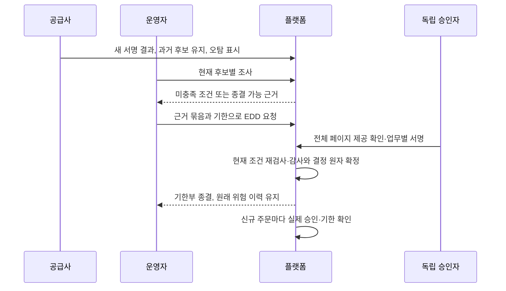

# AML 오탐의 근거 결합·독립 종결과 기한부 신규 주문 허용

AML 후보 조사가 끝나도 기존 서비스에는 오탐을 최종 종결하고 거래를 재개할 좁은 경로가 없었다. 공급사의 새 서명 자료·과거 후보 보존·현재 조사·독립 결정을 함께 검증하고, 원래 위험 이력을 유지하면서 제한된 기한의 신규 주문 권한을 부여한다. 플랫폼 업무 담당자와 구현을 설명할 개발자를 위한 결정·학습 기록이다.

## 문제와 기존 동작

[027 조사 기록](027-signed-aml-evidence-and-investigation.md)은 실제 후보와 담당자 의견을 보존했지만, `IDENTIFIERS_DIFFER`는 직원 의견일 뿐 최종 결론이 아니었다. 공급사 전체 상태가 Approved가 되어도 후보가 존재하면 원래 CDD 평가는 REVIEW_REQUIRED이고 신규 주문을 차단했다. 이를 그대로 두면 오탐 고객도 복구 경로가 없고, 반대로 CLOSED 한 필드만 믿으면 다른 위험이나 미완료 조사까지 허용할 수 있다.

이번 범위는 **AML 검토 사유만 있던 고객의 모든 후보가 오탐으로 재분류되고 완전한 생일 차이로 구별되는 사건**이다. PEP 자기 신고·신원 불일치·실소유자·자금/재산/주소 추가 자료·동일 인물 확정 이력·자료 부족이 섞인 사건은 포함하지 않는다. AML 목록의 분류가 PEP라는 이유만으로 실제 고객을 PEP로 확정하지도, 고객이 직접 신고한 PEP를 후보 오탐으로 해제하지도 않는다.

## 기존 제품과 공식 자료의 접근

2026-10-23 공개 자료를 다시 확인했다. 아래 법적 근거와 공급사 데이터 계약, 자체 승인 정책을 구분한다.

| 근거 | 확인한 내용과 적용 |
| --- | --- |
| [Didit AML 보고서](https://docs.didit.me/core-technology/aml-screening/report-aml-screening) | 검색 노드와 후보 식별자, 후보별 검토 상태, 집계 상태를 구분한다. 후보를 지워 해결한 것으로 보지 않고 현재 자료와 과거 후보를 연결한다. |
| [Didit AML 개요](https://docs.didit.me/core-technology/aml-screening/overview) | 인물 유사성과 위험도는 다른 축이다. 오탐은 자동 분류일 수도 있으므로 공급사의 사람 검토 완료라고 가정하지 않는다. |
| [특정금융정보법 제5조의2](https://law.go.kr/LSW/lsLinkCommonInfo.do?chrClsCd=010202&lsJoLnkSeq=1022860887) | 조회 화면은 시행 2026-10-02·법률 제21857호다. 국내 적용 시 위험에 비례하는 고객확인·업무 지침을 마련해야 하고, 확인 불가 시 거래 거절/종료와 의심거래 보고 여부 검토가 필요하다. 이번 코드는 전체 의무 이행이나 실제 보고/종료가 아니다. |
| [업비트 고객확인 공개 절차](https://support.upbit.com/hc/ko/articles/4406595681817-고객확인절차-알아보기) | 기본 고객확인과 필요 시 추가 확인을 구분하는 서비스 사례다. 이 회사의 내부 오탐 종결·DB 구조를 공개했다고 해석하지 않는다. |

이번의 완전한 생일 차이·현재 모든 후보 조사·독립 인물 승인·최대 24시간 허용은 **자체 보수적 정책**이다. 법령이나 공급사가 이 조합과 기한을 요구한 것은 아니다. 기존 15분 대사 신선도 역시 자체 정책이며, 공급사가 목록을 방금 재검색했거나 국내 모든 명단을 포함한다는 보증은 아니다. 전체 국내 법령·하위 규정·신고·인증 기준을 새로 전수 점검한 작업은 아니다.

## 선택과 트레이드오프

| 대안 | 이점 | 비용·제약과 판단 |
| --- | --- | --- |
| 공급사 Approved 또는 직원 오탐 의견 하나로 정상 변경 | 적은 업무와 빠른 고객 재개 | 후보 누락·다른 위험·과거 확정 판정을 덮을 수 있어 채택하지 않았다. |
| 오탐도 계속 영구 차단 | 잘못된 해제 경로가 적음 | 정상 고객의 불편과 반복 문의, 운영 조사 낭비가 커서 이번에 근거 있는 재개 경로를 만든다. |
| 위험 이력 보존 + 현재 모든 후보·독립 승인 + 기한부 허용 | 판단을 추적하고 근거 변경·기한 만료를 주문 정책에서 차단 | 자료 형식과 생일이 불완전하면 실제 오탐도 이 경로로 풀 수 없다. 독립 검토 인력·반복 승인과 DB/복호화·해시 대조 비용이 늘어난다. 공급사 시각이 같은 실제 새 결과도 이 경로에서는 거절하므로 엄격히 더 늦은 자료가 필요하다. 이 좁은 범위에서 선택했다. |
| 새 승인 종류·별도 해제 상태 저장소 | 업무를 완전히 나눌 수 있음 | 기존 EDD_REVIEW의 서명·감사·원자성을 중복한다. 기존 불변 승인 payload에 근거를 넣고 현재 판정·기한을 조회한다. |

과거 상태와 현재 권한을 분리하면 사고 후 어느 위험을 어떤 자료로 언제까지 해소했다고 판단했는지 설명할 수 있다. 승인 검사는 플랫폼 트랜잭션에서 수행한다. 엔진 코어에 DB 조회·락·감사 업무를 추가하지 않는다. 기존 Spring 트랜잭션, JdbcTemplate, Jackson, 암호화/MFA 구성으로 구현하며 새 라이브러리·표·스키마 변환은 없다.

## 처리 순서와 차단 조건

1. 고객은 현재 신고와 일치하는 live KYC·서명 이벤트·CDD 평가를 가지고 있어야 한다. 신원 기한과 대사 신선도가 유효해야 한다.
2. 현재와 과거의 모든 검토 사유가 정확히 AML_REVIEW_REQUIRED여야 한다. 추가 자료 요청이 하나라도 있으면 이 좁은 종결로 건너뛰지 않는다.
3. 과거 검토 평가마다 실제 암호화 보관 자료가 있어야 한다. 같은 워크플로 버전·같은 검증 인물이어야 하고, 현재 공급사 시각이 모든 과거 검토보다 엄격히 뒤여야 한다.
4. 과거 후보의 `(node_id, hit_id)`가 현재 자료에 모두 남아야 한다. 현재 검색의 총 개수와 실제 후보 수, 노드/후보 중복, 경고, 검색 대상 신원을 검증한다.
5. 현재 모든 검색은 Approved·집계 점수 0, 모든 후보는 정확한 False Positive여야 한다. 후보의 모든 생일은 완전한 유효 날짜·미래 아님·검증 고객과 다름이어야 한다. 생일 차이는 이 제한된 내부 판단의 식별 근거이며 실제 외부 인물 정보의 진실성을 코드가 보증하는 것은 아니다.
6. 각 현재 후보의 최신 조사가 현재 자료 MAC·평가·사건 변경 번호와 일치하고 IDENTIFIERS_DIFFER여야 한다. 메모 암호화 인증도 검사한다. 과거 Confirmed Match는 이후 오탐 표시가 와도 이 경로로 종결하지 않는다.
7. 담당자가 기한을 지정하고 기존 EDD_REVIEW를 요청한다. 현재 전체 근거 묶음과 해소 근거를 payload에 고정한다. 승인자는 승인 근거에 채택한 현재 조사 기여자·요청자와 독립된 사람이어야 하고 본인 세션에서 전체 페이지를 제공받고 업무 내용에 묶인 보안키로 승인한다.
8. 실제 결정 시 모든 조건·전체 묶음·선택 자료/조사를 다시 확인한다. 감사·결정·보안키 증명 소비·사건 갱신이 같은 트랜잭션으로 확정된다.
9. 신규 주문에서는 현재 평가와 결합된 실제 승인·정확한 사건 변경 번호·불변 승인 기한까지 조회한다. 운영 거래 제한과 기존 KYC 조건도 계속 적용한다.



## 구현과 이해에 필요한 실제 코드

모두 2026-10-23 현재 소스의 **부분 발췌**다. Java/Spring 문맥과 주입 객체가 필요하며 독립 실행 예제가 아니다.

### 후보별 오탐과 완전한 생일 차이

출처: [AmlFalsePositiveRules.java](../../src/main/java/dustin/cex/domains/edd/AmlFalsePositiveRules.java#L49)

```java
if(resolved) {
    if(!"False Positive".equals(hit.path("review_status").asText()))return denied("PROVIDER_NOT_CLEARED");
    // 연도만 있거나 날짜가 누락되면 다른 생일이라고 추측하지 않는다. 실제 완전한 날짜가 모두 달라야 한다.
    var dates=hit.path("properties").path("birthDate");if(!dates.isArray()||dates.isEmpty())return denied("BIRTH_DATE_NOT_DISTINCT");
    for(var date:dates) {
        if(!date.isString()||!date.asText().matches("[0-9]{4}-[0-9]{2}-[0-9]{2}"))return denied("BIRTH_DATE_NOT_DISTINCT");
        var birth=LocalDate.parse(date.asText());
        if(birth.equals(subject.birth())||birth.isAfter(LocalDate.now(java.time.ZoneOffset.UTC)))return denied("BIRTH_DATE_NOT_DISTINCT");
    }
}
candidates.add(new Candidate(key,index));
```

`JsonNode.path`는 누락을 표현하므로 문자열/배열 여부도 확인한다. `LocalDate.parse`는 잘못된 날짜를 거절하고 외부 inspect가 이를 미충족으로 처리한다. 생일 여러 개 중 하나라도 같으면 거절한다. TypeScript의 구조적 타입 선언만으로 외부 JSON이 검증되지 않는 것과 같아, 실제 데이터 검증을 수행한다. 점수 0만으로 이 분기를 통과하지 않는다.

### 과거 해소 대상을 현재 자료와 연결

출처: [AmlResolutionPolicy.java](../../src/main/java/dustin/cex/domains/edd/AmlResolutionPolicy.java#L67)

```java
for(var prior:all) {
    if(prior.get("assessment").equals(row.get("assessment")))continue;
    if(!row.get("workflow_id").equals(prior.get("workflow_id"))||!row.get("workflow_version").equals(prior.get("workflow_version")))return denied("WORKFLOW_CHANGED");
    var meta=sources.metadata((UUID)prior.get("source"));
    if(meta.providerTime()>=m.providerTime())return denied("NEW_SIGNED_RESOLUTION_REQUIRED");
    var historical=AmlFalsePositiveRules.inspect(sources.content(meta).report(),false);
    if(!historical.valid())return denied(historical.failure());
    if(!checked.subject().equals(historical.subject()))return denied("SCREENED_PERSON_MISMATCH");
    if(!historical.candidates().stream().allMatch(x->currentKeys.contains(x.key())))return denied("CANDIDATE_NOT_PRESERVED");
    past.add(new SourceRef(meta.id(),meta.contentMac()));
```

Java `record Key(node, hit)`는 값 기반 equals/hashCode를 가지므로 HashSet에서 두 식별자를 함께 비교한다. 문자열 이어붙이기 구분자 충돌을 피한다. JavaScript Set에 서로 다른 객체 두 개를 넣는 참조 동일성 동작과는 다르다. `allMatch`로 과거 후보 하나라도 빠지면 거절한다. 이전 원문 없는 사건을 합성해서 채우지 않는다.

### 최신 조사와 메모 무결성

출처: [AmlResolutionPolicy.java](../../src/main/java/dustin/cex/domains/edd/AmlResolutionPolicy.java#L87)

```java
if(records.isEmpty())return denied("INVESTIGATION_UNRESOLVED");
var record=investigations.verifiedForResolution((UUID)records.getFirst().get("id"));var p=record.payload();
if(p.finding()!=AmlInvestigationService.Finding.IDENTIFIERS_DIFFER||p.caseRevision()!=((Number)row.get("revision")).longValue()
    ||!p.assessmentId().equals(m.assessmentId())||!p.sourceMac().equals(m.contentMac()))return denied("INVESTIGATION_UNRESOLVED");
refs.add(new InvestigationRef(p.id(),record.payloadHash(),p.requesterPerson()));
```

앞선 SQL은 현재 자료·현재 검색 배열 위치·후보별로 최신 조사를 선택한다. 유리했던 옛 의견으로 되돌아갈 수 없다. `verifiedForResolution`은 메타데이터 해시와 암호화 메모 인증을 확인하고 메타데이터만 돌려준다. 최종 payload에는 평문을 넣지 않는다. 데이터가 많아지면 과거 자료 복호화와 조회량이 늘어나므로 운영 수용량 측정이 필요하다.

### 승인에는 식별자와 지문을 고정

출처: [AmlResolutionPolicy.java](../../src/main/java/dustin/cex/domains/edd/AmlResolutionPolicy.java#L20)

```java
public record SourceRef(UUID id,String contentMac) {}
public record InvestigationRef(UUID id,String payloadHash,UUID person) {}
/** 승인 내용에는 개인정보 대신 실제 불변 자료·조사와 정책만 고정한다. */
public record Basis(String policy,SourceRef current,List<SourceRef> historical,List<InvestigationRef> investigations,int candidates) {
    public Basis {historical=List.copyOf(historical);investigations=List.copyOf(investigations);}
}
public record Eligibility(boolean eligible,String unmetCondition,Basis basis,Instant maximumValidUntil) {}
```

`record`는 필드 접근자·값 비교를 제공하지만 참조 필드를 깊게 불변으로 만드는 것은 아니다. `List.copyOf`로 승인 이후 호출자가 목록을 바꾸지 못하게 한다. TypeScript의 readonly는 기본적으로 컴파일 시 제약인 반면 여기서는 런타임 수정도 거절된다. UUID는 익명 정보가 아니라 연결 가능한 내부 식별자이므로 운영 권한·감사·보유 기준은 여전히 필요하다. Eligibility의 가능 응답 자체는 승인이나 거래 권한이 아니다.

### 실제 결정 직전 다시 검증

출처: [EddService.java](../../src/main/java/dustin/cex/domains/cdd/EddService.java#L152)

```java
var resolution=validateFinding(c,current,p.finding(),p.validUntil());
if(!Objects.equals(p.amlResolution(),resolution))throw deny(HttpStatus.CONFLICT);
// 조사자가 나중에 승인 역할로 이동해도 자기 관찰을 독립 승인하지 못한다.
if(resolution!=null&&resolution.investigations().stream().anyMatch(x->x.person().equals(checker.getOperatorPersonId())))throw deny(HttpStatus.FORBIDDEN);
return c;
```

기존 바로 앞 코드가 사건·현재 평가·전체 근거 해시·승인자 전체 페이지 제공을 확인한다. 여기서는 해소 근거의 값까지 다시 비교한다. 조사자가 나중에 APPROVER 역할을 받아도 본인 관찰을 독립 승인하지 못한다. 새 조사·새 서명 자료·새 신고로 내용이 바뀌면 옛 업무 서명은 거절하고, 그 실패로 증명 토큰을 먼저 소비하지 않는다.

### 원래 위험 사실과 현재 허용 분리

출처: [CddService.java](../../src/main/java/dustin/cex/domains/cdd/CddService.java#L136)

```sql
AND (r.outcome='STANDARD' OR (r.outcome='REVIEW_REQUIRED' AND r.reasons='AML_REVIEW_REQUIRED'
 AND EXISTS(SELECT 1 FROM edd_cases closed JOIN edd_reports report ON report.case_id=closed.id
  JOIN edd_decisions decision ON decision.report_id=report.id AND decision.approved=true
  WHERE closed.user_id=c.user_id AND closed.latest_assessment=r.id AND closed.state='CLOSED'
   AND closed.valid_until>clock_timestamp() AND report.payload::jsonb->>'assessmentId'=r.id::text
   AND report.payload::jsonb->>'statusDigest'=r.status_digest
   AND report.payload::jsonb->>'finding'='RESOLVED_AML_FALSE_POSITIVES'
   AND report.payload::jsonb->>'reviewPolicy'=? AND report.payload::jsonb->'amlResolution'->>'policy'=?
   AND (report.payload::jsonb->>'caseRevision')::bigint=closed.revision-1
   AND (report.payload::jsonb->>'validUntil')::timestamptz=closed.valid_until)))
```

이 부분은 큰 SELECT EXISTS의 조건이다. STANDARD 경로는 기존대로 유지하고, AML 검토는 현재 프로토콜의 실제 승인된 종결 기록이 있어야 한다. `::jsonb`는 저장된 승인 내용에서 값을 꺼내며 `::timestamptz`로 원래 기한과 파생 사건 기한을 같은 시간으로 비교한다. 사건만 CLOSED로 바꾸거나 기한만 늘려도 통과하지 않는다. 승인 후 사건 변경 번호는 하나 증가하므로 원래 payload의 번호는 현재 번호에서 1을 뺀 값이다. 이 읽기는 플랫폼 DB에서 수행하며 WAL·매칭 코어와 무관하다.

### 만료와 재심사도 실제 금융 정책으로 검증

출처: [AmlResolutionIntegrationTest.java](../../src/test/java/dustin/cex/domains/kyc/AmlResolutionIntegrationTest.java#L112)

```java
@Test void approvedResolutionExpiresWithoutBackgroundStateMutation() throws Exception {
    ready(1);var r=resolution(Instant.now().plusSeconds(5));decide(r,true,proof(checker,r,true));allowed();
    // 실제 시계를 넘겨 SQL의 기한 조건을 검증한다. 금융 결정이나 사건 기한을 시험용 값으로 덮어쓰지 않는다.
    Thread.sleep(5500);assertEquals("CLOSED",service.status(customer.getId()).state());blocked();
    // 기존 자료 대기 결론으로 재심사를 열고 현재 조사·독립 결정을 새로 확정한다. 과거 기한은 수정하지 않는다.
    var reopen=propose(EddService.Finding.AWAITING_EVIDENCE);decide(reopen,true,proof(checker,reopen,true));
    investigateAll();assertTrue(eligibility().eligible());closeCase();allowed();
```

테스트는 실제 승인 후 시계를 넘기며 불변 결정을 바꾸지 않는다. 저장 상태가 CLOSED여도 주문 권한은 만료된다. 갱신은 기존 AWAITING_EVIDENCE의 독립 결론으로 사건을 열고, 현재 자료의 조사와 새 독립 승인을 다시 만든다. 이때도 공급사 대사와 신원 유효 조건을 재검사한다. 아직 현재인 공급사 자료를 재사용하는 것은 가능하지만 과거 승인 기한을 연장하지 않는다.

## API·프로토콜과 과거 기록

- 신규 GET `/api/admin/edd/customers/{user}/aml-resolution`: OPERATOR/APPROVER의 최근 MFA, 고객/사건 잠금과 필수 감사 후 가능 여부·미충족 코드·내부 근거 식별자·최대 기한만 반환한다. 원문 이름·생일·메모는 반환하지 않는다. CUSTOMER/AUDITOR는 차단한다.
- 기존 EDD 요청의 finding에 RESOLVED_AML_FALSE_POSITIVES를 추가한다. 기한은 미래이고 현재 신원 기한과 요청 시점부터 24시간 중 짧은 쪽 이하여야 한다. 독립 승인까지 10분 요청 유효 기간도 기존대로 적용한다.
- 실행 프로토콜은 EDD_CASE_RESOLUTION_REVIEW_V2다. 과거 V1 요청의 재실행은 거절하고 현재 프로토콜로 새 근거를 요청한다. 과거 고정 묶음·원래 payload 해시의 역사 조회는 유지한다. 과거 이력을 수정하거나 새 승인 근거로 채워 넣지 않는다.
- 새로운 서명 이벤트는 사건을 다시 열고 기존 허용을 멈춘다. 만료·운영 제한도 주문 전 정책으로 차단한다. 이미 확정된 금융 기록을 삭제하지 않는다. 기존 주문 취소/정산과 신규 주문 허용을 혼동하지 않는다.

## 작성한 테스트

신규 [AmlFalsePositiveRulesTest.java](../../src/test/java/dustin/cex/domains/edd/AmlFalsePositiveRulesTest.java)는 **38개 실행 사례**, [AmlResolutionIntegrationTest.java](../../src/test/java/dustin/cex/domains/kyc/AmlResolutionIntegrationTest.java)는 **34개 실행 사례**다. 매개변수 입력은 각각 별도 JUnit 사례로 집계한다. 실제 명령과 개별 사례 이름은 아래 확정 증적에 보존한다. 신규 AML 종결 사례의 주문 검사는 같은 업무 트랜잭션에서 실제 `TradingAccessPolicy.requireNewOrder`를 호출한다. 종결 고객으로 HTTP 주문부터 매칭까지 새로 연결한 전용 시험은 아니며, 기존 별도 실제 시장 연결 1개 및 주문 프로세스 회귀와 구분한다.

### AmlFalsePositiveRulesTest

| 테스트 함수 | 시나리오와 기대 결과 |
| --- | --- |
| `completeDistinctBirthAndProviderFalsePositiveAreEligibleData` | 완전한 다른 생일·공급사 오탐의 형식 조건 통과, 결과 문자열 개인정보 제외 |
| `historyMayRetainUnreviewedButCurrentCannot` | 과거 Unreviewed 보존 허용과 현재 종결 거절 구분 |
| `unqualifiedCandidateStatusNeverClears` | 미검토·확정·불명·대소문자 차이·빈 상태 5종 거절 |
| `equalPartialOrInvalidBirthCannotBeDistinctEvidence` | 같은 생일·부분 날짜·무효일·미래 날짜·빈 값 7종 거절 |
| `oneEqualBirthAmongSeveralCannotBeIgnored` | 여러 생일 중 하나가 고객과 같아도 거절 |
| `searchedPersonMustEqualVerifiedPerson` | 검색 대상 이름·생일·국적 불일치 3종 거절 |
| `missingOrEmptyRootArraysNeverClear` | 신원/검색 배열 누락과 빈 배열 거절, 2개 사례 |
| `eachRequiredScreeningFieldMatters` | 필수 검색 필드 8종을 하나씩 빼면 거절 |
| `countsCannotHideAnExtraCandidate` | 총 개수와 실제 후보 수 불일치 거절 |
| `noRemainingCandidateDoesNotProveHistoryResolved` | 후보를 모두 지운 결과로 해소를 증명하지 못함 |
| `warningNeverDisappearsBehindZeroScore` | 점수 0이어도 경고가 있으면 거절 |
| `positiveOrInvalidScoreCannotClear` | 양수·음수·100 초과 점수 거절 |
| `duplicateNodeIdIsAmbiguous` | 중복 검색 노드 거절 |
| `duplicateHitInOneNodeIsAmbiguous` | 같은 노드의 중복 후보 거절 |
| `sameHitInDifferentNodesHasDifferentKeys` | 다른 노드의 같은 후보 ID를 별도 값 키로 구분 |
| `allSignedIdentityEntriesMustAgree` | 여러 검증 신원 간 불일치 거절 |
| `candidateListCannotBeMutatedByCaller` | 결과 목록의 런타임 수정 거절 |
| `oldConfirmedMatchRequiresEscalationEvenWithLaterDateEvidence` | 과거 Confirmed Match는 좁은 오탐 종결 대상에서 제외 |

### AmlResolutionIntegrationTest

| 테스트 함수 | 시나리오와 기대 결과 |
| --- | --- |
| `signedResolutionAndIndependentDecisionReopenNewOrdersWithoutRewritingRiskHistory` | 실제 서명·후보별 조사·독립 승인 뒤 두 후보 근거와 신규 주문 허용, 원래 REVIEW_REQUIRED 유지 |
| `opinionWithoutNewProviderResolutionCannotClose` | 직원 의견만 있고 새 공급사 해소 결과가 없으면 거절 |
| `providerResolutionWithoutCurrentInvestigationCannotClose` | 공급사 오탐만 있고 현재 조사가 없으면 거절 |
| `oldSourceInvestigationDoesNotReplaceCurrentSourceInvestigation` | 옛 자료의 의견으로 현재 조사 대체 거절 |
| `everyCurrentCandidateNeedsInvestigation` | 일부 후보만 조사하면 거절, 모두 조사하면 가능 |
| `disappearingHistoricalCandidateCannotBeTreatedAsFalsePositive` | 과거 후보 하나가 현재 자료에서 빠지면 거절 |
| `equalOrPartialCandidateBirthCannotAuthorizeClosure` | 같거나 연/월만 있는 후보 생일 3종은 승인 불가 |
| `pepDeclarationCannotBeClearedThroughAmlFalsePositive` | PEP 자기 신고가 섞인 사건 해제 거절 |
| `historicalIdentityMismatchCannotBeClearedThroughAmlFalsePositive` | 과거 신원 불일치가 있으면 현재 오탐으로 해제 불가 |
| `requestedAddressOrFundsEvidencePreventsNarrowClosure` | 추가 자금 자료 요청이 있으면 이 경로 종결 거절 |
| `pastConfirmedMatchCannotBeClearedWithThisLimitedPolicy` | 과거 확정 후보를 나중 오탐 표시로 우회 불가 |
| `historicalMissingSourceNeverGetsInventedToEnableClosure` | 실제 과거 평가의 자료 미보관 표본은 합성 없이 거절 |
| `newInvestigationAfterSignatureInvalidatesDecisionWithoutConsumingProof` | 새 의견 두 종류는 사건 번호가 같아도 옛 결정 거절, 증명 미소비 |
| `newDeclarationAfterOptionsPreventsClosure` | 서명 준비 후 새 고객 신고로 옛 결정 거절 |
| `providerFreshnessLossAfterOptionsPreventsClosure` | 서명 준비 후 대사 신선도 소실로 결정 거절 |
| `validUntilCannotExceedCurrentIdentityExpiry` | 고객 신원 만료를 넘는 기한 거절, 짧은 기한 실제 허용 |
| `nullPastAndMoreThanOneDayValidityAreRejected` | 기한 없음·과거·하루 초과 거절 |
| `decisionAuditFailureRollsBackCaseProofAndGrantThenSameProofCanRetry` | 감사 실패로 사건/증명/허용 롤백, 동일 증명 정상 재시도 |
| `rejectionDoesNotGrantButAllowsFreshRequest` | 반려는 거래 불가, 새 요청과 승인으로 허용 |
| `contributorWhoMovesToApproverCannotApproveOwnInvestigation` | 역할을 옮긴 조사 기여자의 자기 승인 거절 |
| `newProviderEventReopensApprovedCaseAndStopsNewOrders` | 새 서명 이벤트는 승인 사건 재개방·신규 주문 차단 |
| `operationalTradingRestrictionStillOverridesResolvedCase` | 별도 운영 거래 제한 우선 적용 |
| `concurrentApproveAndRejectLeaveOneDecisionAndOnlyMatchingFinancialPermission` | 실제 두 스레드 승인/반려 경합은 단일 결정·그 결과에만 맞는 금융 권한 |
| `oldProtocolRequestIsHistoricalOnlyAndItsDossierStillReadable` | 과거 프로토콜 묶음 역사 열람 유지, 실행 거절 |
| `eligibilityHttpIsMetadataOnlyAndNotCustomerOrAuditorPermission` | 실제 HTTP 권한·no-store·이름/생일 제외 |
| `eligibilityAuditFailureDoesNotReturnBasis` | 조회 감사 실패 시 근거 응답 불가 |
| `helperCannotResolveOutsideBusinessTransaction` | 업무 트랜잭션 없는 내부 정책 호출 거절 |
| `closedFlagWithoutApprovedResolutionDoesNotAuthorizeTrading` | 승인 없이 사건만 CLOSED로 바꾸면 주문 불가 |
| `derivedCaseCannotExtendAnImmutableApprovedValidity` | 파생 사건 기한만 늘리면 주문 불가 |
| `approvedResolutionExpiresWithoutBackgroundStateMutation` | 실제 시간 경과로 차단, 기존 재심사 결론·새 조사/승인으로 갱신 |
| `sameProviderTimeWithNewEventIdCannotReplaceNewResolutionEvidence` | 같은 공급사 시각의 새 ID를 새로운 해소 증거로 쓰지 못함 |

기존 [AmlInvestigationIntegrationTest.java](../../src/test/java/dustin/cex/domains/kyc/AmlInvestigationIntegrationTest.java)의 대사 fixture도 조정했다. 같은 격리 DB에 다른 시험 사건의 예약 작업이 남아 HTTP 대역을 먼저 소비하므로, 해당 테스트를 제외한 작업의 다음 실행 시각만 미룬다. 금융/감사/수신 이력을 지우거나 불변 트리거를 끄지 않았다. `scripts/verify_edd.py`의 기존 범위를 유지하고 새 두 클래스를 추가한다.

## 실행 명령과 결과

macOS·Temurin 21, 실행기가 소유한 별도 PostgreSQL/Kafka와 임시 DB를 사용했다. 공급사 HTTP는 대역이고 HMAC·소프트웨어 WebAuthn·트랜잭션·HTTP 권한·주문 정책은 실제 제품 경로다. 기존 로컬 고객 데이터/서버·다른 프로젝트 DB는 사용하지 않았다. 봇은 0명이다.

- `caffeinate -dims python3 scripts/verify_edd.py`
- `python3 scripts/verify_kyc.py`, `verify_kyc_recovery.py`, `verify_bound_approvals.py`, `verify_operator_mfa.py`, `verify_engine_inbox.py`
- `./gradlew operatorAdminJar bootJar jmhClasses writeDependencyInventory --console=plain`
- `python3 scripts/verify_operator_admin.py`, `verify_order_idempotency.py`, `verify_market_path.py`
- `python3 scripts/audit_dependencies.py`, `verify_dependency_integrity.py`

선택 JUnit **984개**, 실패·오류·제외 0개다. EDD/증빙/근거 묶음/AML/종결 418개(신규 72 = 통합 34 + 순수 조건 38), KYC 150·승인/접근 190·MFA 42·금융 183·실제 시장 연결 1개를 통과했다. 기존 별도 프로세스 **15개**도 통과했다. 실행 소유 컨테이너·임시 DB·체크섬 표본은 정리했다.

두 JAR·JMH 컴파일·의존성 목록 생성을 통과했다. 의존성 222개 버전의 조회 시점 알려진 OSV 검출은 0개이고, 변조 체크섬은 예상한 Gradle 종료 코드 1로 차단됐다. 목록 SHA-256은 `590da8748d7e2940dbc56dfe714c8c4cab4d1e5ed9b0be72dbf14e024e79268a`다.

[확정 증적](../reference/aml-resolution-verification-2026-10-23.json)에 실제 명령·개별 사례·분리 집계·격리 자원 정리·현재 코드 발췌 111개와 별도 6개 대조·한계를 기록했다.

중간 실행에서 신원 재신청 fixture의 새 신고 누락과 과거 평가 표본의 중복 event_id로 413개 중 2개가 실패했다. 별도 새 신고·실제 별도 과거 서명 이벤트로 표본을 수정했다. 다음 417개 실행에서는 앞선 예약 작업이 공급사 HTTP 대역을 소비해 기존 대사 두 사례가 실패했다. 작업 일정 격리로 수정했고 418개 실행 통과 후 만료 뒤 재심사 시나리오까지 추가해 최종 실행했다. 중간 실행 수를 최종 합계에 더하지 않는다. 기존 deprecated/unchecked 및 JVM 계측 안내는 남아 있다.

## 보장 범위·운영 조건과 다음 단계

이번 허용은 이 코드의 제한된 AML 오탐 정책 판단이며 제재 해제·법적 면책·실제 외부 인물 판정·STR 완료가 아니다. 공급사 False Positive가 자동인지 사람 결정인지 증명하지 않는다. 실서비스 전에 명단 완전성·원천 신뢰성·변경 통지·계약·국내 제재/PEP·지속 모니터링과 담당 조직 책임을 확인해야 한다. 고객이 실제 제재 대상이거나 다른 위험이 확인되면 이 경로의 대상이 아니다.

개인정보 보유/파기·국외 이전/위탁·KMS/키 교체·DB 권한·외부 감사·실물 보안키·담당자 사건 배정/과도한 열람 통제·실제 운영 수용량은 별도 운영 검증이다. 보관 투영에는 원래 전체 공급사 본문/서명이 없으므로 수신 당시 HMAC 검증과 자체 MAC 보존을 구분한다. 원문 전체의 사후 재검증은 공급사 원본 보관·계약 등이 필요하다. DB 슈퍼유저 침해를 불변 트리거만으로 방어하지 않는다.

운영 배포·기존 DB/저널 변환·서버 재시작은 하지 않았다. 엔진·프론트 제품 코드는 변경하지 않았다. 새 전용 JVM 강제 종료 시험은 없고 기존 별도 프로세스 시나리오와 새 감사 롤백/경합 검증을 구분한다. JMH는 컴파일만 했으며 성능 수치를 재측정하지 않았다. 디스크/호스트 손실은 기존 문서의 외부 복제·백업 필요 조건을 유지한다.

다음에는 이 경로로 해소할 수 없는 **미확정/확정 위험의 책임 있는 회부·추가 확인·관계 유지/거절·종료 및 보고 검토**를 기존 로드맵과 대조해 이어간다. 거래 차단만으로 필요한 법정 거절/종료·의심거래 보고 검토 업무를 완료했다고 주장하지 않는다.

## 관련 커밋과 참고 자료

- [`024b533`](https://github.com/GiHoon1123/Cex-Platform-Service/commit/024b533638ec745dacd2fb08d98205b9444bf50e): 제한적 AML 오탐 종결·독립 근거 검증·기한부 주문 정책과 신규 테스트 72개.

선행 [027 서명 근거와 개별 조사](027-signed-aml-evidence-and-investigation.md), [026 전체 근거 묶음](026-edd-dossier-and-independent-inspection.md), [021 사건과 독립 결론](021-edd-case-and-independent-review.md), [공통 EDD 계획](../../../docs/roadmap/edd-case-review.md)을 함께 읽는다.

## 후속 비공개 보고 검토와 우회 차단

[029](029-confidential-reporting-review.md)에서 현재 승인된 준법 회부의 비공개 보고 여부를 지정 두 인물과 독립 업무 서명으로 판단한다. 별도 보고 검토가 생긴 사건은 이 글의 좁은 오탐/신원 정정 종결로 건너뛰지 않는다. 위 테스트 수치와 8종 승인 유지 설명은 028 당시 기준이며, 현재는 STR_REVIEW가 추가된 9종 스키마가 필요하다. 미보고·반려도 위험 해소나 외부 보고 완료가 아니다.
