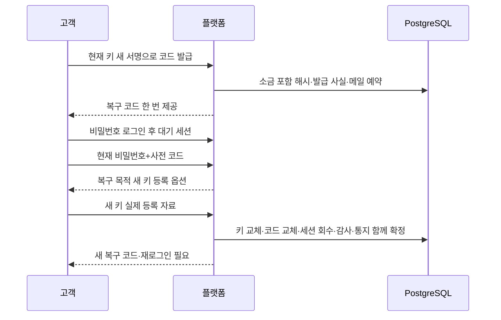

# 사전 복구 코드와 현재 비밀번호로 분실 패스키 복구

미리 보관한 복구 코드와 현재 비밀번호로 분실 패스키를 새 키로 교체한다. 기존 강한 세션을 우회해 거래 권한을 주는 대신, 새 키 검증·기존 키 폐기·코드 교체·전체 세션 회수·불변 사실·보안 메일 예약을 함께 확정한다. 이메일만으로 패스키를 해제하는 기능은 아니다.

## 문제와 기존 동작

063~067은 실제 패스키 로그인, 예비 키와 분실 키 폐기까지 제공했다. 그러나 모든 기기를 잃으면 마지막 키 제거가 금지되어 접근할 수 없었다. 등록 사실을 삭제하거나 인증 수준을 비밀번호로 낮추는 임시 우회는 만들지 않는다.

## 검증된 제품과 공식 자료

[Google 백업 코드 공개 안내](https://support.google.com/accounts/answer/1187538)는 사전 보관·일회 사용·새 코드 발급 시 이전 코드 무효화를 제공한다. 제품의 사용자 계약을 참고하며 내부 저장 구조를 추측하지 않는다. [OWASP MFA](https://cheatsheetseries.owasp.org/cheatsheets/Multifactor_Authentication_Cheat_Sheet.html)는 복구가 인증 우회가 되지 않도록 별도 통제와 변경 통지를 요구한다.

[NIST SP800-63B-4 계정 복구](https://pages.nist.gov/800-63-4/sp800-63b.html#account-recovery)의 저장 복구 코드·기존 인증수단 결합·사용 제한·독립 통지를 참고했다. 이번 코드는 256비트 난수, 설치된 Argon2의 소금 포함 해시, 현재 비밀번호와 일회 코드 결합을 사용한다. **해외 기술 참고 기준**이며 국내 법적 의무나 NIST/AAL 인증 취득을 주장하지 않는다. 단일 알림 주소만 지원하는 현재 상태와 전체 식별/암호 모듈 검증은 별도 미충족 조건이다.

## 선택과 트레이드오프

| 선택 | 얻는 것 | 비용/제약·대안 |
| --- | --- | --- |
| 단일 256비트 복구 코드, 사용/교체 때 이전 코드 무효 | 상태와 사용 경쟁을 단순화 | 여러 코드 묶음보다 사용 후 새 코드 보관을 더 자주 해야 함 |
| 현재 비밀번호+사전 코드로 새 패스키 등록 | 현재 키가 없어도 사전 마련한 자격으로 복구 | 둘을 함께 탈취당하면 위험. 코드는 오프라인 보관해야 하며 이메일만 아는 사람은 복구 불가 |
| 코드 관리에 현재 비밀번호·최근 패스키·전용 새 서명 | 탈취 세션이나 로그인 서명의 재사용 차단 | 코드 발급 때 고객 재확인 필요 |
| 기존 Argon2 재사용 | 별도 암호 구현/패키지 없이 소금 포함 해시 | 코드 확인/생성에 메모리·CPU 사용. 사용자 잠금 안에서 실행하므로 같은 고객 업무가 대기할 수 있음 |
| 복구 후 모든 세션 회수·다시 로그인 | 복구 세션/JWT에 거래 권한을 부여하지 않음 | 새 키 등록 후 로그인 단계를 한 번 더 수행 |
| 개별 키 사실 보존+복구 통지 한 건 | 다중 키 복구의 감사 추적과 메일 중복 방지 | 별도 원본 연결 표와 지연 외래키 필요 |

성공 응답을 잃으면 복구 코드를 다시 읽을 수 없다. 코드 발급 응답 유실 때는 기존 키로 새 코드를 발급하고, 복구 응답 유실 때는 이미 등록한 새 키로 로그인해 새 코드를 발급한다. 원문 재전달을 위한 암호문 저장이나 호환 경로는 만들지 않는다.

## 실행 경로와 API



기본 경로 `/api/auth/customer-recovery`:

| 경로 | 입력/조건 | 응답 |
| --- | --- | --- |
| `GET /status` | 실제 서명 완료 고객 세션 | 발급 여부만 |
| `POST /code/options` | 현재 비밀번호·5분 이내 현재 키 | 목적 CODE_REPLACE·2분 일회 옵션 |
| `POST /code` | 해당 옵션의 실제 현재 키 서명 | 새 코드 한 번 |
| `POST /register/options` | 5분 비밀번호 대기 세션·현재 비밀번호·유효 사전 코드 | 목적 MFA_RECOVER·2분 새 키 옵션 |
| `POST /register` | 정확한 고객/세션/목적의 새 키 등록 자료 | 새 코드 한 번·requiresLogin=true |

운영자/타인/회수/중지/만료 세션과 최초 MFA 미등록 고객을 거부한다. 검증 주소에만 알림을 예약하므로 현재 검증 주소가 필요하다. 사전 코드는 시간으로 만료하지 않고 사용/교체할 때 무효화한다. 복구 실패 시 기존 코드·키·세션·최초 등록 사실은 유지한다. 사용자 행 잠금 안에서 15분5회 실패를 확인하고 거부 감사는 별도 트랜잭션으로 남긴다. 저장/키/감사의 서버 장애를 잘못된 고객 코드로 집계하지 않는다.

## 실제 코드와 이해에 필요한 원리

출처: [CustomerRecoveryService.java](../../src/main/java/dustin/cex/domains/security/CustomerRecoveryService.java#L88), 현재 소스의 부분 발췌.

```java
    public Code recover(long actor,UUID sid,Proof proof){return operation(actor,()->{
        var user=pending(actor,sid);var stored=consume(actor,sid,proof,"MFA_RECOVER");
        if(stored.code()==null||!stored.code().equals(current(actor)))throw denied();
        var old=verifier.keys(actor);var added=verifier.register(stored.options(),proof.publicKey());
        // 이미 등록된 자격을 이름만 바꿔 재등록하는 요청도 복구로 인정하지 않는다.
        if(old.stream().anyMatch(k->k.getCredentialId().equals(added.getCredentialId())))throw denied();
        UUID event=UUID.randomUUID();
        for(var key:old){
            credentials.delete(key.getCredentialId());
            changes.appendForRecovery(actor,sid,CustomerMfaKeyChanges.Kind.REVOKED,fingerprint(key.getCredentialId().toBase64UrlString()),event);
        }
        changes.appendForRecovery(actor,sid,CustomerMfaKeyChanges.Kind.ADDED,fingerprint(added.getCredentialId().toBase64UrlString()),event);
        tokens.revokeAllByUserId(actor,LocalDateTime.now());
        jdbc.update("DELETE FROM customer_mfa_challenges WHERE user_id=?",actor);
        jdbc.update("DELETE FROM customer_password_challenges WHERE user_id=?",actor);
        // 불변 최초 등록 사실은 삭제하지 않는다. 복구 직후에도 새 키 서명 없이 거래할 수 없다.
        return issue(user,sid,"MFA_RECOVERED",stored.code(),true,event);
    });}
    private User strong(long actor,UUID sid){
        var user=sessions.require(actor,sid);limit(actor);
        if(!mfa.required(actor)||!mfa.fresh(actor,tokens.findBySessionId(sid).orElseThrow())||!recipients.verified(user))throw denied();
        return user;
    }
```

사용자 잠금과 유효 대기 세션을 먼저 확인한다. 등록 자료의 RP/출처/사용자 확인은 기존 WebAuthn 검증기에 맡긴다. 새로운 키가 검증된 뒤에만 이전 공개키를 제거한다. 거래 코어에는 접근하지 않는다. Java 플랫폼의 DB 행 잠금이며 Rust 핵심 상태 공유 락과 다르다.

출처: [CustomerRecoveryService.java](../../src/main/java/dustin/cex/domains/security/CustomerRecoveryService.java#L142), 현재 소스의 부분 발췌.

```java
    private Code issue(User user,UUID sid,String kind,UUID consumed,boolean requiresLogin,UUID event){
        byte[] raw=new byte[32];random.nextBytes(raw);String code=Base64.getUrlEncoder().withoutPadding().encodeToString(raw);Arrays.fill(raw,(byte)0);
        UUID id=UUID.randomUUID();
        // 원문은 이 응답에서 한 번만 제공한다. 이미 설치한 소금 포함 Argon2로 저장한다.
        jdbc.update("INSERT INTO customer_recovery_codes(id,user_id,code_hash) VALUES(?,?,?)",id,user.getId(),passwords.hash(code));
        jdbc.update("INSERT INTO customer_recovery_events(id,user_id,session_id,kind,code_id,consumed_code_id) VALUES(?,?,?,?,?,?)",event,user.getId(),sid,kind,id,consumed);
        jdbc.update("DELETE FROM customer_recovery_challenges WHERE user_id=?",user.getId());
        Instant occurred=jdbc.queryForObject("SELECT created_at FROM customer_recovery_events WHERE id=?",java.sql.Timestamp.class,event).toInstant();
        outbox.enqueue(user.getId(),CustomerMailOutbox.Kind.ACCOUNT_RECOVERY,event,user.getEmail(),null,occurred.plusSeconds(86400));
        audit.record(user.getId(),"CUSTOMER_RECOVERY_COMPLETED","recovery:"+event,"SUCCESS",kind);
        return new Code(code,requiresLogin);
    }
    private static String fingerprint(String id){return OperatorMfaService.sha256Hex(id);}
    private <T>T operation(long actor,java.util.function.Supplier<T> work){return tx.execute(t->{
```

SecureRandom은 JDK의 난수 도구다. Base64 URL 표현은 암호화가 아니며 저장은 별도 Argon2 해시로 한다. Java String은 완전한 메모리 소거를 보장하지 않으므로 로그/DB/메일에 원문을 복사하지 않는다. 응답 record의 toString도 비밀을 생략한다. TypeScript와 마찬가지로 단순 타입 선언만으로 비밀 보호가 생기지 않는다.

출처: [CustomerMfaKeyChanges.java](../../src/main/java/dustin/cex/domains/security/CustomerMfaKeyChanges.java#L23), 현재 소스의 부분 발췌.

```java
    public void appendForRecovery(long actor,UUID sid,Kind kind,String fingerprint,UUID recovery){
        UUID id=record(actor,sid,kind,fingerprint);
        // 복구 원본을 뒤에서 만들더라도 커밋 때 실제 같은 고객의 원본이 존재해야 한다.
        jdbc.update("INSERT INTO customer_recovery_key_changes(event_id,user_id,change_id) VALUES(?,?,?)",recovery,actor,id);
    }
```

개별 키 변경은 보존하되 일반 키 변경 메일을 각각 예약하지 않는다. 복구 원본 하나의 보안 통지를 예약하며 각 키 사실을 같은 고객의 원본에 연결한다.

출처: [schema.sql](../../src/main/resources/account/schema.sql#L87), 현재 소스의 부분 발췌.

```sql
CREATE TABLE IF NOT EXISTS customer_recovery_key_changes (
 event_id uuid NOT NULL,user_id bigint NOT NULL,change_id uuid PRIMARY KEY,
 FOREIGN KEY(event_id,user_id) REFERENCES customer_recovery_events(id,user_id) DEFERRABLE INITIALLY DEFERRED,
 FOREIGN KEY(change_id,user_id) REFERENCES customer_mfa_key_changes(id,user_id)
);
DROP TRIGGER IF EXISTS customer_recovery_key_change_no_change ON customer_recovery_key_changes;
```

복합 외래키는 고객 소유까지 대조한다. DEFERRABLE INITIALLY DEFERRED는 같은 트랜잭션의 뒤 단계가 복구 원본을 작성하도록 허용하되 커밋 때 원본이 없으면 전체 실패하게 한다. 원본과 연결 표에는 UPDATE/DELETE/TRUNCATE 거부 트리거가 있다. 현재 코드는 마지막 불변 발급 사실이 가리키는 코드이며 소비 사실을 덮어쓰지 않는다.

## 검증과 남은 한계

실행 명령은 `python3 scripts/verify_customer_account.py`, `python3 scripts/verify_customer_account.py --group recovery`, `python3 scripts/verify_customer_mail.py`다. 실행 소유 PostgreSQL16과 GreenMail의 로컬 SMTPS만 사용하고 Kafka/엔진 주소는 닫힌 루프백으로 격리했다. 기존 서비스와 금융 데이터에 연결하지 않았으며 봇은0명이다.

최종 계정 선택의 고유 테스트 **132개 통과**, 실패/오류/제외0이다. 복구 신규 함수는23개다. 전체 묶음 실행과 마지막 복구23개 재실행에서 같은 테스트를 중복 집계하지 않았다. 첫 검사에서는 테스트 전용 CddCrypto 스파이 선언 누락으로 컴파일 실패해 테스트0개였다. fixture를 수정했다. 초기 버전129개 통과 후 다중 키 알림을 한 건으로 묶고 원본 연결 검증을 추가했으므로 최종 전체 실행을 별도로 기록한다. 초기 성공과 최종 성공을 더하지 않는다.

메일 회귀 **95개 통과**, 실패/오류/제외0이다. 두 실행의 고유 JUnit 합계는 227개다. 고객·운영자 제품 JAR 빌드도 성공했다. 새 패키지/전이 버전 변경은 없다. 기존 deprecated/unchecked/JVM 경고가 남는다. SMTP_ACCEPTED는 최종 배달/열람 보장이 아니며 중복 가능성과 재시도 예산은 기존 아웃박스 계약을 따른다. 운영자 추가 재발송 승인으로 복구 보안 통지를 우회하지 않는다.

미리 발급한 코드와 현재 비밀번호가 있는 패스키 분실 복구만 구현했다. 비밀번호까지 분실한 복구·모든 복구 자격 분실의 신원 재확인·이메일 변경·출금과의 별도 업무 결합·프론트/실물 인증기·운영 HTTPS/키 보호·외부 심사는 후속이다. 인증/법적 심사를 통과했다고 주장하지 않는다.

## 작성한 테스트 코드


[CustomerRecoveryIntegrationTest.java](../../src/test/java/dustin/cex/domains/kyc/CustomerRecoveryIntegrationTest.java)

- `signedCodeIsReturnedOnceAndOnlySaltedHashIsStored`: 43문자 코드는 한 번 반환하고 DB에는 소금 포함 Argon2만 저장한다. 감사·원본·toString에 원문이 없다.
- `codeIssuanceNeedsCurrentPasswordAndFreshExistingKey`: 잘못된 비밀번호·서명 누락·6분 경과로 발급을 거부한다. 발급 여부 읽기는 불필요한 새 인증을 요구하지 않는다.
- `loginSignatureCannotIssueCodeAndOptionsCannotBeReplayed`: 로그인 챌린지로 코드 발급을 승인하지 않으며 성공 옵션 재사용도 거부한다.
- `replacingCodeInvalidatesPreviousWithoutRevealingNewOnStatus`: 재발급 후 이전 코드는 거부하고 새 코드만 복구 옵션을 만들 수 있다.
- `validRecoveryReplacesLostKeysRevokesEverySessionAndRequiresActualNewKeyLogin`: 기존 키 폐기·전체 세션 회수·최초 등록 보존·새 키 재로그인·코드 교체·개별 키 사실 연결을 확인한다.
- `invalidCodePasswordAndForeignSessionsPreserveExistingKey`: 비밀번호/코드 오류와 타인/운영자 세션은 기존 키·발급 원본을 변경하지 않는다.
- `newKeyMustHaveCorrectOriginAndUserVerification`: 다른 출처와 사용자 확인 누락은 거부하고 올바른 자료로 다시 성공할 수 있다.
- `expiredAndPreviousSessionChallengeCannotRecover`: 만료 옵션과 이전 대기 세션의 옵션을 새 세션에서 쓰지 못한다.
- `recoveryAuditFailureRestoresKeysCodeChallengeSessionsAndNotices`: 마지막 감사 실패 때 기존 키·코드·일회 옵션·세션·메일을 모두 복원하며 재시도는 가능하다.
- `codeReservationFailureRollsBackSignatureAndGeneration`: 메일 예약 감사 실패 때 코드·원본·서명 카운터/소비를 롤백하고 같은 정당한 증명으로 재시도한다.
- `simultaneousRecoveryConsumesCodeOnce`: 동시 복구 두 건 중 하나만 성공하고 새 키/새 발급 사실은 한 번 추가된다.
- `fiveInvalidCodesAreDurableAndThenRateLimited`: 잘못된 코드5회는 영속 감사에 남고 다음 시도는429다.
- `infrastructureFailureDoesNotSpendVerificationBudget`: 키 설정 장애6회는503이며 고객 실패 예산을 소진하지 않는다.
- `securityMailContainsNoRecoverySecretAndIgnoresServiceOptOut`: 서비스 알림 동의 없이 고정 보안 안내가 로컬 SMTP에 도착하며 코드/키/비밀번호/세션을 넣지 않는다.
- `recoveryFactsCannotBeChangedOrErased`: 해시·발급 원본·키 변경 연결의 UPDATE/DELETE/TRUNCATE를 거부한다.
- `httpEnforcesStrongCodeManagementAndAllowsOnlyScopedPendingRecovery`: 실제 HTTP에서 강한 상태 조회·대기 세션의 관리 거부·새 키 복구·익명401을 확인한다.
- `disabledAccountCannotRecoverButAlreadyReservedWarningStillSends`: 중지된 계정은 복구할 수 없지만 이미 예약한 검증 주소 보안 안내는 전달한다.
- `changedAddressSuppressesReservedRecoveryWarning`: 수신 주소 변경 뒤 과거 예약을 SUPPRESSED로 끝내고 SMTP로 보내지 않는다.
- `codeManagementHttpSignsExactPurposeAndNeverReReadsSecret`: 실제 HTTP에서 CODE_REPLACE 서명으로 코드를 발급하고 상태 API는 코드를 재노출하지 않는다.
- `unenrolledCustomerCannotCreateRecoveryOrUseItToEnroll`: 최초 MFA 미등록 고객은 미설정 상태만 읽고 복구를 최초 등록 우회로 쓰지 못한다.
- `multiKeyRecoveryKeepsAllFactsButSendsOneAggregateWarning`: 키 두 개를 복구하면 폐기2+추가1 사실을 원본에 연결하되 보안 메일은 한 건만 예약한다.
- `recoveryKeyFactWithoutSourceCannotCommit`: 실제 복구 원본이 없는 개별 키 변경은 지연 외래키가 커밋을 막고 원래 이력을 보존한다.
- `exhaustedRecoveryWarningCannotUseOperatorAdditionalRetry`: SMTP 결과 불명5회 소진 후 운영자 추가 재발송 승인 경로를 거부한다.

## 관련 커밋과 증적

- [구현 0528fd8](https://github.com/GiHoon1123/Cex-Platform-Service/commit/0528fd8a73e5d8305f7e6cdc40fa61795d719e10)
- [격리 실행 증적](../reference/069-customer-saved-code-recovery-verification-2026-10-25.json)

070에서 실제 등록/서명 fixture를 [CustomerRecoveryTestSupport.java](../../src/test/java/dustin/cex/domains/kyc/CustomerRecoveryTestSupport.java)로 추출해 복구 이력 회귀와 공유한다. 제품 검증기를 가짜로 바꾸지 않았으며 기존 복구23개도 재실행한다.
