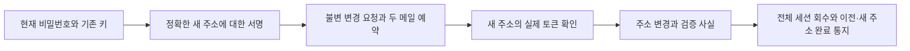

# 정확한 새 주소에 결합한 서명과 이메일 확인으로 연락처 변경

현재 비밀번호와 정확한 새 이메일 주소에 대한 패스키 서명을 확인한 뒤 새 주소로 보낸 일회 토큰을 검증해 로그인 주소를 바꾼다. 요청과 완료는 불변 원본으로 남기고 모든 세션을 회수하며 이전·새 주소에 보안 통지를 예약한다.

## 문제와 기존 동작

054의 이메일 확인은 현재 연락처 소유만 확인했다. 주소를 바꾸는 API나 기존 서명의 정확한 목적/새 주소 결합이 없었다. 또한 가입은 이메일 존재 확인과 INSERT 사이에 동시 요청이 들어오면 DB 유일성 오류로 끝날 수 있었다. 이메일 변경과 가입은 같은 주소를 경쟁하므로 공통 할당 순서가 필요하다.

## 검증된 제품과 공식 자료의 접근

[OWASP 등록 이메일 변경 지침](https://cheatsheetseries.owasp.org/cheatsheets/Authentication_Cheat_Sheet.html#changing-a-users-registered-email-address)의 MFA 확인·보류 주소·새 주소 확인·이전 주소 통지를 적용한다. 이 구현은 패스키 등록 고객에게만 변경을 허용하며 비밀번호만으로 주소를 바꾸는 약한 경로를 만들지 않는다. [066 내용 결합 서명](066-customer-password-authorization.md)과 설치된 Spring Security/WebAuthn4J 검증기를 재사용한다.

완료 검토에서 공개 제품 절차도 다시 대조했다(확인일2026-10-25).

| 공식 공개 자료 | 확인한 절차 | 이번 선택과 차이 |
| --- | --- | --- |
| [Coinbase](https://help.coinbase.com/en/coinbase/managing-my-account/update-my-account/how-do-i-change-my-email-address) | 2단계 인증 뒤 새 주소 코드 확인 | 인증과 새 주소 소유 확인 분리를 참고 |
| [Coinbase Exchange](https://help.coinbase.com/en/exchange/managing-my-account/email-address) | 2단계 확인 안내·다른 계정 주소 금지·새 주소 확인 메일 | 공개 업무 규칙을 참고하며 내부 DB/큐 구조를 추측하지 않음 |
| [Kraken](https://support.kraken.com/articles/360000672283-updating-account-information) | 이전/새 주소 각각의 코드·다른 계정 주소 금지 | 두 주소 코드 방식도 검토. 이번에는 실제 기존 키와 비밀번호가 있는 고객에게 OWASP의 MFA 경로를 적용해 이전 주소는 경고, 새 주소는 확인 |

이전 주소 코드까지 요구하면 독립 확인을 하나 더 얻지만 옛 메일 접근이 끊긴 고객은 현재 비밀번호·키가 있어도 지원 절차에 의존한다. 이번 선택은 그 의존성을 줄이는 대신 비밀번호와 키가 함께 침해된 위험이 남는다. 이전 주소 경고와 키 폐기/사전 코드 복구를 유지하며 신원 재확인 지원 경로는 별도 후속이다.

토큰·메일 저장은 [054](054-customer-email-ownership.md)/[067](067-customer-enrollment-email.md)의 검증된 기존 경로에서 CustomerEmailChallenges로 분리했다. JDK 난수/해시, Jakarta Mail, 기존 JDBC/트랜잭션을 사용하며 새 패키지는 없다. 국내 법정 절차나 인증 취득을 주장하는 문서가 아니라 자체 보안 구현 기록이다.

## 선택과 트레이드오프

| 선택 | 이점 | 비용/제약·대안 |
| --- | --- | --- |
| 현재 비밀번호·최근 키·정확한 새 주소에 대한 새 서명 | 탈취 세션/로그인 서명의 재사용과 주소 바꿔치기 차단 | 변경 전 패스키 등록·현재 주소 검증이 필요 |
| 서명 확정 후15분 새 주소 토큰 확인 | SMTP 지연 중 DB 잠금을 잡지 않고 실제 수신 주소를 확인 | 서명한 변경 의도가15분 유효. 사용자 버전/서명 키가 바뀌면 다시 시작 |
| 최초 서명은2분 옵션, 완료는 현재 강한 고객 세션+실제 토큰 | 메일 확인 후 불필요한 두 번째 업무 서명을 줄임 | 다른 고객 세션은 못 쓰지만 같은 고객의 새 강한 세션에서 계속 가능 |
| 원문 주소는 발송용 암호문에 두고 요청에는 목적별 HMAC | 불변 요청/감사에 주소·토큰 원문 복사 최소화 | 키 보호/회전과 만료 payload 파기의 운영 검증 필요. User.email의 현재 로그인 주소는 기존처럼 평문 DB 필드 |
| 같은 주소 할당에 PostgreSQL 트랜잭션 잠금 | 여러 플랫폼 프로세스의 가입/변경 경쟁을 일관되게 거부 | 해시 충돌 시 추가 직렬화, 잠금 대기 비용. 최종 유일성은 DB 제약이 보장 |
| 요청 시 이전 주소 경고, 완료 시 이전·새 주소 통지 | 변경 전/후 이상을 기존 수신자에게 알림 | 한 변경에 최대4개 메일 예약. SMTP 장애로 경고가 늦거나 중복 전달될 수 있음 |

발송은 통지 예약의 확정과 분리한다. SMTP 수신/고객 열람을 변경 승인 조건으로 가장하지 않는다. 새 주소 확인 링크를 실제로 사용해야 주소가 바뀐다. 발송 한도는 기존 확인과 공유해60초 간격·고객/주소별 시간당3건을 유지한다. 개발 편의를 위해 낮추거나 기존 금융 원본을 고치지 않는다.

## API와 상태 전이

| API | 조건·결과 |
| --- | --- |
| `POST /api/customer/security/email/options` | 현재 비밀번호·5분 이내 실제 키·현재 검증 주소. EMAIL_CHANGE 목적·2분 옵션 반환 |
| `POST /api/customer/security/email/requests` | 정확한 새 주소와 해당 옵션의 실제 서명. 변경 보류·새 주소 토큰/이전 주소 경고 예약. 응답에 토큰 없음 |
| `POST /api/customer/security/email/confirmations` | 현재 강한 본인 세션·요청 ID·실제 토큰. 주소 변경·확인 사실·전체 세션 회수·원본·완료 통지를 함께 확정 |



- 단기 옵션, 불변 서명 요청, 불변 실제 변경을 분리한다. 완료/유효 여부를 꾸며 내는 가변 상태나 폴백은 만들지 않는다.
- 새 주소는 확인 요청 본문에서 다시 받지 않고 암호화된 원본 메일과 HMAC에서 검증한다.
- 최초 서명 이후 계정 버전/주소/키 ID가 바뀌거나 실제 서명 키가 폐기되면 완료를 거부한다. 계정 중지/타인/운영자/대기/회수 세션도 거부한다.
- 같은 서명 요청의 재전송은 동일 영수증만 반환하고 토큰·메일·기한을 늘리지 않는다. 완료 후 새 강한 세션으로 같은 토큰을 보내면 기존 변경 영수증만 반환하며 확인 시각/세션을 다시 묶지 않는다.
- 기존 주소가 비워진 뒤에도 실제 불변 원본과 당시 검증 근거에 한정해 경고를 전달한다. 임의의 옛 주소로 모든 보안 통지를 보내는 것이 아니다.
- 주소 비교는 기존 정확한 문자열 기준이다. 공급사별 별칭을 추측해 합치지 않는다. 발송 제한은 기존 소문자 지문을 공유한다. 새 주소로 기존 선택적 서비스 알림 동의를 자동 이전하지 않는다.

## 실제 코드와 이해에 필요한 원리

출처: [CustomerEmailChangeService.java](../../src/main/java/dustin/cex/domains/security/CustomerEmailChangeService.java#L62), 현재 소스의 부분 발췌.

```java
        var rows=jdbc.queryForList("SELECT * FROM customer_email_change_challenges WHERE id=? AND user_id=? AND session_id=? AND expires_at>clock_timestamp() FOR UPDATE",proof.challengeId(),actor,sid);
        if(rows.size()!=1)throw denied(HttpStatus.FORBIDDEN);var stored=rows.getFirst();checkContext(user,destination,stored);
        var signed=verifier.verifyAssertion(actor,(String)stored.get("options"),proof.publicKey());
        // 워커는 커밋 뒤에만 토큰과 요청 원본을 함께 본다. 새 주소와 이전 주소의 메일을 따로 확정하지 않는다.
        var receipt=challenges.issue(user,proof.challengeId(),destination,CustomerMailOutbox.Kind.EMAIL_CHANGE_VERIFICATION);
        String fingerprint=OperatorMfaService.sha256Hex(signed.getRawId().toBase64UrlString());
        jdbc.update("INSERT INTO customer_email_change_requests(id,user_id,session_id,authorization_id,user_version,credential_fingerprint,old_email_mac,new_email_mac,key_id) VALUES(?,?,?,?,?,?,?,?,?)",receipt.challengeId(),actor,sid,proof.challengeId(),user.getVersion(),fingerprint,stored.get("old_email_mac"),stored.get("new_email_mac"),crypto.keyId());
        jdbc.update("DELETE FROM customer_email_change_challenges WHERE id=?",proof.challengeId());
        Instant occurred=jdbc.queryForObject("SELECT created_at FROM customer_email_change_requests WHERE id=?",java.sql.Timestamp.class,receipt.challengeId()).toInstant();
```

서버가 저장한 고객/세션/기한·계정 버전·기존/새 주소 지문을 확인한 후 실제 서명을 검증한다. 토큰 예약과 요청 원본이 같은 트랜잭션에 참여하므로 워커가 한쪽만 볼 수 없다. WebAuthn 장치가 이메일 문자열 자체를 표시/서명했다고 주장하지 않는다. 브라우저는 실제 대상 주소를 보여주고 서버는 일회 챌린지와 해당 주소를 결합한다.

출처: [CustomerEmailChangeService.java](../../src/main/java/dustin/cex/domains/security/CustomerEmailChangeService.java#L79), 현재 소스의 부분 발췌.

```java
        // 새 주소의 실제 토큰을 먼저 확인한다. 주소 중복 여부를 토큰 없이 알아내는 조회 경로를 만들지 않는다.
        challenges.verifyToken(actor,id,token);
        var done=jdbc.queryForList("SELECT id FROM customer_email_changes WHERE request_id=? AND user_id=?",UUID.class,id,actor);
        if(!done.isEmpty())return new Changed(done.getFirst(),true);
        if(!crypto.keyId().equals(request.get("key_id"))||user.getVersion()!=((Number)request.get("user_version")).longValue()
                ||!recipients.addressMac(user.getEmail()).equals(request.get("old_email_mac"))
                ||!mfa.credentialActive(actor,(String)request.get("credential_fingerprint")))throw denied(HttpStatus.CONFLICT);
        UUID mail=jdbc.queryForObject("SELECT id FROM customer_mail_jobs WHERE reference_id=? AND user_id=? AND kind='EMAIL_CHANGE_VERIFICATION'",UUID.class,id,actor);
        var payload=outbox.open(mail);String destination=payload.email();
        if(!recipients.addressMac(destination).equals(request.get("new_email_mac")))throw new IllegalStateException("확인 주소의 원본이 일치하지 않습니다");
        // 신규 가입과 같은 주소 할당 잠금을 사용한다. 네트워크/SMTP 대기는 이 트랜잭션 안에 없다.
        jdbc.queryForList("SELECT pg_advisory_xact_lock(hashtextextended(?,0))","customer-email-owner-v1:"+destination);
        if(users.existsByEmail(destination))throw denied(HttpStatus.CONFLICT);
        String old=user.getEmail();user.setEmail(destination);users.saveAndFlush(user);
```

주소 중복 여부는 실제 새 주소 토큰을 증명한 뒤에만 확인한다. 유효 대기 요청을 임의의 다른 주소에 적용하지 못한다. 실제 목적지 주소는 클라이언트의 확인 입력이 아니라 검증된 발송 원본에서 읽는다.

출처: [CustomerEmailChangeService.java](../../src/main/java/dustin/cex/domains/security/CustomerEmailChangeService.java#L92), 현재 소스의 부분 발췌.

```java
        String old=user.getEmail();user.setEmail(destination);users.saveAndFlush(user);
        challenges.confirmCurrent(user,sid,id,token);
        UUID change=UUID.randomUUID();jdbc.update("INSERT INTO customer_email_changes(id,user_id,request_id,session_id) VALUES(?,?,?,?)",change,actor,id,sid);
        tokens.revokeAllByUserId(actor,LocalDateTime.now());
        Instant changed=jdbc.queryForObject("SELECT changed_at FROM customer_email_changes WHERE id=?",java.sql.Timestamp.class,change).toInstant();
        outbox.enqueue(actor,CustomerMailOutbox.Kind.EMAIL_CHANGED_PREVIOUS,change,old,null,changed.plusSeconds(86400));
        outbox.enqueue(actor,CustomerMailOutbox.Kind.EMAIL_CHANGED_CURRENT,change,destination,null,changed.plusSeconds(86400));
        jdbc.update("DELETE FROM customer_email_change_challenges WHERE user_id=?",actor);
        audit.record(actor,"CUSTOMER_EMAIL_CHANGED","email-change:"+change,"SUCCESS","ALL_SESSIONS_REVOKED");
        return new Changed(change,true);
```

JPA의 saveAndFlush는 새 주소와 @Version 변경을 현재 DB 트랜잭션에 반영한다. 커밋 전 실패하면 주소·확인 원본·세션 회수·메일 예약이 함께 롤백된다. 자바/TypeScript 모두 DB 커밋과 네트워크 수신을 같은 것으로 볼 수 없다. SMTP는 이 트랜잭션 밖에서 기존 워커가 처리한다.

출처: [AuthService.java](../../src/main/java/dustin/cex/domains/auth/service/AuthService.java#L35), 현재 소스의 부분 발췌.

```java
            // 같은 주소의 신규 가입과 이메일 변경 확정을 DB 트랜잭션 단위로 직렬화한다.
            // 해시 충돌은 추가 대기만 만들며 최종 유일성은 users의 제약이 보장한다.
            jdbc.queryForList("SELECT pg_advisory_xact_lock(hashtextextended(?,0))","customer-email-owner-v1:"+request.getEmail());
            if(users.existsByEmail(request.getEmail())) throw new AuthException(AuthException.Kind.INVALID_SIGNUP);
            var user=users.saveAndFlush(User.builder().email(request.getEmail())
```

가입과 변경 완료가 같은 키 이름 공간으로 주소를 할당한다. 이 잠금은 Java 플랫폼 DB의 희소한 계정 변경 경로에 있으며 Rust 오더북/체결 코어의 공유 락과 무관하다.

출처: [CustomerEmailChallenges.java](../../src/main/java/dustin/cex/domains/mail/CustomerEmailChallenges.java#L62), 현재 소스의 부분 발췌.

```java
    public void confirmCurrent(User user,UUID sid,UUID id,String token){
        long actor=user.getId();verifyToken(actor,id,token);
        var row=jdbc.queryForMap("SELECT email_mac,key_id FROM customer_email_challenges WHERE id=? AND user_id=?",id,actor);
        if(!recipients.addressMac(user.getEmail()).equals(row.get("email_mac")))throw denied(HttpStatus.CONFLICT);
        // 소비된 토큰은 새 세션의 최근 확인으로 다시 결합하지 않는다.
        if(jdbc.queryForObject("SELECT EXISTS(SELECT 1 FROM customer_email_confirmations WHERE challenge_id=?)",Boolean.class,id))return;
        jdbc.update("INSERT INTO customer_email_confirmations(challenge_id,user_id,email_mac,key_id) VALUES(?,?,?,?)",id,actor,row.get("email_mac"),crypto.keyId());
        jdbc.update("INSERT INTO customer_email_confirmation_sessions(challenge_id,session_id) VALUES(?,?)",id,sid);
        audit.record(actor,"CUSTOMER_EMAIL_VERIFIED","email-check:"+id,"SUCCESS","CURRENT_ADDRESS_ONLY");
    }
```

공유 토큰 검증 뒤 현재 주소와 정확히 일치하는 근거만 저장한다. 소비된 토큰은 새 확인 세션을 만들지 않는다. 기존 CustomerEmailVerification은 고객 권한과 응답 조립에 집중한다. 이전 Java Receipt 타입과 사용하지 않는 단순 위임 메서드는 남겨 두지 않고 실제 호출부를 수정했다.

## 실행 명령과 결과

```sh
python3 scripts/verify_customer_account.py
python3 scripts/verify_customer_mail.py
python3 scripts/verify_platform_security.py
./gradlew operatorAdminJar bootJar --console=plain
```

JDK21·실행 소유 PostgreSQL16·GreenMail 로컬 SMTPS에서 계정167개(신규 이메일26개 포함), 메일95개, 공통 보안41개(신규 동시 가입1개 포함), **고유303개 통과**, 실패/오류/제외0이다. 처음 이메일23개 통과 뒤 만료·서명 키 폐기·중지 계정 경계를 보강하고 전체 계정167개를 다시 실행했다. 처음23개를 합산하지 않는다. 두 제품 JAR 빌드와 전체 테스트 컴파일 성공.

새 외부 발송/유료 API/실행 중 기존 서비스/DB/브로커를 쓰지 않았다. 테스트의 Didit/엔진/프로듀서는 격리 대체이고 SMTP만 로컬 실서버다. 봇0명·Kafka/엔진 주소는 닫힌 루프백이다. 보안 검증 프로세스도 공급사/메일 환경 변수를 제거했다. 기존 deprecated/unchecked/JVM 경고가 남는다. 새 의존성/버전 변경·OSV 조회·성능 측정은 없다.

## 한계와 후속

패스키 등록 고객의 정상 이메일 변경을 완성했다. 비밀번호 분실·모든 복구 자격 분실, 독립 신원 재확인, 요청/완료 이력 UI와 조회, 운영 지원 절차는 후속이다. 원문 토큰 링크는 프론트에서 no-referrer·토큰 로그 제외·제3자 리소스 금지·명시적 POST로 처리해야 한다. 실제 HTTPS/메일 공급사·키 보호/회전·보존/파기·DB 잠금 시간 제한/운영 증적은 별도 검증한다. 현재 코드만으로 규제/신고/인증 심사 통과를 주장하지 않는다.

## 작성한 테스트 코드


[CustomerEmailChangeIntegrationTest.java](../../src/test/java/dustin/cex/domains/kyc/CustomerEmailChangeIntegrationTest.java)

- `signedRequestLeavesCurrentAddressAndStoresOnlyBoundFingerprints`: 서명 요청은 현재 주소/세션을 유지하고 요청 표에는 지문만 남기며 토큰·경고 메일2건을 예약한다.
- `exactAddressConfirmationChangesLoginRevokesSessionsAndNotifiesBothAddresses`: 새 주소 확인 뒤 옛 로그인 거부·새 키 로그인·전체 세션 회수·이전/새 주소 완료 통지·완료 재전송의 단일 효과를 확인한다.
- `actualSmtpDeliversNewConfirmationAndOldPendingWarning`: 실제 로컬 SMTP의 새 주소 토큰과 이전 주소 경고를 받고 수신한 토큰으로 완료한다.
- `changedDestinationCannotReuseSignatureAndOriginalCanRetry`: 서명에 묶이지 않은 주소는 거부하고 원래 주소는 같은 정당한 증명으로 재시도한다.
- `passwordFreshnessAndExistingMfaAreRequired`: 잘못된 현재 비밀번호와6분 지난 키 확인으로 요청 옵션을 만들지 못한다.
- `passwordOnlyCustomerCannotRequestEmailChange`: 최초 패스키 미등록 고객은 비밀번호만으로 이메일 변경을 시작하지 못한다.
- `malformedSameAndHeaderInjectionAddressesAreRejected`: 동일 주소·잘못된 형식·표시 이름·헤더 개행 입력을400으로 거부한다.
- `loginChallengeCannotAuthorizeEmailChange`: 로그인 챌린지 서명은 이메일 변경 목적으로 쓰지 못한다.
- `wrongOriginMissingUserVerificationAndExpiredOptionsAreRejected`: 다른 출처·사용자 확인 누락·만료된 서명 옵션을 거부한다.
- `duplicateAndConcurrentRequestReturnOneReceiptAndTwoMails`: 동시/반복 서명 요청은 같은 영수증과 토큰/경고 각1건만 만든다.
- `wrongTokenForeignSessionAndUnrelatedChallengeCannotConfirm`: 다른 토큰·타인 세션·관계없는 ID로 주소를 바꾸지 못한다.
- `currentAddressConfirmationApiCannotApplyPendingNewAddress`: 기존 현재 주소 확인 API로 보류 중 새 주소를 적용하거나 확인 사실을 만들지 못한다.
- `accountVersionChangeInvalidatesSignedIntent`: 서명 이후 계정 버전이 바뀌면 완료409이며 새 주소 토큰 발송도 억제한다.
- `finalAuditFailureRestoresAddressConfirmationSessionsAndNotices`: 마지막 감사 실패는 주소·확인·세션·완료 통지를 함께 롤백하고 정당한 재시도는 성공한다.
- `requestReservationFailureRestoresSignatureNonceAndNoMail`: 예약 실패 때 서명 카운터/옵션/요청/메일을 되돌리고 같은 증명으로 다시 요청한다.
- `simultaneousConfirmationHasOneChange`: 동시 확인은 한 번만 주소를 바꾸고 불변 완료1건만 만든다.
- `signupAndChangeCannotOwnTheSameAddress`: 가입과 변경 완료의 실제 DB 경쟁에서 한쪽만 성공하고 주소 소유자는1명이다.
- `pendingIntentAndCompletionFactsAreImmutable`: 서명 요청·실제 변경의 UPDATE/DELETE/TRUNCATE를 거부한다.
- `actualHttpChangesOnlyWithScopedSignatureAndToken`: 실제 HTTP에서 서명 요청/토큰 완료/토큰 응답 비노출과 운영자403·익명401을 확인한다.
- `fiveInvalidTokensThenRateLimitPreserveOriginalAddress`: 오류5회 뒤429이며 주소·세션·변경 원본은 유지한다.
- `newAddressAlreadyOwnedIsRejectedOnlyAfterItsTokenIsProved`: 다른 계정의 주소여도 실제 토큰을 모르면403, 증명한 뒤에만 소유 충돌409다.
- `serverKeyFailureDoesNotConsumeCustomerFailureBudget`: 서버 키 장애6회는503이며 고객 실패 예산에 넣지 않는다.
- `recentCurrentAddressVerificationSharesChangeMailRateLimit`: 실제 최근 현재 주소 확인과 새 주소 변경이 같은60초 발송 제한을 공유한다.
- `expiredPendingTokenCannotChangeAddressOrReadMailPayload`: 과거 만료 요청 표본은410으로 거부하고 payload 조회/주소 갱신 전에 끝낸다.
- `revokedOriginalSigningKeyInvalidatesPendingChange`: 예비 키로 최초 서명 키를 폐기한 뒤 새 강한 세션에서도 그 변경 의도는 완료하지 못한다.
- `disabledCustomerSuppressesNewAddressTokenButStillWarnsOldAddress`: 계정 중지 후 완료/새 주소 토큰 전달은 막고 이전 주소의 고정 보안 경고만 보낸다.

## 관련 커밋과 증적

- [구현 c08a396](https://github.com/GiHoon1123/Cex-Platform-Service/commit/c08a3962578acfff73611312458a07211bdac5cc)
- [격리 실행 증적](../reference/071-customer-email-change-verification-2026-10-25.json)

[PlatformSecurityTest.java](../../src/test/java/dustin/cex/domains/security/PlatformSecurityTest.java)의 신규 `concurrentSignupAllocatesOneEmailAddress`는 같은 이메일의 동시 가입2건에서1건 성공·1건 통제된 AuthException 거부·DB 사용자1건을 검증한다. 기존 보안40개도 재실행해41개다.

선행 주소 할당 수정: [5def282](https://github.com/GiHoon1123/Cex-Platform-Service/commit/5def2827d56aa14e13a3a6d77dbf680c4593f002). 구현·테스트와 별도로 설명 가능한 가입 경쟁 수정으로 나눴다.
