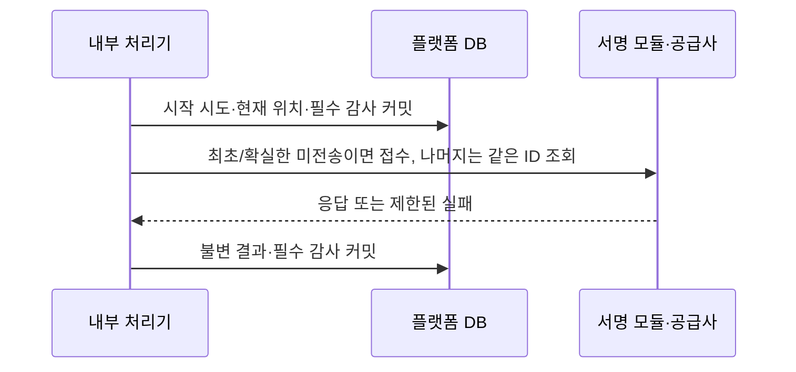

# 입금 검색의 미전송·결과 불명을 구분하고 실행 이력 보존하기

[099 안정 검색 ID](099-durable-deposit-search-reservation.md)의 접수/결과 조회를 실제 클라이언트와 연결한다. 게이트웨이 미전송을 증명한 현재 호출만 재접수하며, 전송 이후 결과 불명·프로세스 중단은 같은 ID의 결과 조회로 회복한다. 조회 시도·결과·필수 감사를 보존하되 금융 승인/잔액 반영은 하지 않는다.

## 문제와 기존 동작

099는 외부 요청 전에 입금/주체/요청 ID를 확정했다. 그러나 호출 시도/완료와 결과 불명에 대한 실행 이력은 없었다. 모든 예외를 재접수하면 공급사에 이미 전달한 요청을 중복 접수할 수 있다. 반대로 서명 모듈 실패처럼 게이트웨이에 보내지 않았음이 확실한 경우까지 결과 조회만 하면 존재하지 않는 요청을 계속 찾게 된다. 현재 호출의 미전송과 전송 이후 불명을 구분해야 한다.

## 기존 제품과 공식 자료의 접근

- [CodeVASP 검색 접수](https://docs.codevasp.com/en/docs/travel-rule/api-reference/03-Request-API/11-Search-VASP-by-TXID-Request)와 [결과 조회](https://docs.codevasp.com/en/docs/travel-rule/api-reference/03-Request-API/12-Search-VASP-by-TXID-Result)를 따른다. 접수의 SUCCESS는 검색 완료가 아니다. PROCESSING은10초보다 긴 간격으로 재확인하도록 권고한다. 이번 재조회 간격30초는 그보다 긴 자체 정책이다.
- [AWS transactional outbox](https://docs.aws.amazon.com/prescriptive-guidance/latest/cloud-design-patterns/transactional-outbox.html)의 DB 확정 후 별도 전송 원칙과 [엔진020의 미접수/결과 불명 구분](../../../Cex-Engine/docs/decisions/020-typed-deposit-outcomes.md)을 참고했다. 공급사가 같은 ID의 POST를 멱등 처리한다고 가정하지 않는다. 최초 전송 시작만 보존된 상태도 미전송으로 추측하지 않는다.
- [PostgreSQL16 잠금](https://www.postgresql.org/docs/16/explicit-locking.html)과 기존 시작→외부 I/O→완료의 짧은 TX 패턴을 재사용한다. 설치된 Spring JDBC/TransactionTemplate/Jackson/JDK만 사용하며 새로운 큐/재시도/암호 라이브러리를 추가하지 않았다.

## 선택과 트레이드오프

| 선택 | 이점 | 비용·제약·대안 |
| --- | --- | --- |
| CodeVaspSubmissionFailure의 NOT_SENT/OUTCOME_UNKNOWN | 확실한 미전송의 회복과 불명의 중복 접수 차단을 함께 달성 | 전송 경계를 추적해야 함. NOT_SENT는 현재 호출만 설명하며 과거 동일 ID의 다른 호출을 소급 증명하지 않음 |
| 시작/현재 위치/감사를 먼저 확정 | 프로세스 중단 후 동일 ID로 상태를 이어감 | DB 확정 직후 실제 전송 전에 죽어도 미전송을 증명할 수 없다. 이후 조회가 UNKNOWN_REQUEST이면 보류/운영 해결이 필요 |
| 미전송 결과에만 같은 ID 재접수, 그 외는 POLL | 공급사의 POST 멱등 보장 없이 재접수하는 경로 제거 | 일시 네트워크 장애 뒤 일부 요청이 수동 해결 대상으로 남을 수 있음. 이 부담을 명시하고 미확인 멱등 동작을 폴백으로 만들지 않음 |
| 완료 뒤30초·미완료2분 임대 | 빠른 반복 호출/동시 실행/지연 응답 중첩 제한 | 처리 결과 반영이 기다려질 수 있음. 실제 공급사 쿼터/운영 경보 기준은 별도 검증 필요 |
| 최신 시작을 현재 위치로 지정 | 새 진행 중/실패를 옛 FOUND로 숨기지 않음 | 새 외부 장애 동안 이전 양성 결과로 업무를 계속할 수 없음 |
| 불변 시도/결과+내용 해시 | 중단/재처리/늦은 완료 추적·변조/혼합 입력 거부 | 조회마다 이력 증가. 원문 reasonMsg/개인정보는 저장하지 않고 타입 결과만 저장하며 보존 운영 비용은 남음 |
| 내부 수동 실행 서비스부터 연결 | 프로토콜/DB/실패 경계를 먼저 검증 | 자동 처리 워커/운영 API·업무 승인/금융 반영은 아직 미완료. 끝나지 않은 업무를 화면에서 성공처럼 보이지 않음 |

## 구현과 관련 코드

[CodeVaspSubmissionFailure](../../src/main/java/dustin/cex/domains/travelrule/CodeVaspSubmissionFailure.java)는 원문 없는503 예외에 현재 호출의 접수 경계를 담는다.

- [CodeVaspTransport](../../src/main/java/dustin/cex/domains/travelrule/CodeVaspTransport.java)에서 게이트웨이 전송 시작 전 모듈 호출/서명 시각·키/본문 대조 실패는 NOT_SENT다. 모듈에 서명 요청이 도달했을 수는 있으며 검색 게이트웨이에 보내지 않았다는 의미다.
- 전송을 시작한 이후의 연결/본문 시간 초과·HTTP 오류·JSON 오류는 OUTCOME_UNKNOWN이다. 네트워크 예외의 문자열로 미전송을 추론하지 않는다.
- [CodeVaspTransactionClient](../../src/main/java/dustin/cex/domains/travelrule/CodeVaspTransactionClient.java)의 잘못된 응답/다른 ID도 이미 전송한 뒤이므로 OUTCOME_UNKNOWN이다.
- 외부 TX 사용 금지/호출 전 입력 조건은 그대로 유지한다. 예외에 원문 응답·키·주소·cause를 넣지 않는다. 최상위503만으로 금융 거절/재송금 여부를 판단하면 안 된다.

[CodeVaspDepositSearchExecution](../../src/main/java/dustin/cex/domains/travelrule/CodeVaspDepositSearchExecution.java)는 refresh(searchId)와 current(searchId)를 제공한다. 저장된 검색 주체와 현재 설정의 원점/등록 주체/등록 공개키가 같아야 한다. 다른 원점으로 옛 검색 ID를 보내지 않는다.



외부 호출 동안 DB TX/행 잠금을 보유하지 않는다. 시작 감사 실패는 모두 롤백해 외부 호출0이고, 완료 감사/DB 실패는 결과를 다시 공급사 실패로 저장하지 않는다. 시작만 남으면2분 뒤 POLL로 이어진다. 오류는 PROVIDER_UNAVAILABLE/INVALID_SOURCE/INTERNAL_FAILURE만 보존한다. result의 요청 ID/상태/4MiB 타입 투영 상한도 확인한다.

| 상태 | 의미와 다음 실행 |
| --- | --- |
|UNSTARTED | 원본 예약만 있음. 최초 SUBMIT |
|RUNNING | 시작 확정·완료 없음.2분 이내409, 지난 뒤 POLL |
|SUBMIT_NOT_SENT | 게이트웨이에 보내기 전 실패를 증명.30초 뒤 같은 ID SUBMIT |
|SUBMIT_ACKNOWLEDGED | 접수 응답 확인.30초 뒤 POLL, 검색/금융 성공 아님 |
|SUBMIT_UNKNOWN | 전송 결과 불명.30초 뒤 POLL, 자동 재접수 안 함 |
|FOUND/NOT_FOUND/PROCESSING/UNKNOWN_REQUEST/AMBIGUOUS |098의 기술 검색 결과.30초 뒤 갱신해도 POLL이며 금융 허가는 별도 |
|POLL_FAILED | 조회 실패/불량 결과.30초 뒤 POLL, 옛 FOUND로 우회 안 함 |

[travelrule/schema.sql](../../src/main/resources/travelrule/schema.sql)의 codevasp_search_attempts/heads/results를 추가했다. 직접 SQL에도 단계 전이·임대/간격·불변성·같은 TX의 현재 위치 전진·요청 ID/상태/해시 결합을 검사한다. 시작/결과 시각을 미래로 넣거나 결과를 시작보다 과거로 넣을 수 없다. DB 시각이 거꾸로 이동한 상황을 정상으로 위장하지 않으며 시각 안정성은 운영 전제다.

current()는 최신 위치를 FOR SHARE로 고정해 새 SQL에서 해당 불변 결과를 읽는다. 바깥 TX가 있으면 참여하며 그 TX가 끝날 때까지 갱신이 기다릴 수 있다. 읽기 전용 TX에서 FOR SHARE를 실행할 수 없으므로 일반 짧은 업무 TX에서 사용한다. 단독 current() 반환 후의 State는 이후 업무의 승인 토큰이 아니다. refresh() 반환도 해당 실행의 상태이며 늦은 실행이면 최신 위치와 다를 수 있다. 중요한 후속 업무는 같은 TX에서 current를 다시 읽어야 한다.

이 잠금/JSON 처리/HTTP 대기는 Java 플랫폼의 외부 처리 경계다. Rust 체결 코어의 단일 스레드 상태 소유와 입출력 분리는 유지한다. 감사의 CODE_DEPOSIT_SEARCH_FINISHED/SUCCESS는 기술 호출 결과 저장 성공이며 입금 승인 이벤트가 아니다.

## 이해에 필요한 문법과 원리

출처: [CodeVaspTransport.java](../../src/main/java/dustin/cex/domains/travelrule/CodeVaspTransport.java#L53), 현재 소스의 부분 발췌.

```java
            // 이 표시 이후의 예외는 실제 미접수를 증명하지 않는다. 서명 모듈 단계의 실패와 구분한다.
            gatewayStarted=true;
            return call(request,2097152);
        }catch(RuntimeException failure){
            if(expectedBody!=null)throw new CodeVaspSubmissionFailure(gatewayStarted?CodeVaspSubmissionFailure.Admission.OUTCOME_UNKNOWN:CodeVaspSubmissionFailure.Admission.NOT_SENT);
            throw unavailable();
        }
    }
```

boolean 표시는 JDK HTTP 호출로 넘어가는 보수적 경계다. 이 뒤의 연결 오류를 보고 미접수를 추정하지 않는다. 모듈 단계 오류는 게이트웨이에 보내지 않은 현재 호출로 분류한다. 공개 실패 타입은 ResponseStatusException의 원문 없는 하위 타입이며, reason 문자열을 파싱해 제어하지 않는다.

출처: [CodeVaspDepositSearchExecution.java](../../src/main/java/dustin/cex/domains/travelrule/CodeVaspDepositSearchExecution.java#L47), 현재 소스의 부분 발췌.

```java
        }catch(CodeVaspSubmissionFailure admission){
            status=started.phase().equals("SUBMIT")?(admission.admission()==CodeVaspSubmissionFailure.Admission.NOT_SENT?"SUBMIT_NOT_SENT":"SUBMIT_UNKNOWN"):"POLL_FAILED";
            failure="PROVIDER_UNAVAILABLE";payload=null;result=null;
        }catch(ResponseStatusException unavailable){status=started.phase().equals("SUBMIT")?"SUBMIT_UNKNOWN":"POLL_FAILED";failure="PROVIDER_UNAVAILABLE";payload=null;result=null;}
        catch(RuntimeException unexpected){status=started.phase().equals("SUBMIT")?"SUBMIT_UNKNOWN":"POLL_FAILED";failure="INTERNAL_FAILURE";payload=null;result=null;}
        String outcome=status,code=failure,body=payload;var value=result;
        // 완료 DB/감사 실패는 공급사 오류로 다시 저장하지 않는다. 시작만 남으면 임대 후 결과 조회로 회복한다.
```

구체 실패 타입을 먼저 잡아 NOT_SENT를 구분한다. 일반503이나 예상하지 못한 예외는 전송되지 않았다고 추측하지 않는다. TypeScript에서도 판별 가능한 오류 종류를 사용하고 message 문자열 비교를 피하는 원칙은 같다. 오류 코드와 단계만 보존한다.

출처: [CodeVaspDepositSearchExecution.java](../../src/main/java/dustin/cex/domains/travelrule/CodeVaspDepositSearchExecution.java#L70), 현재 소스의 부분 발췌.

```java
        boolean prior=Boolean.TRUE.equals(jdbc.queryForObject("SELECT EXISTS(SELECT 1 FROM codevasp_search_attempts WHERE search_id=?)",Boolean.class,id));
        boolean notSent=Boolean.TRUE.equals(jdbc.queryForObject("SELECT EXISTS(SELECT 1 FROM codevasp_search_heads h JOIN codevasp_search_results r ON r.attempt_id=h.attempt_id WHERE h.search_id=? AND r.status='SUBMIT_NOT_SENT')",Boolean.class,id));
        String phase=!prior||notSent?"SUBMIT":"POLL";
        long attempt=jdbc.queryForObject("INSERT INTO codevasp_search_attempts(search_id,phase) VALUES(?,?) RETURNING id",Long.class,id,phase);
        jdbc.update("INSERT INTO codevasp_search_heads(search_id,attempt_id) VALUES(?,?) ON CONFLICT(search_id) DO UPDATE SET attempt_id=excluded.attempt_id",id,attempt);
        audit.record(null,"CODE_DEPOSIT_SEARCH_STARTED","codevasp-search:"+id,"SUCCESS","ATTEMPT:"+attempt+":PHASE:"+phase);
        return new Start(attempt,id,phase);
```

최초 또는 영속한 현재 미전송 결과일 때만 SUBMIT이다. 시작만 남거나 결과가 불명이면 POLL로 이어진다. 시도·현재 위치·감사를 하나의 TX에 넣고 나서 외부 호출한다. Long attemptId는 UNSTARTED의 null을 표현하는 참조형이며 SQL 유일 키/단계 제약이 실제 전이를 함께 검사한다.

## 작성한 테스트

[CodeVaspDepositSearchIntegrationTest](../../src/test/java/dustin/cex/domains/kyc/CodeVaspDepositSearchIntegrationTest.java)에 아래15개를 추가했다. 기존 예약12개와 같은 격리 컨텍스트에서 원본을 매번 분리한다. 외부 공급사 실행은 모의 클라이언트이며 실제 PG 시작/결과/제약을 검증한다.

| 함수 | 시나리오·기대 결과 |
| --- | --- |
|executionSubmitsOriginalRequestOnceAndPersistsAcknowledgement | UNSTARTED→외부 호출 중 RUNNING/TX없음→접수 ACK, 원래 요청 전달·서비스 재생성 후 같은 상태 |
|concurrentExecutionCannotSubmitTwiceWhileFirstProviderCallIsPending | 첫 외부 호출 정지 중 두 번째409, 실제 접수 호출1회 |
|executionStartAuditFailureCannotReachProvider | 시작 감사 실패 시 UNSTARTED·외부 호출0 |
|executionFinishAuditFailureRetainsRunningStartWithoutSecondSubmission | 외부 접수 후 완료 감사 실패, 결과0/시작 보존·즉시 재접수409 |
|orphanedSubmissionIsRecoveredByPollingAndLateAckCannotMoveCurrentHead | 처음부터181초 지난 시작 원본 구성, POST 재접수 없이 같은 ID POLL/FOUND, 늦은 ACK 보존하되 현재 위치 유지 |
|lostSubmissionResponseIsUnknownAndDoesNotTriggerImmediateResubmission | 접수 오류는 SUBMIT_UNKNOWN/제한 코드·원문 미보존·즉시 추가 접수 없음 |
|latestRunningAndFailedPollCannotExposeEarlierFound | 과거 FOUND 뒤 새 호출 중 RUNNING, 새 실패 후 POLL_FAILED/옛 결과 우회 없음·이력은 보존 |
|malformedPollReplyKeepsBoundedInvalidSourceFailure | 다른 요청 ID 반환 시 POLL_FAILED/INVALID_SOURCE·결과 본문 미보존 |
|completedAttemptEnforcesPollingIntervalAndDirectResubmissionIsRejected | 완료 직후409·SQL로 새 시작 시각을 과거로 넣어도 현재 간격/단계를 우회하지 못함 |
|immutableResultsAndPayloadBindingRejectDirectDatabaseBypass | 다른 요청 ID/틀린 해시·원본 UPDATE/DELETE/TRUNCATE CASCADE·현재 위치 역행 거부 |
|resultPhaseCannotPretendSubmissionWasCompletedSearch | SUBMIT에 FOUND 결과를 직접 넣어도 단계 제약 거부 |
|executionCannotUseAmbientTransactionForProviderIo | 외부 TX에서는 실행/외부 호출0·UNSTARTED 유지 |
|futureExecutionTimesCannotBeInsertedAsFreshHistory | 미래 시작/미래 결과 직접 입력 거부 |
|provenNonSendIsStoredSeparatelyWithoutImmediateRetryBurst | 타입 NOT_SENT는 SUBMIT_NOT_SENT로 보존, 즉시 재시도409 |
|provenNonSendCanRetrySameRequestAfterIntervalWithoutPollingUnknownIdentity | 처음부터 지난 미전송 원본 구성, 같은 요청 ID SUBMIT 후 ACK·POLL 호출0 |

시간 경과/중단 fixture는 새 시도·결과를 처음부터 과거 시각으로 삽입한다. 기존 원본 UPDATE/트리거 해제나 실제2분 프로세스 정지 시험을 한 것이 아니다. 단순한 같은 객체 결과와 재생성 객체 조회도 실제 프로세스 재기동 시험과 구분한다. 모든 시험 뒤 엔진/Kafka 생산자 호출0과 사용 가능 잔액 표0을 확인한다. 예약만 검사하는 기존 시험은 검색 호출0 확인도 유지했다.

[CodeVaspTransactionClientTest.typedAdmissionSeparatesProvenCurrentNonSendFromUnknownGatewayOutcome](../../src/test/java/dustin/cex/domains/travelrule/CodeVaspTransactionClientTest.java)1개를 추가했다. 실제 소유 HTTP 대역에서 다른 거래가 서명되면 게이트웨이 수신0/NOT_SENT,429·잘못된 ACK는 게이트웨이 수신 뒤 OUTCOME_UNKNOWN임을 검사한다. 기존12개를 포함한13개 프로토콜 시험도 모듈/게이트웨이에서 실제 임시 Ed25519 서명 바이트를 검증한다. 실제 공급사 키나 공식 모듈 이미지는 사용하지 않는다.

## 실행 명령과 결과

- Java21/소유 PostgreSQL16. `python3 scripts/verify_codevasp_deposit_searches.py`: 최종27개(신규15+기존12), 실패/오류/제외0. 개발 중24/25개 실행 후 미전송 분류를 보완해 최종27개를 다시 실행했다.
- `python3 scripts/verify_codevasp_directory.py`: 최종54개(신규 타입 HTTP1+기존53), 실패/오류/제외0. 앞선53개 실행을 최종54개와 중복 합산하지 않는다.
- 공급사/메일/BTC/CodeVASP 환경을 제거하고 소비자 자동 시작=false로 `python3 scripts/verify_engine_inbox.py`: 금융182개, 실패/오류/제외0. 전역 스키마/빈 추가와 H2 정산 fixture를 함께 확인했다.
- 최종 세 묶음 고유263개/실행263개·중복0. `.local/cycle100-proof`에 검색/목록/금융 XML·결과·로그를 분리 보존했다. 소유한 최종 세 DB 컨테이너 모두 제거 확인.
- `bootJar operatorAdminJar` 성공. 두 JAR에 실행 서비스/실패 타입/스키마 포함·테스트 코드 제외. 기존 deprecated/unchecked/JVM CDS 경고는 남는다. 신규 의존성 없음. `git diff --check`·코드 발췌/상대 링크 대조.
- 실제 공급사/샌드박스/Cipher 이미지·메인넷·BTC 실제 노드 전체·Rust/Kafka/브라우저 회귀는 이번에 실행하지 않았다.

## 남은 한계

자동 처리 워커/실행 진입점·작업 임대 선택/운영 보류 해결·송수신인 정보 교환/개인지갑 소유·위험/고객/업무 승인·엔진/원장 반영은 후속이다. 이번 서비스는 같은 ID의 검색 상태를 다루며 금융 인가/입금 승인 API가 아니다. FOUND의 DB 기록 시각이 원래 송신인의 신원 확인 시각이나 온체인 확정 시각을 증명하지 않는다. 최초 시작 커밋 후 전송 전에 중단된 요청은 POLL의 UNKNOWN_REQUEST로 남을 수 있고, 공급사 멱등 계약을 확인하지 않고 자동 재접수하지 않는다. 운영 해결 절차가 완성되기 전 이런 상태를 정상 입금으로 표시하면 안 된다. 외부 호스트/계약·DB 관리자/시각/백업 보장은 별도 운영 조건이다.

## 관련 선행 커밋

- [미전송/불명 분류 ed8e12e](https://github.com/GiHoon1123/Cex-Platform-Service/commit/ed8e12e)는 프로토콜 실패 타입과 실제 HTTP 시험을 함께 바꾼 별도 작은 커밋이다. 아래 구현 커밋은 실행 이력/DB 제약/통합 시험을 포함한다.


## 관련 커밋과 증적

- [구현 9caa2cf](https://github.com/GiHoon1123/Cex-Platform-Service/commit/9caa2cfd69c2518a4ef84c96806a83dec0ffbfec)
- [격리 실행 증적](../reference/100-durable-deposit-search-execution-verification-2026-10-25.json)

## 후속 자동 처리 시점

[101](101-automatic-deposit-search-processing.md)에서 이미 예약된 검색의 전용 워커/후보 선택·자동 반복 제한을 연결했다. 위 자동 처리 미구현 설명은100의 시점이다. 실제 보류 입금의 자동 예약·정보 교환/운영 해결·금융 허가는 여전히 미완료다.

104에서 공통 서명/헤더를 추출해 위 전송 경계 발췌의 다음 메서드는 생략했다. 현재 동작과 과거100 검증의 시점은 구분한다.
