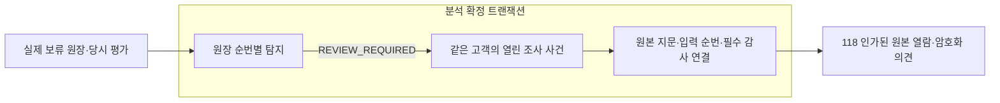

# 반복 거래 탐지 신호를 고객별 조사 사건에 연결하기

같은 고객에게 반복된 거래 탐지 신호를 하나의 조사 사건에 연결한다. 각 신호는 당시 원장 입력·정책·원본 지문과 담당자 의견으로 추적하며, 새 신호·사건 연결·필수 감사를 함께 확정한다. 사건 생성은 종결·의심거래보고·거래 제한 변경·금융 허가가 아니다.

후속 [121 범위가 고정된 독립 판단](121-bound-independent-transaction-case-reviews.md)은 실제 원본/의견 열람·암호화 사유·지정 인물의 내용 결합 서명을 연결한다. 범위 밖 새 신호는 승인에 포함하지 않으며 판단 승인 자체는 사건 종결·외부 보고·금융 허가가 아니다.

## 문제와 기존 동작

116~119는 입력마다 탐지와 원본·의견을 남겼다.5번째 입금에서 신호가 발생한 뒤6번째 입금에서도 같은 패턴이 이어지면 평가2개가 만들어진다. 이를 각각 별도 조사 사건으로 취급하면 같은 고객의 연관 거래가 흩어지고 담당자의 중복 작업이 늘어난다.

탐지 평가와 조사 사건의 역할을 나눈다. 평가는 한 입력 시점의 규칙 실행 결과이고, 사건은 연관된 검토 신호들을 함께 조사하는 업무 묶음이다. 개별 평가를 합쳐 삭제하거나 마지막 결과로 덮지 않는다.

## 기존 제품과 공식 자료의 접근

2026-10-25 확인한 [ComplyAdvantage 거래 모니터링 사건 조사](https://support.complyadvantage.com/articles/3606136172-understanding-and-investigating-a-transaction-monitoring-case)는 고객/상대방을 중심으로 연관 신호와 거래를 모아 검토하는 구조를 공개한다. 갱신일은2026-08-21이다. 신호별 거래/조건 확인과 사건 전체의 판단을 구분하는 접근을 적용한다. 비공개 내부 저장 구조를 추정하지 않는다.

[118 원본·담당자 의견](118-verified-monitoring-evidence-and-analyst-observations.md)을 재사용해 사건→개별 신호→당시 입력/의견으로 이동할 수 있도록 한다. [116 FATF/KoFIU 근거](116-durable-native-deposit-monitoring.md)의 맥락 검토와 자체 정책 수치의 구분은 유지한다. 사건을 만들었다는 이유로 신고·인증 요건을 충족하거나 범죄가 입증됐다고 해석하지 않는다.

현재 구현 범위는 **열린 사건의 자동 생성·신호 연결·조회**다. 독립적인 종결/보고 판단은 아직 구현하지 않았으므로 CLOSED 상태나 가짜 완료 경로를 추가하지 않는다. 설치된 JDBC·PostgreSQL·Spring 트랜잭션·운영 세션/감사를 사용하며 새 의존성·범용 사건 프레임워크를 만들지 않았다.

## 선택과 트레이드오프

| 선택 | 이점 | 비용·제약·대안 |
| --- | --- | --- |
| 고객의 현재 사건에 반복 신호 연결 | 연관 입력을 함께 조사하고 신호마다 사건을 중복 생성하지 않는다 | 한 사건의 신호가 늘어난다. 조회는25개씩 제한하고 개별 평가를 보존한다 |
| 실제 REVIEW_REQUIRED에만 자동 사건 생성 | 미평가/무신호를 위험 신호처럼 꾸미지 않는다 | INCOMPLETE는 별도 미완료 상태로 남는다. 사건이 없다고 저위험·자금 사용 허가가 아니다 |
| 고객 잠금 아래 사건/현재 위치 확보 | 여러 프로세스가 같은 고객의 첫 사건을 동시에 중복 생성하지 않는다 | 플랫폼 고객별 DB 경합/추가 쓰기. 엔진 코어의 락 제거와 무관하다 |
| 신호·사건 연결·필수 감사 같은 TX | 사건 없는 완료 신호·감사 없는 연결을 커밋하지 못한다 | 사건 저장/감사 장애가 해당 분석 위치를 지연한다. 기존 원장/이전 분석은 보존한다 |
| 원본 지문/순번만 연결하고 의견을 복사하지 않음 | 금융·조사 원본 권위를 유지하고 기존 열람 권한/암호화를 재사용한다 | 세부 확인에는 원본/메모의 별도 인가된 열람이 필요하다 |
| 현재 역할·5분 추가 인증·최소 메타데이터 | 고객/익명/회수된 운영자 접근과 메모 유출 차단 | 운영 담당자의 재인증과 조회 감사 비용이 남는다 |

정책은 현재 NATIVE_SMALL_REFERENCE_INFLOW_V1 하나다. 현재 열려 있는 사건을 고객당 하나로 관리한다. 정책 변경/사건 종결 후 새 사건의 수명주기는 이후 실제 기능에서 정의해야 하며 현재 다중 정책·종결이 구현됐다고 표시하지 않는다.

## 실제 흐름과 API



GET `/api/admin/monitoring-cases?page={n}`는 OPERATOR/APPROVER/AUDITOR에게 최소 사건 목록25개를 제공한다. 사건 ID·고객 ID·정책·첫 연결 평가·신호 수·개시 시각·OPEN 상태와 비금융 보증을 반환한다. 하나의 SQL 조회로 목록/신호 수를 읽어 사건마다 별도 DB 왕복을 반복하지 않는다.

GET `/api/admin/monitoring-cases/{case}?before={cursor}`는 신호25개와 다음 원장 위치를 제공한다. 신호의 실제 입금 ID·평가 ID로118의 원본 검증/메모 경로에 연결하며 원문 메모·이름·주소·암호문·키/HMAC은 반환하지 않는다. 입력 순번은 문자열이다. 같은 신호를 재연결해도 사건/연결/감사를 추가하지 않는다.

고객 입력으로 사건을 생성하거나 상태를 바꾸는 API는 없다. 생성은 신뢰된 탐지 업무의 MANDATORY 트랜잭션에서만 수행한다. 현재 계정 탐지 요약에도 caseId를 연결한다. null은 사건 연결이 없다는 뜻이며 위험 해결을 의미하지 않는다. 과거 확정 평가를 새 사건으로 추측해 채우거나 원본을 갱신하는 호환 경로는 추가하지 않았다.

## 구현과 관련 코드·문법

출처: [DepositMonitoringService.java](../../src/main/java/dustin/cex/domains/monitoring/DepositMonitoringService.java#L70), 현재 소스의 부분 발췌.

```java
            // 사건 연결 실패도 같은 평가 TX를 롤백한다. 원래 수탁 원장과 이전 순번의 확정 결과는 보존한다.
            if("REVIEW_REQUIRED".equals(result.outcome()))cases.link(id);
            audit.record(null,"DEPOSIT_MONITORING_ASSESSED","monitoring-assessment:"+id,"SUCCESS","POLICY:"+SmallDepositMonitoringPolicy.POLICY+":OUTCOME:"+result.outcome()+":REASON:"+result.reason()+":SOURCE:"+hash);
```

실제 새 검토 신호를 평가/현재 위치와 같은 트랜잭션에서 연결한다. 실패하면 이 평가 위치의 확정은 롤백되지만 앞서 반입한 금융 원장과 이전 분석은 되돌리지 않는다. Java if 조건은 TypeScript와 비슷하지만 호출의 원자성은 실제 DB 트랜잭션이 보장한다.

출처: [DepositMonitoringCases.java](../../src/main/java/dustin/cex/domains/monitoring/DepositMonitoringCases.java#L37), 현재 소스의 부분 발췌.

```java
    @Transactional(propagation=Propagation.MANDATORY)
    public UUID link(UUID assessment){
        var rows=jdbc.queryForList("SELECT user_id,policy_id,outcome,input_cursor,source_hash FROM deposit_monitoring_assessments WHERE id=?",assessment);
        if(rows.isEmpty())throw denied(HttpStatus.NOT_FOUND);var source=rows.getFirst();long owner=((Number)source.get("user_id")).longValue();
        if(!"REVIEW_REQUIRED".equals(source.get("outcome")))throw denied(HttpStatus.CONFLICT);
        users.lockById(owner).orElseThrow(()->denied(HttpStatus.NOT_FOUND));
```

사건 ID를 요청에서 받아 금융 원본처럼 신뢰하지 않는다. 실제 평가에서 고객/정책/순번/지문을 읽고 소유자를 잠근다. MANDATORY는 기존 실제 TX가 없으면 실행을 거부한다. TypeScript의 타입 표시만으로 이런 런타임 계약이 생기지는 않는다.

출처: [DepositMonitoringCases.java](../../src/main/java/dustin/cex/domains/monitoring/DepositMonitoringCases.java#L44), 현재 소스의 부분 발췌.

```java
        if(!old.isEmpty())return old.getFirst();
        var heads=jdbc.queryForList("SELECT case_id FROM deposit_monitoring_case_heads WHERE user_id=? FOR UPDATE",UUID.class,owner);UUID id;
        if(heads.isEmpty()){
            id=UUID.randomUUID();jdbc.update("INSERT INTO deposit_monitoring_cases(id,user_id,policy_id,first_assessment_id) VALUES(?,?,?,?)",id,owner,source.get("policy_id"),assessment);
            jdbc.update("INSERT INTO deposit_monitoring_case_heads(user_id,case_id) VALUES(?,?)",owner,id);
        }else id=heads.getFirst();
        jdbc.update("INSERT INTO deposit_monitoring_case_assessments(case_id,assessment_id,input_cursor,source_hash) VALUES(?,?,?,?)",id,assessment,source.get("input_cursor"),source.get("source_hash"));
```

이미 연결된 평가면 원래 사건 ID를 반환한다. 새 첫 신호만 UUID 사건/현재 위치를 만들고 이후 신호는 그 사건에 붙인다. 신호를 사건에 묶는 연결 관계이며 금융 잔액이나 실행 상태의 권위를 옮기는 구조가 아니다.

출처: [case-schema.sql](../../src/main/resources/monitoring/case-schema.sql#L79), 현재 소스의 부분 발췌.

```sql
CREATE CONSTRAINT TRIGGER monitoring_assessment_case_complete_check AFTER INSERT ON deposit_monitoring_assessments
 DEFERRABLE INITIALLY DEFERRED FOR EACH ROW WHEN(NEW.outcome='REVIEW_REQUIRED') EXECUTE FUNCTION monitoring_assessment_case_complete();
```

지연 제약은 새 REVIEW_REQUIRED 평가가 커밋될 때 사건 연결 존재를 요구한다. 서비스에서 연결 호출이 조용히 빠져도 부분 완료를 확정하지 못한다. 다른 지연 제약은 새 사건의 첫 연결/현재 위치와 각 연결의 특정 원본·필수 감사를 요구한다.

출처: [DepositMonitoringCases.java](../../src/main/java/dustin/cex/domains/monitoring/DepositMonitoringCases.java#L62), 현재 소스의 부분 발췌.

```java
            SELECT a.id,i.receipt_id,m.input_cursor,a.reference_at,a.reason,m.source_hash,
             (SELECT count(*) FROM deposit_monitoring_observations o WHERE o.assessment_id=a.id) observations
             FROM deposit_monitoring_case_assessments m JOIN deposit_monitoring_assessments a ON a.id=m.assessment_id
             JOIN deposit_monitoring_inputs i ON i.input_cursor=m.input_cursor
             WHERE m.case_id=? AND m.input_cursor<? ORDER BY m.input_cursor DESC LIMIT 26
            """,id,before==null?Long.MAX_VALUE:before);
```

사건의 신호와 실제 입금·의견 수를 연결한다. 원래 입력 순번으로 상한26개를 읽고25개만 반환해 다음 위치를 판별한다. 과거 신호/원문 의견을 복사해서 권위가 다른 자료를 만들지 않는다. 원문은118의 별도 현재 인증과 검증 뒤 열람한다.

## 작성한 테스트와 기대 결과

[DepositMonitoringCaseIntegrationTest](../../src/test/java/dustin/cex/domains/kyc/DepositMonitoringCaseIntegrationTest.java)18개를 추가했다. 가격은 고정 대역이지만 실제 수탁 원장·당시 평가·탐지·사건·필수 감사·운영 세션/보안키·HTTP 필터/컨트롤러는 제품 코드와 PostgreSQL로 실행한다.

| 함수 | 시나리오·기대 결과 |
| --- | --- |
| firstSignalCreatesOneCaseAndFurtherSignalsJoinIt |1~4입금 무사건,5번째 첫 사건,6번째 같은 사건에 두 번째 신호·계정 caseId 연결 |
| incompleteInputDoesNotInventAReviewSignalCase | 가격 미확인 INCOMPLETE는 새 위험 사건/금융 허가로 둔갑하지 않음 |
| duplicateLinkReturnsSameCaseWithoutNewMembershipOrAudit | 동일 신호 연결 멱등성, 별도 TX 없는 직접 호출 거부 |
| concurrentProcessingKeepsOneCustomerCase | 실제 동시 처리·임대/고객 잠금으로 사건1개·신호2개·입력6개 보존 |
| differentCustomersNeverShareAnInvestigation | 다른 고객의 검토 신호는 별도 사건으로 분리 |
| caseAuditFailureRollsBackSignalButKeepsEarlierPositions | 첫 사건 감사 실패 시 앞4분석/5수탁 원장 보존, 임대 만료 후5번째부터 정상 연결 |
| omittedCaseAuditIsRejectedAtCommit | 감사 호출이 누락돼도 구체 지연 제약 오류, 사건/해당 분석 롤백 |
| omittedCaseLinkCannotCommitASeeminglyCompleteSignal | 연결 호출 누락 시 구체 새 신호 제약 오류, 완료처럼 진행하지 못함 |
| operatorsApproversAndAuditorsCanReadMinimumCaseMetadata | 실제 HTTP에서 세 역할의 최소 조회·no-store·OPEN/비금융 보증 |
| customerAnonymousAndExtraMethodsCannotProbeCases | 고객/익명은 존재/부재 모두 거부, POST/임의 하위 경로도 거부 |
| staleOrRevokedOperatorCannotReadEvenKnownCase | 오래된 MFA/비활성 운영자 거부 |
| caseMemberLinksReachExistingEvidenceAndEncryptedOpinions | 사건→실제 신호/입금→118 원본 열람/의견→의견 수·이력 확인, 사건은 OPEN 유지 |
| thirtySignalsHaveBoundedCursorPagesWithoutDuplicates |30신호를25+5로 중복 없이 탐색, 잘못된 위치/페이지400 |
| historicalCaseRemainsVisibleWhenCustomerIsDisabled | 고객 비활성이 과거 사건/신호를 숨기거나 삭제하지 않음 |
| databaseRejectsWrongCustomerPolicyAndBlankCase | SQL의 잘못된 고객/정책·첫 연결/현재 위치 없는 빈 사건을 구체 제약 오류로 거부 |
| financialSourceHashCannotBeSubstitutedOnMembership | 지문 위조가 고유 키 충돌보다 앞선 원본 결합 제약으로 거부됨 |
| casesHeadsAndMembershipsCannotBeRewrittenOrCleared | 세 표 변경/삭제·함께 TRUNCATE도 거부, 원본 보존 |
| missingCaseAndAmbientTransactionsHaveNoSideEffects | 부재404·외부 TX 거부, 부분 사건 없음 |

후처리로 BTC 원장 합계0·사용 가능 잔액0·고객 거래 제한 변경 없음·노드/엔진/Kafka/추가 가격 호출 없음도 확인한다. 금융 원본·감사 이력을 삭제하거나 불변 제약을 꺼서 fixture를 만들지 않는다.

초기7개는 통과했고8번째의 호출 누락 대역을 설정할 때 AOP의 MANDATORY가 시험 준비 호출부터 거부했다. 제품의 TX 제약을 완화하지 않고 이미 설치/사용 중인 Spring AopTestUtils로 실제 스파이 대상을 얻어 대역을 설정했다. 그 뒤 전체18개를 다시 실행해 통과했다. 중간 실행 수는 최종에 중복 합산하지 않는다.

## 실행 명령과 결과

| 최종 실행 | 결과 |
| --- | --- |
| `python3 scripts/verify_deposit_monitoring_cases.py` | 신규18개 통과, 함수별18 DB |
| `python3 scripts/verify_deposit_monitoring.py` | 기존16개 통과, 실제1001개 금융 입력/순번 분석·반복 신호 연결 포함 |
| `python3 scripts/verify_deposit_monitoring_investigations.py` | 기존29개 통과 |
| `python3 scripts/verify_deposit_monitoring_drain.py` | 실제 워커2개 통과 |
| `python3 scripts/verify_codevasp_transfer_inspections.py` | 기존58개 통과 |
| `python3 scripts/verify_engine_inbox.py` | 기존 금융182개 통과 |

최종 **고유305개/305회**, 실패·오류·제외0. 실행기를 순서대로 실행하고 소유 PostgreSQL16 서버/함수별 DB·봇0·자동 소비 금지·외부 환경 제거/격리 주소를 적용했다. 소유 컨테이너를 정리했고 기존5개 서비스 컨테이너는 유지했다. 최종 XML/로그·실행기 결과·중복 제거 집계는 `.local/cycle120-proof`에 보존한다.

고객/운영자 JAR 빌드·사건 클래스/SQL 포함·시험 제외, Python 구문·현재 코드 발췌·로컬 링크·`git diff --check`를 확인했다. 기존 deprecated/unchecked/JVM CDS 경고는 남는다. 실제 공급사/메인넷·운영 장기 부하·인증/신고 완료 검증이 아니다. 실제 Core 전체 회귀를 이번 수정 뒤 다시 실행했다고 표시하지 않는다.

## 남은 범위

이번 사건은 모두 열린 조사 업무다. 독립적인 종결/보고 판단·새 자료/신호에 대한 결정 유효성·실제 후속 조치는 계속 구현해야 한다. 과거 연결 없는 평가를 자동 보완했다고 주장하지 않으며 caseId가 없다는 이유로 과거 REVIEW_REQUIRED를 해결됐다고 간주하지 않는다.

거래 탐지의 정책 효과/오탐·지속 처리량·운영 적체 관리, 현재 위험/출처·자격과 금융 허용 조건, 사용 가능 잔액/엔진 반입도 남는다. DB 제약은 관리자 DDL·호스트/디스크 손실 보호와 구분한다. Rust 단일 소유 체결 코어·자체 WAL/출력 계약은 변경하지 않는다.

## 작성한 테스트 코드


## 관련 커밋과 증적

- [구현 e3dd461](https://github.com/GiHoon1123/Cex-Platform-Service/commit/e3dd461e499901b96301eb615b178091b1d66b9a)
- [격리 실행 증적](../reference/120-group-monitoring-signals-into-customer-cases-verification-2026-10-25.json)
