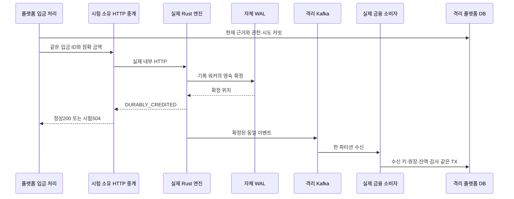

# 실제 엔진 WAL·Kafka 입금 확정과 장애 복구 연결

플랫폼의 실제 입금 처리 서비스부터 별도 Rust 프로세스의 HTTP·자체 WAL·Kafka, 플랫폼의 금융 트랜잭션과 독립 대사까지 연결했다. 응답 유실·강제 종료·감사 저장 실패를 주입해 같은 입금 원본과 자산 보존을 검증한다. 공통 사이클130이다. 이번 제품 코드 변경은 없으며 실제 연결 자동화 테스트·실행기를 추가했다.

후속 [131 실행 후 체인 위험](131-bitcoin-post-authorization-chain-risk.md)은 권한 이후 위험 관찰을 플랫폼 신규 권한에 연결했다. 아래130의 당시 범위/검증과 구분한다.

## 문제와 기존 동작

[127 전달/금융 확정](127-durable-bitcoin-credit-dispatch-and-settlement.md)과 [128 자동 처리](128-automatic-bitcoin-credit-processing.md)는 실제 PG 트랜잭션과 원장·감사를 검증했지만 새 시험에서는 엔진 HTTP와 노드 응답을 대역으로 사용했다. [엔진021](../../../Cex-Engine/docs/decisions/021-internal-deposit-credit-http.md)은 별도 경계 검증이었다. 각 경계 통과만으로 실제 Rust 직렬화·HTTP 결과 코드·브로커 수신·플랫폼의 원장 조건이 맞는다고 주장할 수 없었다.

선행 [공통129/엔진022](../../../Cex-Engine/docs/decisions/022-first-bootstrap-current-history.md)에서 현재 금융 이력이 있는 다른 빈 데이터 경로의 재초기화를 차단했다. 이후 새 원본을 준비하되 명령 전송 전에 엔진의 최초 저널을 시작하는 실제 실행 순서를 사용한다.

## 기존 제품과 공식 자료의 접근

2026-10-26 KST [Spring Kafka 수신기 수명 관리](https://docs.spring.io/spring-kafka/reference/kafka/receiving-messages/kafkalistener-lifecycle.html)와 [오류 처리](https://docs.spring.io/spring-kafka/reference/kafka/annotation-error-handling.html)를 확인했다. 공개 문서는4.1.2이며 현재 gradle.lockfile의 설치 버전4.1.1과 구분한다. 설치된 Registry·AdminClient의 타입으로 시험 코드를 컴파일하고 실제 실행했다. 이미 있는 KafkaListenerEndpointRegistry의 시작/중단과 기존 CommonContainerStoppingErrorHandler를 그대로 사용한다.

[AWS 멱등 재시도](https://aws.amazon.com/builders-library/making-retries-safe-with-idempotent-APIs/)의 안정 호출자 식별자와 응답 불명 원칙을 기존 구현의 시험 기준으로 삼는다. Kafka와 DB를 하나의 원자 트랜잭션이라고 부르지 않는다. 실제 금융 DB 커밋과 브로커 오프셋 사이의 중복은 영속 수신 키로 처리한다.

## 선택과 트레이드오프

| 선택 | 이점 | 비용·제약·대안 |
| --- | --- | --- |
| 시험별 별도 PostgreSQL16·Kafka3.9.1·Rust 프로세스 | 원본/오프셋/엔진 식별자 격리, 실제 전송 계약 확인 | Docker와 형제 Engine 소스/빌드가 필요하다. 공유9092/5432로 빠르게 확인하는 대안은 사용하지 않음 |
| 기존 엔진 소유 브로커 실행기 재사용 | 이미 검증하는 수명/단일 파티션 설정을 중복 구현하지 않음 | 단일 플랫폼 저장소만으로는 실행 불가. 실행기가 형제 경로를 명시 |
| 실제 HTTP를 중계하는 시험 전용 프록시 | 실제200·WAL 확정 뒤 플랫폼에504를 반환해 응답 불명 주입 | 실제 네트워크 단절 모든 종류를 재현하지 않는다. 연결은 성공하지만 응답 의미가 불명인 한 시나리오다 |
| 금융 소비 시작을 시험에서 제어 | HTTP 확정과 고객 AVAILABLE 반영 시점을 구분 | 실제 Kafka 소비 코드를 바꾸지 않지만 정상 운영의 자동 시작 시간표와 동일하지는 않다 |
| 합성 외부 자료·노드 응답 유지 | 유료 공급사/메인넷 없이 금융 확정 경계에 집중 | 실제 블록 발견부터 공급사 응답까지 전체 실연동 검증은 아니다. 기존 실제 Core31.1 시험과 분리한다 |
| 기존 필수 감사 장애 주입 | 성공처럼 넘어가거나 이벤트를 버리지 않는 계약 확인 | 막힌 금융 소비는 운영 확인/원인 해소 후 재시작해야 한다. 가용성보다 잘못된 금융 확정 방지를 선택 |

봇0·민감 외부 전송 비활성화를 명시하고 시험이 생성한 자원만 제거한다. 실제 고객 금융 데이터나 기존 서비스 설정을 바꾸지 않는다.

## 실제 연결 구조



다이어그램의 Kafka 전송과 HTTP 응답 사이 순서는 고정하지 않는다. 시험에서는 소비를 잠시 시작하지 않아 HTTP 결과 뒤에도 PENDING을 유지하는지 확인한다. 출력은 기존 장수 워커가 담당하고 코어 구현에 네트워크/디스크 대기나 공유 락을 추가하지 않았다.

## 실제 코드·문법과 검증 경계

출처: [BitcoinCreditWireIntegrationTest.java](../../src/test/java/dustin/cex/domains/kyc/BitcoinCreditWireIntegrationTest.java#L112), 현재 소스의 부분 발췌.

```java
        var result=processing.processNext().orElseThrow();assertEquals(EngineDepositClient.Outcome.DURABLY_CREDITED,result.transportOutcome());assertEquals("WAITING_EVENT",result.state());pendingOnly();
        String raw=originalEvent();listeners.start();settled();
        var duplicate=kafka.send("order-events",0,"same-original",raw).get(10,TimeUnit.SECONDS).getRecordMetadata();
```

대역 EngineDepositClient를 주입하지 않고 Spring의 실제 클라이언트인지 별도 확인한다. 현재 금융 조건/권한·시도를 거친 결과가 WAITING_EVENT여도 원장에는 PENDING만 있어야 한다. listeners.start() 뒤 실제 Kafka 금융 수신을 기다린다. Java var는 컴파일 시 타입 추론이며 TypeScript any와 달리 타입 검사를 없애지 않는다.

출처: [BitcoinCreditWireIntegrationTest.java](../../src/test/java/dustin/cex/domains/kyc/BitcoinCreditWireIntegrationTest.java#L104), 현재 소스의 부분 발췌.

```java
        if(engineProcess!=null){engineProcess.destroy();if(!engineProcess.waitFor(15,TimeUnit.SECONDS)){engineProcess.destroyForcibly();assertTrue(engineProcess.waitFor(10,TimeUnit.SECONDS));}}
        if(directory!=null)try(var files=Files.walk(directory)){for(Path p:files.sorted(Comparator.reverseOrder()).toList())Files.delete(p);}
    }
    @Override @AfterEach void noExternalOrFinancialRelease(){
```

이 시험이 생성한 Rust 프로세스만 강제 종료한다. startEngine은 같은 임시 WAL 경로로 다시 실행한다. 기존 전달의5초 간격을 실제 기다리며 금융 원본/이력을 수정해 재시도 조건을 우회하지 않는다. 같은 입금 ID와 이벤트 원문이 복구 후 유지되어야 한다.

출처: [BitcoinCreditWireIntegrationTest.java](../../src/test/java/dustin/cex/domains/kyc/BitcoinCreditWireIntegrationTest.java#L116), 현재 소스의 부분 발췌.

```java
        try(var admin=AdminClient.create(Map.of("bootstrap.servers",System.getenv("CEX_WIRE_KAFKA")))){await(()->{try{var offset=admin.listConsumerGroupOffsets("cex-consumer-group").partitionsToOffsetAndMetadata().get(2,TimeUnit.SECONDS).get(new TopicPartition("order-events",0));return offset!=null&&offset.offset()>duplicate.offset();}catch(Exception waiting){return false;}},20);}
        settled();assertEquals(1,rows("bitcoin_credit_dispatch_attempts"));assertEquals(1,rows("bitcoin_credit_authorizations"));assertEquals(raw,originalEvent());
```

실제 금융 소비 그룹의 커밋 위치가 재발행 오프셋을 넘을 때까지 기다린다. 잔액이 잠시 같다는 관찰만으로 중복 처리 통과를 주장하지 않는다. try-with-resources는 블록 종료 시 AdminClient를 닫는 문법이며, await는 시험의 유한 대기다.

출처: [BitcoinCreditWireIntegrationTest.java](../../src/test/java/dustin/cex/domains/kyc/BitcoinCreditWireIntegrationTest.java#L128), 현재 소스의 부분 발췌.

```java
        var attempted=new AtomicBoolean();
        doAnswer(call->{attempted.set(true);throw new IllegalStateException("격리 필수 감사 기록 실패");}).when(audit).record(isNull(),eq("BTC_DEPOSIT_CREDITED"),anyString(),anyString(),anyString());listeners.start();
        await(()->attempted.get()&&listeners.getListenerContainers().stream().anyMatch(c->!c.isRunning()),25);pendingOnly();
        doCallRealMethod().when(audit).record(isNull(),eq("BTC_DEPOSIT_CREDITED"),anyString(),anyString(),anyString());listeners.start();settled();assertEquals(1,rows("bitcoin_credit_dispatch_attempts"));
```

spy로 필수 감사 호출에만 실패를 주입한다. 실제 소비가 그 호출을 시도하고 중단됐는지 기다린 뒤 수신 키/금융 결과가0인지 확인한다. 새 감사 원본을 대역 성공으로 만들지 않고 실제 메서드로 복원한 후 같은 이벤트를 재소비한다. AtomicBoolean은 시험 실행 스레드 사이의 관찰 신호이며 체결 코어의 공유 락이 아니다.

## 시험별 시나리오와 기대 결과

| 함수 | 실제 시나리오 | 기대 결과 |
| --- | --- | --- |
| actualHttpAcknowledgementWaitsForKafkaAndDuplicateDeliveryDoesNotCreditTwice | 실제 처리→HTTP200, 소비 전 보류 확인→실제 소비→같은 원문을 Kafka 재발행, 그룹 오프셋 전진 대기 | PENDING에서 AVAILABLE로 한 번만 이동, 권한/시도/수신/금융 영수증 하나, 실제 저널 독립 대사 MATCHED |
| lostHttpSuccessAndForcedEngineRestartPreserveTheSameDepositAndEvent | 실제 WAL 성공 뒤 프록시504, 실제 Rust 강제 종료/같은 경로 재시작→동일 입금 재확인→소비 | 불명 상태에서 보류 유지, 시도2개지만 의도/권한/금융 결과 하나, 원래 이벤트 원문 유지·대사 MATCHED |
| requiredAuditFailureStopsTheRealConsumerAndReplaysWithoutLosingFunds | 실제 전송 후 BTC_DEPOSIT_CREDITED 감사만 실패→실제 소비 중단→감사 복구/소비 재시작 | 실패 때 수신 키·원장·잔액 전체 롤백, 재수신으로 한 번 적립·대사 MATCHED, 추가 엔진 전달 없음 |

독립 대사는 실제 EngineAuditClient가 별도 읽기 전용 저널 조회 HTTP를 호출한다. 이전 시험처럼 감사 결과를 대역으로 만들지 않았다. 부트스트랩에 쓰는 최소 과거 접수 표는 현재 플랫폼의 소유 시험 DB에만 만든다. 제품의 호환 레이어를 되살린 것이 아니다.

## 실행 명령과 결과

환경은 macOS·JDK21·로컬 Rust·Docker PostgreSQL16/Kafka3.9.1이다. 로컬 Kafka 한 파티션·복제1은 검증용이며 운영 복제/보안이 완료됐다는 뜻이 아니다.

```sh
JAVA_HOME=/Library/Java/JavaVirtualMachines/temurin-21.jdk/Contents/Home ./gradlew compileTestJava --console=plain
caffeinate -i python3 scripts/verify_bitcoin_credit_wire.py
```

- 전체 시험 코드 컴파일 통과.
- 최종 소유 실행에서 신규 **고유3개/3회 통과**, 실패·오류·제외0. 함수마다 새 DB 서버/브로커와 별도 Gradle 실행이다.
- 매 시험 `--rerun-tasks bootJar operatorAdminJar` 포함 빌드 통과. Rust `cargo build --locked --offline --bin cex-engine` 통과. 두 제품 JAR에 시험 클래스가 포함되지 않음을 확인했다.
- Python AST·git diff --check 통과. 기존 deprecation/unchecked/JDK class sharing 및 Rust unused/dead_code·SQLx 향후 호환 경고는 남는다.
- 소유 PG·Kafka 모두 정리했고 원래5개 컨테이너는 유지했다. 실행/엔진 로그·JUnit XML/초기 실패 집계는 .local/cycle130-proof에 보존했다.

최초 실행은 정상 연결1개가 통과한 뒤 두 번째 시험의 합성 가격 준비 중 DB 시각 검증에서 실패했다. 엔진/전달 경로에 도달하기 전 실패이며 최종 통과 집계에 더하지 않는다. 당시 DB 시계 증적이 없어 가상 머신 시계 지연이라고 확정하지 않는다. 재실행부터 호스트/소유 DB 시각 차이를 기록·검사했고 최종3개 시작 시 약0.006~0.007초였다. 가격 신선도·DB 트리거를 완화하거나 끄지 않았다. 최종 세 시험을 처음부터 다시 실행했다.

제품 코드는 변경하지 않아 기존 금융/노드 전체 회귀를 다시 실행하지 않았다. 128의470고유/488회나 129의엔진181고유/218회를 이번3개와 합쳐 새 전체 성공 수치로 표시하지 않는다.

## 남은 한계

이번은 실제 입금 명령의 엔진 연결과 금융 확정 경계 검증이다. 체인 관찰·가격·Didit·CodeVASP 응답은 합성 자료이므로 실제 메인넷/유료 공급사 전체 실연동이나 실제 운영 심사 완료를 뜻하지 않는다. 128 전용 자동 워커는 별도 실제 PG 시험으로 검증했고 이번에는 실제 처리 서비스를 직접 호출했다. 이 시험을 자동 스케줄러까지 모두 한 실행에서 검증했다고 표현하지 않는다.

적립 후 재조직·거절/반환·비VASP/개인지갑/소액·강화 고객·출금/서명·전반 검토·프론트·마지막 ETH는 남는다. Kafka 생산자 신원/사설 연결/단일 활성 저널 계보와 외부 운영 증적은 별도 조건이다. 외부 백업·복제 인프라는 사용자 지시대로 문서 조건만 유지한다.

## 작성한 테스트 코드


[BitcoinCreditWireIntegrationTest.java](../../src/test/java/dustin/cex/domains/kyc/BitcoinCreditWireIntegrationTest.java)

- `actualHttpAcknowledgementWaitsForKafkaAndDuplicateDeliveryDoesNotCreditTwice`: 아래 테스트 파일에서 해당 이름의 시나리오·기대 결과를 확인한다.
- `lostHttpSuccessAndForcedEngineRestartPreserveTheSameDepositAndEvent`: 아래 테스트 파일에서 해당 이름의 시나리오·기대 결과를 확인한다.
- `requiredAuditFailureStopsTheRealConsumerAndReplaysWithoutLosingFunds`: 아래 테스트 파일에서 해당 이름의 시나리오·기대 결과를 확인한다.

## 관련 커밋과 증적

- [구현 f521e86](https://github.com/GiHoon1123/Cex-Platform-Service/commit/f521e86be263c5a22dae8dc5c4cf48eaf6f7cd54)
- [격리 실행 증적](../reference/130-real-engine-bitcoin-credit-wire-verification-2026-10-26.json)
