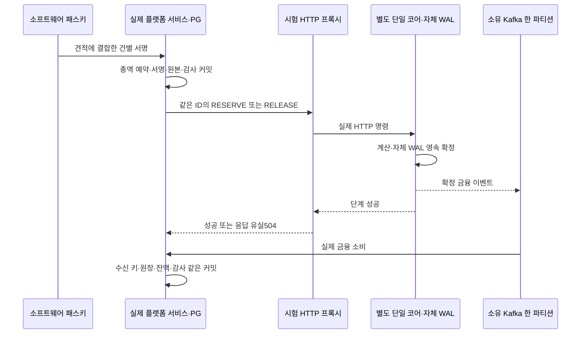

# 실제 고객 서명부터 Rust·WAL·Kafka까지 출금 예약과 취소 검증

실제 고객 패스키 서명과 플랫폼의 불변 출금 원본을 별도 Rust 프로세스·HTTP·자체 WAL·Kafka·플랫폼 원장에 연결했다. 예약/해제의 HTTP 성공 응답 유실, 강제 종료/복원, 실제 중복 소비에서도 금융 반영이 한 번뿐임을 검증한다. 체인 지급·서명 시험과 구분한다.

## 문제와 기존 검증

141~142의 실제 PG 시험은 고객 확인·패스키·금융 트랜잭션을 검증했지만 엔진 HTTP를 대역으로 사용했다. 138의 실제 단계 통신은 플랫폼 출금 원본/소비까지 연결하지 않았다. 두 경계가 각각 맞아도 원래 총액·이벤트·복원·수신 순서가 실제 프로세스 사이에서 연결되는지는 별도 확인해야 한다.

## 기존 제품과 공식 자료의 접근

2026-10-26 [Kafka3.9 전달 의미 문서](https://kafka.apache.org/39/design/design/#message-delivery-semantics)를 확인했다. 네트워크 오류는 기록 전/후를 구분하지 못하고, 소비 후 위치 저장 전 실패에는 재소비가 생긴다. Kafka의 생산자 멱등만으로 외부 PostgreSQL 금융 TX의 한 번 반영을 증명하지 않는다. 기존 자체 WAL 위치 기반 ID와 플랫폼 영속 수신 키를 사용하고 실제 그룹의 소비 커밋 위치까지 확인한다.

설치된 JDK HttpServer·HttpClient·ProcessBuilder, Kafka AdminClient·템플릿과 이미 사용하는 소유 브로커 실행기를 재사용했다. 별도 장애 주입 패키지·서비스를 추가하지 않았다. 엔진과 플랫폼의 제품 금융 처리를 시험 코드로 다시 구현하지 않았다.

## 선택과 트레이드오프

| 선택 | 얻는 검증 | 비용·한계 |
| --- | --- | --- |
| 실제 별도 Rust 실행 파일 | 스레드/HTTP/자체 WAL/종료 복원 경계를 함께 실행 | 로컬 프로세스와 파일·브로커 시작 비용이 있다. CPU/부하·호스트 디스크 손실은 별도 |
| 성공한 엔진 응답 뒤 시험 HTTP 프록시가504로 교체 | 실행은 성공했지만 호출자는 모르는 상태를 재현 | 실제 네트워크의 모든 부분 장애를 재현하지 않는다. 실제 성공 단계가 DB에 OUTCOME_UNKNOWN으로 남았는지도 검사 |
| 시험마다 새 PostgreSQL/Kafka | 이력 삭제/불변 제약 해제 없이 독립 검증 | 컨테이너 자원/시작 시간이 필요. 기존5432/5433/9092 서비스는 사용하지 않음 |
| 소비자 시작/중지를 시험이 소유 | HTTP 확인과 금융 반영 사이 잠금을 실제로 관찰 | 자동 워커의 일정/장기 복구 검증은 별도. 실제 제품 금융 소비 팩터리를 사용 |
| 실제 그룹 offset으로 중복 소비 완료 확인 | 잔액이 잠깐 같다는 관찰에 의존하지 않음 | Kafka Admin 조회/제한된 대기 필요. 운영 다중 브로커 장애 검증과 다름 |

## 연결한 실제 경로



시험은 공통 고객 기반의 HTTP 대역을 우회하고 실제 `EngineWithdrawalClient`, `BitcoinWithdrawalDispatches`, `BitcoinWithdrawalRequests`, `BitcoinWithdrawalCancellations`를 직접 구성한다. 고객 인증/견적·실제 패스키 서명 검증, 금융 DB와 Kafka 소비는 제품 코드다. 실제 고객 REST 라우터/필터 시험은141~142이며 이번 시험은 업무 서비스부터 프로세스 사이의 실제 연결을 검증한다. 물리 보안키·실제 브라우저·체인 지급지 노드는 이 시험의 대상이 아니다.

## 이해에 필요한 실제 코드

출처: [BitcoinWithdrawalWireIntegrationTest.java](../../src/test/java/dustin/cex/domains/kyc/BitcoinWithdrawalWireIntegrationTest.java#L73), 현재 소스의 부분 발췌.

```java
        actual=new EngineWithdrawalClient("http://127.0.0.1:"+PROXY_PORT,10000,SERVICE);
        var dispatch=new BitcoinWithdrawalDispatches(jdbc,users,audit,actual,manager);
        realRequests=new BitcoinWithdrawalRequests(jdbc,quotes,authorization,balances,ledger,audit,dispatch,withdrawalValuations,manager);
        realCancellations=new BitcoinWithdrawalCancellations(jdbc,users,quotes,realRequests,actual,audit,manager);
        assertFalse(org.mockito.Mockito.mockingDetails(actual).isMock());
```

현재 시험 소스의 부분 발췌다. 실제 클라이언트를 실제 플랫폼 서비스에 전달한다. Mockito 엔진 대역을 호출하지 않았다는 점도 종료 때 검사한다. Java 생성자 주입으로 외부 경계를 명시하는 것이며 TypeScript에서 실제 포트를 구현한 객체를 서비스 생성자에 전달하는 방식과 비교할 수 있다. 금융 업무를 별도 시험 구현으로 대체하지 않는다.

출처: [BitcoinWithdrawalWireIntegrationTest.java](../../src/test/java/dustin/cex/domains/kyc/BitcoinWithdrawalWireIntegrationTest.java#L64), 현재 소스의 부분 발췌.

```java
                boolean lost=exchange.getRequestURI().getPath().equals("/api/cex/withdrawals/reservations")
                    &&loseAction.get().equals(json.readTree(input).path("action").asText());
                if(lost)assertEquals(200,response.statusCode());
                byte[] body=lost?json.writeValueAsBytes(Map.of("code","OUTCOME_UNKNOWN")):response.body();
                response.headers().firstValue("Content-Type").ifPresent(v -> exchange.getResponseHeaders().set("Content-Type",v));
                exchange.sendResponseHeaders(lost?504:response.statusCode(),body.length);exchange.getResponseBody().write(body);
```

실제 엔진의200을 받은 뒤 호출자에게만504를 준다. JSON의 action과 경로로 예약/해제 각각의 응답 유실을 고른다. 엔진 계산 실패를 응답 유실처럼 부르지 않는다. 테스트는 전송 결과 DB의 OUTCOME_UNKNOWN도 검사한다.

출처: [BitcoinWithdrawalWireIntegrationTest.java](../../src/test/java/dustin/cex/domains/kyc/BitcoinWithdrawalWireIntegrationTest.java#L118), 현재 소스의 부분 발췌.

```java
        try(var admin=AdminClient.create(Map.of("bootstrap.servers",System.getenv("CEX_WIRE_KAFKA")))) {
            // 실제 그룹의 커밋 위치로 재소비 완료를 확인한다. 잔액이 잠시 같다는 관찰에 의존하지 않는다.
            await(()->{try {
                var offset=admin.listConsumerGroupOffsets("cex-consumer-group").partitionsToOffsetAndMetadata().get(2,TimeUnit.SECONDS).get(new TopicPartition("order-events",0));
                return offset!=null&&offset.offset()>duplicate.offset();
            }catch(Exception waiting){return false;}},20);
        }
    }
```

현재 소스의 부분 발췌다. `try(var ...)`는 자원을 닫는 Java 문법이며 TypeScript의 try/finally 자원 정리와 비교할 수 있다. 해당 파티션의 그룹 커밋 위치가 중복 메시지 offset을 지나야 시험을 계속한다. 실제 재소비가 끝난 뒤 수신 키/원장/잔액이 늘지 않았는지 검사한다.

## 작성한 테스트

| 실제 함수 | 실행한 시나리오 | 기대·실제 결과 |
| --- | --- | --- |
| `realSignedReservationAndCancellationWaitForKafkaAndConsumeDuplicatesOnce` | 고객 서명→실제 RESERVE/WAL→소비 시작→취소/실제 RELEASE→소비 시작, 각 원문을 실제 브로커로 중복 발행 | HTTP 단계 성공은 저장되지만 소비 전 금융 상태는 대기. 확정 예약/해제 각각1건, 총액 전액 반환, 독립 대사 MATCHED |
| `lostReserveResponseAndRestartPreserveEarlyCancellationAndTheOriginalEvents` | 실제 예약200만 유실, 확정 수신 전 취소 의도 저장, 엔진 SIGKILL/같은 WAL 복원, 실제 예약 소비 뒤 해제 | 같은 원문 이벤트 복원, 선행 확정 전 해제 시도0, 새 고객 서명/출금 ID 없이 한 번 반환 |
| `lostReleaseResponseAndRestartKeepFundsLockedUntilTheSameDurableKafkaEvent` | 실제 해제200 유실, 엔진 SIGKILL/같은 WAL 복원, 실제5.1초 재확인, 실제 금융 소비/중복 | 원래 총액 잠금 유지, 같은 UUID RELEASE만 재확인, 같은 이벤트/금융 반영1건·대사 MATCHED |

셋 모두 실제 원장/현재 잔액을 비교한다. 마지막 두 시험은 복원된 이벤트 문자열 전체가 원문과 같은지도 확인한다. 3건의 시험이 실제 지급·전송의 완료 증거는 아니다.

## 실행 명령과 결과

`python3 scripts/verify_bitcoin_withdrawal_wire.py`:3통과, 실패/제외0. 첫3개 통과 뒤 HTTP 결과 저장 상태에 대한 명시적 단언을 보강하고 전체3개를 다시 통과시켰다. 최종 고유3개/3회로 집계하며 개발 중 선행 실행을 더하지 않는다.

환경은 macOS·JDK21·PostgreSQL16 소유 컨테이너·Apache Kafka3.9.1 KRaft 소유 컨테이너·현재 형제 저장소 Rust 개발 빌드다. 실행기는 엔진을 `cargo build --locked --offline --bin cex-engine`으로 새로 빌드하고 메서드별 실제 프로세스/DB/브로커를 만든다. 각 Gradle 실행은 고객/운영자 JAR 빌드도 통과했다. 엔진 기준 커밋은 기계 판독 증적에 기록했다.

이번 금융 제품 코드는 주석 설명만 갱신했다. 기존297개 회귀 결과는142 기록이며 이번 실행에서 다시297개를 실행했다고 합산하지 않는다. 기존 Rust unused/dead_code·bench 조건·SQLx 향후 호환 경고와 JVM 클래스 공유/Java deprecated API 경고는 남는다. 변경된 시험이 통과했다는 사실이 이 경고나 운영 보안 검토 완료를 뜻하지 않는다.

실행 로그와 XML은 공통 로컬 `.local/bitcoin-withdrawal-wire/{run}/`에 보존한다. 시험의 PG·Kafka·자체 저널 임시 경로·엔진 프로세스는 정리했다. 기존 로컬 서비스와 봇은 변경하지 않았다.

## 남은 업무

고객 요청의 원본·예약·취소·확정 반환 경계는 실제 연결로 확인했다. 실제 출금 수신인/주소/자금세탁 위험 심사·독립 지급 승인, 취소와 지급의 배타적 결정, 실제 BTC 서명/전송/결과 불명/체인 확정 및 COMPLETE는 후속이다. 주소 형식 검증만으로 수신인·트래블룰·위험 심사를 마쳤다고 주장하지 않는다.

플랫폼 프로세스 전체 강제 종료·다중 브로커/호스트 손실·운영 키·외부 백업/복제·장기 부하와 법령/신고·외부 인증은 별도 검증이다. 엔진 거래 코어의 단일 스레드/독점 상태/공유 락0은 변경하지 않았다.

## 작성한 테스트 코드


[BitcoinWithdrawalWireIntegrationTest.java](../../src/test/java/dustin/cex/domains/kyc/BitcoinWithdrawalWireIntegrationTest.java)

- `realSignedReservationAndCancellationWaitForKafkaAndConsumeDuplicatesOnce`: 아래 테스트 파일에서 해당 이름의 시나리오·기대 결과를 확인한다.
- `lostReserveResponseAndRestartPreserveEarlyCancellationAndTheOriginalEvents`: 아래 테스트 파일에서 해당 이름의 시나리오·기대 결과를 확인한다.
- `lostReleaseResponseAndRestartKeepFundsLockedUntilTheSameDurableKafkaEvent`: 아래 테스트 파일에서 해당 이름의 시나리오·기대 결과를 확인한다.

## 관련 커밋과 증적

- [구현 d2c6b57](https://github.com/GiHoon1123/Cex-Platform-Service/commit/d2c6b5747ed5d88ea15552761ee7664a2fdbcf0c)
- [격리 실행 증적](../reference/143-real-engine-bitcoin-withdrawal-wire-verification-2026-10-26.json)
